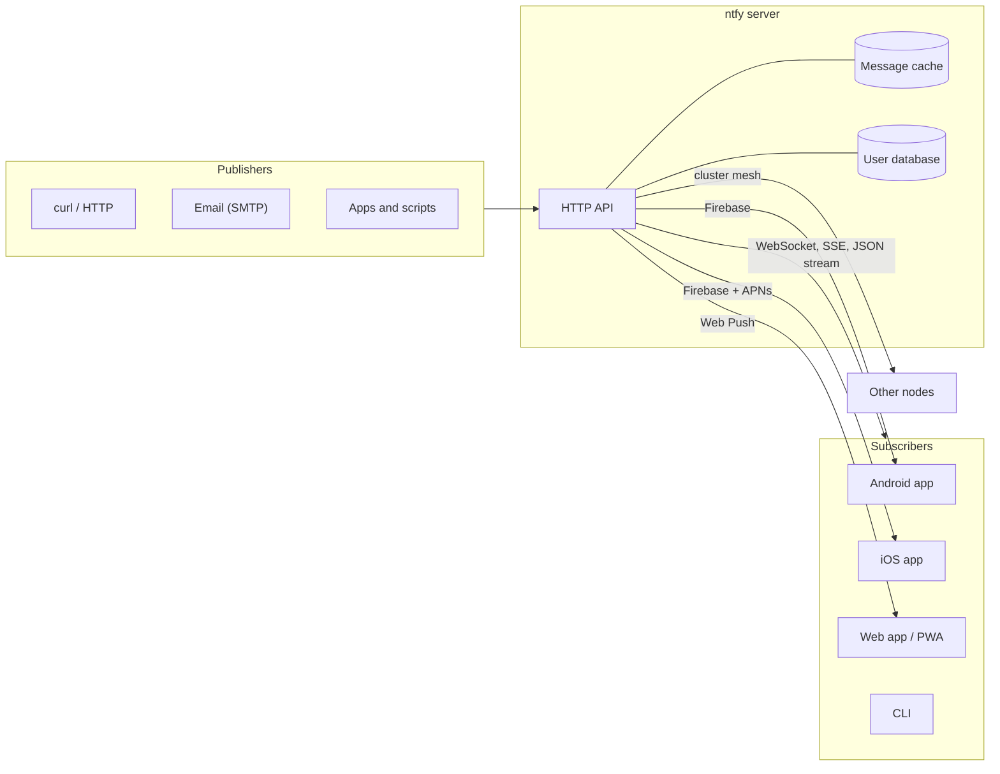

# ntfy internals

These docs are mostly for AI agents (and the humans working with them) who need to understand
how ntfy works before changing it. They are not part of the user documentation at
[docs.ntfy.sh](https://docs.ntfy.sh): `mkdocs.yml` excludes this folder, so they only live here
on GitHub.

They favor diagrams over prose: sequence diagrams for the important flows, data models with
example rows, component diagrams, and call trees for the hot paths. Text is kept short on
purpose, because detailed prose goes stale. When the docs and the code disagree, the code wins;
please fix the doc in the same pull request.

## The big picture

## Documents

| Document | Covers |
|----------|--------|
| [server-architecture.md](server-architecture.md) | Components, request lifecycle, topics and subscribers, publish and subscribe flows, concurrency |
| [protocol-and-data-model.md](protocol-and-data-model.md) | Wire format, events, publish and subscribe APIs, database schemas with example rows |
| [rate-limiting.md](rate-limiting.md) | Visitors, limits, token buckets, daily counters, tiers |
| [access-control-and-abuse.md](access-control-and-abuse.md) | Users, roles, tokens, ACLs, the access cache, the ban feed |
| [integrations.md](integrations.md) | Firebase, APNs, Web Push, Matrix and UnifiedPush, email, Twilio, Stripe, attachments, templates |
| [cluster.md](cluster.md) | Multi-node mode: registry, leader, mesh fan-out, message tail, shared limits, drain |
| [web-app.md](web-app.md) | The React web app and PWA, service worker, local database; cross-client feature matrix |
| [android.md](android.md) | The Android app (ntfy-android): delivery modes, database, UnifiedPush distributor |
| [ios.md](ios.md) | The iOS app (ntfy-ios): app and extension, Core Data, polling |
| [ios-push-architecture.md](ios-push-architecture.md) | How a notification reaches the iOS app via Firebase and APNs |
| [cli.md](cli.md) | The `ntfy` command: publish, subscribe, serve and the admin commands |

## Conventions

- Code references are repo-relative paths and function names, never line numbers. Paths in other
  repos name the repo, e.g. "ntfy-android: `app/src/main/...`".
- Diagrams are [mermaid](https://mermaid.js.org), which GitHub renders inline.
- Example data uses documentation IPs (`203.0.113.0/24`, `2001:db8::/32`), `example.com` addresses
  and made-up IDs.
