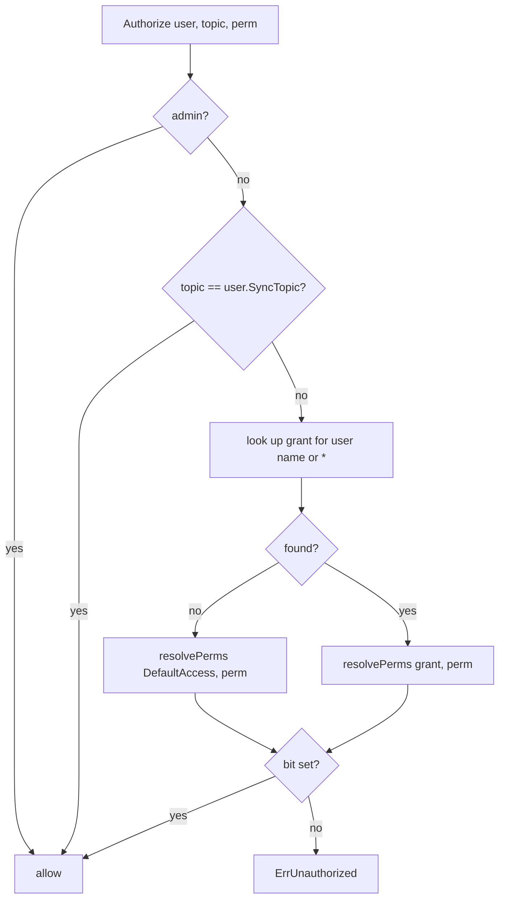

# Access control and abuse handling

How the ntfy server decides who may read or write a topic, how it rejects requests, and how it can
turn sustained rejections into a ban feed for an external firewall tool. Code references are
repo-relative: the authorization model is in `user/` (`user/types.go`, `user/manager.go`,
`user/access_cache.go`), the HTTP side in `server/` (`server/server_auth.go`,
`server/server_middleware.go`, `server/errors.go`), and the ban feed in `ban/`. Rate limits and quotas
are covered in [rate-limiting.md](rate-limiting.md).

## 1. Authorization model

### Roles

`user.Role` (`user/types.go`):

| Role | Constant | Meaning |
|---|---|---|
| `admin` | `RoleAdmin` | Bypasses all ACL checks; `Manager.Authorize` returns `nil` immediately. |
| `user` | `RoleUser` | Normal account, subject to the ACL table. |
| `anonymous` | `RoleAnonymous` | Unauthenticated. In the ACL table it is the special user `*` (`user.Everyone`), row ID `u_everyone`. |

Anonymous requests travel through the authorization path as a `nil` `*user.User`, not as a user
object with the anonymous role.

### Permissions

`user.Permission` is a 2-bit mask (`user/types.go`):

| Constant | Value | `IsRead()` | `IsWrite()` |
|---|---|---|---|
| `PermissionDenyAll` | 0 | false | false |
| `PermissionRead` | 1 | true | false |
| `PermissionWrite` | 2 | false | true |
| `PermissionReadWrite` | 3 | true | true |

`ParsePermission` accepts `read-write`/`rw`, `read-only`/`read`/`ro`, `write-only`/`write`/`wo`
and `deny-all`/`deny`/`none`.

### The ACL table

Grants live in `user_access` (`user/manager_sqlite_schema.go`, `user/manager_postgres_schema.go`):
`user_id`, `topic`, `read`, `write`, `owner_user_id`, `provisioned`, keyed by `(user_id, topic)`.
`owner_user_id` records who reserved the topic (topic reservations). `provisioned` marks grants
created from the config (`auth-access`), which the CLI lists as "server config".

Topic patterns use `*` as the only wildcard. `toSQLWildcard` (`user/util.go`) translates `*` to SQL
`%` and escapes `_` to `\_` so it is not a single-character wildcard; `fromSQLWildcard` reverses it.
Patterns are validated by `AllowedTopicPattern`.

### Grant resolution and precedence

`Manager.authorizeTopicAccess` (`user/manager.go`) runs `selectTopicPerms` (SQLite version in
`user/manager_sqlite.go`, Postgres in `user/manager_postgres.go`):

```sql
SELECT read, write
FROM user_access a
JOIN user u ON u.id = a.user_id
WHERE (u.user = ? OR u.user = ?) AND ? LIKE a.topic ESCAPE '\'
ORDER BY u.user DESC, LENGTH(a.topic) DESC, a.write DESC
```

The first row wins:

1. **A specific user beats `*` (Everyone).** `ORDER BY u.user DESC` sorts any real username before
   `*`; this relies on usernames not sorting below `*`, which `AllowedUsername` guarantees.
2. **A longer pattern beats a shorter one.** `test*` beats `*`.
3. **Write beats read** at equal length.

`Manager.Authorize(user, topic, perm)` (`user/manager.go`):



The sync topic check uses a constant-time compare and exists so that `auth-default-access:
deny-all` does not lock users out of their own settings-sync topic (#733).

### `auth-default-access`

The fallback when **no** ACL row matches (`user.Config.DefaultAccess`). Flag `--auth-default-access`
/ `-p`, env `NTFY_AUTH_DEFAULT_ACCESS`, default `read-write` (`cmd/serve.go`); any value other than
the `ParsePermission` strings is rejected at startup. On an open server (`read-write`), a
topic-level deny grant for `*` is the tool for shutting down an abused topic or prefix, e.g.
`ntfy access '*' 'abused*' deny`.

### Tokens

Access tokens (`user_token`) are `tk_` plus 29 random characters (`tokenPrefix`, `tokenLength = 32`,
`user/manager.go`); a user keeps at most `tokenMaxCount` (60). `AuthenticateToken` rejects any value
of the wrong length before touching the database, and the lookup ignores expired tokens
(`expires = 0 OR expires >= now`); `pruneTokens` (`server/server_manager.go`) deletes them. A token
authenticates as its user: role, ACLs, tier and rate-limit key are the user's. Each use enqueues a
`LastAccess` / `LastOrigin` update (`authenticateBearerAuth`, `server/server_auth.go`).

Password auth (`Manager.Authenticate`) accepts a username or a verified primary e-mail and runs one
bcrypt compare whether or not the user exists, to avoid a timing oracle. `Basic` auth with an empty
username treats the password as a token.

### Access cache

By default every authorization runs the SQL above (on a read replica if configured). With
`auth-access-cache: true` (env `NTFY_AUTH_ACCESS_CACHE`, default `false`, `user.DefaultAccessCacheEnabled`)
the whole `user_access` table is held in memory by `accessCache` (`user/access_cache.go`): an exact
map per user plus a list of compiled wildcard patterns, resolved with the same precedence.

| Trigger | Effect |
|---|---|
| A write through this server's user manager (API, admin, provisioning) | `accessWritten` reloads the cache before the write returns, and `AccessWrittenFunc` (`broadcastAccessChanged`) tells cluster peers to reload |
| A peer's access change | `handlePeerAccessChanged` requests a coalesced reload |
| Anything else, e.g. `ntfy access` from the CLI (a separate process writing the database) | picked up by the periodic reload, every `AuthAccessCacheReloadInterval`, default `user.DefaultAccessCacheReloadInterval` = **67s** (compile-time, no config key) |

When a reload finds changed entries, `reauthorizeSubscribers` (`server/server_admin.go`) re-checks
the open streams on matching topics and ends those that lost read access. Without the cache, a
changed ACL applies to the next request, but streams that are already open are not re-checked by
this path.

### How a request is authorized

1. `maybeAuthenticate` (`server/server_auth.go`) extracts the client IP with `extractIPAddress`
   (honoring `behind-proxy`, `proxy-forwarded-header`, `proxy-trusted-hosts`) and stores it in the
   request context as `contextVisitorIP`, which the ban feed uses.
2. Without a user database, or without an `Authorization` header (or `?auth=` query parameter),
   or with a scheme other than `Basic` / `Bearer`, it returns an IP visitor with a `nil` user.
3. Otherwise it checks the auth-failure bucket **before** the credential check (`AuthAllowed`,
   `42909` if empty), and charges it on failure (`AuthFailed`, then `40101`). This is the
   brute-force defense.
4. Topic handlers are wrapped in `authorizeTopicRead` / `authorizeTopicWrite`
   (`server/server_middleware.go`), which call `Authorize` for every topic in the path and return
   `403` / `40301` on the first denial. Anonymous and authenticated denials both get `40301`;
   `40101` means the credentials themselves were rejected.

## 2. Application-layer denial and error codes

Errors are `errHTTP` values (`server/errors.go`) with a 5-digit ntfy code (the HTTP status plus a
two-digit serial), the HTTP status, a message and an optional docs link, serialized as JSON. A
denial from a limit also carries its `limit.Decision`, sent as `Retry-After` / `RateLimit` headers
(see [rate-limiting.md](rate-limiting.md)). `handleError` (`server/server.go`) writes the response,
records the metric (`ntfy_http_requests_total` by HTTP and ntfy code) and then feeds the ban feed.

Codes relevant to access control:

| Code | HTTP | Constant | Meaning |
|---|---|---|---|
| `40101` | 401 | `errHTTPUnauthorized` | credentials invalid, or an operation needs a user |
| `40301` | 403 | `errHTTPForbidden` | the ACL denies the topic |
| `40302` | 403 | `errHTTPForbiddenAdminSocketOnly` | operation only allowed over the local admin socket |
| `40009` | 400 | `errHTTPBadRequestTopicInvalid` | malformed topic name |
| `40010` | 400 | `errHTTPBadRequestTopicDisallowed` | topic name on the disallowed list |
| `40401` | 404 | `errHTTPNotFound` | unknown path, or a disabled feature |

Rate-limit codes (`429`, `413`, `507`) and where they are raised are listed in
[rate-limiting.md](rate-limiting.md#error-codes). Two UnifiedPush codes matter for abuse handling
because they are not attacks: `50701` (publish without a subscriber) and `41002` (topic abandoned).

## 3. The in-server abuse counter (ban feed)

An optional, in-process counter that turns a sustained stream of rejected requests from one network
prefix into a line in a ban file, for a log-driven firewall tool (such as fail2ban)
to act on. Unlike a proxy log parser, it knows *why* a request was rejected: it can tell an
auth-failure flood (`42909`) from a client hitting its daily quota (`42908`), and weigh them
differently. It is implemented in `ban/service.go` and `ban/weights.go`, and built by `server.New`
only when `ban-file` is set.

### Configuration

| `server.yml` key | Env var | Default |
|---|---|---|
| `ban-file` | `NTFY_BAN_FILE` | empty (disabled) |
| `ban-window` | `NTFY_BAN_WINDOW` | `10m` (`DefaultBanWindow`) |
| `ban-threshold` | `NTFY_BAN_THRESHOLD` | `100` (`DefaultBanThreshold`) |
| `ban-weights` | `NTFY_BAN_WEIGHTS` | `DefaultBanWeights`: `42909:2`, `50701:0.05`, `41002:0.05` |

The defaults are in `server/config.go`; `DefaultBanWeights` is built with `banWeight(errHTTP..., w)`
so the codes stay in sync with the error definitions. (Note: `server.NewConfig` leaves
`BanWeights` nil; the defaults come from the CLI flag, so code that builds a `Config` directly gets
weight 1 for everything.) With `ban-file` set, `cmd/serve.go` rejects a non-positive window, a
non-positive threshold or one above `ban.MaxThreshold`, empty weights, malformed weights, and a ban
file whose directory does not exist.

### Weight matching

`ban.ParseWeights` turns the `KEY:WEIGHT` list into a `ban.Weights` map:

| Key form | Example | Matches |
|---|---|---|
| Exact ntfy code | `42909` | only `42909` |
| Prefix family | `429*` | every code starting with `429` |
| Bare HTTP status | `403` | shorthand for `403*` |
| Catch-all | `*` | everything |

Weights are non-negative numbers in steps of 0.001, at most `ban.MaxWeight`. **Weight 0 means
exempt.** `Weights.WeightFor` is longest-match-wins (exact, then the longest family, then `*`). A
code that matches nothing costs an implied weight of **1**, so forgetting `*` cannot disable the
feed; `*:0` explicitly exempts everything not listed.

### Accumulation and decay

`Service.Record(ip, httpCode, errorCode)`:

1. Ignores anything below HTTP 400.
2. Looks up the weight; returns if it is 0.
3. Masks the IP to the ban unit (`visitor-prefix-bits-ipv4` / `-ipv6`, passed in as
   `ban.Config.PrefixBitsIPv4/6`), so the ban unit is exactly the rate-limit unit.
4. Draws `weight` strikes from that prefix's `tracker`: a single token bucket of `Threshold` strikes
   (counted in thousandths, `strikeUnits`, so fractional weights work), refilling at
   `Threshold / Window`. All codes share one budget, so rotating rejection types does not help.
5. If the bucket cannot cover the strike, the prefix has breached: unless a line was already
   emitted for it within the last `Window`, a ban line is buffered.

The trigger is a sustained rate, not a burst count: at the defaults a weight-1 source breaches after
about 100 rejections in quick succession, or at a sustained rate above `100 / 600s` (about 0.17 per
second). An auth-failure flood (`42909`, weight 2) breaches after about 50. Tiered and logged-in
visitors are not exempt; the prefix is what is counted.

Trackers idle for a full window are pruned every 10 minutes (`pruneInterval`). Trackers are per
process: in a cluster, each node counts separately.

### Call site

`handleError` (`server/server.go`) records every error after the response is written:

```go
if s.ban != nil {
	if ip, err := fromContext[netip.Addr](r, contextVisitorIP); err == nil {
		s.ban.Record(ip, httpErr.HTTPCode, httpErr.Code)
	}
}
```

The IP comes from the request context (set by `maybeAuthenticate`), which is the real client IP
behind a trusted proxy. WebSocket errors return earlier in `handleError` and are not recorded.

### File format and lifecycle

`formatBanLine` builds the line at breach time:

```
<RFC3339-UTC-timestamp> <ip> <prefix> <http-code> <ntfy-code>
```

```
2026-07-18T20:56:32Z 192.0.2.4 192.0.2.4/32 429 42901
2026-07-18T20:56:32Z 2001:db8::abcd 2001:db8::/64 429 42909
```

This format is a contract for whatever parses the file; change it only together with the parser.

- Lines are buffered and appended every 3 seconds (`writeInterval`, `runWriteLoop`), plus a final
  flush on `Close`. The file is opened `O_APPEND|O_CREATE|O_WRONLY`, mode `0644`, per flush.
- Writes are best effort: an error is logged and the batch dropped; a ban-feed failure never fails a
  request. The ntfy process must be able to create and write the file, or the feed fails quietly
  apart from the log line.
- Because the file is reopened on each flush, rotation by rename or by `copytruncate` both work.
- At most one line per prefix per window, so a persistent offender does not flood the file.

The feed only sees requests that reach ntfy. Anything a reverse proxy or firewall in front already
rejected is invisible to it, and an overloaded ntfy that cannot respond will not write its own feed.
