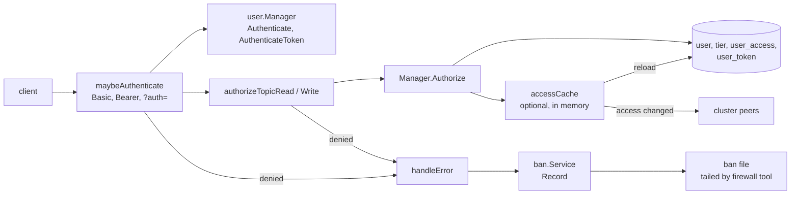
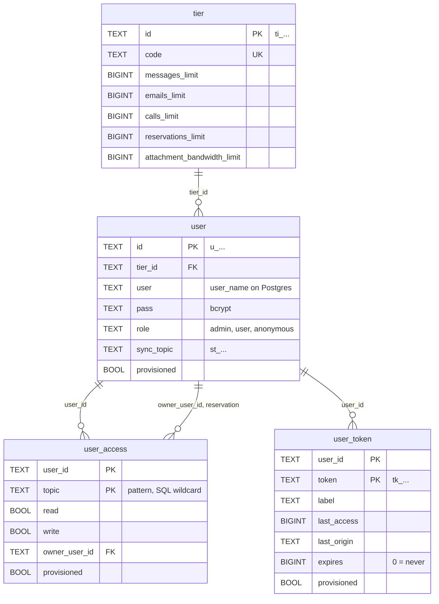
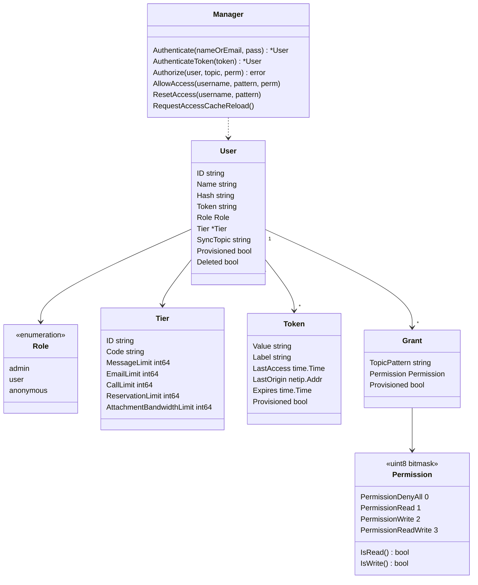
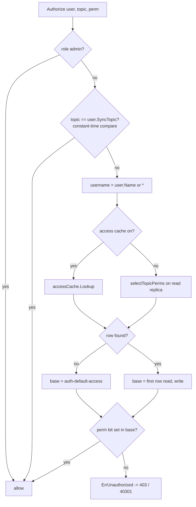
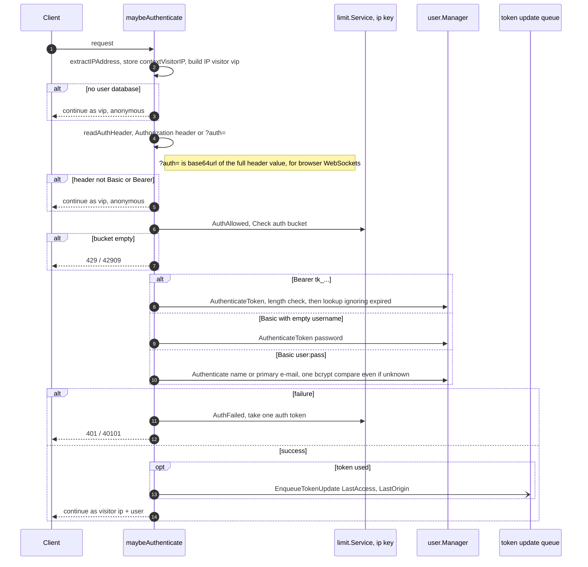
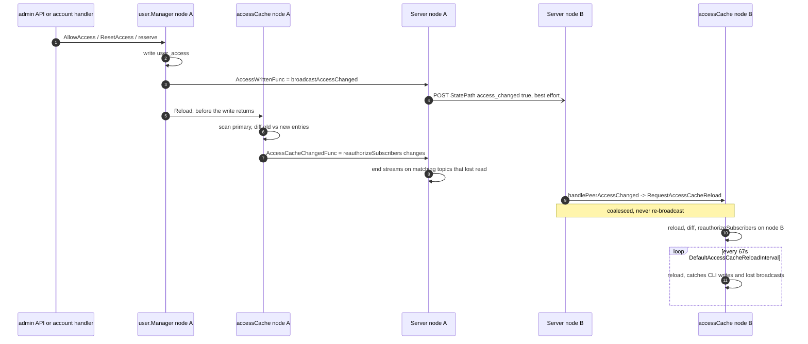
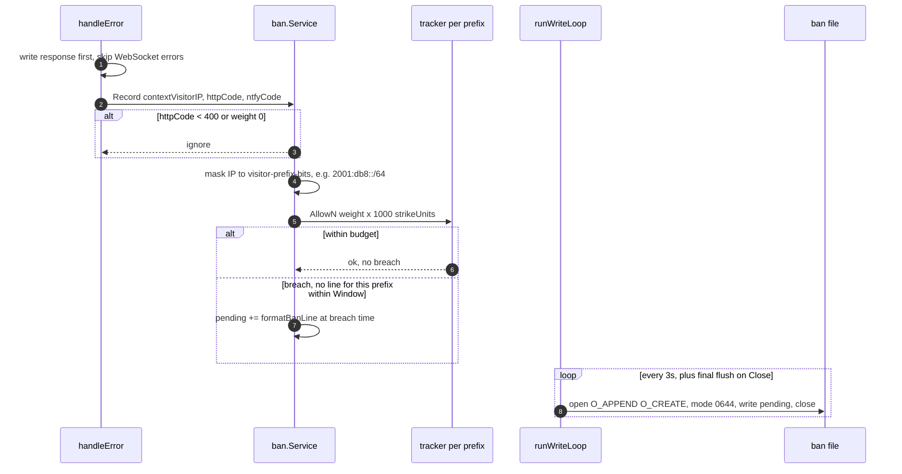
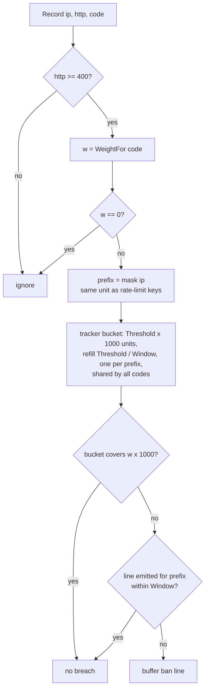

# Access control and abuse handling

Who may read or write a topic, how requests are rejected, and how sustained rejections become a ban
feed for an external firewall tool. Code: `user/` (`types.go`, `manager.go`, `access_cache.go`),
`server/` (`server_auth.go`, `server_middleware.go`, `errors.go`), and `ban/`. Rate limits and
quotas are in [rate-limiting.md](rate-limiting.md).



## 1. Authorization model

### Users, roles, tiers, tokens, grants



Example rows (`user_access.topic` is stored with `%` for `*` and `\_` for `_`, see `toSQLWildcard`):

| table | row |
|---|---|
| `tier` | `ti_Pq7Rs8Tu9Vw0`, code `pro`, messages_limit `20000`, emails_limit `100`, calls_limit `20` |
| `user` | `u_everyone`, user `*`, role `anonymous`, no tier (the special Everyone row) |
| `user` | `u_A1b2C3d4E5f6`, user `phil`, role `admin`, tier none |
| `user` | `u_G7h8I9j0K1l2`, user `backupbot`, role `user`, tier `ti_Pq7Rs8Tu9Vw0`, sync_topic `st_Xy12Za34Bc56` |
| `user_access` | `u_G7h8I9j0K1l2`, `backups-%`, read `1`, write `1`, owner null (wildcard grant by an admin) |
| `user_access` | `u_everyone`, `backups-%`, read `1`, write `0` (everyone may read) |
| `user_access` | `u_G7h8I9j0K1l2`, `backupbot-private`, read `1`, write `1`, owner `u_G7h8I9j0K1l2` (reservation, exact topic) |
| `user_access` | `u_everyone`, `backupbot-private`, read `0`, write `0`, owner `u_G7h8I9j0K1l2` (reservation: others denied) |
| `user_access` | `u_everyone`, `announcements`, read `1`, write `0`, provisioned `1` (from `auth-access`) |
| `user_access` | `u_everyone`, `abused%`, read `0`, write `0` (shut down a prefix) |
| `user_token` | `u_G7h8I9j0K1l2`, `tk_AgQdq7mVBoFD37...`, label `nas`, last_origin `203.0.113.7`, expires `0` |



- **Roles**: `admin` bypasses all ACL checks; `user` is subject to the ACL table; `anonymous` is
  the special user `*` (`user.Everyone`, row `u_everyone`). Anonymous requests travel as a `nil`
  `*user.User`, not as a user with the anonymous role.
- **Permissions**: `ParsePermission` accepts `read-write`/`rw`, `read-only`/`read`/`ro`,
  `write-only`/`write`/`wo`, `deny-all`/`deny`/`none`.
- **Grants**: `*` is the only wildcard, validated by `AllowedTopicPattern`. `owner_user_id` marks a
  topic reservation (always an exact topic, `AddReservation`); `provisioned` marks grants from `auth-access` config ("server config" in the CLI).
- **Tiers** carry the limits (see [rate-limiting.md](rate-limiting.md#limit-resolution)); they do
  not change authorization.

### Grant resolution and precedence

`Manager.authorizeTopicAccess` runs `selectTopicPerms` (`user/manager_sqlite.go`,
`user/manager_postgres.go`; Postgres names the column `user_name`):

```sql
SELECT read, write FROM user_access a JOIN user u ON u.id = a.user_id
WHERE (u.user = ? OR u.user = ?) AND ? LIKE a.topic ESCAPE '\'
ORDER BY u.user DESC, LENGTH(a.topic) DESC, a.write DESC
```

The first row wins: a specific user beats `*` (any allowed username sorts after `*`, guaranteed by
`AllowedUsername`), then a longer pattern beats a shorter one, then write beats read. SQLite is
opened with `_case_sensitive_like=on`, so `secret` does not match `SECRET`.

Example for user `backupbot` (or anonymous) and the rows above:

| Topic | Matching rows | Winner | Read / write |
|---|---|---|---|
| `backups-nas` | `backupbot backups-%`, `* backups-%` | `backupbot backups-%` (user beats `*`) | yes / yes |
| `backups-nas`, anonymous | `* backups-%` | it | yes / no |
| `backupbot-private`, anonymous | `* backupbot-private` | it | no / no |
| `abused-topic`, anonymous | `* abused%` | it, beats the default | no / no |
| `random-topic` | none | `auth-default-access` | default |



The sync-topic shortcut keeps `auth-default-access: deny-all` from locking users out of their own
settings-sync topic (#733).

### `auth-default-access`

The fallback when **no** ACL row matches (`user.Config.DefaultAccess`). Flag `--auth-default-access`
/ `-p`, env `NTFY_AUTH_DEFAULT_ACCESS`, default `read-write`; other values fail at startup. On an
open server, a deny grant for `*` shuts down an abused topic or prefix:
`ntfy access '*' 'abused*' deny`.

### Tokens and login

Tokens are `tk_` plus 29 random characters (`tokenLength = 32`); a user keeps at most
`tokenMaxCount` (60). A token authenticates as its user: same role, ACLs, tier and rate-limit key.



Then topic handlers are wrapped in `authorizeTopicRead` / `authorizeTopicWrite`
(`server/server_middleware.go`), which call `Authorize` for every topic in the path and return
`403` / `40301` on the first denial. `40101` means the credentials were rejected; an ACL denial is
`40301` for anonymous and authenticated users alike. Expired tokens are deleted by `pruneTokens`
(`server/server_manager.go`).

### Access cache

By default every `Authorize` runs the SQL above. With `auth-access-cache: true` (env
`NTFY_AUTH_ACCESS_CACHE`, default `false`) `accessCache` (`user/access_cache.go`) holds all of
`user_access` in memory: an exact map per user plus compiled wildcard patterns, same precedence.



| Trigger | Effect |
|---|---|
| Write through this server's user manager | reload before the write returns, peers told to reload |
| Peer's access change | coalesced reload (`RequestReload`) |
| `ntfy access` from the CLI (separate process) | periodic reload, every 67s (compile-time, no config key) |

`authorizeSubscribed` re-checks a new stream right after it subscribed, closing the race with a
concurrent reload. Without the cache, a changed ACL applies to the next request, but open streams
are not re-checked. Deleted users' streams end via `handleUsersDeleted` (cluster `DeletedUserIDs`).

## 2. Application-layer denial and error codes

Errors are `errHTTP` values (`server/errors.go`): a 5-digit ntfy code (HTTP status plus a two-digit
serial), status, message and optional docs link, sent as JSON. `handleError` (`server/server.go`)
writes the response (plus `Retry-After` / `RateLimit` for limit denials), counts
`ntfy_http_requests_total` by HTTP and ntfy code, then feeds the ban feed.

| Code | HTTP | Constant | Meaning |
|---|---|---|---|
| `40101` | 401 | `errHTTPUnauthorized` | credentials invalid, or a user is required |
| `40301` | 403 | `errHTTPForbidden` | the ACL denies the topic |
| `40302` | 403 | `errHTTPForbiddenAdminSocketOnly` | only over the local admin socket |
| `40009` | 400 | `errHTTPBadRequestTopicInvalid` | malformed topic name |
| `40010` | 400 | `errHTTPBadRequestTopicDisallowed` | topic name on the disallowed list |
| `40401` | 404 | `errHTTPNotFound` | unknown path, or a disabled feature |

Rate-limit codes are in [rate-limiting.md](rate-limiting.md#error-codes). `50701` (UnifiedPush
without subscriber) and `41002` (topic abandoned) matter here because they are not attacks.

## 3. The in-server abuse counter (ban feed)

An optional counter (`ban/service.go`, `ban/weights.go`, built by `server.New` only when `ban-file`
is set) that turns a sustained stream of rejections from one network prefix into a ban-file line
for a log-driven firewall tool (such as fail2ban). Unlike a proxy log parser it knows why a request
failed, so an auth flood (`42909`) can weigh more than a quota hit (`42908`).



### Configuration

| `server.yml` key | Env var | Default |
|---|---|---|
| `ban-file` | `NTFY_BAN_FILE` | empty (disabled) |
| `ban-window` | `NTFY_BAN_WINDOW` | `10m` (`DefaultBanWindow`) |
| `ban-threshold` | `NTFY_BAN_THRESHOLD` | `100` (`DefaultBanThreshold`) |
| `ban-weights` | `NTFY_BAN_WEIGHTS` | `42909:2`, `50701:0.05`, `41002:0.05` (`DefaultBanWeights`) |

`DefaultBanWeights` is built with `banWeight(errHTTP..., w)` so codes stay in sync. `server.NewConfig`
leaves `BanWeights` nil (defaults come from the CLI flag), so a directly built `Config` weighs
everything 1. With `ban-file` set, `cmd/serve.go` rejects a non-positive window, a threshold outside
`1..ban.MaxThreshold`, empty or malformed weights, and a missing ban-file directory.

### Weight matching

`ban.ParseWeights` builds `ban.Weights`; `WeightFor` is longest match wins.

| Key form | Example | Matches |
|---|---|---|
| Exact ntfy code | `42909` | only `42909` |
| Prefix family | `429*` | every code starting with `429` |
| Bare HTTP status | `403` | shorthand for `403*` |
| Catch-all | `*` | everything |

Weights are non-negative, in steps of 0.001, at most `ban.MaxWeight`. **Weight 0 exempts.** An
unmatched code costs **1**, so forgetting `*` cannot disable the feed; `*:0` exempts the rest.

### Accumulation and decay



The trigger is a sustained rate, not a burst count: at defaults a weight-1 source breaches after
about 100 rejections in quick succession, or above `100 / 600s` (~0.17/s) sustained; a `42909`
flood (weight 2) after about 50. Logged-in and tiered visitors are not exempt; the prefix counts.
Trackers idle for a full window are pruned every 10 minutes; trackers are per node.

### File format and lifecycle

```
<RFC3339-UTC-timestamp> <ip> <prefix> <http-code> <ntfy-code>
```

```
2026-07-18T20:56:32Z 203.0.113.42 203.0.113.42/32 429 42901
2026-07-18T20:57:03Z 2001:db8:0:1::abcd 2001:db8:0:1::/64 429 42909
```

This format is a contract with whatever parses the file; change both together.

- Writes are best effort: an error is logged and the batch dropped; a feed failure never fails a
  request. The file is reopened per flush, so rename and `copytruncate` rotation both work.
- At most one line per prefix per window.
- The feed only sees requests that reach ntfy: whatever a proxy or firewall in front rejects is
  invisible, and an overloaded ntfy that cannot respond writes nothing.
