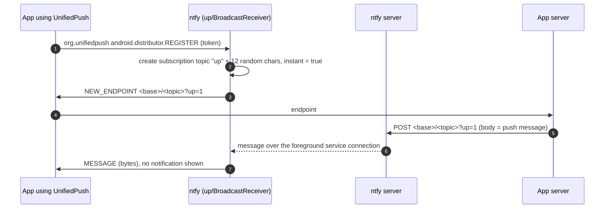

# Android app internals

How the Android app is structured, how it receives messages (Firebase, or its own long-lived connection), and how it
stores and shows them. Code is in [ntfy-android](https://github.com/binwiederhier/ntfy-android); paths below are
relative to `app/src/main/java/io/heckel/ntfy/` unless they start with `app/`. `server/` paths are in this repo.
See [web-app.md](web-app.md#cross-client-feature-matrix) for how Android compares to the other clients.

## Overview

| Item | Value (`app/build.gradle`) |
|---|---|
| Package / application ID | `io.heckel.ntfy` (debug builds add `.debug`) |
| SDK | min 26, target and compile 36, JVM 17 |
| Architecture | MVVM plus a `Repository`; Room DAOs return `Flow`, ViewModels expose LiveData, coroutines on `Dispatchers.IO` |
| Storage | Room (SQLite) for data, `SharedPreferences` for settings (both behind `db/Repository.kt`) |
| HTTP | OkHttp (`util/HttpUtil.kt`), Gson for JSON |

## Package layout

| Package | Key files |
|---|---|
| `app/` | `Application.kt`: holds the `Repository`, registers a network callback that forces reconnects after network changes |
| `db/` | `Database.kt` (entities, DAOs, migrations), `Repository.kt` |
| `service/` | `SubscriberService.kt` (foreground service), `SubscriberServiceManager.kt`, `JsonConnection.kt`, `WsConnection.kt` |
| `msg/` | `ApiService.kt` (HTTP calls), `NotificationDispatcher.kt`, `NotificationService.kt` (Android notifications), `NotificationParser.kt`, `BroadcastService.kt`, download and user-action workers |
| `ui/` | Activities, fragments, adapters, ViewModels (`MainActivity`, `DetailActivity`, `SettingsActivity`, `ShareActivity`, ...) |
| `up/` | UnifiedPush distributor: `BroadcastReceiver.kt`, `Distributor.kt`, `LinkActivity.kt`, `RaiseAppToForeground.kt` |
| `work/` | `PollWorker.kt`, `DeleteWorker.kt` |
| `backup/` | `Backuper.kt` (JSON settings export/import) |
| `util/` | `Util.kt` (URL builders, helpers), `HttpUtil.kt`, `CertUtil.kt`, `Log.kt`, emoji helpers |

## Flavors: `play` and `fdroid`

Flavor dimension in `app/build.gradle`:

| BuildConfig field | `play` | `fdroid` |
|---|---|---|
| `FIREBASE_AVAILABLE` | `true` | `false` |
| `RATE_APP_AVAILABLE` | `true` | `false` |
| `PAYMENT_LINKS_AVAILABLE` | `false` (Google Play payments policy) | `true` |

- Firebase is a `playImplementation` dependency. The `google-services` plugin is applied to every variant, but its
  `process*GoogleServices` tasks are disabled for non-`play` variants. `google-services.json` is not in the repo.
- Two classes exist once per flavor with the same fully qualified name, so `main/` compiles against either:
  `io.heckel.ntfy.firebase.FirebaseMessenger` (subscribe/unsubscribe FCM topics; a no-op in `fdroid`) and
  `io.heckel.ntfy.firebase.FirebaseService` (a `FirebaseMessagingService` in `play`; an empty `Service` in
  `fdroid`, needed because the manifest registers it for every flavor). Sources are in `app/src/play/java/` and
  `app/src/fdroid/java/`.
- Release signing reads `.signing/keystore.properties`; without it the release build is unsigned, which is what
  F-Droid's reproducible build expects.

## Delivery: Firebase vs instant delivery

Every subscription has an `instant` flag. Instant subscriptions get a long-lived connection from the foreground
service; the others rely on FCM.

| Case | `instant` | How messages arrive |
|---|---|---|
| `play`, topic on the app's base URL (`R.string.app_base_url`, ntfy.sh), box unchecked | `false` | FCM only |
| `play`, topic on the app's base URL, "instant delivery" checked | `true` | foreground service connection, plus FCM |
| `play`, any other server | forced `true` (`AddFragment`) | foreground service connection |
| `fdroid` | always `true` | foreground service connection |
| UnifiedPush registration | always `true` (`up/BroadcastReceiver.kt`) | foreground service connection |

Subscriptions on the app's base URL are always subscribed to the FCM topic of the same name (`MainActivity`,
`DetailActivity`), even when instant, and the app also subscribes to the `~control` topic.

### FCM path (`play` only)

`app/src/play/java/io/heckel/ntfy/firebase/FirebaseService.kt`, `onMessageReceived`. Only data messages are
processed; everything from FCM is assumed to belong to the app's base URL. The server side is
`toFirebaseMessage` in `server/server_firebase.go`.

| `event` | Handling |
|---|---|
| `message` | Builds a `Notification` from the flat data map and dispatches it. A message marked `truncated=1` is dropped if the subscription is instant, since the full copy comes over the connection |
| `message_delete`, `message_clear` | Mark deleted / read by `sequence_id`, cancel the shown notification |
| `poll_request` | Enqueues a unique one-shot `PollWorker` for that topic (`ExistingWorkPolicy.REPLACE`), which fetches the message from the server |
| `keepalive` | Sends a broadcast to `SubscriberService.AutoRestartReceiver` so a killed foreground service comes back |

### Foreground service (`service/SubscriberService.kt`)

The file starts with a long design comment; read it before changing the service.

- **Start and keep alive.** `onCreate` calls `startForeground` (type `specialUse` on SDK 34+, justified in the
  manifest). `ForegroundServiceStartNotAllowedException` stops the service cleanly. `onStartCommand` returns
  `START_STICKY`. Restart paths: `AutoRestartReceiver` on `onDestroy`, an alarm one second after `onTaskRemoved`,
  `BootStartReceiver`, the periodic `ServiceStartWorker`, and the FCM `keepalive` on `play`.
- **Start or stop.** `SubscriberServiceManager` runs a `ServiceStartWorker` that starts the service if there is at
  least one instant subscription and stops it otherwise.
- **One connection per server.** `refreshConnections` groups instant subscriptions by `baseUrl` and builds a
  `ConnectionId` from the topics, the protocol, and hashes of the credentials, custom headers, trusted and client
  certificates, plus a per-server `connectionForceReconnectVersion`. A change to any of them closes the connection
  and opens a new one. All topics of a server share one request (comma-separated topic list).
- **Protocol.** `Repository.getConnectionProtocol()`, default `jsonhttp` (`JsonConnection`); `ws` selects
  `WsConnection`.
- **No network.** All connections close, but the service stays up with a "no network" notification text.
- **Wake lock.** A reference-counted `PARTIAL_WAKE_LOCK` is acquired per incoming message (10 minute timeout) and
  released after dispatch.
- **Connection-lost alert.** Optional (`getConnectionAlertSeconds`, default never), on channel
  `ntfy-connection-alert`, with 1 h and 8 h snooze actions.

### Connections

| | `JsonConnection.kt` (default) | `WsConnection.kt` |
|---|---|---|
| URL | `<base>/<topics>/json?since=<id>` (`ApiService.subscribe`) | `<base>/<topics>/ws?since=<id>` |
| `since` | `repository.getLastNotificationId(...)`, else `none` | same |
| Read loop | blocking `readUtf8Line()` in a coroutine | OkHttp `WebSocketListener` |
| Retry | 5, 10, 15, 20, 30, 45, 60, 120 s via `delay()` | same ladder, scheduled with `AlarmManager.setExact` (needs exact-alarm permission on Android 13+; skipped if not granted) |
| Timeouts (`HttpUtil.kt`) | 77 s read timeout, longer than the server keepalive | no read timeout, 3 min ping, 10 s connect |

`WsConnection` maps a `ProtocolException` to "WebSocket not supported" and 401/403 to "not authorized", and uses a
`listenerId` to ignore callbacks from replaced sockets.

## Message dispatch and notifications

`msg/NotificationDispatcher.kt` takes each received notification and decides what to do:

- **Notify** (`shouldNotify`): not for UnifiedPush subscriptions, only for `message` events, not below the
  per-topic or global min priority, not while the topic's detail view is open, not while muted.
- **Broadcast** (`shouldBroadcast`): sends `io.heckel.ntfy.MESSAGE_RECEIVED` for other apps (`BroadcastService`);
  never for UnifiedPush subscriptions. The app also accepts `io.heckel.ntfy.SEND_MESSAGE` to publish.
- **Distribute**: for UnifiedPush subscriptions, hands the message bytes to the registered app (`up/Distributor.kt`).
- **Download**: attachments (with a size limit pref) and icons via `DownloadManager`.

`msg/NotificationService.kt` builds the Android notification:

| ntfy priority | Channel importance | Extras |
|---|---|---|
| 1 (min) | `IMPORTANCE_MIN` | |
| 2 (low) | `IMPORTANCE_LOW` | |
| 3 (default) | `IMPORTANCE_DEFAULT` | |
| 4 (high) | `IMPORTANCE_HIGH` | vibration |
| 5 (max) | `IMPORTANCE_HIGH` (there is no usable MAX) | lights, vibration, bypass DND; optional insistent looping alarm sound |

- Channels live in group `ntfy`, or `ntfy-subscription-<id>` when the subscription has dedicated channels, one
  channel per priority.
- The notification ID is `deriveNotificationId(baseUrl, topic, sequenceId)` (`util/Util.kt`), so a message with the
  same `sequence_id` replaces the earlier notification and `message_delete`/`message_clear` can cancel it.
- Image attachments use `BigPictureStyle`, others `BigTextStyle`; the large icon is the message icon, else the
  subscription icon. Markdown is rendered with Markwon.
- `click` opens the URL, otherwise `DetailActivity`. User actions: `view` opens a URL; `http`, `broadcast` and
  `copy` go through `UserActionBroadcastReceiver` -> `UserActionManager` -> `UserActionWorker`.

## Database (Room)

`db/Database.kt`, version 18, file `AppDatabase`, with `fallbackToDestructiveMigration(true)`. Exported schemas are in
`app/schemas/io.heckel.ntfy.db.Database/`. Migrations are in the `Database` companion object; add a new one (and bump
the version) for every schema change.

| Entity | Key | Notable fields |
|---|---|---|
| `Subscription` | `id`; unique `(baseUrl, topic)` and `upConnectorToken` | `instant`, `mutedUntil`, `minPriority`, `autoDelete`, `insistent`, `lastNotificationId`, `icon`, `upAppId`, `upConnectorToken`, `displayName`, `dedicatedChannels` |
| `Notification` | `(id, subscriptionId)` | `timestamp`, `sequenceId`, `title`, `message`, `contentType`, `encoding`, `priority`, `tags`, `click`, `deleted`, embedded `icon_*` and `attachment_*`, `actions` (Gson converter) |
| `User` | `baseUrl` | `username`, `password` |
| `CustomHeader`, `TrustedCertificate`, `ClientCertificate` | per `baseUrl` | extra headers, pinned server certs, PKCS#12 client certs (`util/CertUtil.kt`) |
| `LogEntry` (table `Log`) | `id` | in-app log, pruned |

## Background work

| Worker | Schedule (`MainActivity`) | Purpose |
|---|---|---|
| `work/PollWorker.kt` | every 60 min, plus one-shot per FCM `poll_request` | polls `GET <base>/<topic>/json?poll=1&since=<id>` for every subscription |
| `work/DeleteWorker.kt` | every 8 h | deletes expired attachments and icons, marks old notifications deleted (default after 1 month), hard-deletes after 4 months |
| `ServiceStartWorker` | every 3 h, plus one-shot | starts or stops the foreground service |
| `DownloadAttachmentWorker`, `DownloadIconWorker`, `UserActionWorker` | on demand | downloads and user actions |

Each periodic worker has a `VERSION` (the app version code); after an upgrade it is re-enqueued with `REPLACE`
instead of `KEEP`.

## UnifiedPush distributor

ntfy is a UnifiedPush distributor ([spec](https://unifiedpush.org/developers/spec/android/)). Code in `up/`, wired in
`AndroidManifest.xml` (`REGISTER`/`UNREGISTER` receiver, link activity, raise-to-foreground service).

- The server is the default server pref, else the app's base URL.
- Re-registering an existing token for the same app returns the same endpoint; a token owned by another app is
  refused.
- `UNREGISTER` deletes the subscription and sends `UNREGISTERED`.
- Server side, `parsePublishParams` (`server/server.go`) treats `?up=1` (or `Content-Encoding: aes128gcm`) as a
  UnifiedPush publish: Firebase is skipped and a binary body is kept as the message (base64-encoded) instead of
  becoming an attachment. `up` plus 12 characters matches `unifiedPushTopicPrefix`/`unifiedPushTopicLength`, which
  the server's rate limiting uses to recognize UnifiedPush topics (`server/server_rate_visitor.go`).

## Endpoints used

URL builders are in `util/Util.kt`; calls in `msg/ApiService.kt`.

| Purpose | Request |
|---|---|
| Publish | `PUT <base>/<topic>?priority=&tags=&title=&delay=&filename=&click=&attach=&email=&call=&markdown=` (body is the message, or the attachment when uploading from the share sheet) |
| Subscribe | `GET <base>/<topics>/json?since=` or `/ws?since=` |
| Poll | `GET <base>/<topic>/json?poll=1&since=` |
| Auth check | `GET <base>/<topic>/auth` |

Auth is HTTP Basic per server (`HttpUtil.kt`); the app does not use `/v1/account*`. The User-Agent is
`ntfy/<version> (<flavor>; Android <release>; SDK <n>)`, so server logs show the flavor.

## Gotchas

- **Message handling is duplicated** in `SubscriberService.onNotificationReceived`, `FirebaseService.onMessageReceived`,
  and in this repo's web app (`web/src/components/hooks.js`, `web/public/sw.js`). Change all of them together.
- **`NotificationDao.get(notificationId)`** queries by `id` alone although the primary key is
  `(id, subscriptionId)`, so it returns an arbitrary row if the same message ID exists under two subscriptions.
- **Credentials are stored in plaintext** in the Room `User` table.
- **Exact alarms**: with the WebSocket protocol on Android 13+, reconnects need the exact-alarm permission;
  `MainActivity` shows a banner asking for it, and for battery optimization exemption.
- **Release notes**: Android changes also need a line in `fastlane/metadata/android/en-US/changelog/` (F-Droid and
  Play listing metadata live under `fastlane/`).
