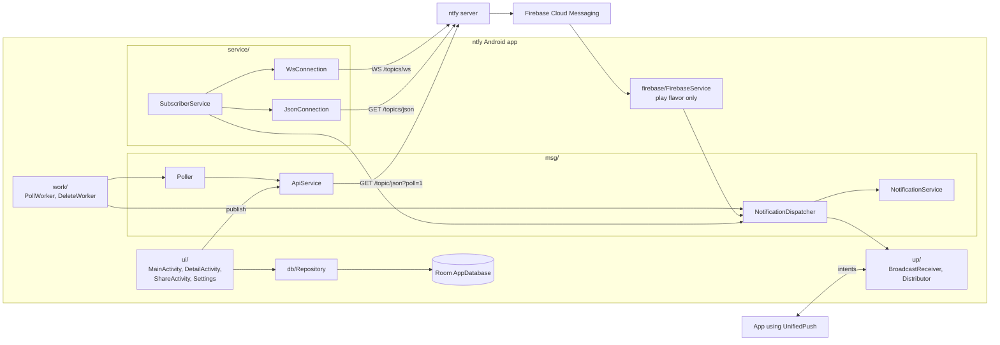
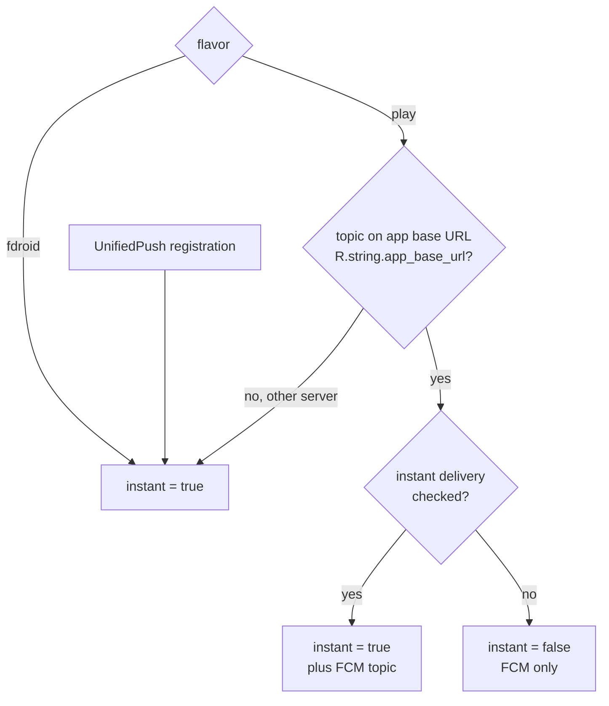
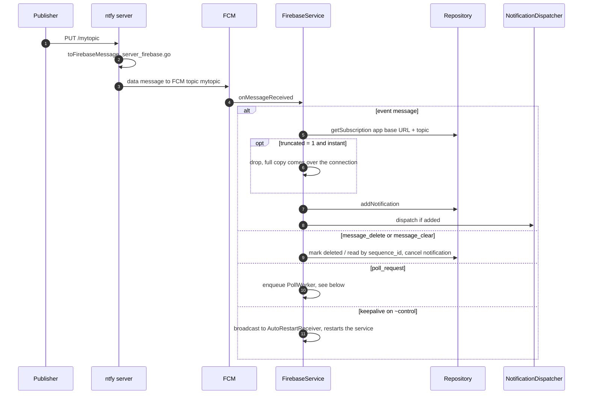
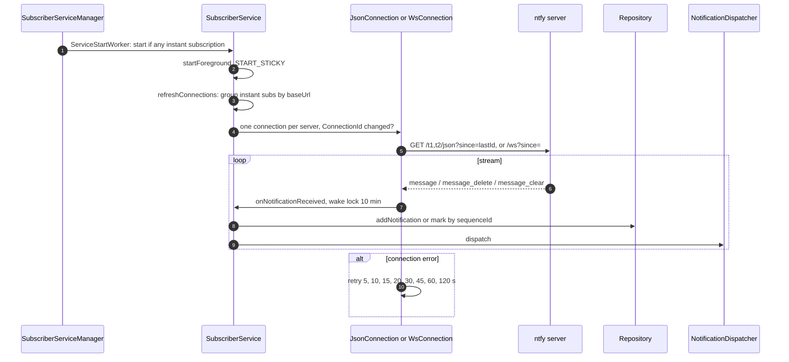
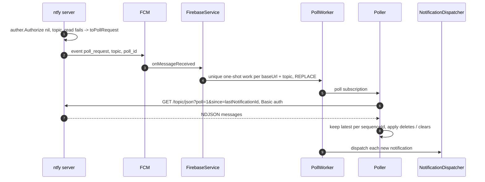
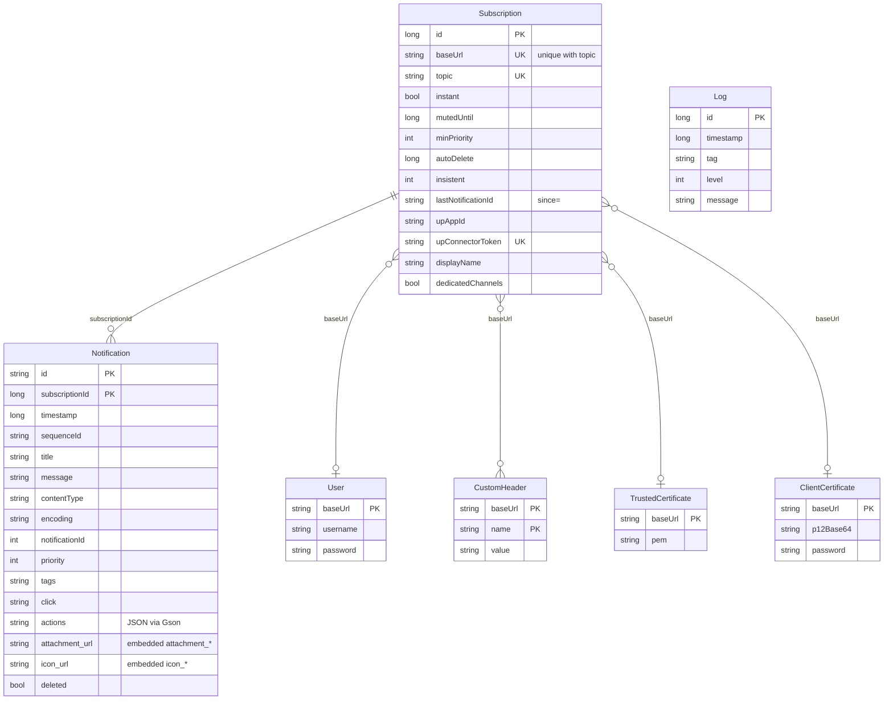
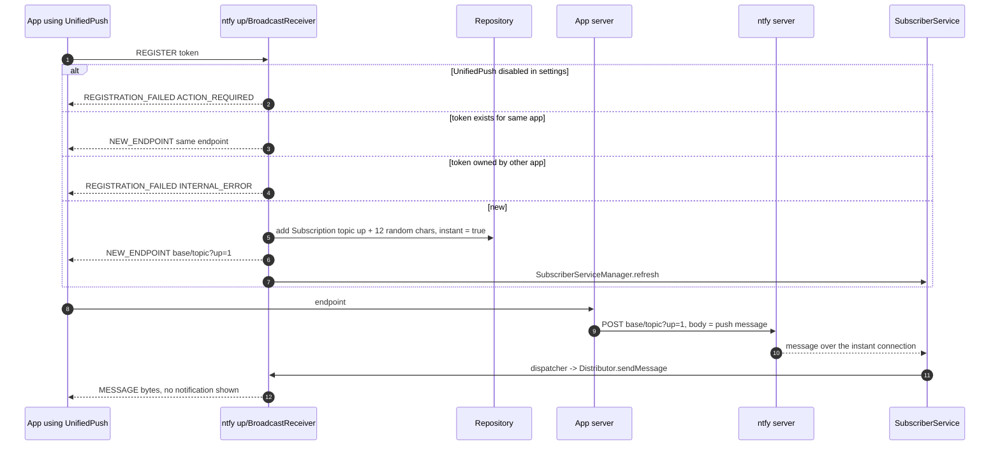

# Android app internals

How the Android app is structured, how it receives messages (Firebase, or its own long-lived connection), and how it
stores and shows them. Code is in [ntfy-android](https://github.com/binwiederhier/ntfy-android); paths below are
relative to `app/src/main/java/io/heckel/ntfy/` unless they start with `app/`. `server/` paths are in this repo.
See [web-app.md](web-app.md#cross-client-feature-matrix) for how Android compares to the other clients.

## Overview

| Item | Value (`app/build.gradle`) |
|---|---|
| Package / application ID | `io.heckel.ntfy` (debug builds add `.debug`) |
| SDK | min 26, target and compile 36, JVM 17 |
| Architecture | MVVM + `Repository`; Room DAOs return `Flow`, ViewModels expose LiveData, coroutines on `Dispatchers.IO` |
| Storage | Room (SQLite) for data, `SharedPreferences` for settings, both behind `db/Repository.kt` |
| HTTP | OkHttp (`util/HttpUtil.kt`), Gson |

## Package layout

| Package | Key files |
|---|---|
| `app/` | `Application.kt`: holds the `Repository`, network callback forces reconnects |
| `db/` | `Database.kt` (entities, DAOs, migrations), `Repository.kt` |
| `service/` | `SubscriberService.kt`, `SubscriberServiceManager.kt`, `JsonConnection.kt`, `WsConnection.kt` |
| `msg/` | `ApiService.kt`, `Poller.kt`, `NotificationDispatcher.kt`, `NotificationService.kt`, `NotificationParser.kt`, `BroadcastService.kt`, download and user-action workers |
| `up/` | `BroadcastReceiver.kt`, `Distributor.kt`, `LinkActivity.kt`, `RaiseAppToForeground.kt` |
| `work/` | `PollWorker.kt`, `DeleteWorker.kt` |
| `backup/`, `util/` | `Backuper.kt` (JSON settings export/import); `Util.kt`, `HttpUtil.kt`, `CertUtil.kt`, `Log.kt` |

## Flavors: `play` and `fdroid`

| BuildConfig field | `play` | `fdroid` |
|---|---|---|
| `FIREBASE_AVAILABLE` | `true` | `false` |
| `RATE_APP_AVAILABLE` | `true` | `false` |
| `PAYMENT_LINKS_AVAILABLE` | `false` (Play payments policy) | `true` |

- Firebase is `playImplementation`; `process*GoogleServices` tasks are disabled for other variants, and
  `google-services.json` is not in the repo.
- `firebase.FirebaseMessenger` and `firebase.FirebaseService` exist once per flavor (`app/src/play/java/`,
  `app/src/fdroid/java/`) with the same name; the `fdroid` ones are no-ops.
- Release signing reads `.signing/keystore.properties`; without it the build is unsigned (what F-Droid expects).

## Delivery: Firebase vs instant delivery

Every subscription has an `instant` flag: instant ones get a connection from the foreground service, the rest rely
on FCM.

Subscriptions on the app's base URL always subscribe to the FCM topic of the same name (`MainActivity`,
`DetailActivity`); the app also subscribes to `~control` for keepalives.

### Firebase delivery (`play` only)

### Instant delivery (foreground service)

- **`ConnectionId`** = topics + protocol + hashes of credentials, custom headers, trusted and client certs + a
  per-server `connectionForceReconnectVersion`. Any change reopens the connection.
- **Protocol**: `Repository.getConnectionProtocol()`, default `jsonhttp`; `ws` selects `WsConnection`.
- **Restart paths**: `AutoRestartReceiver` on `onDestroy`, an alarm 1 s after `onTaskRemoved`, `BootStartReceiver`,
  periodic `ServiceStartWorker`, FCM `keepalive`. `ForegroundServiceStartNotAllowedException` stops cleanly.
- **No network**: connections close, the service stays up. Optional connection-lost alert on channel
  `ntfy-connection-alert` (`getConnectionAlertSeconds`, default never).
- The long design comment at the top of `SubscriberService.kt` is worth reading before changes.

| | `JsonConnection.kt` (default) | `WsConnection.kt` |
|---|---|---|
| Read loop | blocking `readUtf8Line()` in a coroutine | OkHttp `WebSocketListener`, `listenerId` ignores replaced sockets |
| Retry | `delay()` | `AlarmManager.setExact` (exact-alarm permission on Android 13+) |
| Timeouts (`HttpUtil.kt`) | 77 s read, longer than server keepalive | no read timeout, 3 min ping, 10 s connect |

### poll_request handling

The server sends `poll_request` instead of the content when anonymous users may not read the topic
(`toFirebaseMessage`, `server/server_firebase.go`).

## Message dispatch and notifications

`msg/NotificationDispatcher.kt` decides per notification:

| Step | Rule |
|---|---|
| Notify (`shouldNotify`) | `message` events only; not UnifiedPush; not below min priority (topic or global); not while the detail view is open or muted |
| Broadcast (`shouldBroadcast`) | `io.heckel.ntfy.MESSAGE_RECEIVED` for other apps (not UnifiedPush). `io.heckel.ntfy.SEND_MESSAGE` publishes |
| Distribute | UnifiedPush subscriptions: bytes to the registered app (`up/Distributor.kt`) |
| Download | attachments (size-limit pref) and icons via `DownloadManager` |

`msg/NotificationService.kt` builds the notification:

| ntfy priority | Channel importance | Extras |
|---|---|---|
| 1, 2, 3 | `IMPORTANCE_MIN`, `_LOW`, `_DEFAULT` | |
| 4 | `IMPORTANCE_HIGH` | vibration |
| 5 | `IMPORTANCE_HIGH` (no usable MAX) | lights, vibration, bypass DND, optional insistent alarm |

- Channels: group `ntfy`, or `ntfy-subscription-<id>` with dedicated channels; one channel per priority.
- Notification ID = `deriveNotificationId(baseUrl, topic, sequenceId)` (`util/Util.kt`), so updates replace and
  deletes cancel.
- Images use `BigPictureStyle`; Markdown via Markwon. `view` opens a URL; `http`, `broadcast`, `copy` go through
  `UserActionBroadcastReceiver` -> `UserActionManager` -> `UserActionWorker`.

## Database (Room)

`db/Database.kt`, version 18, file `AppDatabase`, `fallbackToDestructiveMigration(true)`. Schemas exported to
`app/schemas/io.heckel.ntfy.db.Database/`; add a migration in the companion object for every schema change.

| Entity | Example row |
|---|---|
| `Subscription` | `id=4823910452, baseUrl=https://ntfy.sh, topic=backups-alerts, instant=0, mutedUntil=0, minPriority=0, lastNotificationId=aB3dE5fG7hJ9, upAppId=NULL` |
| `Subscription` (UnifiedPush) | `id=771203, baseUrl=https://ntfy.example.com, topic=upxK29aLm3QpZ1, instant=1, upAppId=org.example.chat, upConnectorToken=7f3c1e2a-...` |
| `Notification` | `id=aB3dE5fG7hJ9, subscriptionId=4823910452, timestamp=1764000000, sequenceId=aB3dE5fG7hJ9, title=Backup, message=Nightly backup done, priority=3, tags=white_check_mark, deleted=0` |
| `User` | `baseUrl=https://ntfy.example.com, username=alice, password=s3cret` |
| `CustomHeader` | `baseUrl=https://ntfy.example.com, name=X-Proxy-Key, value=abc123` |

## Background work

| Worker | Schedule (`MainActivity`) | Purpose |
|---|---|---|
| `work/PollWorker.kt` | 60 min, plus one-shot per `poll_request` | `Poller.poll` for every (or one) subscription |
| `work/DeleteWorker.kt` | 8 h | delete expired attachments/icons; mark old notifications deleted (default 1 month), hard-delete after 4 months |
| `ServiceStartWorker` | 3 h, plus one-shot | start or stop the foreground service |
| `DownloadAttachmentWorker`, `DownloadIconWorker`, `UserActionWorker` | on demand | downloads, user actions |

Periodic workers carry a `VERSION` (app version code); after an upgrade they are re-enqueued with `REPLACE`.

## UnifiedPush distributor

ntfy is a UnifiedPush distributor ([spec](https://unifiedpush.org/developers/spec/android/)); code in `up/`, wired in
`AndroidManifest.xml`.

- The server is the default server pref, else the app's base URL. `UNREGISTER` deletes the subscription and sends
  `UNREGISTERED`.
- Server side, `parsePublishParams` (`server/server.go`) treats `?up=1` (or `Content-Encoding: aes128gcm`) as
  UnifiedPush: no Firebase, and a binary body stays the message (base64) instead of an attachment. `up` + 12 chars
  matches `unifiedPushTopicPrefix` / `unifiedPushTopicLength`, which rate limiting uses
  (`server/server_rate_visitor.go`).

## Endpoints used

| Purpose | Request (`util/Util.kt` builders, `msg/ApiService.kt` calls) |
|---|---|
| Publish | `PUT <base>/<topic>?priority=&tags=&title=&delay=&filename=&click=&attach=&email=&call=&markdown=` |
| Subscribe | `GET <base>/<topics>/json?since=` or `/ws?since=` |
| Poll | `GET <base>/<topic>/json?poll=1&since=` |
| Auth check | `GET <base>/<topic>/auth` |

Auth is HTTP Basic per server; no `/v1/account*`. User-Agent: `ntfy/<version> (<flavor>; Android <release>; SDK <n>)`.

## Gotchas

- **Message handling is duplicated** in `SubscriberService.onNotificationReceived`, `FirebaseService.onMessageReceived`,
  `msg/Poller.kt`, and this repo's `web/src/components/hooks.js` and `web/public/sw.js`. Change them together.
- **`NotificationDao.get(notificationId)`** queries by `id` alone although the key is `(id, subscriptionId)`.
- **Credentials are plaintext** in the Room `User` table.
- **Exact alarms**: WebSocket reconnects on Android 13+ need the exact-alarm permission (`MainActivity` banner).
- **Release notes**: Android changes need a line in `fastlane/metadata/android/en-US/changelog/`.
