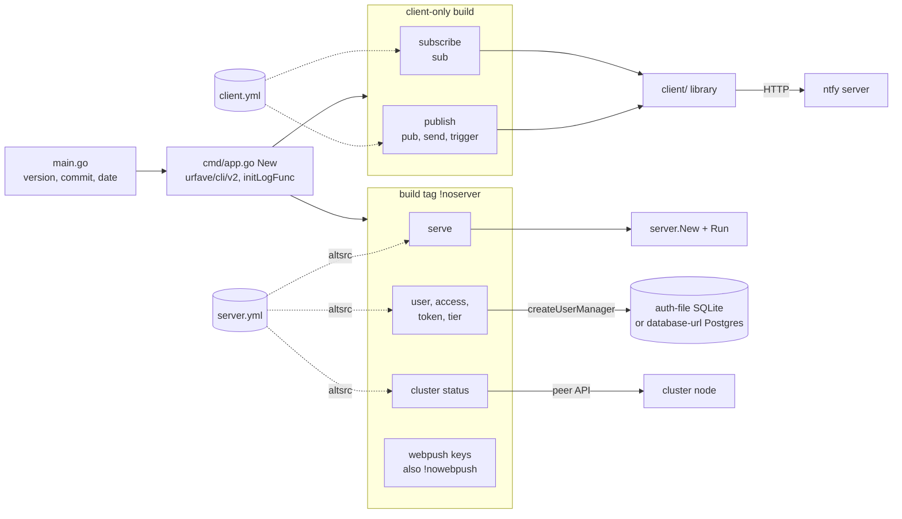
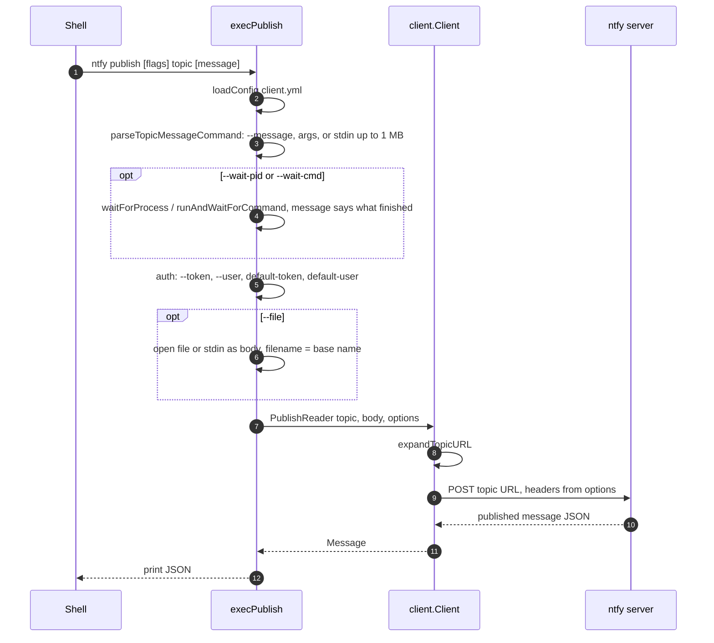
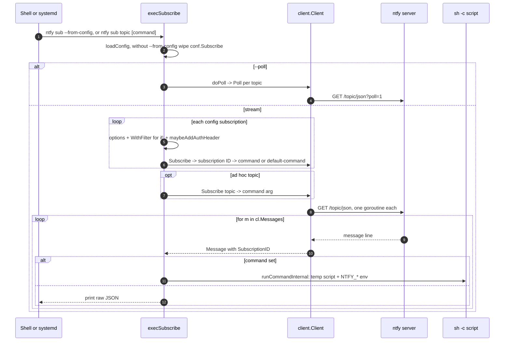

# CLI internals

How the `ntfy` binary's commands are built, how the publish/subscribe client works, where config files are read
from, and how `ntfy serve` turns flags into a running server. Code is in `main.go`, `cmd/` and `client/` in this
repo. See [web-app.md](web-app.md#cross-client-feature-matrix) for how the CLI compares to the other clients.

## Command framework



- `cmd/app.go` adds global logging flags (`flagsDefault`: `--debug`, `--trace`, `--no-log-dates`, `--log-level`,
  `--log-level-overrides`, `--log-format`, `--log-file`) that each command appends to its own.
- Each command file registers itself in `init()` with `commands = append(commands, cmdX)`.

| Command | Purpose | Subcommands |
|---|---|---|
| `publish` (`cmd/publish.go`) | send a message | |
| `subscribe` (`cmd/subscribe.go`) | subscribe or poll; print or run a command | |
| `serve` (`cmd/serve.go`) | run the server | |
| `user` (`cmd/user.go`) | manage users | `add`, `remove`, `change-pass`, `reset-pass`, `change-role`, `change-tier`, `hash`, `list` |
| `access` (`cmd/access.go`) | `access [USERNAME [TOPIC [PERMISSION]]]`, `--reset` | |
| `token` (`cmd/token.go`) | access tokens | `add`, `remove`, `list`, `generate` |
| `tier` (`cmd/tier.go`) | tiers | `add`, `change`, `remove`, `list` |
| `webpush` (`cmd/webpush.go`) | VAPID keys as a `server.yml` fragment | `keys` |
| `cluster` (`cmd/cluster.go`) | an experimental node's view of the cluster | `status` |

The admin commands don't call a running server: `createUserManager` (`cmd/user.go`) opens the same database
directly (Postgres if `database-url`, else SQLite `auth-file`), with provisioning and the access cache disabled.

## Client library (`client/`)

`client.New(config)` returns a `Client` with a `Messages` channel (buffer 50).

| Method | Request |
|---|---|
| `Publish`, `PublishReader` | `POST <topic URL>`; body = message or attachment; `options.go` sets headers (`WithTitle`, `WithPriority`, `WithTags`, `WithDelay`, `WithClick`, `WithIcon`, `WithActions`, `WithAttach`, `WithMarkdown`, `WithTemplate`, `WithFilename`, `WithSequenceID`, `WithEmail`, `WithNoCache`, `WithNoFirebase`, auth). Response (max 4096 bytes) parsed as the message |
| `Poll` | `GET <topic URL>/json?poll=1` + subscribe options (`WithSince*`, `WithScheduled`, filters) |
| `Subscribe` / `Unsubscribe` | one goroutine per subscription streaming `GET <topic URL>/json`; returns a random 10-char subscription ID |

- **Topic expansion** (`expandTopicURL`): `http(s)://` as is; anything with `/` gets `https://`; a bare name must
  match `topicRegex` and is joined to `default-host`.
- **Transport**: JSON stream only (`performSubscribeRequest`, `bufio.Scanner`); only `message` events are forwarded.
  No SSE, raw or WebSocket.
- **Reconnect** (`handleSubscribeConnLoop`): flat 10 s, without `since=`, so messages in between are lost.
- **`Message`**: `ID`, `Event`, `Time`, `Topic`, `Message`, `Title`, `Priority`, `Tags`, `Click`, `Icon`,
  `Attachment`, `TopicURL`, `SubscriptionID`, `Raw`. No `Actions`.
- **Auth options**: `WithBasicAuth`, `WithBearerAuth`, `WithEmptyAuth` (removes the header).

## Config files

### Client (`client.yml`)

| Platform | Root | Other users |
|---|---|---|
| Linux/BSD (`client/config_unix.go`) | `/etc/ntfy/client.yml` | `~/.config/ntfy/client.yml` (`os.UserConfigDir()`) |
| macOS (`client/config_darwin.go`) | `/etc/ntfy/client.yml` | `~/Library/Application Support/ntfy/client.yml` |
| Windows (`client/config_windows.go`) | | `%AppData%\ntfy\client.yml` |

`loadConfig` (`cmd/subscribe.go`, also used by `publish`): `--config`, else the default file if it exists, else
`client.NewConfig()` (host `https://ntfy.sh`). Plain YAML unmarshal into `client.Config`, no `altsrc`; flags are
applied in code on top.

| Key | Meaning |
|---|---|
| `default-host` | host for bare topic names |
| `default-user`, `default-password`, `default-token` | fallback auth |
| `default-command` | command for config subscriptions without their own |
| `subscribe` | list of `topic`, `user`, `password`, `token`, `command`, `if` (filters) |

`User`, `Password`, `Token` in `Subscribe` are pointers so "explicitly empty" (no auth) differs from unset.
Annotated example: `client/client.yml`.

### Server (`server.yml`)

`server.DefaultConfigFile`: `/etc/ntfy/server.yml` (Unix), `%ProgramData%\ntfy\server.yml` (Windows).
`initConfigFileInputSourceFunc` (`cmd/config_loader.go`) is the `Before` hook of `serve`, `user`, `access`, `token`,
`tier` and `cluster`:

- explicit `--config` missing = error; missing default file = skipped;
- applied via `altsrc`: **flag > env var > YAML > flag default**;
- `newYamlSourceFromFile` maps aliases, so `listen-http` and `listen_http` both work.

## Publish



- `--user` and `--token` together are rejected; every flag also has an `NTFY_*` environment variable.

## Subscribe



- **Service mode** units: `client/ntfy-client.service` (system, `/etc/ntfy/client.yml`) and
  `client/user/ntfy-client.service` (user, `~/.config/ntfy/client.yml`).
- **Per-subscription auth** (`maybeAddAuthHeader`): explicitly empty token or user+password = no auth; then the
  subscription's token, its user/password, `default-token`, `default-user`.
- **Command**: config subscriptions use `command`, else `default-command`; the ad hoc topic uses only the command
  argument. No command prints the raw JSON. A failing command is a warning; the subscription continues.

| Platform | Script | Launcher |
|---|---|---|
| Linux/BSD, macOS (`subscribe_unix.go`, `subscribe_darwin.go`) | `ntfy-subscribe-<random>.sh`, `#!/bin/sh` | `sh -c <script>` |
| Windows (`subscribe_windows.go`) | `ntfy-subscribe-<random>.bat` | `cmd.exe /Q /C <script>` |

| Variable (`envVars`) | Aliases |
|---|---|
| `NTFY_ID`, `NTFY_TOPIC`, `NTFY_TIME` | `id`, `topic`, `time` |
| `NTFY_MESSAGE`, `NTFY_TITLE` | `message`, `m`; `title`, `t` |
| `NTFY_PRIORITY`, `NTFY_TAGS` | `priority`, `prio`, `p`; `tags`, `tag`, `ta` |
| `NTFY_RAW` | `raw` (read click, icon, attachment, actions from here) |

## How `serve` starts up

```
ntfy serve
+- initConfigFileInputSourceFunc         server.yml -> flags (altsrc)
+- initLogFunc
+- execServe                              cmd/serve.go
   +- read + validate flagsServe          companion options, durations, cluster drain
   +- parseUsers / parseAccess / parseTokens   provisioning
   +- server.NewConfig + copy fields
   +- maybeRunAsService                   Windows service -> runAsWindowsService
   +- go sigHandlerConfigReload           SIGHUP: only log-level, log-level-overrides
   +- server.New(conf)                    server/server.go
   |  +- mail sender, stripe, db.New(pg primary + replicas)
   |  +- createMessageCache               nop / Postgres / SQLite / memory
   |  +- webpush store, createAttachmentStore (S3 or file)
   |  +- user.NewPostgresManager / NewSQLiteManager
   |  +- newFirebaseClient
   |  +- limit.New, newVisitorEnv, topicService
   |  +- cluster.New                      enabled by experimental-cluster-listen
   |  +- go runTail, limiter.Start, topicService.Start
   +- go sigHandlerShutdown               SIGTERM/SIGINT: Drain, then Stop
   +- s.Run()                             blocks on first listener error
   |  +- HTTP, HTTPS, unix, admin unix listeners
   |  +- metrics, cluster, profile listeners, runSMTPServer
   |  +- go runManager, runDelayedSender, runFirebaseKeepaliver
   +- s.Stop()                            flushes pending writes, exit
```

- A second shutdown signal skips the drain. Other config changes than log levels need a restart.
- `cmd/serve_windows.go` runs as a Windows service when started by the service manager.

## Gotchas

- **`doPoll` shares one options slice** across config subscriptions, so auth options accumulate (last wins; an
  empty-auth entry removes auth for the ones after it). `doSubscribe` copies per topic.
- **`doPoll` ignores `if:` filters**; only `doSubscribe` applies `WithFilter`.
- **Reconnect loses messages** (no `since=`), and the 64 KB `bufio.Scanner` line limit ends the stream on longer
  lines.
- **Credentials are plaintext** in `client.yml`.
- **No phone call option**: no `WithCall` in `client/options.go`, no `--call` flag.
