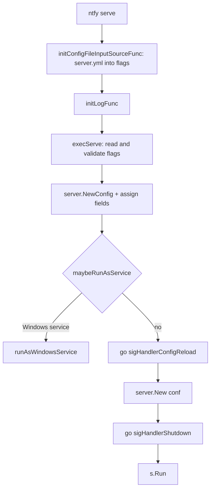

# CLI internals

How the `ntfy` binary's commands are built, how the publish/subscribe client works, where config files are read
from, and how `ntfy serve` turns flags into a running server. Code is in `main.go`, `cmd/` and `client/` in this
repo. See [web-app.md](web-app.md#cross-client-feature-matrix) for how the CLI compares to the other clients.

## Command framework

- `main.go` sets `version`, `commit` and `date` (via `-ldflags` at build time), extends the help text and runs
  `cmd.New()`.
- `cmd/app.go` builds the `urfave/cli/v2` app: `UseShortOptionHandling`, `Before: initLogFunc`, and the global
  logging flags (`flagsDefault`: `--debug`, `--trace`, `--no-log-dates`, `--log-level`, `--log-level-overrides`,
  `--log-format`, `--log-file`), which each command appends to its own flags.
- Each command file registers itself in `init()` with `commands = append(commands, cmdX)`.
- Server-side commands carry `//go:build !noserver` (and `webpush.go` also `!nowebpush`), so a client-only build
  contains only `publish` and `subscribe`.

| Command | Aliases | Build tag | Purpose | Subcommands |
|---|---|---|---|---|
| `publish` (`cmd/publish.go`) | `pub`, `send`, `trigger` | | send a message | |
| `subscribe` (`cmd/subscribe.go`) | `sub` | | subscribe or poll; print or run a command | |
| `serve` (`cmd/serve.go`) | | `!noserver` | run the server | |
| `user` (`cmd/user.go`) | | `!noserver` | manage users | `add`, `remove`, `change-pass`, `reset-pass`, `change-role`, `change-tier`, `hash`, `list` |
| `access` (`cmd/access.go`) | | `!noserver` | show, grant or revoke (`--reset`) topic access, as `access [USERNAME [TOPIC [PERMISSION]]]` | |
| `token` (`cmd/token.go`) | | `!noserver` | manage access tokens | `add`, `remove`, `list`, `generate` |
| `tier` (`cmd/tier.go`) | | `!noserver` | manage tiers | `add`, `change`, `remove`, `list` |
| `webpush` (`cmd/webpush.go`) | | `!noserver && !nowebpush` | generate VAPID keys (YAML fragment for `server.yml`) | `keys` |
| `cluster` (`cmd/cluster.go`) | | `!noserver` | show an experimental cluster node's view of the cluster | `status` |

The admin commands (`user`, `access`, `token`, `tier`) don't talk to a running server over HTTP. They open the same
database the server uses, via `createUserManager` (`cmd/user.go`): Postgres if `database-url` is set, else the SQLite
`auth-file`. Provisioning and the access cache are disabled there. They read `server.yml` like `serve` does.

## Client library (`client/`)

`client.New(config)` returns a `Client` with a `Messages` channel (buffer 50).

| Method | Request |
|---|---|
| `Publish`, `PublishReader` | `POST <topic URL>`, body is the message or the attachment; options set headers (`options.go`: `WithTitle`, `WithPriority`, `WithTags`, `WithDelay`, `WithClick`, `WithIcon`, `WithActions`, `WithAttach`, `WithMarkdown`, `WithTemplate`, `WithFilename`, `WithSequenceID`, `WithEmail`, `WithNoCache`, `WithNoFirebase`, auth). The response (max 4096 bytes) is parsed as the published message |
| `Poll` | `GET <topic URL>/json?poll=1` plus subscribe options (`WithSince*`, `WithScheduled`, filters) |
| `Subscribe` / `Unsubscribe` | a goroutine per subscription streaming `GET <topic URL>/json`; returns a random 10-character subscription ID |

- **Topic expansion** (`expandTopicURL`): full `http(s)://` URLs are used as is, anything with a `/` gets `https://`,
  and a bare name must match `topicRegex` and is joined to `default-host`.
- **Transport**: only the JSON stream (`performSubscribeRequest`). It reads lines with a `bufio.Scanner` and forwards
  only `message` events; `open` and `keepalive` are dropped. The CLI has no SSE, raw or WebSocket support.
- **Reconnect** (`handleSubscribeConnLoop`): after a failed or closed connection it waits a flat 10 s and reconnects
  without `since=`, so messages published in between are lost (TODOs in the code).
- **`Message`** has `ID`, `Event`, `Time`, `Topic`, `Message`, `Title`, `Priority`, `Tags`, `Click`, `Icon`,
  `Attachment`, plus `TopicURL`, `SubscriptionID` and `Raw` (the original JSON). There is no `Actions` field.
- **Auth options**: `WithBasicAuth`, `WithBearerAuth`, `WithEmptyAuth` (removes the header). `WithHeader` skips empty
  values.

## Config files

### Client (`client.yml`)

`client.DefaultConfigFile` is set per platform:

| Platform | Root | Other users |
|---|---|---|
| Linux/BSD (`client/config_unix.go`) | `/etc/ntfy/client.yml` | `os.UserConfigDir()/ntfy/client.yml` (`~/.config/ntfy/client.yml`) |
| macOS (`client/config_darwin.go`) | `/etc/ntfy/client.yml` | `~/Library/Application Support/ntfy/client.yml` |
| Windows (`client/config_windows.go`) | | `%AppData%\ntfy\client.yml` |

`loadConfig` (`cmd/subscribe.go`, also used by `publish`) loads `--config` if given, else the default file if it
exists, else built-in defaults (`client.NewConfig()`, host `https://ntfy.sh`). The file is unmarshalled straight
into `client.Config` (`client/config.go`); it does not use `altsrc`, and flags are applied in code on top of it.

| Key | Meaning |
|---|---|
| `default-host` | host for bare topic names |
| `default-user`, `default-password`, `default-token` | auth when nothing more specific is set |
| `default-command` | command for subscriptions without their own |
| `subscribe` | list of `topic`, `user`, `password`, `token`, `command`, `if` (filters such as `priority`, `tags`) |

In `Subscribe`, `User`, `Password` and `Token` are pointers so an explicit empty string ("no auth for this topic")
differs from unset. An annotated example is `client/client.yml`.

### Server (`server.yml`)

`server.DefaultConfigFile` is `/etc/ntfy/server.yml` on Unix and `%ProgramData%\ntfy\server.yml` on Windows.
`initConfigFileInputSourceFunc` (`cmd/config_loader.go`) is the `Before` hook of `serve`, `user`, `access`, `token`,
`tier` and `cluster`:

- an explicitly set `--config` that doesn't exist is an error; a missing default file is skipped;
- the YAML is applied with `altsrc`, so the order is **flag > environment variable > YAML > flag default**;
- `newYamlSourceFromFile` maps aliases to canonical names, which is why both `listen-http` and `listen_http` work.

## Publish

`execPublish` (`cmd/publish.go`):

- **Message source** (`parseTopicMessageCommand`): `--message` if set, else the arguments after the topic, else
  stdin if redirected (up to 1 MB). `--file` uploads
  a file as an attachment (`-` for stdin); the filename defaults to the file's base name.
- **Wait modes**: `--wait-pid` waits for a process to exit, `--wait-cmd` runs a command and waits for it; the
  message then says what finished (`waitForProcess`, `runAndWaitForCommand`).
- **Auth precedence**: `--token`, then `--user` (`user:pass`, or a password prompt), then `default-token`, then
  `default-user` with `default-password`. `--user` and `--token` together are rejected.
- Every flag also has an `NTFY_*` environment variable.

## Subscribe

`execSubscribe` (`cmd/subscribe.go`):

- **Ad hoc**: `ntfy sub <topic> [command]`. Without `--from-config`, the config's `subscribe` list is cleared, so
  config subscriptions never mix into ad hoc runs.
- **Service mode**: `ntfy sub --from-config` subscribes to every `subscribe` entry (`doSubscribe`). The systemd units
  are `client/ntfy-client.service` (system, `/etc/ntfy/client.yml`) and `client/user/ntfy-client.service` (user,
  `~/.config/ntfy/client.yml`).
- **Poll**: `--poll` polls once instead of streaming (`doPoll`); `--since` and `--scheduled` are passed through.
- **Per-subscription auth** (`maybeAddAuthHeader`): an explicitly empty token, or empty user and password, sends no
  auth; then the subscription's token, then its user/password, then `default-token`, then `default-user`.
- **Command**: the subscription's `command`, else `default-command`, else the raw JSON is printed.

`runCommandInternal` writes the command to a temp script and runs it, so multi-line commands work:

| Platform | Script | Launcher |
|---|---|---|
| Linux/BSD, macOS (`subscribe_unix.go`, `subscribe_darwin.go`) | `ntfy-subscribe-<random>.sh` with `#!/bin/sh` | `sh -c <script>` |
| Windows (`subscribe_windows.go`) | `ntfy-subscribe-<random>.bat` | `cmd.exe /Q /C <script>` |

The script gets the parent environment plus the message (`envVars`):

| Variable | Aliases |
|---|---|
| `NTFY_ID` | `id` |
| `NTFY_TOPIC` | `topic` |
| `NTFY_TIME` | `time` |
| `NTFY_MESSAGE` | `message`, `m` |
| `NTFY_TITLE` | `title`, `t` |
| `NTFY_PRIORITY` | `priority`, `prio`, `p` |
| `NTFY_TAGS` | `tags`, `tag`, `ta` |
| `NTFY_RAW` | `raw` |

There are no variables for click, icon, attachment or actions; scripts read them from `$NTFY_RAW`. A failing command
is logged as a warning and does not stop the subscription.

## How `serve` wires up

- `flagsServe` (`cmd/serve.go`) defines every server option; nearly all are `altsrc` flags so they can come from
  `server.yml`. `execServe` reads them, checks combinations (for example that required companion options are set),
  parses users, ACLs and tokens for provisioning (`parseUsers`, `parseAccess`, `parseTokens`), then copies
  everything into a `server.Config` from `server.NewConfig()`.
- `server.New(conf)` (`server/server.go`) builds the server; `s.Run()` starts the listeners and blocks.
- **SIGHUP** (`sigHandlerConfigReload`, `cmd/serve_unix.go`) re-reads the config file but only applies
  `log-level` and `log-level-overrides`. Other changes need a restart.
- **SIGTERM / SIGINT** (`sigHandlerShutdown`) drains a cluster node (`Server.Drain`; a second signal skips the
  drain) and calls `Server.Stop`, which flushes pending writes such as the message cache batch. `execServe` then
  calls `Stop` again and exits cleanly.
- On Windows, `cmd/serve_windows.go` runs the server as a Windows service when started by the service manager.

## Gotchas

- **`doPoll` shares one options slice across subscriptions**: each subscription's auth option is appended to the
  same `options`, unlike `doSubscribe`, which copies them per topic. With several config subscriptions using
  different credentials, later polls carry earlier headers (the last one set wins, and an empty-auth entry removes
  auth for the ones after it).
- **`doPoll` ignores `if:` filters**; only `doSubscribe` applies `client.WithFilter`. So
  `ntfy sub --poll --from-config` returns unfiltered messages.
- **Reconnect loses messages** (no `since=`), and the scanner uses `bufio.Scanner`'s default 64 KB line limit, so a
  longer JSON line ends the stream and forces a reconnect.
- **Credentials are plaintext** in `client.yml`.
- **No phone call option**: the server supports `X-Call`, but `client/options.go` has no `WithCall`, and `publish`
  has no `--call` flag.
