# Cluster mode

## How several ntfy nodes act as one server

Several `ntfy serve` processes share one PostgreSQL database, sit behind any load balancer, and deliver every
message to every subscriber no matter which node it connected to. This is the design view; the operator reference
(options, example config, `ntfy cluster status`) is "Clustering (experimental)" in `docs/config.md`.

| Area | Code |
|---|---|
| Mesh, peer API, fan-out, bucket exchange | `cluster/` (`cluster_mesh.go`, `cluster_mesh_handler.go`, `cluster_mesh_buckets.go`, `client.go`) |
| Membership and leadership | `cluster/registry/registry.go` |
| Server glue | `server/server.go` (`dispatch`, `/v1/health`, `/v1/ready`, delayed sender), `server/server_cluster.go`, `server/server_tail.go`, `server/server_drain.go`, `server/server_admin.go` |
| Shared limits, UnifiedPush topic state | `limit/`, `topic/` |
| Tail, delayed-message claims | `message/tail.go`, `message/cache.go` |
| Flags, `ntfy cluster status` | `cmd/serve.go`, `cmd/cluster.go` |

## The shape of it

A single node fans a message out to its in-memory subscriber map (`topic.Publish`), so a publish on node A cannot
reach a subscriber on node B by itself. Durable state already lives in PostgreSQL; cluster mode adds live cross-node
delivery with two planes kept apart on purpose.

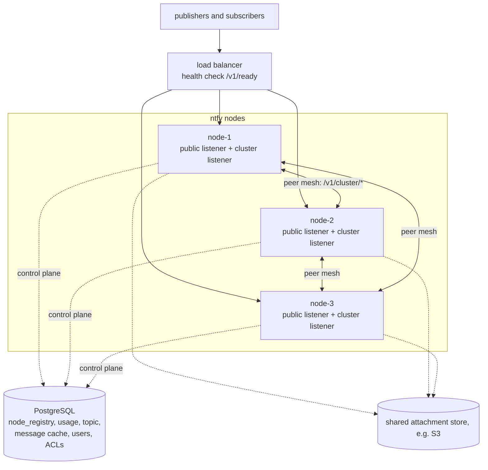

| Plane | Carried by | Used for |
|---|---|---|
| Control plane | PostgreSQL | Membership and leadership (`node_registry`), daily limits (`usage`), UnifiedPush topic state (`topic`), delayed-message claims, message cache read by the tail |
| Data plane | Node-to-node HTTP on the private cluster listener | Message fan-out, rate bucket exchange, access-change and user-deletion signals |

PostgreSQL is never on the publish path: fan-out reads the in-memory peer snapshot from the last heartbeat.

Clustering is off unless `experimental-cluster-listen` is set. Then `cluster.New` returns the nop cluster
(`cluster/cluster_nop.go`): 404s the peer API, always leader, healthy and ready, never drains, no peers. Call sites
never ask whether clustering is on.

### Main types

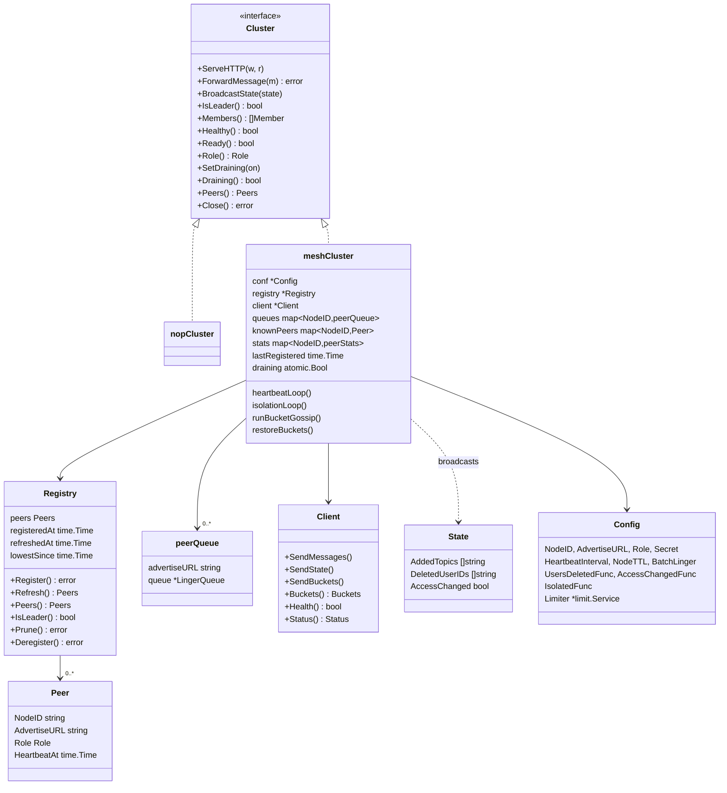

`DeliverFunc` (`Server.deliverFromBus`) is how received messages reach the server; the `*Func` callbacks in
`Config` are the server's hooks for state signals and isolation.

### Cluster tables

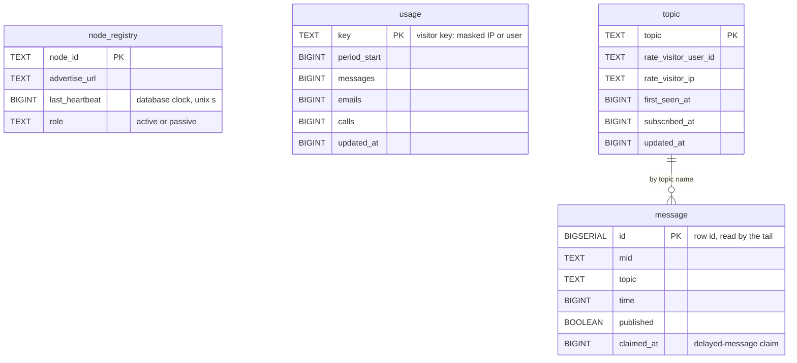

The tables are independent (no foreign keys); `node_registry` is created by `registry.New`, `usage` and `topic`
with the user schema (`user/manager_postgres_schema.go`), `message` by the message cache.

| node_id | advertise_url | last_heartbeat | role |
|---|---|---|---|
| node-1 | http://198.51.100.11:2587 | 1764072000 | active |
| node-2 | http://198.51.100.12:2587 | 1764071999 | active |
| node-3 | http://198.51.100.13:2587 | 1764071998 | passive |

| key | period_start | messages | emails | calls | updated_at |
|---|---|---|---|---|---|
| ip:203.0.113.0 | 1764050412 | 37 | 0 | 0 | 1764071995 |
| user:u_A1b2C3d4E5f6 | 1764031207 | 812 | 3 | 1 | 1764071990 |
| ip:2001:db8:: | 1764061111 | 5 | 0 | 0 | 1764071002 |

| topic | rate_visitor_user_id | rate_visitor_ip | first_seen_at | subscribed_at | updated_at |
|---|---|---|---|---|---|
| upAbc123xyz | u_A1b2C3d4E5f6 | | 1763900000 | 1764068400 | 1764068400 |
| upQrs789uvw | | 198.51.100.23 | 1763950000 | 1764060000 | 1764060000 |

| id | mid | topic | time | published | claimed_at |
|---|---|---|---|---|---|
| 918273 | Xk2mP9qRt4Lz | backups-alerts | 1764071990 | true | 0 |
| 918274 | b7Hn3WcY1sDe | backups-alerts | 1764075600 | false | 1764075601 |

## Requirements

Checked in `cmd/serve.go` and `cluster.New`:

| Requirement | Why |
|---|---|
| Same `database-url` (PostgreSQL) on every node | Control plane and shared state; SQLite cannot be shared |
| `experimental-cluster-secret`, identical on all nodes | Authenticates the peer API |
| `experimental-cluster-node-id`, stable across restarts | Keys the registry row, leader order and per-peer stats |
| `experimental-cluster-advertise-url` if the listener binds a wildcard | Defaults to `http://<experimental-cluster-listen>` |
| Shared attachment storage (e.g. S3) | A local cache dir cannot serve a file uploaded via another node |
| Clocks in sync (NTP) | `limit` and `topic` stamp rows with the node clock; the registry uses the database clock |

## Node roles

`experimental-cluster-role` is `active` (default) or `passive`, written to `node_registry.role` on every heartbeat.

| | Active | Passive |
|---|---|---|
| `/v1/ready` | 200 (see readiness) | always 503 |
| Can lead | yes | never; no active node live means no leader |
| Fences itself when isolated | yes, if another active node is healthy | never |
| Counts as "somewhere better" for an isolated peer | yes | no |
| Receives fan-out, runs the tail, serves direct clients | yes | yes |

A passive node observes real traffic without being behind the load balancer. A draining node acts as passive
(`meshCluster.Role`) without changing its configured role.

### Node lifecycle

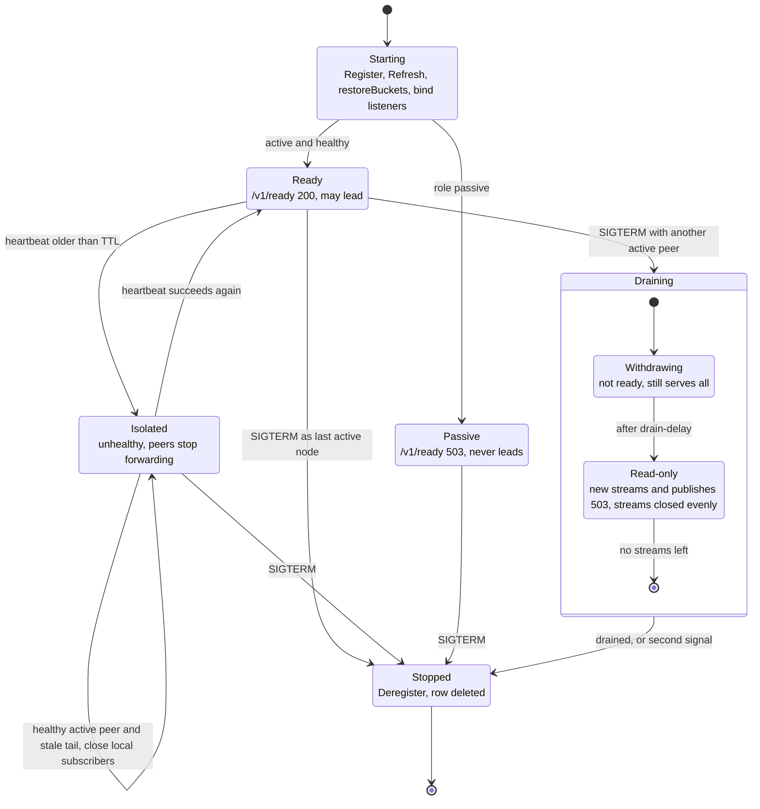

## Membership: the node registry

`cluster/registry/registry.go`. The `node_registry` table is the whole membership mechanism; no gossip protocol.

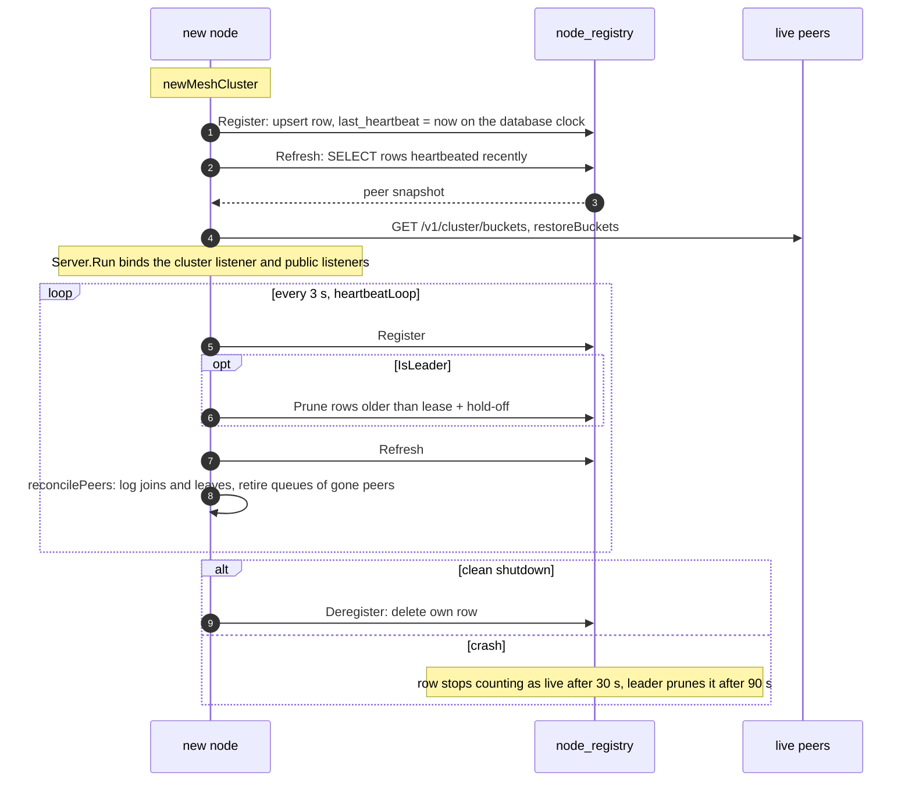

| Constant | Value | Where |
|---|---|---|
| Heartbeat interval | 3 s | `defaultHeartbeatInterval`, `cluster/cluster.go` |
| Node TTL (live if heartbeat newer) | 30 s | `defaultNodeTTL` |
| Per-call database timeout | `min(ttl/2, 5 s)` | `Registry.opContext` |
| Prune | rows older than lease + hold-off (90 s), leader only | `Registry.Prune` |

Liveness is evaluated in SQL against the database clock, so node clock skew does not matter. `Peers()` only returns
the last snapshot, so a database outage leaves fan-out working on the last known peer list. The node registers
before its listener binds; peers' batches in that short window are refused, and the tail covers them.

## Leadership

`Registry.IsLeader`, `Registry.Refresh`. No election, lock or lease row: the leader is the live **active** node with
the lowest `node_id`, computed locally from the snapshot. Belief also needs a fresh own registration and a fresh
registry read (both within the lease, 1x TTL), and having been lowest, continuously observed, for the hold-off
(2x TTL). The hold-off is skipped if no other active node was live recently, so a lone node leads at once.

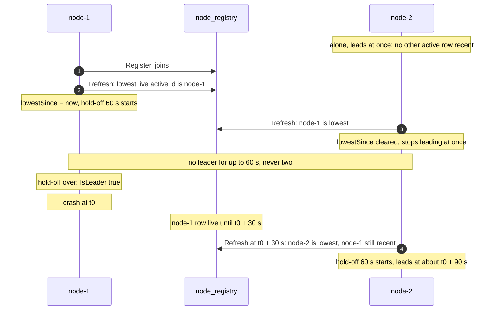

With the 30 s TTL: lease 30 s, hold-off 60 s, failover gap up to about 90 s. The invariant
`leaseFactor < 1 + holdoffFactor` makes the old belief lapse before a successor's hold-off ends. A gap in
observation (a frozen process) restarts the hold-off. Leadership is a belief, not a fence: callers re-check
`IsLeader` per unit of work, and anything where double execution matters has its own claim or is idempotent.

| Leader-gated job | Where |
|---|---|
| Token, attachment and message pruning; web push expiry warnings and pruning | `execManager`, `server/server_manager.go` |
| Firebase keepalive | `runFirebaseKeepaliver`, `server/server.go` |
| Delayed-message sender (preference only; the claim makes it safe) | `runDelayedSender` |
| Pruning stale `node_registry` rows | `meshCluster.heartbeat` |

`ntfy_cluster_leader` is 1 on the leading node; leadership changes are not logged.

### Delayed messages

`message/cache.go` (`MessagesDue`), `Server.sendDelayedMessages`. Claims use `FOR UPDATE SKIP LOCKED`, so concurrent
senders get disjoint rows; delivery is at least once and clients dedupe by message ID.

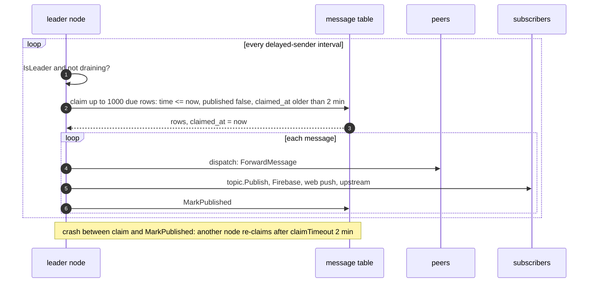

## The peer API

All node-to-node traffic is HTTP under `/v1/cluster/` (paths in `cluster/cluster.go`, handlers in
`cluster/cluster_mesh_handler.go`). The cluster handler serves the whole private listener (`httpClusterServer` in
`Server.Run`); public listeners never route there.

| Path | Method | Auth | Purpose |
|---|---|---|---|
| `/v1/cluster/message` | POST | secret + origin | Batch of messages, NDJSON, one `apiMessage` per line |
| `/v1/cluster/state` | POST | secret + origin | `access_changed`, `deleted_user_ids` (`topics.added` is not sent today) |
| `/v1/cluster/buckets` | POST | secret + origin | Rate bucket deltas since the sender's last round |
| `/v1/cluster/buckets` | GET | secret | This node's non-full buckets, for a starting peer |
| `/v1/cluster/health` | GET | secret | `{"healthy": bool}`, 503 when unhealthy; probed by an isolated peer |
| `/v1/cluster/status` | GET | secret | This node's view (`cluster.Status`); backs `ntfy cluster status` |
| `/v1/cluster/members` | GET | secret | Live members with role and health |

Auth runs before the body is read: constant-time compare of `X-Cluster-Secret`, then for peer-to-peer paths a
required `X-Cluster-Origin`; a request with this node's own ID gets 200 and is ignored (loop prevention). Bodies are
size-capped (`batchMaxBytes` plus one message, `stateMaxBytes` 1 MiB, `bucketsMaxBytes` 8 MiB). Unknown state
sections are ignored and unknown paths 404, so mixed versions work during a rolling deploy.

The secret is the only protection: anyone holding it can inject messages into any topic. Keep the listener on a
private network, firewalled to the other nodes.

## Fan-out

`meshCluster.ForwardMessage`, `peerWorker`, `peerQueue` (`cluster/types.go`), `util/linger_queue.go`.

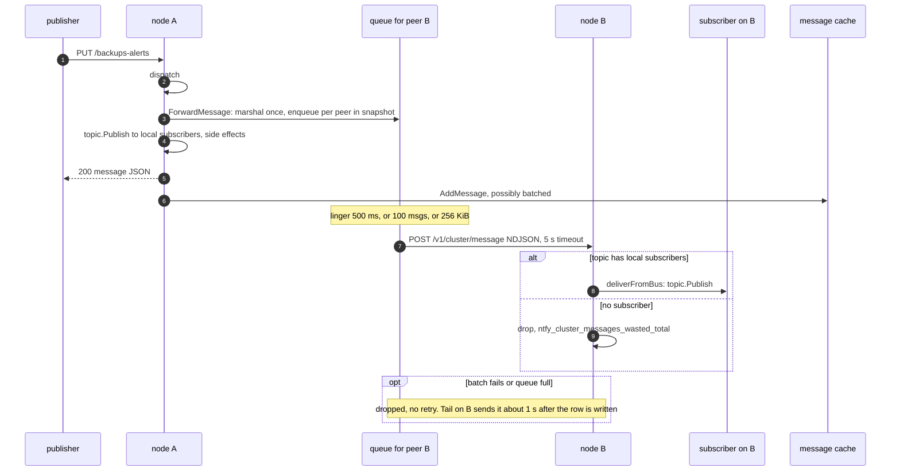

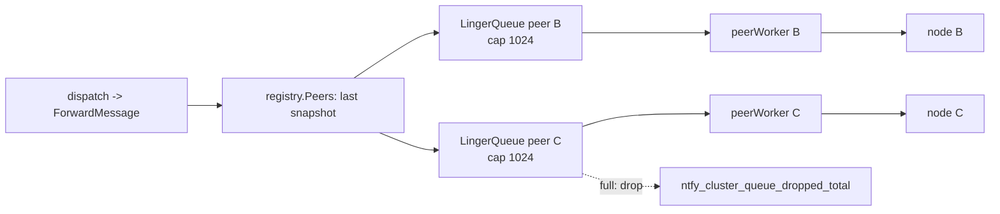

- **Every message goes to every peer.** No routing by subscription; a peer without a local subscriber drops it and
  does not keep the topic alive. Cheaper than keeping a distributed subscription map consistent.
- **One choke point.** Every publish path (HTTP, actions, delayed sender, account sync) goes through
  `Server.dispatch`. Side effects (Firebase, email, calls, web push, upstream) run on the origin only.
- **Per-peer bounded queues.** A slow peer backs up only its own queue. `experimental-cluster-batch-linger` 0 sends
  each message at once.
- **No retries.** Failures are counted and dropped; recovery is the tail's job.

`apiMessage` adds `Sender` and `User` (not serialized by `model.Message`) so the receiver can rebuild the visitor.

## Message cache tail

`message/tail.go` (`Tail`), `server/server_tail.go` (`runTail`, `sinceForTopic`), `server/topic.go` (`deliver`,
`PublishMissed`, `delivered`). Turns fire-and-forget fan-out into reliable delivery for cached messages.

Every node reads new rows (by any node) every second from the primary, in row id order, up to 10 pages of 1000.
Each topic remembers when each recent message went out (`delivered`, 2 min). `topic.deliver` sends a tailed message
to every subscriber that has not had it, under one lock with per-subscriber chained sends, so order holds and the
tail never sends twice.

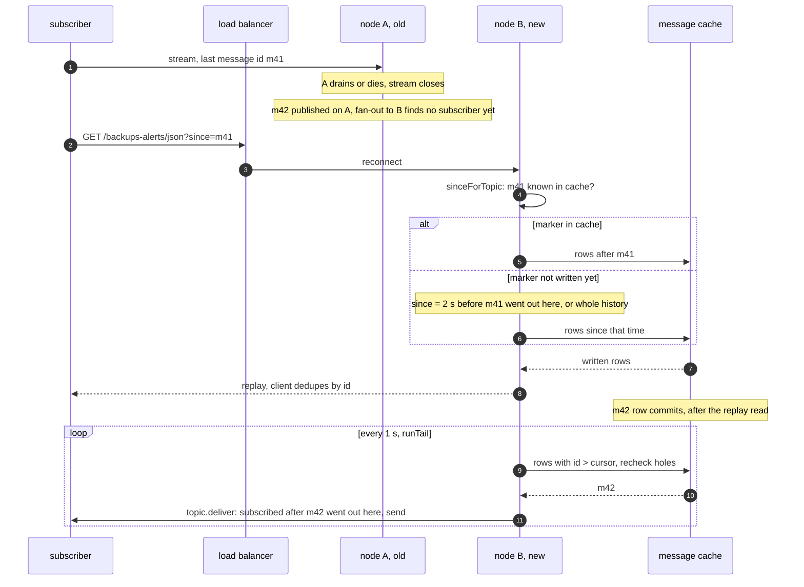

Row ids are assigned at insert but visible at commit, and nodes commit out of order. A skipped row id is kept as a
hole and re-checked each read until it appears or 1 minute passes (rolled back); at most 10,000 holes.

| Delivery | Guarantee |
|---|---|
| Subscribers on the publishing node | as on a single node |
| Cached messages, cross-node | live via fan-out, or about 1 s after the row is written via the tail |
| `since=` reconnect to any node | from the database, plus the tail for rows not yet written |
| `cache: no` messages | best effort across nodes: never written, so the tail cannot see them |

The tail runs whenever the cache is on (`cache-duration` > 0), also on a single node, where it finds nothing to
send.

## Health, readiness and isolation

`Server.handleHealth`, `Server.handleReady`, `meshCluster.Healthy`, `Ready`, `maybeIsolated`,
`Server.maybeCloseLocalSubscribers`.

| Endpoint | Answers | 200 when |
|---|---|---|
| `/v1/health` | Is the registration fresh? `{"healthy":true,"role":"active"}` | last heartbeat younger than the TTL. For monitoring, not load balancers |
| `/v1/ready` | Should a load balancer send clients here? `{"ready":true,"role":"active"}`, `"draining":true` while draining | see below |

Single-node, both always return 200.

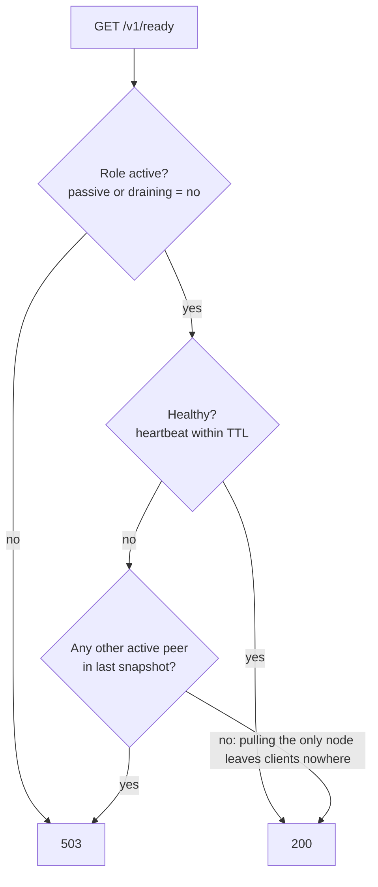

**Isolation.** A node that loses the database keeps its subscribers, but peers stop forwarding to it.

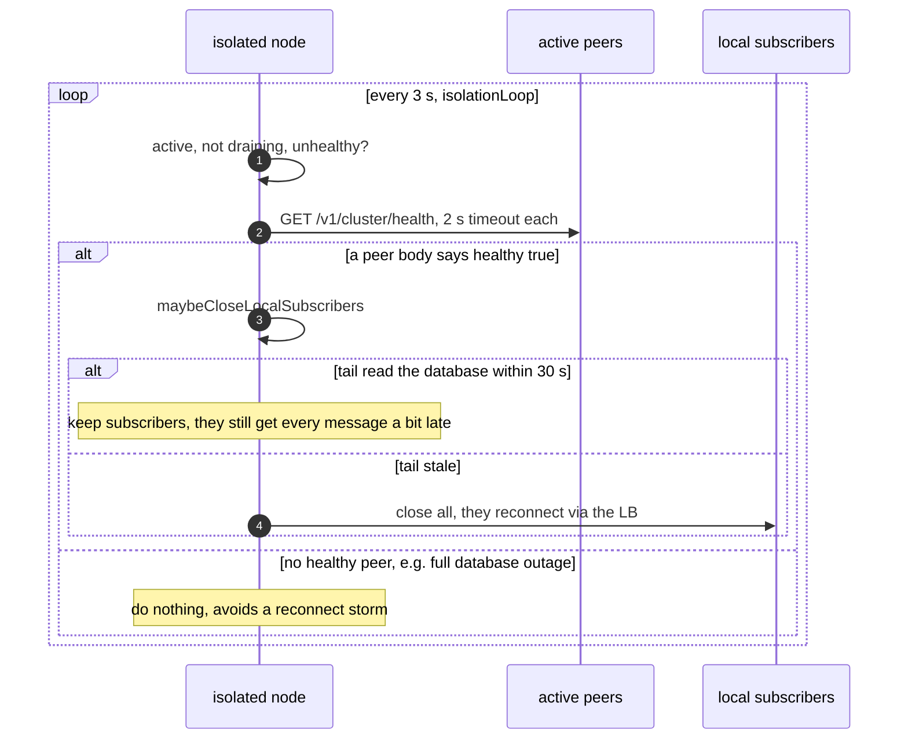

A bare 200 from a proxy does not count as healthy; the body must say so.

## Draining on shutdown

`Server.Drain` (`server/server_drain.go`), called from `sigHandlerShutdown` (`cmd/serve_unix.go`) before `Stop`.
Only an active node with another active peer drains; otherwise it stops at once. A second signal skips the rest.

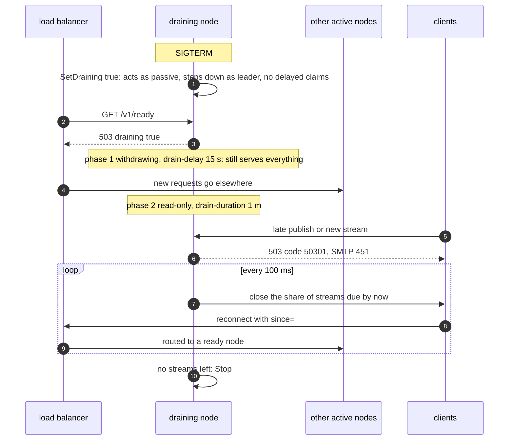

| | Withdrawing | Read-only |
|---|---|---|
| `/v1/ready` | 503 | 503 |
| New streams and WebSockets | accepted | 503 (`errHTTPServiceUnavailableDraining`), before the upgrade |
| Open streams | kept | closed evenly (`streams.CancelSome`); all at once with 0 |
| Polls and reads | served | served |
| Publishes (HTTP, SMTP) | served | 503 / SMTP 451 |
| Mesh delivery, tail | yes | yes |
| Leads, claims delayed messages | no | no |

The withdrawing phase exists because a load balancer that streams request bodies cannot retry a rejected publish.
Size drain-delay to cover the load balancer's detection time; the service manager's stop timeout must cover both
phases (systemd's 90 s default fits the defaults).

```
Stop
+- close listeners
+- close tail
+- cluster.Close: last bucket round, wait loops, Deregister
+- limiter: flush daily counts; topic service: flush
+- close message cache, then other stores (shared pool on PostgreSQL)
```

## Access changes and deleted users

`server/server_admin.go`. With `auth-access-cache` on, each node holds ACLs in memory and reloads periodically.
Signals make changes take effect everywhere sooner.

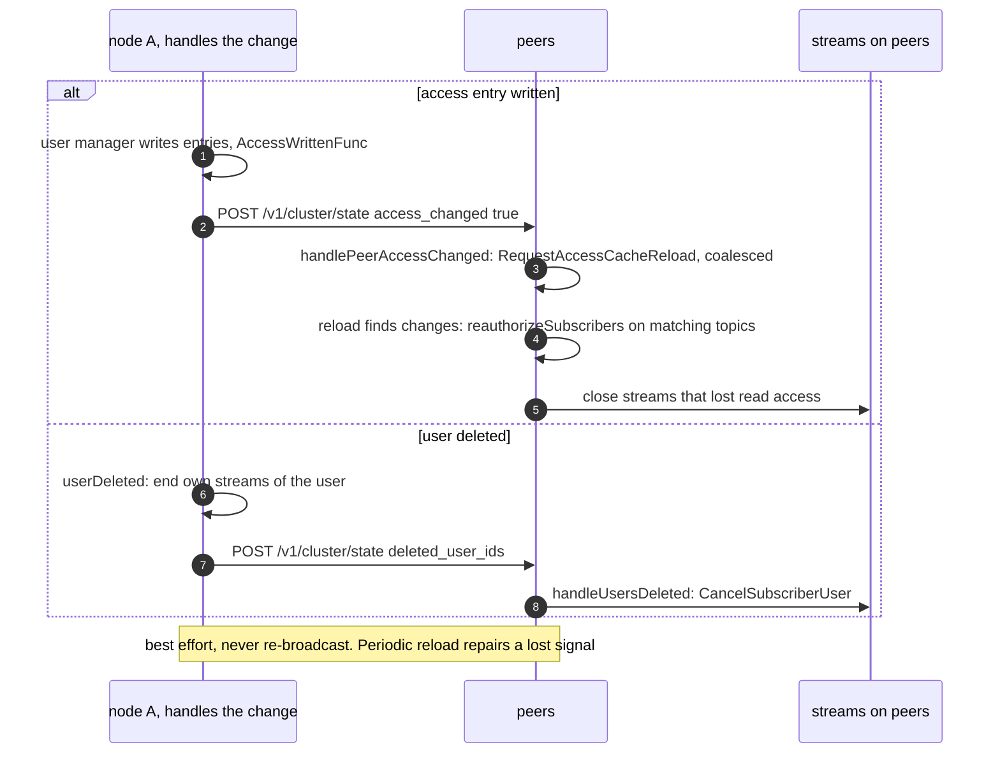

`reauthorizeSubscribers` runs on every node, including A, after a reload that found changes. `authorizeSubscribed`
re-checks a new stream right after it subscribed, so a change racing the subscribe is caught by one side.
Deletions travel separately because a deleted user leaves no entries to compare.

## Shared limits

`limit/` (`Service`), `server/visitor.go`, `cluster/cluster_mesh_buckets.go`. A visitor key (masked IP prefix, or
the user) is the same on every node. All decisions are from memory; neither exchange is on the request path, and
both fail open to per-node limits.

| Limit | Kinds (`limit.Kind`) | Shared via | Persisted | Exactness |
|---|---|---|---|---|
| Daily quotas | messages, emails, calls | `usage` table, every 5 s | yes | overshoot about (nodes - 1) x one sync interval's admits |
| Token buckets | requests, emails, attachment bandwidth, topic creation, account actions, auth failures, Firebase pauses | mesh, every 1 s | no | about one extra burst per node, once |
| Open subscriptions | | not shared | no | per node on purpose: protects its own memory and fds |

### Daily counts: the `usage` table

`limit/service.go`, `limit/store_postgres.go`. Also used on a single SQLite node, where it keeps counts across
restarts.

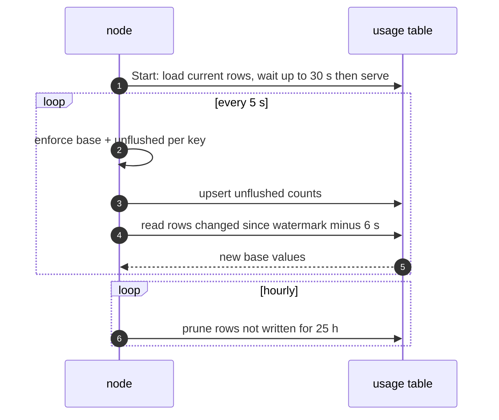

- One row per key, reused across periods; each key's 24 h period starts at an offset hashed from the key, so there is
  no midnight reset.
- An anonymous visitor's message count gets a row only from a tenth of its daily cap (`promoteRate`,
  `server/visitor.go`); a user's from the first message.
- `user.stats_*` columns are zeroed and unused.

### Token buckets over the mesh

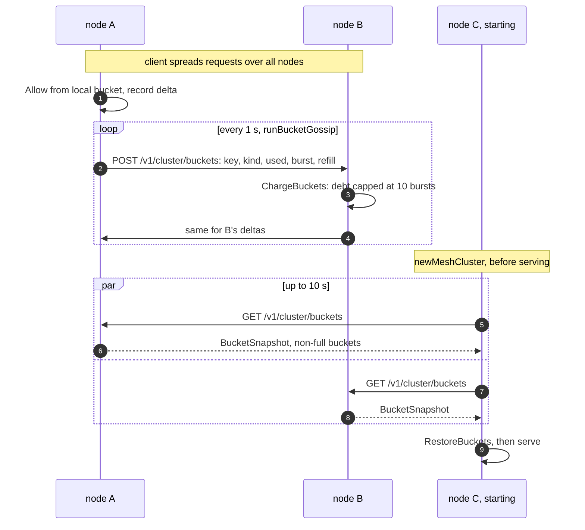

- Deltas include every key used, not only drained ones; at most 50,000 per round (`BucketDeltasMax`).
- A lost round undercounts and is not retried; sends time out after 1 s.
- A rolling restart forgives nothing; only if all nodes restart at once do buckets start full.
- Delta tracking is on only in cluster mode (`limit.Config.TrackDeltas`).

## UnifiedPush topic state: the `topic` table

`topic/service.go`, `server/server_rate_visitor.go`. With `visitor-subscriber-rate-limiting`, UnifiedPush pushes are
billed to the subscriber (rate visitor). Publish and subscriber are often on different nodes, so the state is shared.

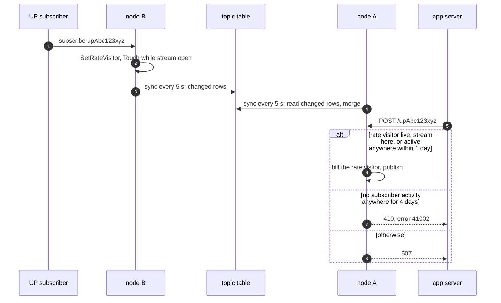

- Merge rules: earliest `first_seen_at`, latest `subscribed_at`, last written rate visitor, so writes may land in any
  order.
- Open-stream topics are touched at most every 1 to 2 h (`touchInterval`, jittered). Rows pruned after 7 days.
- Topics known only from refused pushes are capped at 100,000 (`maxRefused`).

## Other shared state

| State | How it is shared |
|---|---|
| Published-messages total (`/v1/stats`) | Each node adds its delta to `message_stats` every manager tick and folds the total back |
| Users, tokens, tiers, ACLs, web push subscriptions | Already in PostgreSQL; any node serves any request |
| Live subscriptions, in-memory topic map | Never shared; why fan-out goes to every peer |

## Load balancer requirements

Any load balancer works if it does the following:

| Requirement | Detail |
|---|---|
| Health check on `/v1/ready` | Route only to 200. Not `/v1/health`: it would pull the only active node in a database blip and ignores passive/draining. Detect failure well within drain-delay |
| No stickiness | Limits are shared and `since=` resumes anywhere. Least-connections suits long streams |
| Client IP | `behind-proxy: true`; the LB appends to `X-Forwarded-For` (or `proxy-forwarded-header`). ntfy drops `proxy-trusted-hosts` and takes the right-most remaining (`extractIPAddressFromHeader`, `server/util.go`). Only the LB should reach the HTTP listeners |
| Streaming | No response buffering; read timeouts above `keepalive-interval` (45 s); pass WebSocket upgrades |
| Many connections | One LB source IP gets about 64k ports per `ip:port`; `listen-http` takes several comma-separated addresses |
| Retries | A 503 before the body is consumed is safe to retry elsewhere; a streamed publish body is not |
| SMTP | MX or a TCP balancer at the nodes; draining answers 451 so senders retry |

## Configuration

Flags in `cmd/serve.go`, defaults in `server/config.go`, documented in `server/server.yml` and `docs/config.md`.

| Option | Default | Notes |
|---|---|---|
| `database-url` | | required, PostgreSQL, same on all nodes |
| `experimental-cluster-listen` | | private `ip:port` of the peer API; setting it enables clustering |
| `experimental-cluster-node-id` | | required, stable per node |
| `experimental-cluster-advertise-url` | `http://<experimental-cluster-listen>` | required for a wildcard listen |
| `experimental-cluster-secret` | | required, identical on all nodes |
| `experimental-cluster-role` | `active` | or `passive` |
| `experimental-cluster-batch-linger` | 500ms | fan-out batch wait per peer; 0 sends at once |
| `experimental-cluster-drain-delay` | 15s | SIGTERM phase 1, withdrawing |
| `experimental-cluster-drain-duration` | 1m | SIGTERM phase 2, read-only; 0 closes all at once |
| `behind-proxy` | false | set true behind a load balancer |

Each node has its own pool (`pool_max_conns`), so nodes x pool size must fit the database's connection limit. Log
tags: `cluster`, `tail`, `drain`, `limit`, `topic`; `log-level-overrides: "tag=cluster -> trace"` shows per-message
fan-out decisions.

## Metrics

`metrics/metrics.go`, exported with `enable-metrics`.

| Metric | Type | Meaning |
|---|---|---|
| `ntfy_cluster_peers` | gauge | Live peers at the last reconcile |
| `ntfy_cluster_leader` | gauge | 1 on the leading node |
| `ntfy_cluster_messages_forwarded_total` | counter | Messages handed to fan-out |
| `ntfy_cluster_batches_sent_total` | counter | Fan-out requests; forwarded / batches = batch ratio |
| `ntfy_cluster_send_errors_total{path}` | counter | Failed peer requests per peer API path (message, state, buckets) |
| `ntfy_cluster_queue_dropped_total` | counter | Dropped on a full peer queue |
| `ntfy_cluster_messages_wasted_total` | counter | Received with no local subscriber |
| `ntfy_cluster_peer_batches_sent_total{peer,result}` | counter | Batches per peer, `ok` or `error` |
| `ntfy_cluster_peer_batches_received_total{peer}` | counter | Batches received per peer |
| `ntfy_cluster_peer_last_send_success_timestamp_seconds{peer}` | gauge | Last accepted batch, 0 for never |
| `ntfy_tail_messages_read_total` | counter | Rows read by the tail |
| `ntfy_tail_messages_missed_total` | counter | Tail sends to subscribers that missed a message live |
| `ntfy_tail_messages_lag_seconds` | gauge | Age of the newest message in the last tail read |

Per-peer series start at zero when a peer is first seen and are removed 24 h after it left (`peerStatsRetention`).
A one-way broken link shows as `result="error"` on one side; `ntfy cluster status --all` lists both directions.

## Known limits

- **Experimental.** Option names, behavior and tables may change.
- **`cache: no` messages** are best effort across nodes.
- **Delayed messages are at least once.**
- **Burst overshoot**: about one extra burst per node before the first bucket round; a few daily units at a quota's
  edge.
- **Subscription limits are per node.**
- **Per-node memory scales with cluster-wide visitors** (every node holds all buckets).
- **No rebalancing**: clients stay where they landed until they reconnect.
- **Revocation is eventually consistent**: a lost signal is repaired by the next access cache reload.
