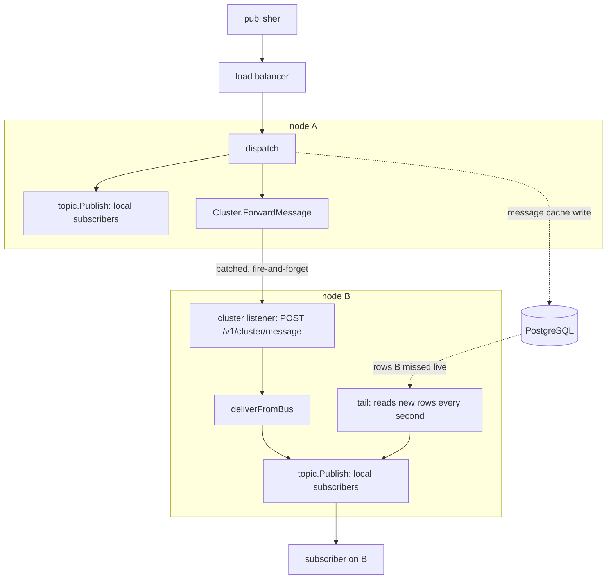
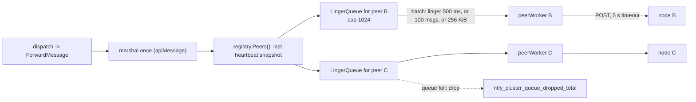
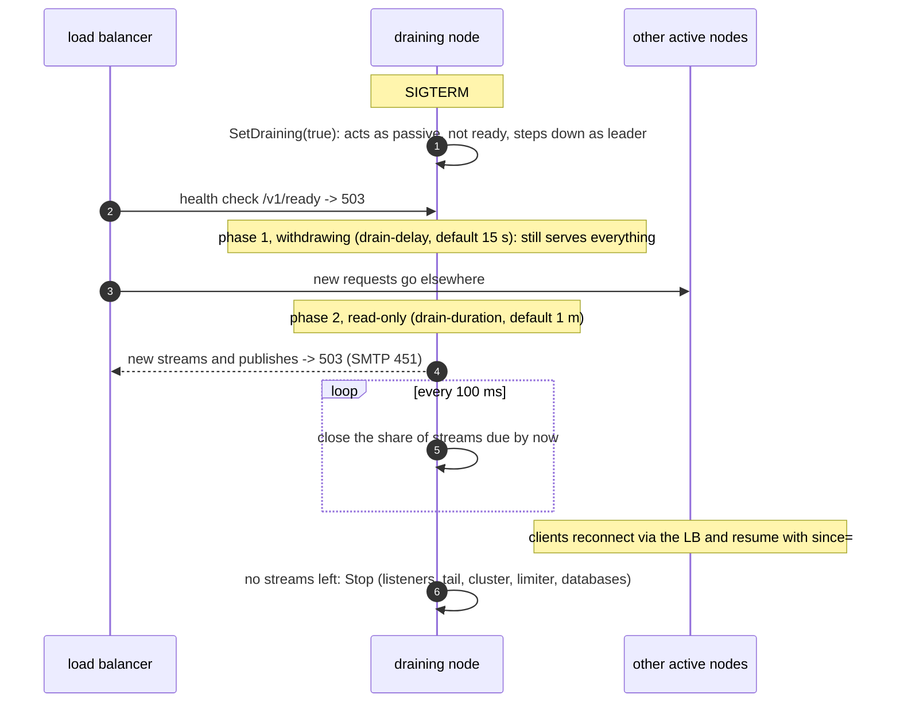
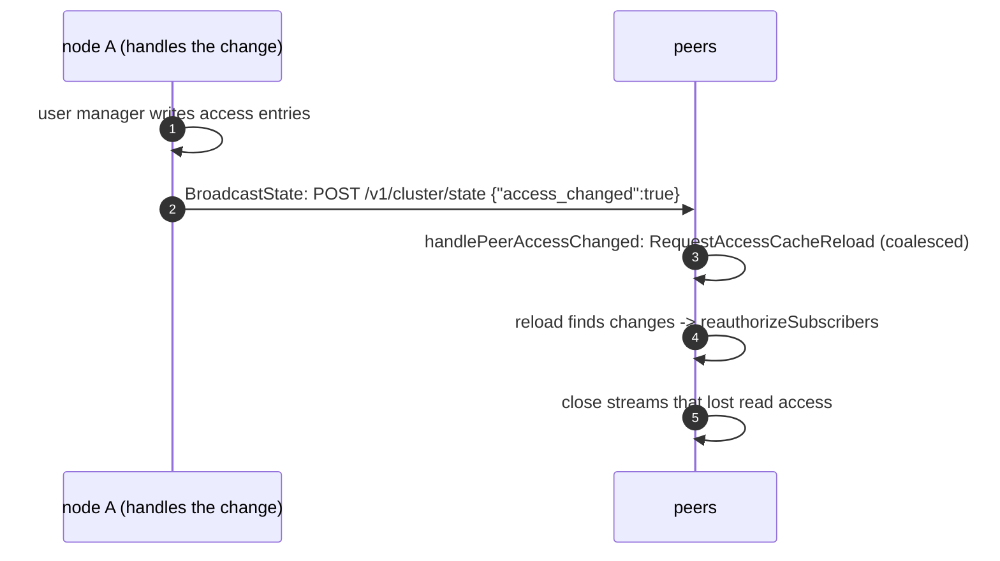
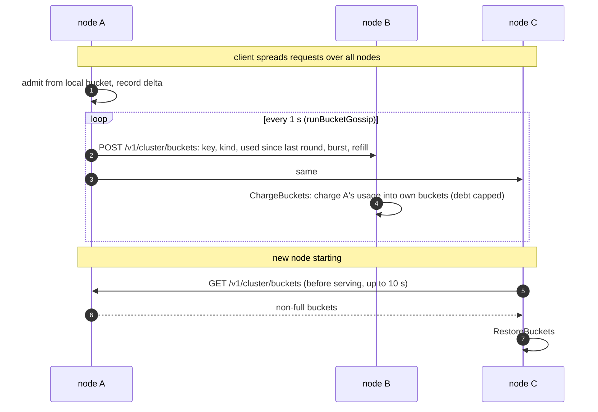

# Cluster mode

## How several ntfy nodes act as one server

How ntfy's experimental cluster mode works: several `ntfy serve` processes share one PostgreSQL database, sit behind
any load balancer, and deliver every message to every subscriber no matter which node it connected to. This is the
design view for contributors and for self-hosters who want to know what happens underneath; the operator-facing
reference (options, example config, draining, `ntfy cluster status`) is the "Clustering (experimental)" section of
`docs/config.md`.

Code references: `cluster/` (the mesh, `cluster/registry/` for membership and leadership), `server/server.go`
(construction, `dispatch`, `/v1/health`, `/v1/ready`), `server/server_cluster.go`, `server/server_tail.go`,
`server/server_drain.go`, `server/server_admin.go` (access-change relay), `limit/` (rate buckets and daily counts),
`topic/` (UnifiedPush topic state), `message/tail.go` and `message/cache.go` (tail, delayed-message claims),
`cmd/serve.go` (flags and validation), `cmd/cluster.go` (`ntfy cluster status`).

## The shape of it

A single ntfy server fans a message out to an in-memory map of subscriber connections (`topic.Publish`), so a
publish on node A cannot reach a subscriber on node B by itself. Everything durable (messages, users, ACLs, web push
subscriptions) already lives in PostgreSQL when `database-url` is set, so the missing piece is live cross-node
delivery. Cluster mode adds it with two planes that are kept apart on purpose:

| Plane | Carried by | Used for |
|---|---|---|
| Control plane | PostgreSQL | Membership (`node_registry`), leadership, daily limits (`usage`), UnifiedPush topic state (`topic`), delayed-message claims, and the message cache the tail reads |
| Data plane | Direct node-to-node HTTP on a private listener | Message fan-out, rate bucket exchange, access-change and user-deletion signals |

PostgreSQL is never on the publish path: the only membership read during a publish is the in-memory peer snapshot
taken by the last heartbeat.



Clustering is off unless `experimental-cluster-listen` is set. Then `cluster.New` returns the nop cluster
(`cluster/cluster_nop.go`): it 404s the peer API, is always leader, always healthy and ready, never drains, and has
no peers, so no call site has to ask whether clustering is on.

## Requirements

Checked in `cmd/serve.go` and `cluster.New`:

| Requirement | Why |
|---|---|
| `database-url` (PostgreSQL) on every node, the same database | It is the control plane and holds all shared state; SQLite cannot be shared |
| `experimental-cluster-secret`, identical on all nodes | Authenticates the peer API |
| `experimental-cluster-node-id`, stable across restarts (e.g. the hostname) | Keys the registry row, the leader order and per-peer stats |
| `experimental-cluster-advertise-url` if the cluster listener binds a wildcard address | Peers need a concrete address; otherwise it defaults to `http://<experimental-cluster-listen>` |
| Shared attachment storage (e.g. S3), if attachments are on | A node's local cache directory cannot serve a file uploaded through another node |
| Clocks in sync (NTP) | `limit` and `topic` stamp rows with the node's clock (see the package comments); the registry uses the database clock |

## Node roles

`experimental-cluster-role` is `active` (default) or `passive`. The role is written to `node_registry.role` on every
heartbeat, so every node sees every peer's role in the snapshot it already reads.

| | Active | Passive |
|---|---|---|
| `/v1/ready` | 200 (see readiness below) | always 503 |
| Can lead (singleton jobs) | yes | never; with no active node live there is no leader |
| Fences itself when isolated | yes, if another active node is healthy | never |
| Counts as "somewhere better" for an isolated peer | yes | no |
| Receives fan-out, runs the tail, serves clients that connect directly | yes | yes |

A passive node is for observing a node under real traffic without putting it behind the load balancer (test
subscribers connect to it directly). A draining node acts as passive (`meshCluster.Role` returns passive while
draining) without changing its configured role.

## Membership: the node registry

`cluster/registry/registry.go`. The `node_registry` table (`node_id`, `advertise_url`, `last_heartbeat`, `role`) is
the whole membership mechanism; there is no gossip protocol.

```mermaid
sequenceDiagram
    autonumber
    participant N as node
    participant PG as node_registry
    N->>PG: Register (synchronous, in newMeshCluster)
    N->>PG: Refresh: first peer snapshot
    N->>N: restoreBuckets from live peers
    loop every 3 s (heartbeatLoop)
        N->>PG: Register: upsert own row, last_heartbeat = database now()
        N->>PG: Refresh: rows heartbeated recently
        N->>N: reconcilePeers: retire queues of peers that left or changed URL
    end
    alt clean shutdown
        N->>PG: Deregister: delete own row
    else crash
        Note over PG: row stops counting as live after 30 s; the leader prunes it later
    end
```

| Constant | Value | Where |
|---|---|---|
| Heartbeat interval | 3 s | `defaultHeartbeatInterval`, `cluster/cluster.go` |
| Node TTL (live if heartbeat newer than this) | 30 s | `defaultNodeTTL` |
| Per-call database timeout | `min(ttl/2, 5 s)` | `Registry.opContext` |
| Prune | rows older than lease + hold-off (90 s), leader only | `Registry.Prune` |

Heartbeats are stamped with the database clock (`EXTRACT(EPOCH FROM now())`) and liveness is evaluated in SQL, so a
node with a skewed clock neither expires its peers early nor keeps dead ones. `Peers()` only ever returns the snapshot
of the last `Refresh`, so a database outage leaves fan-out working on the last known peer list instead of putting a
query or timeout on the publish path. The node registers before its cluster listener binds (in `Server.Run`), so for
a short window at startup peers may forward to a port that is not accepting yet; the tail covers those messages.

## Leadership

`Registry.IsLeader`, `Registry.Refresh`. Some jobs must run on one node only. There is no election, lock or lease
row: the leader is the live **active** node with the lowest `node_id`, computed locally from the registry snapshot.
Belief in leadership additionally needs:

1. a fresh own registration (the lease, 1x TTL, dated from when the heartbeat was issued);
2. a recent registry read (also within the lease);
3. having been the lowest live active id, continuously observed, for the hold-off (2x TTL). If no other active node
   was live recently, the hold-off is skipped, so a lone node leads at once.

With the 30 s TTL that is a 30 s lease and 60 s hold-off: after a leader crashes there is a gap of up to about 90 s
with no leader, never two. The invariant `leaseFactor < 1 + holdoffFactor` guarantees the old belief lapses before a
successor's hold-off ends. A gap in observation (a frozen process) restarts the hold-off.

Leadership is a belief, not a fence: a job blocked in a database call can outlive its lease, so callers re-check
`IsLeader` per unit of work, and anything where double execution matters has its own claim (delayed messages, below)
or is idempotent.

| Leader-gated job | Where |
|---|---|
| Token, attachment and message pruning; web push expiry warnings and pruning | `execManager`, `server/server_manager.go` |
| Firebase keepalive | `runFirebaseKeepaliver`, `server/server.go` |
| Delayed-message sender (preference only; the claim makes it safe) | `runDelayedSender` |
| Pruning stale `node_registry` rows | `meshCluster.heartbeat` |

The `ntfy_cluster_leader` gauge is 1 on the node that currently leads; leadership changes are not logged.

### Delayed messages

`message/cache.go` (`MessagesDue`). Due messages are claimed with one `UPDATE ... (SELECT ... FOR UPDATE SKIP LOCKED)`
that stamps `claimed_at`, so concurrent senders get disjoint rows. `published` is still set only after dispatch. A
node that dies between claim and dispatch leaves a stale claim that another node takes over after `claimTimeout`
(2 min), so delivery is at least once and clients dedupe by message ID. `claimBatchSize` is 1000. A draining node
claims nothing (`sendDelayedMessages`).

## The peer API

All node-to-node traffic is HTTP under `/v1/cluster/` (paths in `cluster/cluster.go`, handlers in
`cluster/cluster_mesh_handler.go`). The cluster serves the **whole** private listener (`httpClusterServer` in
`Server.Run`); the public listeners never route there.

| Path | Method | Auth | Purpose |
|---|---|---|---|
| `/v1/cluster/message` | POST | secret + origin | Batch of published messages, NDJSON, one `apiMessage` per line |
| `/v1/cluster/state` | POST | secret + origin | `apiState` envelope: `access_changed`, `deleted_user_ids` (and `topics.added`, which the server does not send today) |
| `/v1/cluster/buckets` | POST | secret + origin | Rate bucket deltas since the sender's last round (`limit.Buckets`) |
| `/v1/cluster/buckets` | GET | secret | This node's non-full buckets, for a starting peer |
| `/v1/cluster/health` | GET | secret | `{"healthy": bool}`, 503 when unhealthy; what an isolated peer probes |
| `/v1/cluster/status` | GET | secret | This node's view for operators (`cluster.Status`); backs `ntfy cluster status` |
| `/v1/cluster/members` | GET | secret | Live members with role and health, for external agents |

Auth (`authenticated`, `secretAuthenticated`) runs before any body is read: a constant-time compare of
`X-Cluster-Secret`, then for peer-to-peer paths a required `X-Cluster-Origin` header; a request carrying this node's
own ID is answered 200 and ignored (loop prevention). Bodies are size-capped (`batchMaxBytes` plus one message,
`stateMaxBytes` 1 MiB, `bucketsMaxBytes` 8 MiB). Unknown sections in the state envelope are ignored and an unknown
path is a 404, which keeps mixed-version clusters working during a rolling deploy.

The secret is the only protection: anything holding it can inject messages into any topic. Keep the cluster listener
on a private network and firewall it to the other nodes.

## Fan-out

`meshCluster.ForwardMessage`, `peerWorker`, `cluster/types.go` (`peerQueue`), `util/linger_queue.go`.



- **Every message goes to every peer.** There is no routing by subscription: a peer without a local subscriber
  for the topic drops it (`deliverFromBus`, counted in `ntfy_cluster_messages_wasted_total`) and does not even keep
  the topic alive. Fan-out cost scales with the cluster-wide publish rate, which is small compared to the
  correctness cost of keeping a distributed subscription map consistent.
- **One choke point.** Every publish path (HTTP publish, actions, delayed sender, account sync events) goes through
  `Server.dispatch`, which forwards first, then publishes locally and fires side effects. Side effects (Firebase,
  email, calls, web push, upstream) run on the origin only; the receiving node only publishes to its local topic.
- **Per-peer queues.** A slow or dead peer backs up only its own bounded queue; a full queue drops. Batching caps
  the request rate per peer at a few per second (`experimental-cluster-batch-linger`, default 500 ms; 0 sends each
  message at once).
- **No retries.** A failed batch is counted (`ntfy_cluster_send_errors_total{path}`,
  `ntfy_cluster_peer_batches_sent_total{result="error"}`) and dropped. Recovery is the tail's job.

`apiMessage` carries `Sender` and `User`, which `model.Message` does not serialize, so the receiving node can rebuild
the visitor. Received NDJSON is decoded and delivered line by line; malformed lines are skipped and logged.

## Message cache tail

`message/tail.go` (`Tail`), `server/server_tail.go` (`runTail`, `sinceForTopic`), `server/topic.go` (`deliver`,
`PublishMissed`, `delivered`). This is what turns fire-and-forget fan-out into reliable delivery for cached messages.

Every node reads the rows written to the message cache, by any node, once per second (`tailInterval`), from the
primary, in row id order, up to 10 pages of 1000 rows per read. Each topic remembers when each recent message went
out to its subscribers (`delivered`, kept for 2 min). For every tailed message, `topic.deliver` sends it to the
subscribers that have not had it: all of them if it never went out on this node (its fan-out batch was lost), or
those that subscribed after it went out (they were reconnecting and their `since=` read missed the not-yet-written
row). Picking subscribers and recording the delivery happen under one lock, and each subscriber's sends are chained,
so messages to one subscriber stay in order and nothing is sent twice by the tail itself.

Row ids are assigned at insert but become visible at commit, and several nodes commit out of order. A row id the
tail skipped is kept as a hole and re-checked on each read until it appears or 1 minute passes (a rolled-back
insert); at most 10,000 holes are tracked.

Reconnects: a `since=<id>` marker the cache does not know yet (still in a write batch) is resolved by
`sinceForTopic`: if that message went out on this node, replay starts 2 s before then (`unwrittenMarkerMargin`),
otherwise from the topic's whole history, as on a single node. Clients dedupe by message ID.

| Delivery | Guarantee |
|---|---|
| Subscribers on the publishing node | as on a single node |
| Cached messages, cross-node | live via fan-out, or about a second after the row is written via the tail |
| `since=` reconnect to any node | from the database, plus the tail for rows not yet written |
| Messages published with `cache: no` | best effort across nodes: they are never written, so the tail cannot see them |

The tail runs whenever the message cache is on (`cache-duration` > 0), also on a single node, where it finds
nothing to send. Metrics: `ntfy_tail_messages_read_total`, `ntfy_tail_messages_missed_total` (sends the tail made
because a subscriber had missed the message), `ntfy_tail_messages_lag_seconds`.

## Health, readiness and isolation

`Server.handleHealth`, `Server.handleReady`, `meshCluster.Healthy`, `Ready`, `maybeIsolated`,
`Server.maybeCloseLocalSubscribers`.

| Endpoint | Answers | Clustered behavior |
|---|---|---|
| `/v1/health` | Is this node's registration fresh? `{"healthy":true,"role":"active"}` | 503 once the last successful heartbeat is older than the TTL (30 s). For monitoring, not for load balancers |
| `/v1/ready` | Should a load balancer send clients here? `{"ready":true,"role":"active"}`, plus `"draining":true` while draining | 200 for an active node that is healthy, or unhealthy but with no other active peer (pulling the only node leaves clients nowhere). 503 for passive and draining nodes, and for an unhealthy active node with an active peer |

Single-node, both always return 200.

**Isolation.** A node that loses the database keeps its subscribers, but its registration goes stale and peers stop
forwarding to it. `isolationLoop` runs every heartbeat interval: if this node is active, not draining and unhealthy,
it probes its known active peers' `/v1/cluster/health` (2 s timeout each), and only if one answers `healthy: true` in
the body (a bare 200 from a proxy does not count) does it call `maybeCloseLocalSubscribers`, so the clients reconnect
through the load balancer to a node that still gets fan-out. With no healthy peer it does nothing: during a full
database outage every node is unhealthy while the mesh keeps delivering on cached peer lists, and closing everyone
would only cause a reconnect storm. It also does nothing while its own tail read the database within the last 30 s
(`tailStaleAfter`): then its subscribers still get every message, a little late, and a slow database is not a reason
to move tens of thousands of connections.

## Draining on shutdown

`Server.Drain` (`server/server_drain.go`), called from `sigHandlerShutdown` (`cmd/serve_unix.go`) before `Stop`.
On `SIGTERM`, an active node with at least one other active peer drains in two phases; a passive node, or the last
active node, stops at once. A second signal skips the rest of the drain.



| | Withdrawing | Read-only |
|---|---|---|
| `/v1/ready` | 503 | 503 |
| New streams and WebSockets | accepted | 503 (`errHTTPServiceUnavailableDraining`, code 50301), before the WebSocket upgrade |
| Open streams | kept | closed evenly over the duration (`streams.CancelSome`); all at once with 0 |
| Polls and other reads | served | served |
| Publishes (HTTP and SMTP) | served | 503 / SMTP 451 |
| Mesh delivery to its streams, tail | yes | yes |
| Leads, claims delayed messages | no | no |

The withdrawing phase exists because a load balancer that streams request bodies cannot retry a rejected publish;
rejecting publishes is only safe once no new requests arrive. Size `experimental-cluster-drain-delay` to cover the
load balancer's time to notice a failing `/v1/ready`, and make the service manager's stop timeout cover both phases
(systemd's default is 90 s, which the defaults fit).

`Stop` then closes listeners first, then the tail, then the cluster (its last bucket gossip round and `Deregister`),
then flushes the limiter's daily counts and the topic service, and closes the message cache before the other stores,
since on PostgreSQL they share one pool.

## Access changes and deleted users

`server/server_admin.go`. With the access cache on (`auth-access-cache`), each node holds ACLs in memory and reloads
them periodically. To make reservations and revocations take effect everywhere without waiting for the reload:



- `broadcastAccessChanged` is the user manager's `AccessWrittenFunc`; `reauthorizeSubscribers` is its
  `AccessCacheChangedFunc`, which runs on every node (including A) after a reload that found changes, and only
  checks topics matching the changed pattern.
- `authorizeSubscribed` re-authorizes a new stream right after it subscribed, so a change racing the subscribe is
  caught by one side or the other.
- A deleted user has no access entries left to compare, so deletions travel separately: `userDeleted` ends the
  user's streams locally and broadcasts `deleted_user_ids`; peers run `handleUsersDeleted`.
- Signals are best effort. A lost one is caught by the periodic access cache reload. Peers never re-broadcast.

## Shared limits

`limit/` (`Service`, buckets, counters, store), `server/visitor.go` (rules per visitor), `cluster/cluster_mesh_buckets.go`.
A visitor key (masked IP prefix, or the user) is the same on every node, and two kinds of limit are shared in two
different ways:

| Limit | Kinds (`limit.Kind`) | Shared via | Persisted | Exactness |
|---|---|---|---|---|
| Daily quotas | messages, emails, calls | `usage` table, synced every 5 s | yes | can overshoot by about (nodes - 1) x what a key is admitted in one sync interval |
| Token buckets | requests, emails, attachment bandwidth, topic creation, account actions (signups, password resets), auth failures, Firebase pauses | mesh, `/v1/cluster/buckets`, every 1 s | no | up to about one extra burst per node, once, then the configured rate cluster-wide |
| Open subscriptions | | not shared | no | per node on purpose: they protect the node's own memory and file descriptors |

All decisions are made from memory; neither exchange is on the request path, and both fail open to per-node limits.

### Daily counts: the `usage` table

`limit/service.go`, `limit/store_postgres.go`; schema in `user/manager_postgres_schema.go` (created with the user
schema, so it also exists on a single SQLite node, where it keeps counts across restarts).

```
usage(key TEXT PRIMARY KEY, period_start BIGINT, messages BIGINT, emails BIGINT, calls BIGINT, updated_at BIGINT)
```

- One row per key, reused across periods. Each key's 24 h period starts at an offset hashed from the key, so resets
  are spread over the day and there is no midnight reset job.
- Each node keeps per key the row as last read (base) and what it admitted since its last write (unflushed); it
  enforces against their sum. Every 5 s (`syncInterval`) it upserts its unflushed counts and reads back rows changed
  since its watermark, re-reading `readOverlap` (6 s) behind it so a slow commit is not skipped.
- At startup it loads the current rows (waits up to 30 s, then serves while the load continues).
- Rows not written for 25 h are pruned hourly.
- Not every key gets a row: an anonymous visitor's message count is written only from a tenth of its daily cap
  (`promoteRate` in `server/visitor.go`); a logged-in user's from the first message. Below that threshold a restart
  forgets the count and N nodes may each admit up to the threshold.
- The `user.stats_*` columns are zeroed and unused since this table replaced them.

### Token buckets over the mesh



- Deltas include every key used, not only drained ones: a client at N times its rate spread over N nodes drains no
  single bucket on its own. At most 50,000 buckets per round (`BucketDeltasMax`).
- A peer's usage can put a bucket into debt of at most 10 bursts (`peerDebtMax`), so a bad or buggy peer cannot lock
  a key out for good.
- A lost round undercounts; it is not retried. Sends time out after 1 s so rounds do not pile up.
- Since every node holds the whole cluster's buckets, a restarting node takes them over from its peers
  (`restoreBuckets`, in `newMeshCluster`, before the server serves), so a rolling restart forgives nothing. Only if
  all nodes restart at once do buckets start full.
- Delta tracking is only on in cluster mode (`limit.Config.TrackDeltas`).

## UnifiedPush topic state: the `topic` table

`topic/service.go`, `server/server_rate_visitor.go`. With `visitor-subscriber-rate-limiting`, a UnifiedPush topic's
pushes are billed to its subscriber (the rate visitor), not to the app server that publishes. In a cluster, the
publish and the subscriber are often on different nodes, so that state is shared:

```
topic(topic TEXT PRIMARY KEY, rate_visitor_user_id TEXT, rate_visitor_ip TEXT,
      first_seen_at BIGINT, subscribed_at BIGINT, updated_at BIGINT)
```

- Every node keeps the state in memory and syncs changed rows every 5 s, merging by per-field rules (earliest
  `first_seen_at`, latest `subscribed_at`, last written rate visitor), so writes may land in any order.
- A subscribe sets the rate visitor (`SetRateVisitor` in the subscribe path); the manager touches topics with open
  streams, written at most every one to two hours per topic (`touchInterval`, jittered per topic).
- A rate visitor pays while a stream is open on this node, or for 1 day (`rateVisitorLiveFor`) after the subscriber
  was last active on any node. A push with no live rate visitor gets the single-node answer (507), unless the topic
  had no subscriber activity anywhere for 4 days (`unifiedPushAbandonedAfter`): then `410` (error 41002), so app
  servers delete the subscription. Rows are pruned after 7 days.
- Topics known only from refused pushes are capped at 100,000 (`maxRefused`).

## Other shared state

| State | How it is shared |
|---|---|
| Published-messages total (`/v1/stats`) | Each node writes its delta to the message stats row every manager tick and folds the shared total back in |
| Users, tokens, tiers, ACLs, web push subscriptions | Already in PostgreSQL; any node serves any request |
| Live subscriptions, the in-memory topic map | Never shared; this is why fan-out goes to every peer |

## Load balancer requirements

ntfy does not care which load balancer is in front, as long as it does the following:

| Requirement | Detail |
|---|---|
| Health check on `/v1/ready` | Route only to nodes answering 200. Do not use `/v1/health`: it would pull the only active node during a database blip, and it does not reflect passive or draining nodes. The check interval and failure threshold should detect a failing node well within `experimental-cluster-drain-delay` |
| No stickiness needed | Limits are shared, any node can serve any request, and a reconnect to another node resumes with `since=` (database plus tail). Least-connections balancing suits long-lived streams; a node that just came back then gets new streams first |
| Client IP | Set `behind-proxy: true` and have the load balancer append the client address to `X-Forwarded-For` (or the header named by `proxy-forwarded-header`). ntfy joins all header lines, drops addresses in `proxy-trusted-hosts`, and uses the right-most remaining one (`extractIPAddressFromHeader`, `server/util.go`). Rate limits and the shared buckets key on it, so it must be the real client. ntfy trusts the header from any sender, so the HTTP listeners should be reachable only from the load balancer |
| Streaming | Do not buffer responses (JSON/SSE streams, WebSockets, keepalives every `keepalive-interval`, default 45 s); upstream read timeouts must exceed the keepalive interval. Pass WebSocket upgrades through |
| Many connections per node | One load balancer source IP reaches one `ip:port` with at most ~64k ports. `listen-http` accepts several comma-separated addresses, so a node can listen on several private ports and the load balancer can list each node once per port |
| Retries | A 503 before the request body is consumed (draining, read-only) is safe to retry on another node; a publish whose body was already streamed is not |
| SMTP | If you use ntfy's SMTP server, point MX records (or a TCP balancer) at the nodes; a draining node answers 451 so the sender retries |

## Configuration

All options are in `cmd/serve.go`, defaults in `server/config.go`, documented in `server/server.yml` and
`docs/config.md`.

```yaml
database-url: "postgres://..."              # required, shared by all nodes
experimental-cluster-listen: "10.0.0.5:2587" # private ip:port of the peer API; setting it enables clustering
experimental-cluster-node-id: "node-1"       # required, stable per node
experimental-cluster-advertise-url: ""       # default http://<experimental-cluster-listen>; required for a wildcard listen
experimental-cluster-secret: ""              # required, identical on all nodes
experimental-cluster-role: active            # or passive
experimental-cluster-batch-linger: 500ms     # fan-out batch wait per peer; 0 sends immediately
experimental-cluster-drain-delay: 15s        # SIGTERM phase 1: withdraw (not ready, still serving)
experimental-cluster-drain-duration: 1m      # SIGTERM phase 2: read-only, close streams evenly
behind-proxy: true                           # behind a load balancer: client IP from X-Forwarded-For
```

Each node holds its own database pool (`pool_max_conns` on `database-url`), so nodes x pool size must fit the
database's connection limit. Cluster logs are tagged `cluster` (also `tail`, `drain`, `limit`, `topic`);
`log-level-overrides: "tag=cluster -> trace"` shows per-message fan-out decisions.

## Metrics

Defined in `metrics/metrics.go`, exported with `enable-metrics`.

| Metric | Meaning |
|---|---|
| `ntfy_cluster_peers` | Live peers at the last reconcile |
| `ntfy_cluster_leader` | 1 on the node that leads |
| `ntfy_cluster_messages_forwarded_total` | Messages handed to fan-out |
| `ntfy_cluster_batches_sent_total` | Fan-out requests; forwarded / batches is the batch ratio |
| `ntfy_cluster_send_errors_total{path}` | Failed or rejected peer requests, per peer API path |
| `ntfy_cluster_queue_dropped_total` | Messages dropped on a full peer queue |
| `ntfy_cluster_messages_wasted_total` | Received messages with no local subscriber (the cost of fanning out to everyone) |
| `ntfy_cluster_peer_batches_sent_total{peer,result}` | Batches per peer, `result` is `ok` or `error` |
| `ntfy_cluster_peer_batches_received_total{peer}` | Batches received per peer |
| `ntfy_cluster_peer_last_send_success_timestamp_seconds{peer}` | Last accepted batch per peer, 0 for never |
| `ntfy_tail_messages_read_total` | Rows read by the tail |
| `ntfy_tail_messages_missed_total` | Sends the tail made for subscribers that missed a message live |
| `ntfy_tail_messages_lag_seconds` | Age of the newest message in the last tail read |

Per-peer series start at zero when a peer is first seen and are removed 24 h after it left (`peerStatsRetention`).
A one-way broken link shows as `result="error"` growing on one side; `ntfy cluster status --all` lists both
directions of every link.

## Known limits

- **Experimental.** Option names, behavior and tables may still change.
- **`cache: no` messages** are best effort across nodes.
- **Delayed messages are at least once.**
- **Burst overshoot**: up to about one extra burst per node before the first bucket gossip round, and a few daily
  units over at the edge of a quota.
- **Subscription limits are per node.**
- **Per-node memory scales with cluster-wide visitors**, since every node holds the buckets of keys used anywhere.
- **No rebalancing**: clients that moved during a restart stay where they landed until they reconnect.
- **Revocation is eventually consistent**: a lost access-change signal is repaired by the next access cache reload.
