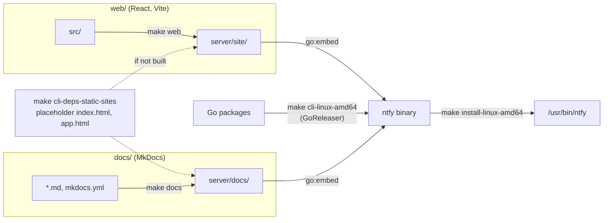
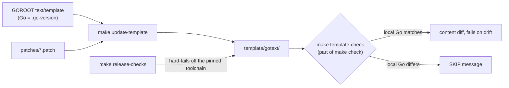

# Development

How to build, run and test ntfy from this repo, and the conventions the code follows. Run every
`make` target from the repo root; `make help` lists them all. The build is serial on purpose
(`MAKEFLAGS := --jobs=1`).

## How a build fits together



`server/site/` and `server/docs/` are embedded with `go:embed`, so any Go build fails if they do not
exist. Every `cli-*` target depends on `cli-deps-static-sites`, which creates placeholders; a binary
built that way serves a placeholder web UI. Run `make web` first when you need the real app.

## Local dev loop

```bash
make web cli-linux-amd64 install-linux-amd64 && ntfy serve   # full server with the real web app
make cli-deps-static-sites && CGO_ENABLED=1 go run main.go serve   # Go only, placeholder UI
cd web && npm start                                          # Vite dev server on :3000
```

The server listens on http://localhost:2586/ by default (`listen-http: :2586`).

**Stale service worker trap.** The web app registers a PWA service worker. In a persistent browser
profile an old worker and its caches keep serving a stale bundle, sometimes with confusing
`localhost:3000` errors while you are on :2586. Before testing web changes, unregister the worker
and clear site storage (DevTools, Application tab), or use a fresh profile.

## Targets

| Group | Target | What it does |
|-------|--------|--------------|
| Everyday | `make cli-linux-amd64` | Fast dev build: GoReleaser snapshot, Linux amd64, no web app or docs |
| | `make install-linux-amd64` | Copy that binary to `/usr/bin/ntfy` (sudo) |
| | `make web` / `make docs` | Build the web app into `server/site/` / the docs into `server/docs/` |
| | `make build` | `web docs cli`: everything, slow |
| | `make clean` | Remove `dist`, `build`, `server/docs`, `server/site` |
| Tests | `make check` | The full gate: tests, format checks, vet, lints, staticcheck, `template-check`, `go-check` |
| | `make test` / `cli-test` / `web-test` | Go and web tests / Go only / Vitest only |
| | `make race`, `make coverage` | Go tests with `-race`; coverage summary |
| | `make web-e2e` | Playwright end-to-end tests against a fresh local server |
| Lint and format | `make fmt` / `fmt-check` | Prettier and `gofmt -s` / check only |
| | `make vet`, `lint`, `staticcheck` | `go vet`, `golint`, `staticcheck` (no golangci-lint config) |
| | `make web-lint`, `web-fmt-check` | ESLint and Prettier for `web/src/` |
| Cross builds | `make cli` | All architectures via GoReleaser |
| | `make cli-linux-{armv6,armv7,arm64}`, `cli-windows-amd64`, `cli-darwin-all` | Single targets (need the matching cross compiler) |
| | `make cli-linux-server`, `cli-darwin-server`, `cli-client` | Plain `go build` without GoReleaser; `cli-client` is `-tags noserver` |
| Dependencies | `make build-deps-ubuntu` | apt-install cross compilers, python3, jq |
| | `make web-deps`, `docs-deps`, `cli-deps` | `npm ci`, the docs venv, GoReleaser and compiler checks |
| | `make update` | Update web, Go and docs dependencies |
| Release | `make release-checks` | Pinned Go toolchain, latest tag in `docs/install.md` and `docs/releases.md`, clean tree |
| | `make release` / `release-snapshot` | Full pipeline and `goreleaser release` / snapshot only |

## Vendored `text/template`

`template/gotext/` is a patched copy of the standard library's `text/template`, pinned to the Go
version in `.go-version`.



`make go-check` is advisory: it warns when a newer upstream Go exists, and never fails.

## Testing

Bug fixes and features follow red/green TDD: write the test first, run it and watch it fail, then
implement until it passes. A test that passes before the change proves nothing.

| Convention | Detail |
|------------|--------|
| Location | Colocated with the code: `server/topic_test.go`, `web/src/app/Api.test.js` |
| Shape | Table-driven (`tests := []struct{...}` plus `t.Run`), `t.Parallel()` where safe |
| Assertions | `require.*` aborts the test, `assert.*` is a soft check |
| Setup and cleanup | Helpers call `t.Helper()` (e.g. `newTestServer(t)`); cleanup via `t.Cleanup()` |
| Shared helpers | `test/` (`WaitForPortUp`, server bring-up); it is a helper package, excluded from `make test` along with `examples/` and `tools/` |
| Race-sensitive tests | Gated by build tag: `server/server_race_on_test.go`, `server_race_off_test.go` |

## Web app conventions (`web/`)

React, Vite, MUI, Dexie (IndexedDB) and i18next.

| Rule | Detail |
|------|--------|
| Lint and format | ESLint (`airbnb` + `prettier`, `web/.eslintrc`); Prettier `printWidth: 140` |
| Style | Arrow functions for functions and components; hooks, no class components |
| Banned | `for...in`, labels, `with`; `no-await-in-loop` is an error; avoid new import cycles |
| Data access | Through the service layer (`Api.js`, `AccountApi.js`, `SubscriptionManager`, `Prefs`), not raw `fetch` in components |
| Translations | Edit only `web/public/static/langs/en.json`; every other language comes from Hosted Weblate. New UI strings need an `en.json` key |
| MUI icons | MUI v9 dropped the legacy `*Outline` icons: use `*OutlineOutlined`, not `*Outlined` (which can resolve to the filled glyph) |

See [web-app.md](web-app.md) for how the app itself works.
