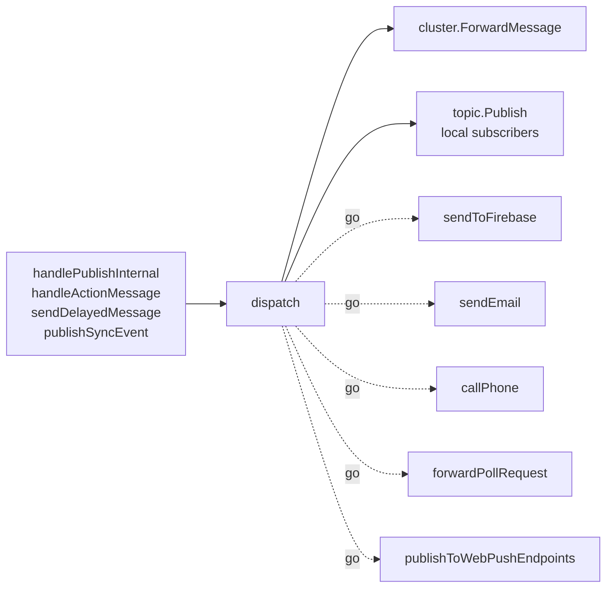

# Integrations

Everything the ntfy server talks to that is not a ntfy client: Firebase Cloud Messaging (Android and iOS push), Web
Push via VAPID (browsers), the Matrix Push Gateway plus UnifiedPush, email in both directions (an embedded SMTP server
for inbound mail, an SMTP client for outbound mail), Twilio (voice calls and phone number verification), Stripe
(tiers and billing), and attachment storage (local disk or S3-compatible object storage). Message templates and action
buttons are not external services, but they are the untrusted-input surfaces that integrations feed, so they are
covered here too.

Every integration is optional and switched on by a config key being non-empty; a server with none of them set is a
fully functional ntfy. All paths are relative to this repo. The iOS-specific push path is documented separately in
[ios-push-architecture.md](ios-push-architecture.md).

## Dispatch overview

Every published message passes through one choke point, `dispatch` in `server/server.go`. It forwards the message to
cluster peers, delivers it to local subscribers, and then fires the side-effect targets selected by `dispatchOpts`
(`server/types.go`). Each target runs in its own goroutine, so a slow or dead integration never stalls the publisher.



| Target | Fires when | Function |
|---|---|---|
| Firebase | `s.firebaseClient != nil && opts.firebase` | `sendToFirebase` (`server/server.go`) |
| Email | `s.mailer != nil && opts.email != ""` | `sendEmail` (`server/server.go`) |
| Twilio call | `s.config.TwilioAccount != "" && opts.call != ""` | `callPhone` (`server/server_twilio.go`) |
| Upstream poll request | `s.config.UpstreamBaseURL != "" && opts.upstream` | `forwardPollRequest` (`server/server.go`) |
| Web Push | `s.config.WebPushPublicKey != "" && opts.webPush` | `publishToWebPushEndpoints` (`server/server_webpush.go`) |

Which options each caller sets:

| Caller | firebase | email / call | upstream | webPush |
|---|---|---|---|---|
| `handlePublishInternal` (normal publish) | from `X-Firebase` (default on; off for UnifiedPush) | from `X-Email` / `X-Call` | `!unifiedpush` | yes |
| `handleActionMessage` (delete / clear) | yes | no | no | yes |
| `sendDelayedMessage` (scheduled messages) | yes | no (delayed messages cannot carry them) | yes | yes |
| `publishSyncEvent` (account sync topic) | no | no | no | no |

Peers that receive a forwarded message (`deliverFromBus`, `server/server_cluster.go`) only publish locally; all side
effects already ran on the origin node. Failures in the side-effect goroutines are logged and counted in metrics, never
returned: a publish returns HTTP 200 even if FCM, Twilio and the mailer all failed.

## Firebase Cloud Messaging

FCM is how the Android app (Play flavor) and the iOS app get push. The server holds no device tokens: it publishes to
an FCM topic whose name is the ntfy topic name (`Topic: m.Topic` in `toFirebaseMessage`), and the apps subscribe to
those FCM topics themselves. There are therefore no tokens to prune on the server side.

### Config

| Key | Meaning |
|---|---|
| `firebase-key-file` | Path to the Firebase service account JSON. Non-empty enables FCM; the file must exist (`cmd/serve.go`). |
| `FirebaseKeepaliveInterval` | `~control` keepalive interval, default 3h (`server/config.go`, no CLI flag) |
| `FirebasePollInterval` | `~poll` interval, default 20m (`server/config.go`, no CLI flag; currently unused, see below) |
| `FirebaseQuotaExceededPenaltyDuration` | Visitor lockout after a quota error, default 10m (`server/config.go`, no CLI flag) |

FCM support compiles out with the `nofirebase` build tag: `server/server_firebase_dummy.go` is the stub, and
`cmd/serve.go` rejects `firebase-key-file` in such a build.

### Code path

`sendToFirebase` (`server/server.go`) -> `firebaseClient.Send` -> `toFirebaseMessage` -> `firebaseSenderImpl.Send`
(all in `server/server_firebase.go`). The `firebaseSender` interface exists so tests can inject a mock. On a failed
HTTP response, `firebaseSenderImpl.Send` wraps the error in `firebaseSendError`, which carries the HTTP status,
`Retry-After` and a truncated body as log fields, so different 429s can be told apart in logs.

### Payload shape

`toFirebaseMessage` switches on `m.Event` and builds a flat `map[string]string` in `Data`, plus an APNs config:

| Event | Data fields | APNs config |
|---|---|---|
| `keepalive`, `open` | id, time, event, topic | background |
| `poll_request` | id, time, event, topic, message (`newMessageBody`), poll_id | alert |
| `message_delete`, `message_clear` | id, time, event, topic, sequence_id | background |
| `message` | id, time, event, topic, sequence_id, priority, tags (comma-joined), click, icon, title, message, content_type, encoding; optional actions (JSON), attachment_*, poll_id | alert |

Everything goes into `Data` as strings because Android receives data messages and renders the notification itself.
iOS cannot receive data-only messages, so `createAPNSAlertConfig` also sets `aps.alert` (title and a truncated body)
and `mutable-content`, so the iOS Notification Service Extension can rewrite it. `createAPNSBackgroundConfig` sets
`apns-push-type: background`, `apns-priority: 5` and `content-available`. Priority 4 and up sets
`AndroidConfig.Priority = "high"`.

### Size caps

Two best-effort truncations, both in `server/server_firebase.go`:

- `maybeTruncateFCMMessage` marshals the whole `messaging.Message` to JSON; if it exceeds `fcmMessageLimit` (4000
  bytes), it cuts the `message` field by the overage plus 16 bytes and sets `truncated: "1"`. The code comment admits
  the real FCM limit semantics were never pinned down, so it just caps the serialized JSON.
- `maybeTruncateAPNSBodyMessage` caps the APNs alert body at `fcmApnsBodyMessageLimit` (100) with a `...` suffix,
  because the body duplicates the message and would otherwise count twice against the 4 KB APNs payload limit. APNs
  silently drops payloads over that limit.

Both cut by bytes, not runes, so a multi-byte character at the cut point can produce invalid UTF-8. Action buttons are
serialized into `data.actions` as JSON, a common reason a message crosses the cap and gets its body truncated.
`DefaultMessageSizeLimit` is 4096 bytes (`server/config.go`) because FCM and APNs cap around 4 KB.

### Poll request fallback

Two situations replace the real message content with a `poll_request`:

1. **Restricted read.** If a `user.Auther` is configured and anonymous read is denied on the topic,
   `toFirebaseMessage` converts the message with `toPollRequest`, so message content never travels through Google's
   infrastructure for a topic anonymous users cannot read. `toPollRequest` keeps only ID, time, priority, content type
   and encoding, and sets `PollID`; the client then fetches the message over authenticated HTTP. The data map still
   carries every field, because the iOS decoder fails on a partial payload (see the comment in `toFirebaseMessage`
   and [PR #1345](https://github.com/binwiederhier/ntfy/pull/1345)).
2. **Self-hosted iOS.** If `upstream-base-url` is set, `forwardPollRequest` (`server/server.go`) POSTs an empty body to
   `<upstream-base-url>/<sha256(topic URL)>` with an `X-Poll-ID` header and a 10s timeout. The upstream server pushes a
   poll request through its own Firebase project, and the iOS app fetches the message from the self-hosted server.
   `upstream-access-token` is sent as a bearer token to raise the upstream rate limit; a 429 from upstream logs a
   warning that suggests exactly that. See [ios-push-architecture.md](ios-push-architecture.md) for the full flow.

`cmd/serve.go` requires `upstream-base-url` to start with `http://` or `https://`, have no trailing slash, come with a
`base-url`, and differ from `base-url` (identical values would loop).

UnifiedPush messages skip FCM: `parsePublishParams` sets `firebase = false` when `up=1` is set or the body has
`Content-Encoding: aes128gcm`.

### Keepalive topics

`runFirebaseKeepaliver` (`server/server.go`) publishes to two magic topics, `firebaseControlTopic` (`~control`) and
`firebasePollTopic` (`~poll`):

- `~control` every `FirebaseKeepaliveInterval`, which restarts the Android foreground service if it died (e.g. after an
  app update). In a cluster only the leader sends it, checked on every tick so it survives a failover.
- `~poll` is commented out (FIXME referencing [#677](https://github.com/binwiederhier/ntfy/issues/677), a thundering
  herd problem). Apple allows only a few background pushes per hour, with no delivery guarantee.

Both topic names are hardcoded in the Android and iOS apps; changing them breaks every installed client.

### Failure handling

`firebaseSenderImpl.Send` maps `messaging.IsQuotaExceeded` to `errFirebaseQuotaExceeded`. `firebaseClient.Send` then
calls `v.FirebaseTemporarilyDeny()` (`server/visitor.go`), which consumes the visitor's Firebase limiter token for
`FirebaseQuotaExceededPenaltyDuration`; later sends short-circuit with `errFirebaseTemporarilyBanned` while
`FirebaseAllowed()` is false. The quota is usually per FCM topic, but the penalty is per visitor, a deliberately blunt
instrument. `sendToFirebase` logs the banned case at Debug and everything else at Warn. Metrics:
`FirebasePublishedSuccess` / `FirebasePublishedFailure` (`metrics/`). An FCM outage is invisible to publishers (HTTP 200,
no delivery); watch the failure metric.

## Web Push (VAPID)

Browser push for the web app, delivered directly to the browser vendor's push service with VAPID auth. Compiles out
with the `nowebpush` build tag (`server/server_webpush_dummy.go`).

### Config

| Key | Meaning |
|---|---|
| `web-push-public-key` | VAPID public key; non-empty enables the feature |
| `web-push-private-key` | VAPID private key |
| `web-push-file` | SQLite file for subscriptions; must not be set when `database-url` is set (Postgres is used then) |
| `web-push-email-address` | VAPID `Subscriber` contact, required by push services |
| `web-push-startup-queries` | SQLite statements run at startup |
| `web-push-expiry-duration` | Delete subscriptions not refreshed for this long, default 60d (`server/config.go`) |
| `web-push-expiry-warning-duration` | Send an expiry warning after this long, default 55d (`server/config.go`) |

Generate keys with `ntfy webpush keys`. `cmd/serve.go` requires public key, private key, storage, email address and
`base-url` together.

### Storage

`webpush.Store` (`webpush/store.go`) runs over SQLite (`webpush/store_sqlite.go`) or Postgres
(`webpush/store_postgres.go`); `server.New` picks Postgres when a `database-url` pool exists. Two tables:

- `subscription`: id (`wps_` plus 10 random characters), endpoint (unique index), `key_auth`, `key_p256dh`, `user_id`,
  `subscriber_ip`, `updated_at`, `warned_at`.
- `subscription_topic`: (subscription_id, topic), indexed by topic.

`UpsertSubscription` runs in one transaction: count subscriptions for the subscriber IP, reject a new endpoint with
`ErrWebPushTooManySubscriptions` once `subscriptionEndpointLimitPerSubscriberIP` (10) is reached, upsert the row and read
back the real ID (a race on the same endpoint is resolved by the unique index), then delete and re-insert all topic
rows. Topic lists are replaced wholesale, never merged. The stored subscriber IP is masked with `vis.Mask` (the same
prefix used by the other visitor limits), so the per-IP cap covers a whole prefix.

### Endpoint allow-list

`webPushAllowedEndpointsRegexes` (`server/server_webpush.go`) is a host-level allow-list: `fcm.googleapis.com`,
`jmt17.google.com`, `updates.push.services.mozilla.com`, `*.mozaws.net`, `web.push.apple.com`, `*.notify.windows.com`.
Each regex anchors the `https://` scheme and ends at `/`, and wildcard labels are `[^/]+`, so a wildcard cannot span
into the path. This is the fix for GHSA-w9hq-5jg7-q4j7 (a loose host wildcard allowed SSRF); do not loosen it without
re-reading that advisory.

### Request handling

| Method | Path | Handler | Notes |
|---|---|---|---|
| POST | `/v1/webpush` | `handleWebPushUpdate` | Requires `endpoint`, `p256dh`, `auth`; endpoint must be allow-listed; at most `webPushTopicSubscribeLimit` (50) topics; checks `PermissionRead` on every topic |
| DELETE | `/v1/webpush` | `handleWebPushDelete` | Removes by endpoint, no auth; knowing the endpoint is sufficient proof |

Both are wrapped in `ensureWebPushEnabled` and `limitRequests` in `server/server.go`.

### Browser side

The web app registers a service worker; `Notifier.webPushSubscription` (`web/src/app/Notifier.js`) reuses
`pushManager.getSubscription()` or calls `pushManager.subscribe({ userVisibleOnly: true, applicationServerKey })`,
but only when there is at least one topic to subscribe to. `SubscriptionManager.updateWebPushSubscriptions`
(`web/src/app/SubscriptionManager.js`) then sends the full topic list, or deletes the subscription when the list is
empty. `web/public/sw.js` dispatches on the payload's `event` field (`message` with an inner message, delete, clear,
or `subscription_expiring`). A stale service worker is the most common source of confusing behavior when testing
locally; clear it and the caches first.

### Delivery and pruning

`publishToWebPushEndpoints` loads all subscriptions for the topic, marshals one payload and loops. The payload is
`webPushPayload` (`server/types.go`): `{event, subscription_id, message}`. Note the quirk: `subscription_id` is the
topic URL `<base-url>/<topic>`, not a `wps_` ID; the web app uses it to route the notification to its local
subscription.

`sendWebPushNotification` sends with `UrgencyHigh` (iOS requires it for delivery), `TTL = CacheDuration`, and a shared
HTTP client with a 15s timeout (`webPushRequestTimeout`). Outcomes:

| Result | Action |
|---|---|
| `*url.Error` (timeout, network error) | Keep the subscription; the push service may be temporarily down |
| Any other send error | Delete the subscription by endpoint |
| Non-2xx status other than 429 | Delete the subscription by endpoint |
| 429 | Keep; a rate-limiting push service must not wipe out every subscription behind it |

The response body is drained (up to 4096 bytes) and closed, so connections are reused.

`pruneAndNotifyWebPushSubscriptions` runs from the manager loop (`server/server_manager.go`, cluster leader only):
delete subscriptions not updated within `WebPushExpiryDuration`, then send a `subscription_expiring` control message to
those older than `WebPushExpiryWarningDuration` and mark `warned_at`. The warning query filters on `warned_at = 0`, so a
subscription is warned once; the web app refreshing its subscription resets both fields. The expiry sweep also removes
orphaned `subscription_topic` rows.

## Matrix and UnifiedPush

ntfy is both a Matrix Push Gateway and, via UnifiedPush, the push provider. The ASCII diagram at the top of
`server/server_matrix.go` maps the roles. There are no config keys of its own; it needs only `base-url`.

### Endpoints

| Method | Path | Handler |
|---|---|---|
| GET | `/_matrix/push/v1/notify` | `handleMatrixDiscovery`: returns `{"unifiedpush":{"gateway":"matrix"}}` (`writeMatrixDiscoveryResponse`) |
| POST | `/_matrix/push/v1/notify` | `transformMatrixJSON` -> `limitRequestsWithTopic` -> `authorizeTopicWrite` -> `handlePublishMatrix` |

### Pushkey handling

`newRequestFromMatrixJSON` peeks the body up to `MessageSizeLimit`, parses `notification.devices[0].pushkey`, and
rewrites the request into an ordinary ntfy publish POST to that pushkey URL, with the original JSON as the message
body. Only the first device is used ([#316](https://github.com/binwiederhier/ntfy/issues/316)). The rewritten path must
match `topicPathRegex`, because the pushkey bypasses the router's own topic check. `X-Forwarded-For` is carried over
and the pushkey is stored in the request context as `contextMatrixPushKey`.

The key validation is `strings.HasPrefix(pushKey, baseURL+"/")`. Anything else yields `errMatrixPushkeyRejected`, and
`transformMatrixJSON` answers HTTP 200 with the pushkey listed in `rejected`, which tells the homeserver to stop using
it. A 4xx here would make the homeserver retry instead. `matrixResponse.Rejected` is always a non-nil array.

### Rejected pushkeys for abandoned UnifiedPush topics

With `visitor-subscriber-rate-limiting` on, UnifiedPush topics (`up` prefix, `unifiedPushTopicLength` = 14 characters,
`isUnifiedPushTopic` in `server/server_rate_visitor.go`) are rate limited against the subscriber, not the publisher. A
push to such a topic without a live rate visitor is refused in `handlePublishInternal`:

| Condition | Response |
|---|---|
| No subscriber activity on any node for `unifiedPushAbandonedAfter` (4 days, `unifiedPushTopicAbandoned`) | 410 `errHTTPGoneUnifiedPushTopicAbandoned`, so app servers delete the subscription |
| Otherwise | 507 `errHTTPInsufficientStorageUnifiedPush` (a 5xx, because some app servers such as Mastodon drop a subscription on most 4xx codes) |

`handlePublishMatrix` turns the 410 into HTTP 200 with the pushkey in `rejected`; every other error is returned as is
(a 507 is transient to the homeserver). `unifiedPushAbandonedAfter` must stay below the topic row's prune age (7 days,
see the constant's comment), which is what ends the 410s. Metrics: `MatrixPublishedSuccess` / `MatrixPublishedFailure`.

UnifiedPush messages (`up=1` or `Content-Encoding: aes128gcm`) also disable Firebase and are not forwarded upstream
(`parsePublishParams`, `handlePublishInternal`).

## Email

Two independent directions with separate config and code.

### Inbound: the SMTP server

An embedded SMTP server ([go-smtp](https://github.com/emersion/go-smtp)) turns received mail into published messages.
`runSMTPServer` (`server/server.go`) wires `smtpBackend` (`server/smtp_server.go`) to `s.handle`, the same HTTP handler
chain real requests use.

| Key | Meaning |
|---|---|
| `smtp-server-listen` | e.g. `:25`; non-empty enables |
| `smtp-server-domain` | Domain of the recipient addresses, required with listen |
| `smtp-server-addr-prefix` | Optional prefix, e.g. `ntfy-`, to make addresses harder to guess |

Hardcoded server settings in `runSMTPServer`: 10s read and write timeouts, `MaxMessageBytes` 1 MB (much larger than the
message size limit, to leave room for headers and MIME parts), `MaxRecipients` 1, `AllowInsecureAuth` true.

**Address format**, parsed in `smtpSession.Rcpt`:

```
[<prefix>]<topic>[+<token>]@<smtp-server-domain>
```

The domain must match (`errInvalidDomain`), the prefix must match if configured (`errInvalidAddress`), anything after
`+` is an access token, and the rest must match `topicRegex` (`errInvalidTopic`). More than one address yields
`errTooManyRecipients`.

**Body extraction** (`readMailBody`): no `Content-Type` means plain text; `text/plain` and `text/html` are read
directly; `multipart/*` is walked, preferring `text/plain` over `text/html`. Nesting at `maxMultipartDepth` (2) is
rejected. `base64` and `quoted-printable` transfer encodings are decoded. HTML bodies get `<br>` turned into newlines
first (so appliance mails keep their line breaks), are stripped with `bluemonday.StrictPolicy()`, and then have extra
empty lines collapsed (`readHTMLMailBody`, `removeExtraEmptyLines`).

In `smtpSession.Data`, CRLF is normalized to LF, the body is trimmed and truncated to `MessageSizeLimit` bytes, and the
`Subject` header is MIME-word-decoded into the title. If there is a title but no body, they are swapped, so a
subject-only mail becomes the message.

`publishMessage` builds a synthetic `POST <base-url>/<topic>`, sets `RemoteAddr` and the configured
`ProxyForwardedHeader` from the SMTP peer (so rate limiting applies normally), turns the `+token` into
`Authorization: Bearer` or a prior `AUTH PLAIN` into `Authorization: Basic`, and runs it through
`httptest.NewRecorder`. A 503 (the server is draining) becomes `errSMTPServiceUnavailable` so the sender retries; any
other non-200 becomes an SMTP error.

Most failures are user input, so `withFailCount` logs them at Debug and counts `EmailsReceivedFailure`; watch the
metric rather than the logs. Session state (topic, token, basic auth) is mutex-protected and cleared on
`Reset`/`Logout`. Exposing `:25` to the internet means the prefix is the main protection against address guessing.

### Outbound: notification and account email

`mail.Sender` (`mail/sender.go`) sends three kinds of mail: notification emails (the `X-Email` publish parameter),
email verification links, and password reset links.

| Key | Meaning |
|---|---|
| `smtp-sender-addr` | `host:port`; non-empty enables |
| `smtp-sender-user` / `smtp-sender-pass` | Optional auth |
| `smtp-sender-from` | Sender address, required with addr |
| `smtp-sender-verify` | Only allow sending to addresses the user has verified |

`sendRaw` is a plain `net/smtp.SendMail`: synchronous, no retry, no pooling, no queue. It is called from the dispatch
goroutine, and a failure is logged once and dropped. Auth is `plainOrLoginAuth`: PLAIN, or LOGIN when the server offers
only LOGIN (e.g. Outlook), see [#930](https://github.com/binwiederhier/ntfy/issues/930); PLAIN's TLS and host checks
always run first.

Notification format (`formatMail`, `mail/format.go`): the subject is the title, falling back to the message, with
CR/LF flattened; tags found in `mail/mailer_emoji_map.json` are prepended to the subject as emoji, the rest become a
`Tags:` trailer; a non-default priority adds a `Priority:` trailer; an attachment is linked (not attached) with its name
and expiry; the footer is `This message was sent by <ip> at <time> via <topicURL>`. The `From` display name is the
shortened topic URL, so mail clients group by topic. The subject is B-encoded UTF-8.

Recipient resolution (`convertEmailAddress`, `server/server_account.go`), called from `handlePublishInternal`:

| `X-Email` value | Result |
|---|---|
| Boolean (`yes`, `true`, `1`) | The user's primary verified address, else the first verified one; anonymous publishers are rejected |
| Literal address, `smtp-sender-verify` off (default) | Sent as is |
| Literal address, `smtp-sender-verify` on | Must be one of the user's verified addresses; anonymous publishers are rejected |

The literal address must also match the deliberately loose `emailAddressRegex` (`^[^\s,;]+@[^\s,;]+$`,
`server/server.go`). Email sends are rate limited per visitor via `visitor-email-limit-burst` (default 16) and
`visitor-email-limit-replenish` (default 1h). Delayed messages cannot carry an email or a call
(`errHTTPBadRequestDelayNoEmail`, `errHTTPBadRequestDelayNoCall`), because the address is not persisted.

Verification and reset mails are plain text with 24h and 1h expiries stated in the copy (`SendEmailVerification`,
`SendPasswordReset`); the token state lives in the user database, not in the sender. Stripe checkout has a side channel
into this: `maybeEnqueueBillingEmailVerification` (`server/server_payments.go`) sends a verification link to the
billing email if the user has no verified email yet and the address is not primary on another account. It is
best-effort and skipped for provisioned users.

## Twilio

Twilio powers the call feature (`X-Call`) and phone number verification. There is no SMS notification delivery; SMS is
only one of the two verification channels. The HTTP client lives in the `twilio/` package (`twilio/client.go`,
`twilio/types.go`); the server glue is `server/server_twilio.go` and the phone endpoints in `server/server_account.go`.

| Key | Meaning |
|---|---|
| `twilio-account` | Account SID; non-empty enables |
| `twilio-auth-token` | Auth token |
| `twilio-phone-number` | Outgoing caller ID |
| `twilio-verify-service` | Verify service SID |
| `twilio-call-format` | Optional TwiML override, parsed as a Go `text/template` at startup |
| `TwilioCallsBaseURL` / `TwilioVerifyBaseURL` | `https://api.twilio.com` / `https://verify.twilio.com`, overridden only in tests (`server/config.go`) |

`cmd/serve.go` requires account, token, phone number, verify service, `base-url`, and a user database together; calls
are for authenticated users only.

### Calls

`parsePublishParams` reads `X-Call` and rejects it if Twilio or the user manager is missing, or if the value is neither
a boolean nor matches `phoneNumberRegex` (`^\+\d{1,100}$`). `convertPhoneNumber` (`server/server_twilio.go`) then
enforces the real rule: anonymous callers are rejected (`errHTTPBadRequestAnonymousCallsNotAllowed`), and the number
must be one of the user's verified numbers; a boolean picks the first verified number. Unverified numbers get
`errHTTPBadRequestPhoneNumberNotVerified`. Calls cost the operator money, so an unverified number is never dialed. The
per-visitor call limit (`vrate.CallAllowed()`, the tier's `CallLimit`) is checked right after.

`callPhone` passes a `twilio.CallData` to `Client.Call`, which renders the TwiML from `defaultCallFormatTemplate` or the
configured override and POSTs form-encoded `From`/`To`/`Twiml` to
`<calls-base-url>/2010-04-01/Accounts/<account>/Calls.json` with basic auth. Every string field is XML-escaped by
`CallData.escaped()` (`xmlEscapeText`) before the template runs, because TwiML is XML and an unescaped message would be
an injection vector. This is `text/template`, not `html/template`, so the escaping is the only defense; a custom
`twilio-call-format` that adds raw markup around the fields is the operator's responsibility. Any non-2xx response
(Twilio returns 201 for a queued call) is an error. Failures are logged and counted (`CallsMadeFailure`), never returned
to the publisher.

### Phone verification

| Method | Path | Handler | Twilio call |
|---|---|---|---|
| PUT | `/v1/account/phone/verify` | `handleAccountPhoneNumberVerify` | `Client.Verify`: POST `To`, `Channel` (`sms` or `call`) to `/v2/Services/<service>/Verifications` |
| PUT | `/v1/account/phone` | `handleAccountPhoneNumberAdd` | `Client.CheckVerify`: POST `To`, `Code` to `/v2/Services/<service>/VerificationCheck` |
| DELETE | `/v1/account/phone` | `handleAccountPhoneNumberDelete` | none |

Requesting a code requires a user whose tier allows calls (`CallLimit > 0`; admins pass). `CheckVerify` maps a 404
to `ErrVerificationExpired` (`errHTTPGonePhoneVerificationExpired`), and a 200 whose `status` is not `approved` to
`ErrVerificationCodeInvalid`, because Twilio answers a wrong code with 200 too. Only then is the number stored as
verified.

## Stripe

Payments live in `server/server_payments.go` (handlers, compiled out with the `nopayments` build tag, stub in
`server/server_payments_dummy.go`) and `payments/payments.go` (a small shim that sets `stripe.Key` and disables
telemetry). The design principle, from the comment at the top of `server/server_payments.go`: Stripe is the source of
truth; what Stripe says is mirrored and not questioned. All Stripe calls go through the `stripeAPI` interface so tests
can use a mock.

| Key | Meaning |
|---|---|
| `stripe-secret-key` | API key; non-empty enables payments |
| `stripe-webhook-key` | Webhook signing secret, required with the secret key |
| `billing-contact` | Email or website shown in the upgrade dialog |
| `StripePriceCacheDuration` | In-memory price cache TTL, default 3h (`server/config.go`, no CLI flag) |

`cmd/serve.go` requires the webhook key and `base-url` with the secret key, an auth database (`auth-file` or
`database-url`), and rejects both keys in a `nopayments` build.

### Tiers and prices

A `user.Tier` carries `StripeMonthlyPriceID` and `StripeYearlyPriceID`, set with
`ntfy tier add|change --stripe-monthly-price-id=... --stripe-yearly-price-id=...` (`cmd/tier.go` requires both or
neither). The mapping is by price ID, not product or subscription: `TierByStripePrice(priceID)` resolves the tier from
whatever price the subscription currently has.

`fetchStripePrices` lists all active prices into `map[priceID]unitAmountCents` behind a `util.LookupCache`
(`s.priceCache`); USD is implied. `handleBillingTiersGet` (`GET /v1/account/billing/tiers`) builds the upgrade dialog:
a synthetic "Free" tier with no code or price, built from the IP-based visitor limits, then every tier that has both a
monthly and a yearly price in the price cache. A tier missing either price is silently hidden, the usual cause of "my
new tier does not show up".

### Flows

| Flow | Method and path | Handler | Notes |
|---|---|---|---|
| Checkout | POST `/v1/account/billing/subscription` | `handleAccountBillingSubscriptionCreate` | Rejects if the user has a subscription, or the existing Stripe customer still has one (`errMultipleBillingSubscriptions`); `AllowPromotionCodes` and `AutomaticTax` on; `ClientReferenceID` = ntfy user ID |
| Checkout success | GET `/v1/account/billing/subscription/success/{CHECKOUT_SESSION_ID}` | `handleAccountBillingSubscriptionCreateSuccess` | The only place the ntfy user is mapped to the Stripe customer; writes `user_id`/`user_name` into the customer metadata, updates tier and billing, then redirects to `/account` |
| Upgrade / downgrade | PUT `/v1/account/billing/subscription` | `handleAccountBillingSubscriptionUpdate` | Swaps the single line item's price with `ProrationBehavior` always-invoice; clears `CancelAtPeriodEnd` |
| Cancel | DELETE `/v1/account/billing/subscription` | `handleAccountBillingSubscriptionDelete` | Only sets `CancelAtPeriodEnd: true`; the tier changes when the deleted webhook arrives at period end |
| Billing portal | POST `/v1/account/billing/portal` | `handleAccountBillingPortalSessionCreate` | Requires a `StripeCustomerID`; returns the portal redirect URL |
| Webhook | POST `/v1/account/billing/webhook` | `handleAccountBillingWebhook` | Called by Stripe, see below |

Every flow assumes the subscription has exactly one line item; multi-item subscriptions created by hand in the Stripe
dashboard are rejected with `errHTTPBadRequestBillingRequestInvalid`.

### Webhooks

`handleAccountBillingWebhook` requires a `Stripe-Signature` header, peeks the body up to `jsonBodyBytesLimit`, and
verifies it with `webhook.ConstructEvent` and `stripe-webhook-key`. Exactly two event types are handled; anything else is
logged at Warn and acknowledged, so enabling more events in the Stripe dashboard only adds log noise.

| Event | Handler | Effect |
|---|---|---|
| `customer.subscription.updated` | `handleAccountBillingWebhookSubscriptionUpdated` | Find the user by customer ID, resolve the tier by price ID, mirror status, interval, paid-until and cancel-at, publish an account sync event |
| `customer.subscription.deleted` | `handleAccountBillingWebhookSubscriptionDeleted` | Reset the user's tier and clear the subscription fields (the customer ID is kept, so a later checkout reuses the customer) |

The updated webhook races the checkout success redirect: the redirect is what writes the customer ID onto the user,
and the webhook needs it to find the user. `util.Retry` over `retryUserDelays` (3s, 5s, 7s) covers that; if all
attempts fail, the webhook returns an error and Stripe's own retry eventually wins. An updated event that is not paying
(`incomplete`, `incomplete_expired`, `canceled`, see `stripeSubscriptionPaying`) for a different subscription than the
user's current one is ignored, so an abandoned second checkout expiring cannot replace a paid subscription.

`updateSubscriptionAndTier` is the single write path: it first calls `maybeRemoveMessagesAndExcessReservations`
(a downgrade must shed reserved topics over the new limit), then `ResetTier` or `ChangeTier`, then `ChangeBilling` with
the mirrored fields. Paid-until and cancel-at are written as `time.Unix(0, 0)`, not null, when absent.

A webhook that fails is retried by Stripe with backoff, so a transient lookup failure heals itself; a customer that is
never mapped (the success redirect never ran) keeps failing until Stripe gives up, and the user stays on the old tier.
The Stripe dashboard's webhook delivery log is the place to check.

## Attachment storage

Attachments are stored by one `attachment.Store` (`attachment/store.go`) over two interchangeable backends
implementing the `backend` interface (`attachment/backend.go`): the local file system (`attachment/backend_file.go`) and
S3-compatible object storage (`attachment/backend_s3.go`).

### Selecting the backend

One key decides: `attachment-cache-dir`. `createAttachmentStore` (`server/server.go`) selects `NewS3Store` if the value
starts with `s3://`, otherwise `NewFileStore` with the value as a directory. Empty disables attachments. A non-empty
value requires `base-url` (`cmd/serve.go`). The S3 URL format (`s3.ParseURL`, `s3/util.go`):

```
s3://ACCESS_KEY:SECRET_KEY@BUCKET[/PREFIX]?region=REGION[&endpoint=ENDPOINT][&disable_http2=true]
```

- `region` is required. Without `endpoint` the client targets `s3.<region>.amazonaws.com` with virtual-host addressing;
  with `endpoint` it forces path-style addressing.
- An endpoint without a scheme is assumed to be `https`; `http://` must be explicit. (`url.Parse` would misread a bare
  `host:port` as `scheme:opaque`, hence the manual handling.)
- `disable_http2=true` forces HTTP/1.1 (`newHTTP1Client` in `s3/client.go`), a workaround for HTTP/2 stream errors with
  some S3-compatible providers (the code comment names DigitalOcean Spaces).

`s3.Client` (`s3/client.go`) is a minimal hand-written client with SigV4 signing (`s3/client_auth.go`), not the AWS
SDK. The required IAM actions are listed in the `Client` doc comment: `ListBucket`, `ListBucketMultipartUploads`,
`GetObject`, `PutObject`, `DeleteObject`, `AbortMultipartUpload`.

Upload strategy (`Client.PutObject`): if the client's `Content-Length` is between 1 byte and `maxSinglePutSize` (5 GB),
the body is streamed in one PUT with `UNSIGNED-PAYLOAD` and no buffering, reading at most that many bytes. Otherwise the
first `partSize` (5 MB) is buffered (`s3/part_buffer.go`) to choose between a simple PUT and a multipart upload
(`s3/client_multipart.go`). Listing stops with an error after `maxPages` (500) pages; deletes are batched at
`maxDeleteBatchSize` (1000).

### Limits

| Key | Default (`server/config.go`) |
|---|---|
| `attachment-total-size-limit` | 5 GB |
| `attachment-file-size-limit` | 15 MB |
| `attachment-expiry-duration` | 3h |
| `AttachmentOrphanGracePeriod` (no CLI flag) | 1h |
| `visitor-attachment-total-size-limit` | 100 MB |
| `visitor-attachment-daily-bandwidth-limit` | 500 MB |

`Store.Write` validates the ID as a message ID (`model.ValidMessageID`), adds a fixed limiter for the store's remaining
capacity to the caller's limiters, and deletes the object on any write error, so a failed upload leaves nothing behind.

### Expiry and orphan cleanup

Two loops, deliberately decoupled:

1. **Database.** `pruneAttachments` (`server/server_manager.go`, cluster leader only) calls
   `MarkExpiredAttachmentsDeleted` in batches of `ManagerBatchSize`. It touches only database rows; `pruneMessages`
   likewise deletes only rows.
2. **Storage.** `Store.syncLoop` runs `sync()` at startup and then every `syncInterval` (15 minutes). `sync()` lists
   every object in the backend, deletes objects that are not in the database's active set and are older than the
   orphan grace period (the grace period protects in-flight uploads not yet committed to the database), and recomputes
   the total size from the database rather than from the listing. Objects whose key is not a valid message ID are
   skipped, never deleted, so unrelated files under the same prefix are safe. It then calls `DeleteIncomplete` to abort
   stale multipart uploads (a no-op on the file backend); a failure there is only logged.

Sizes are loaded from the database in `newStore`, so `Size()` and `Remaining()` are correct before the first sync.
Without an `attachmentsWithSizes` callback the sync loop never starts. On S3 the full listing runs every 15 minutes, so
a large bucket costs API calls; past 500 pages the listing fails and that sync round does nothing.

## Message templates

Templates turn a JSON webhook body (Grafana, GitHub, Alertmanager, ...) into a ntfy message. It is the main path by
which third-party JSON reaches a template engine, so the safety limits matter. Code: `server/server_template.go`.

Templating is selected with `X-Template` / `template` / `tpl` (`parsePublishParams`) and modeled by `templateMode`
(`server/types.go`):

- **Inline** (a boolean value, `renderTemplateFromParams`): the `message`, `title` and `priority` parameters are
  themselves templates.
- **File** (any other value, `renderTemplateFromFile`): `tpl=grafana` loads `grafana.yml`, a YAML file with optional
  `message`, `title` and `priority` templates. The name must match `templateNameRegex` (`^[-_A-Za-z0-9]+$`), so no path
  traversal. The embedded `server/templates/` directory (`alertmanager.yml`, `github.yml`, `grafana.yml`) is read
  first; a non-empty file of the same name in `template-dir` overrides it. If the file has no `priority`, the request's
  priority parameter is rendered instead.

Rendering uses `template/gotext`, a vendored copy of Go's `text/template` with two patches (`template/gotext/patches/`):
`ExecuteContext` for cancellation and `PrintCheck` to vet values before printing. `template/gotext/README.md` explains
why and how to update it. The function map is `template/sprig` (a vendored Sprig, `TxtFuncMap`).

### Safety limits

| Limit | Value | Where |
|---|---|---|
| Execution deadline | 100 ms (`templateMaxExecutionTime`) | `renderTemplate`, via `context.WithTimeout` derived from the request context |
| Output | 1 MB (`templateMaxOutputBytes`) | `util.NewLimitWriter` in `renderTemplate` |
| Template size | 32 KB (`templateMaxTemplateBytes`) | `renderTemplate` |
| Input body | max(`MessageSizeLimit`, `jsonBodyBytesLimit` = 128 KB) | `handleBodyAsTemplatedTextMessage` |
| Printed values | depth 100, about 256 KB expanded, no cycles | `template.CheckPrintable` (`template/printable.go`) |
| Rendered title and message | `MessageSizeLimit` | `handleBodyAsTemplatedTextMessage` |

The execution deadline is the fix for GHSA-rhwf-xgc9-m9fp (runaway `{{range}}` loops); exceeding it returns
`errHTTPBadRequestTemplateExecutionTimeout`.

`templateUsesDisallowedFeatures` walks the parse tree, not the raw string, and rejects `{{define}}` / `{{block}}` /
`{{template}}` (more than one associated template, or a `*parse.TemplateNode`) and the builtins in
`templateDisallowedFuncs` (`call`, `html`, `js`, `urlquery`). Walking the tree is what catches forms like
`{{if call .x}}` or `{{$y := call .x}}`; if you extend the template feature set, extend `treeContainsDisallowedNode`
too.

A body that is not valid JSON returns `errHTTPBadRequestTemplateMessageNotJSON`. Output is trimmed, and literal `\n`
sequences left outside template actions become real newlines.

## Action buttons

`action.Parse` (`action/action.go`) accepts a JSON array (when the trimmed string starts with `[`) or the
human-readable simple format, parsed by a hand-written lexer modeled on Go's template lexer (`parseActionsFromSimple`):

```
view, "Look ma, commas and \"quotes\" too", url=https://..; action=broadcast, ...
```

Sections are comma-separated and actions semicolon-separated. Keyless sections are expanded by position
(`populateAction`): section 0 is `action`, section 1 is `label`, section 2 is `url` for view/http or `value` for copy.
`headers.*` and `extras.*` keys fill maps; `clear` must be a boolean.

Validation in `Parse`: at most `actionsMax` (3) actions; the action must be `view`, `broadcast`, `http` or `copy`;
`label` is always required; `url` is required for view and http; `value` is required for copy; `body` is rejected for
GET and HEAD. Each action gets a random 10-character ID, and the action and method are normalized to lower and upper
case. The simple parser rejects invalid UTF-8 and errors on an unterminated quote (`parseQuotedValue`). The server
reads actions from `X-Actions` / `actions` / `action` in `parsePublishParams` and wraps parse errors in
`errHTTPBadRequestActionsInvalid`. Actions are carried in the FCM `data.actions` field as JSON (see the size caps
above).

## iOS and APNs

The server never talks to APNs directly. Everything goes through FCM, which relays to APNs, so the server-side APNs
surface is just the `messaging.APNSConfig` built by `createAPNSAlertConfig` and `createAPNSBackgroundConfig` (see
Firebase above). Self-hosted servers reach the App Store app through `upstream-base-url`. The full flow (registration,
FCM topic naming, the Notification Service Extension, poll requests and event handling on the device) is in
[ios-push-architecture.md](ios-push-architecture.md).
