# Integrations

Everything the ntfy server talks to that is not a ntfy client: Firebase Cloud Messaging (Android and iOS), Web Push
(browsers), the Matrix Push Gateway and UnifiedPush, email in both directions, Twilio (calls and phone verification),
Stripe (billing) and attachment storage (local disk or S3). Templates and action buttons are covered at the end,
because they are the untrusted-input surfaces that integrations feed.

Every integration is optional and switched on by a non-empty config key. Paths are relative to the repo root. The
iOS push path in depth is in [ios.md](ios.md#push-delivery).

## Dispatch overview

Every published message goes through `dispatch` (`server/server.go`). It forwards to cluster peers, delivers to local
subscribers, then starts one goroutine per side-effect target selected by `dispatchOpts` (`server/types.go`). A slow
or dead integration never stalls the publisher, and its failure is never returned: the publish still answers 200.

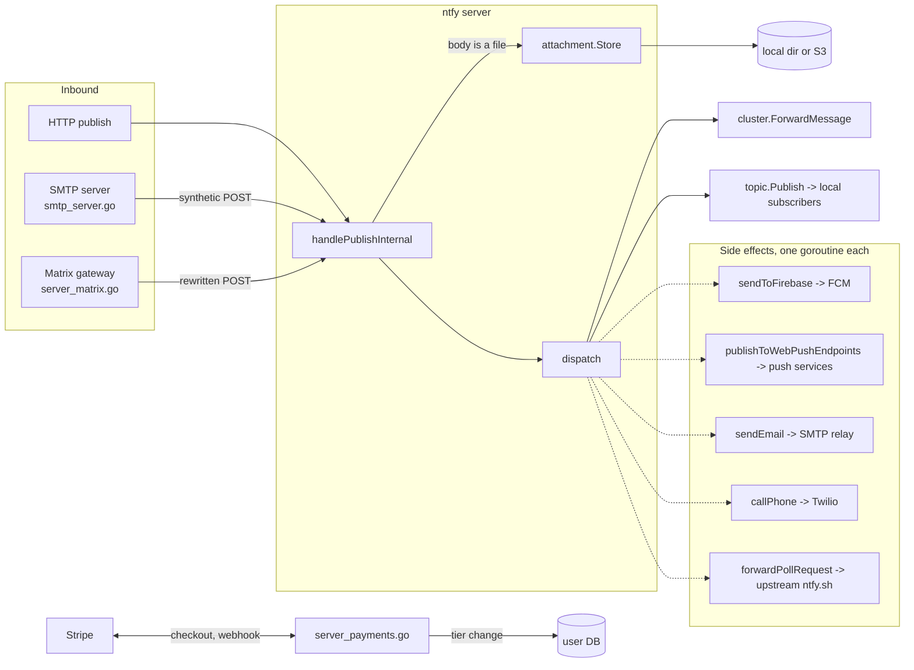

| Target | Fires when | Function |
|---|---|---|
| Firebase | `s.firebaseClient != nil && opts.firebase` | `sendToFirebase` (`server/server.go`) |
| Email | `s.mailer != nil && opts.email != ""` | `sendEmail` (`server/server.go`) |
| Twilio call | `TwilioAccount != "" && opts.call != ""` | `callPhone` (`server/server_twilio.go`) |
| Upstream poll request | `UpstreamBaseURL != "" && opts.upstream` | `forwardPollRequest` (`server/server.go`) |
| Web Push | `WebPushPublicKey != "" && opts.webPush` | `publishToWebPushEndpoints` (`server/server_webpush.go`) |

| Caller | firebase | email / call | upstream | webPush |
|---|---|---|---|---|
| `handlePublishInternal` | `X-Firebase`, default on, off for UnifiedPush | `X-Email` / `X-Call` | `!unifiedpush` | yes |
| `handleActionMessage` (delete / clear) | yes | no | no | yes |
| `sendDelayedMessage` | yes | no (not persisted) | yes | yes |
| `publishSyncEvent` (account sync) | no | no | no | no |

Peers receiving a forwarded message (`deliverFromBus`, `server/server_cluster.go`) only publish locally; side effects
already ran on the origin node.

## Firebase Cloud Messaging

FCM carries push to the Android app (Play flavor) and the iOS app. The server holds no device tokens: it publishes to
the FCM topic named like the ntfy topic (`Topic: m.Topic`), and the apps subscribe to FCM topics themselves.

### Config

| Key | Meaning |
|---|---|
| `firebase-key-file` | Service account JSON; non-empty enables FCM (`cmd/serve.go`) |
| `FirebaseKeepaliveInterval` | `~control` keepalive interval, default 3h (`server/config.go`, no flag) |
| `FirebasePollInterval` | `~poll` interval, default 20m (no flag, currently unused) |
| `FirebaseQuotaExceededPenaltyDuration` | Visitor lockout after a quota error, default 10m (no flag) |

The `nofirebase` build tag compiles FCM out (`server/server_firebase_dummy.go`).

### Code path

```
sendToFirebase                         server/server.go
+- firebaseClient.Send                 server/server_firebase.go
   +- v.FirebaseAllowed?  -> errFirebaseTemporarilyBanned
   +- toFirebaseMessage(m, auther)
   |  +- Authorize(anonymous, read)? no -> toPollRequest
   |  +- createAPNSAlertConfig / createAPNSBackgroundConfig
   |  +- maybeTruncateFCMMessage, maybeTruncateAPNSBodyMessage
   +- firebaseSenderImpl.Send -> FCM HTTP v1
      +- quota exceeded -> v.FirebaseTemporarilyDeny
```

`firebaseSender` is an interface so tests can inject a mock; HTTP failures are wrapped in `firebaseSendError` (status,
`Retry-After`, truncated body) to tell 429s apart in logs.

### Normal message

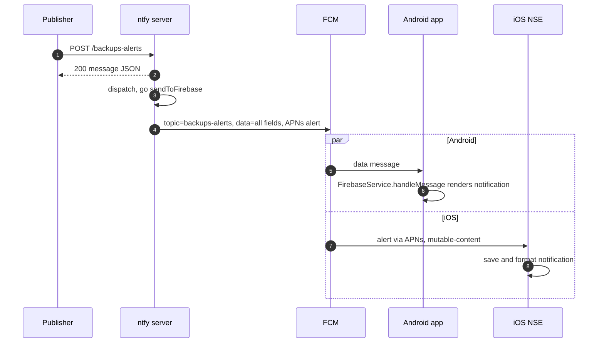

### Payload shape

`toFirebaseMessage` switches on `m.Event`. All fields are strings in `Data` (Android renders data messages itself);
iOS also gets `aps.alert` plus `mutable-content` so the Notification Service Extension can rewrite it.

| Event | Data fields | APNs config |
|---|---|---|
| `keepalive`, `open` | id, time, event, topic | background |
| `poll_request` | id, time, event, topic, message (`newMessageBody`), poll_id | alert |
| `message_delete`, `message_clear` | id, time, event, topic, sequence_id | background |
| `message` | id, time, event, topic, sequence_id, priority, tags, click, icon, title, message, content_type, encoding; optional actions (JSON), attachment_*, poll_id | alert |

Background config: `apns-push-type: background`, `apns-priority: 5`, `content-available`. Priority 4 and up sets
`AndroidConfig.Priority = "high"`.

### Size caps

| Cap | Value | Function |
|---|---|---|
| Whole FCM message as JSON | `fcmMessageLimit` 4000 bytes; cuts `message`, sets `truncated: "1"` | `maybeTruncateFCMMessage` |
| APNs alert body | `fcmApnsBodyMessageLimit` 100, `...` suffix | `maybeTruncateAPNSBodyMessage` |

Both cut by bytes, not runes. Action buttons (`data.actions`) are a common reason for body truncation. This is why
`DefaultMessageSizeLimit` is 4096 bytes.

### Poll request for protected topics

If a `user.Auther` is configured and anonymous read is denied, the content never goes through Google: `toPollRequest`
keeps only ID, time, priority, content type and encoding and sets `PollID`. The data map still has every key, because
the iOS decoder fails on a partial payload ([PR #1345](https://github.com/binwiederhier/ntfy/pull/1345)).

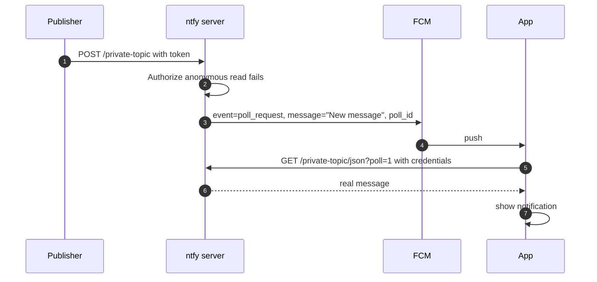

### Upstream forwarding for iOS on self-hosted servers

The App Store app's APNs credentials live in the public ntfy.sh Firebase project, so a self-hosted server asks its
`upstream-base-url` (usually `https://ntfy.sh`) to push a poll request on its behalf.

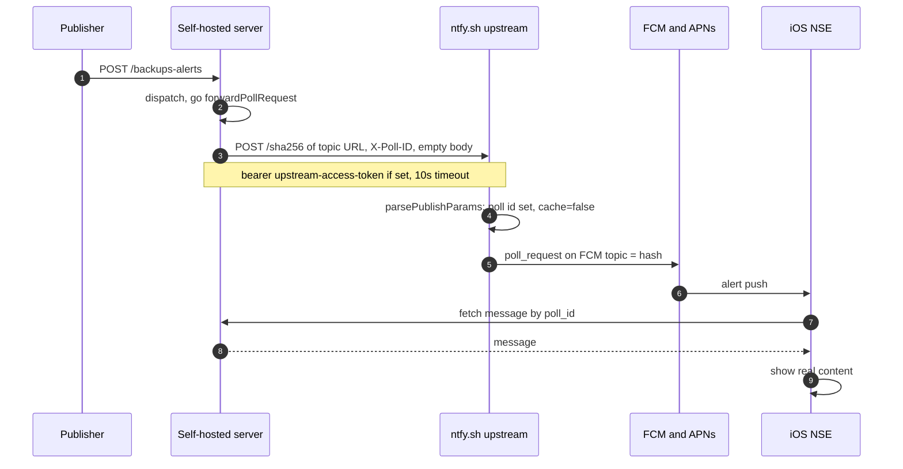

`cmd/serve.go` requires `upstream-base-url` to have a scheme, no trailing slash, a `base-url`, and to differ from
`base-url` (equal values would loop). A 429 from upstream logs a hint to set `upstream-access-token`. UnifiedPush
messages are never forwarded upstream.

### Keepalives

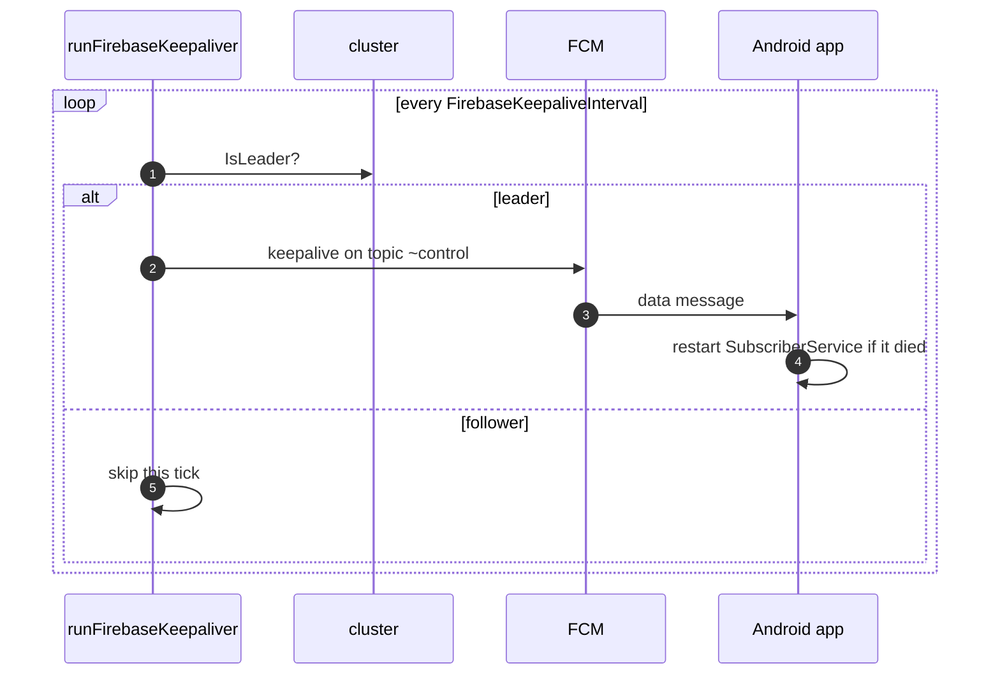

`~poll` keepalives (iOS background refresh) are commented out because of a thundering herd
([#677](https://github.com/binwiederhier/ntfy/issues/677)). Both topic names are hardcoded in the apps.

### Failure handling

`messaging.IsQuotaExceeded` -> `errFirebaseQuotaExceeded` -> `v.FirebaseTemporarilyDeny()` (`server/visitor.go`): the
visitor's Firebase sends short-circuit for `FirebaseQuotaExceededPenaltyDuration`. The quota is per FCM topic but the
penalty is per visitor, deliberately blunt. Metrics: `FirebasePublishedSuccess` / `FirebasePublishedFailure`. An FCM
outage is invisible to publishers; watch the failure metric.

## Web Push (VAPID)

Browser push for the web app, sent straight to the browser vendor's push service with VAPID. Build tag `nowebpush`
compiles it out (`server/server_webpush_dummy.go`).

### Config

| Key | Meaning |
|---|---|
| `web-push-public-key` / `web-push-private-key` | VAPID keys (`ntfy webpush keys`); public key non-empty enables |
| `web-push-file` | SQLite store; must be empty with `database-url` (Postgres is used) |
| `web-push-email-address` | VAPID `Subscriber` contact |
| `web-push-startup-queries` | SQLite statements run at startup |
| `web-push-expiry-duration` | Delete subscriptions not refreshed for this long, default 60d |
| `web-push-expiry-warning-duration` | Send `subscription_expiring` after this long, default 55d |

### Storage

`webpush.Store` (`webpush/store.go`) over SQLite (`store_sqlite.go`, tables `subscription`, `subscription_topic`) or
Postgres (`store_postgres.go`, same tables prefixed `webpush_`). This is its own database, separate from the user DB.

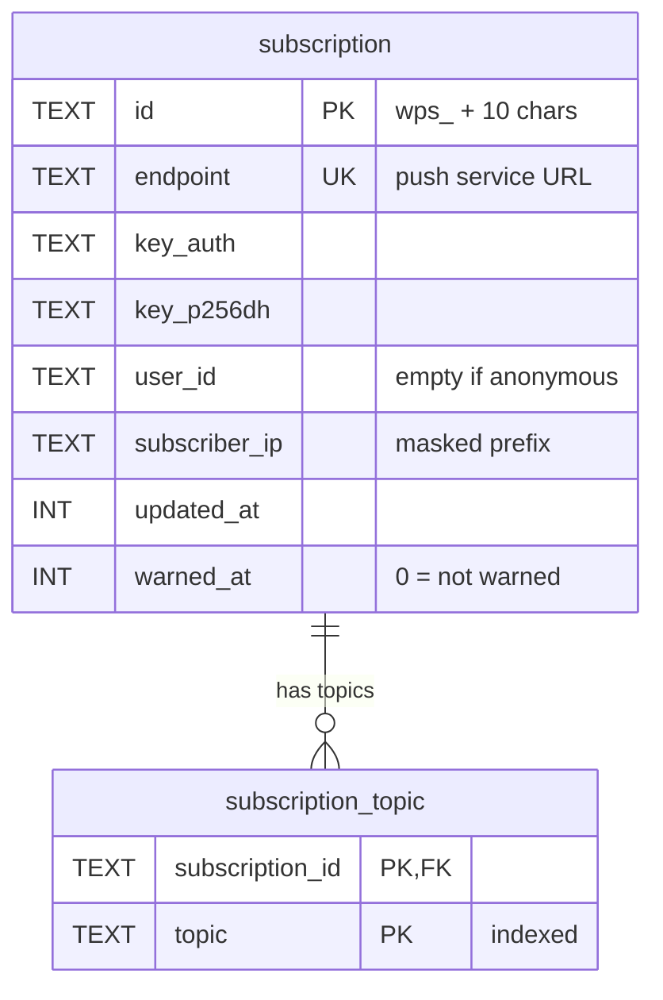

| id | endpoint | user_id | subscriber_ip | updated_at | warned_at | topics |
|---|---|---|---|---|---|---|
| `wps_Ab3dE6gH9k` | `https://fcm.googleapis.com/fcm/send/eXa...` | `u_A1b2C3d4E5f6` | `203.0.113.0` | 1764000000 | 0 | `backups-alerts`, `ci-builds` |
| `wps_Zx8yW7vU6t` | `https://updates.push.services.mozilla.com/wpush/v2/gAA...` | | `2001:db8::` | 1759200000 | 1763950000 | `home-doorbell` |

`UpsertSubscription` runs in one transaction: count rows for the masked IP and reject a new endpoint past
`subscriptionEndpointLimitPerSubscriberIP` (10), upsert by endpoint, then replace all topic rows (never merged).

### Subscribe

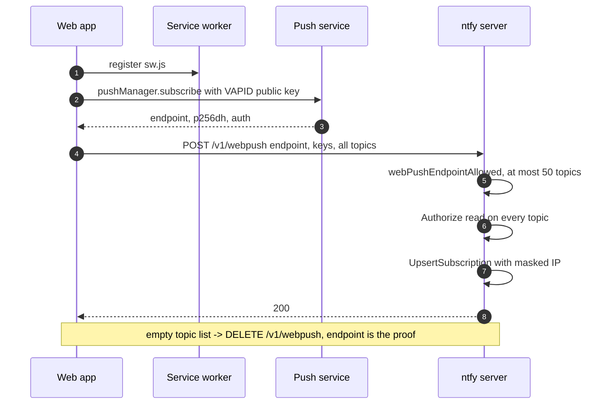

Browser side: `Notifier.webPushSubscription` (`web/src/app/Notifier.js`) and
`SubscriptionManager.updateWebPushSubscriptions` (`web/src/app/SubscriptionManager.js`). A stale service worker is
the most common source of confusion when testing; clear it and the caches first.

**Endpoint allow-list** (`webPushAllowedEndpointsRegexes`, `server/server_webpush.go`): `fcm.googleapis.com`,
`jmt17.google.com`, `updates.push.services.mozilla.com`, `*.mozaws.net`, `web.push.apple.com`,
`*.notify.windows.com`. Each regex anchors `https://` and ends at `/`, wildcards are `[^/]+`. This fixes
GHSA-w9hq-5jg7-q4j7 (SSRF via a loose wildcard); do not loosen it.

### Deliver

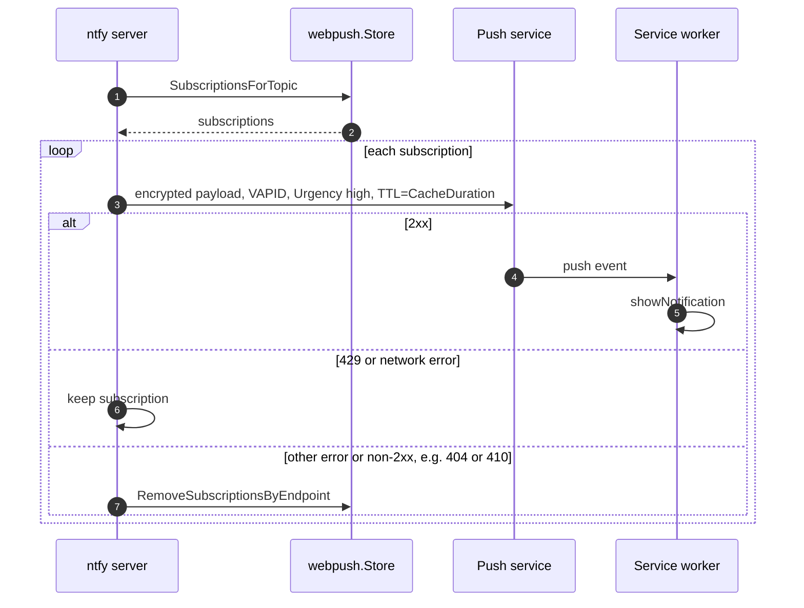

The payload is `webPushPayload` (`server/types.go`): `{event, subscription_id, message}`. Quirk: `subscription_id` is
the topic URL, not a `wps_` ID; the web app routes by it. The HTTP client has a 15s timeout and the response body is
drained (up to 4096 bytes) so connections are reused.

### Expiry

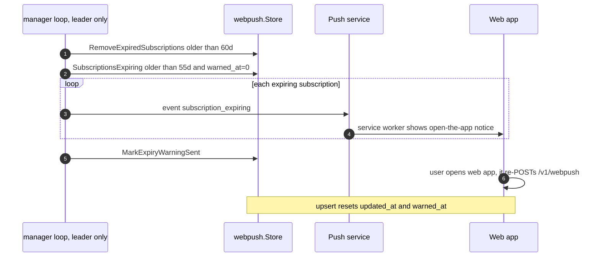

`pruneAndNotifyWebPushSubscriptions` runs from `server/server_manager.go`; the expiry sweep also removes orphaned topic
rows.

## Matrix and UnifiedPush

ntfy is both the UnifiedPush distributor's server and a Matrix Push Gateway. The ASCII diagram at the top of
`server/server_matrix.go` maps the roles. No config of its own beyond `base-url`.

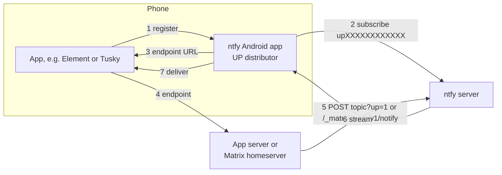

### Registration and delivery

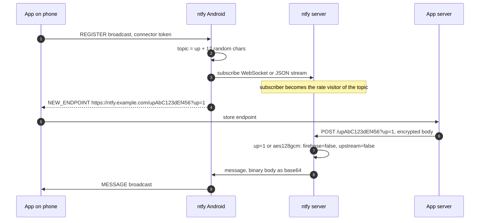

### Refusals: 507 and 410

With `visitor-subscriber-rate-limiting`, `up` topics (`isUnifiedPushTopic`, 14 characters,
`server/server_rate_visitor.go`) are rate limited against the subscriber. A push without a live rate visitor is
refused in `handlePublishInternal`:

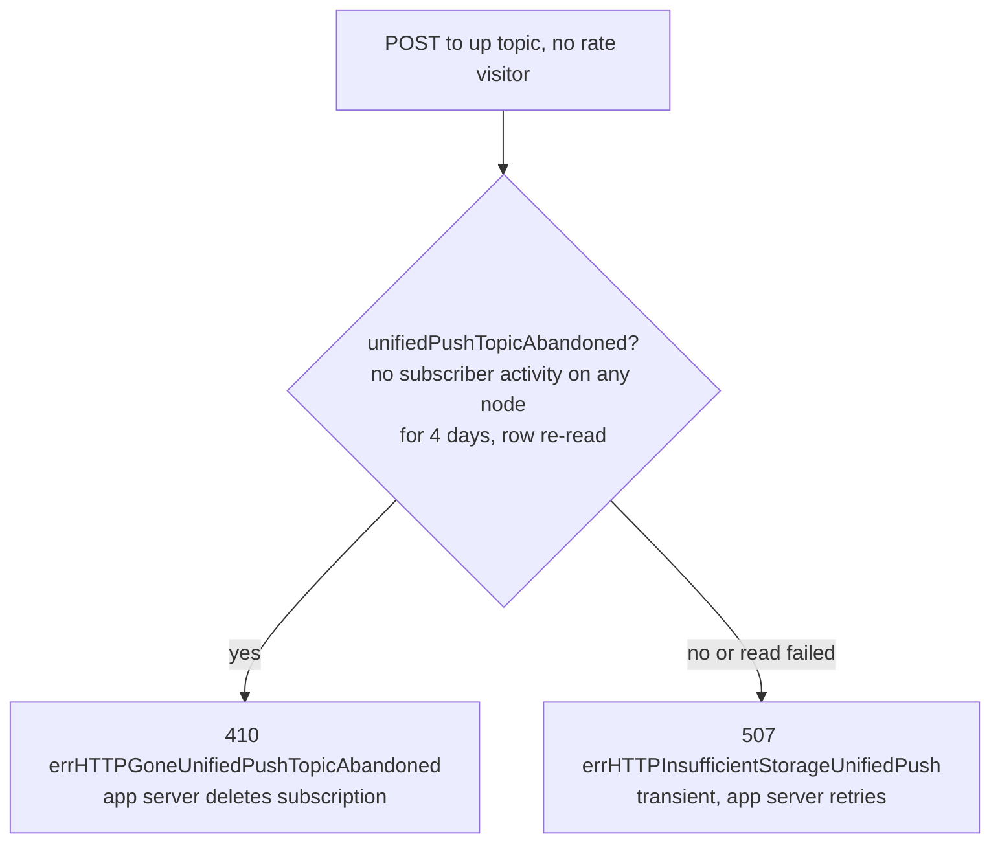

507 is a 5xx on purpose: some app servers (Mastodon) drop a subscription on most 4xx. `unifiedPushAbandonedAfter`
must stay below the topic row's prune age (7 days). Metrics: `MatrixPublishedSuccess` / `MatrixPublishedFailure`.

### Matrix push gateway

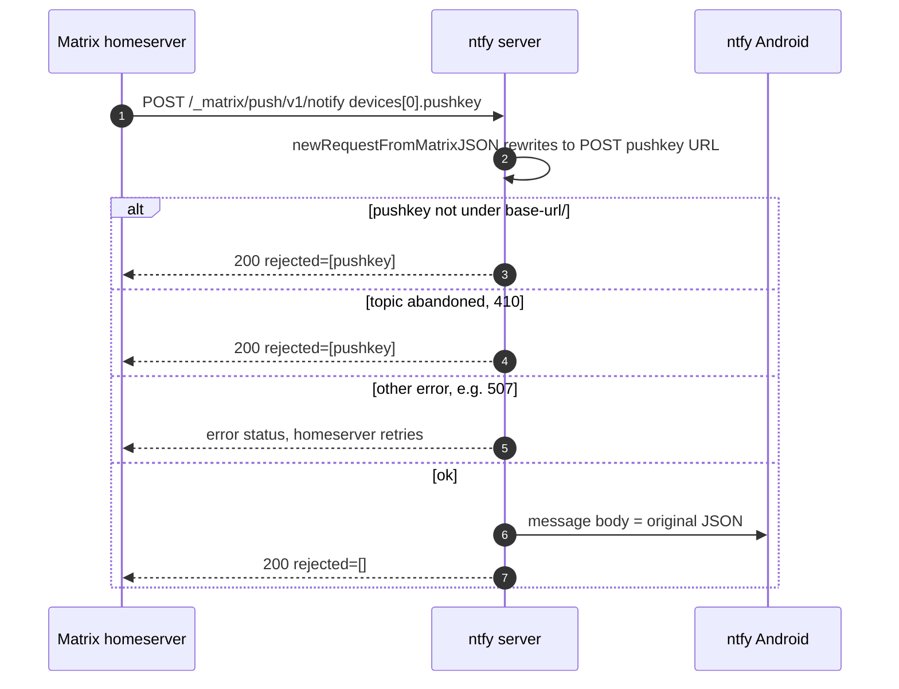

`GET /_matrix/push/v1/notify` returns `{"unifiedpush":{"gateway":"matrix"}}`. Only the first device is used
([#316](https://github.com/binwiederhier/ntfy/issues/316)). A rejection is a 200 with `rejected`, because a 4xx would
make the homeserver retry; the rewritten path must still match `topicPathRegex`.

## Email

Two independent directions with separate config and code.

### Inbound: the SMTP server

An embedded [go-smtp](https://github.com/emersion/go-smtp) server (`server/smtp_server.go`, wired in `runSMTPServer`)
turns mail into a synthetic HTTP publish through `s.handle`, so auth and rate limits apply normally.

| Key | Meaning |
|---|---|
| `smtp-server-listen` | e.g. `:25`; non-empty enables |
| `smtp-server-domain` | Recipient domain, required |
| `smtp-server-addr-prefix` | Optional prefix like `ntfy-`, against address guessing |

Address format: `[<prefix>]<topic>[+<token>]@<smtp-server-domain>`, one recipient only.

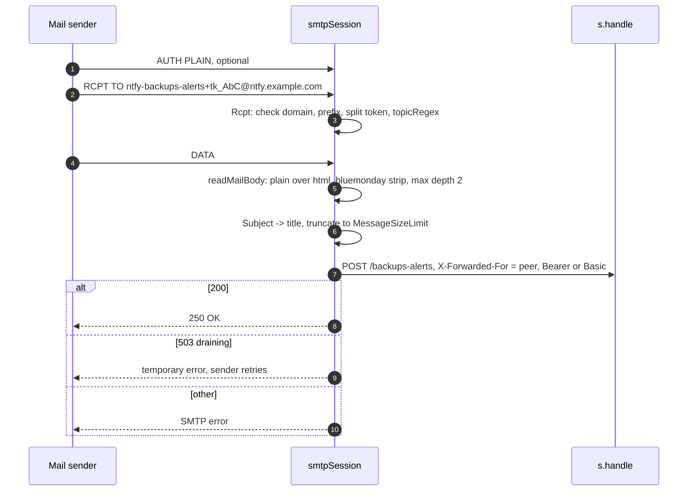

Hardcoded: 10s timeouts, `MaxMessageBytes` 1 MB, `MaxRecipients` 1, `AllowInsecureAuth`. A subject-only mail becomes
the message. Most failures are user input, logged at Debug; watch `EmailsReceivedFailure`.

### Outbound: notification email

`mail.Sender` (`mail/sender.go`) sends notifications (`X-Email`), email verification and password reset links.

| Key | Meaning |
|---|---|
| `smtp-sender-addr` | `host:port`; non-empty enables |
| `smtp-sender-user` / `smtp-sender-pass` | Optional auth (PLAIN, or LOGIN if only that is offered, [#930](https://github.com/binwiederhier/ntfy/issues/930)) |
| `smtp-sender-from` | Sender address, required |
| `smtp-sender-verify` | Only allow the user's verified addresses |

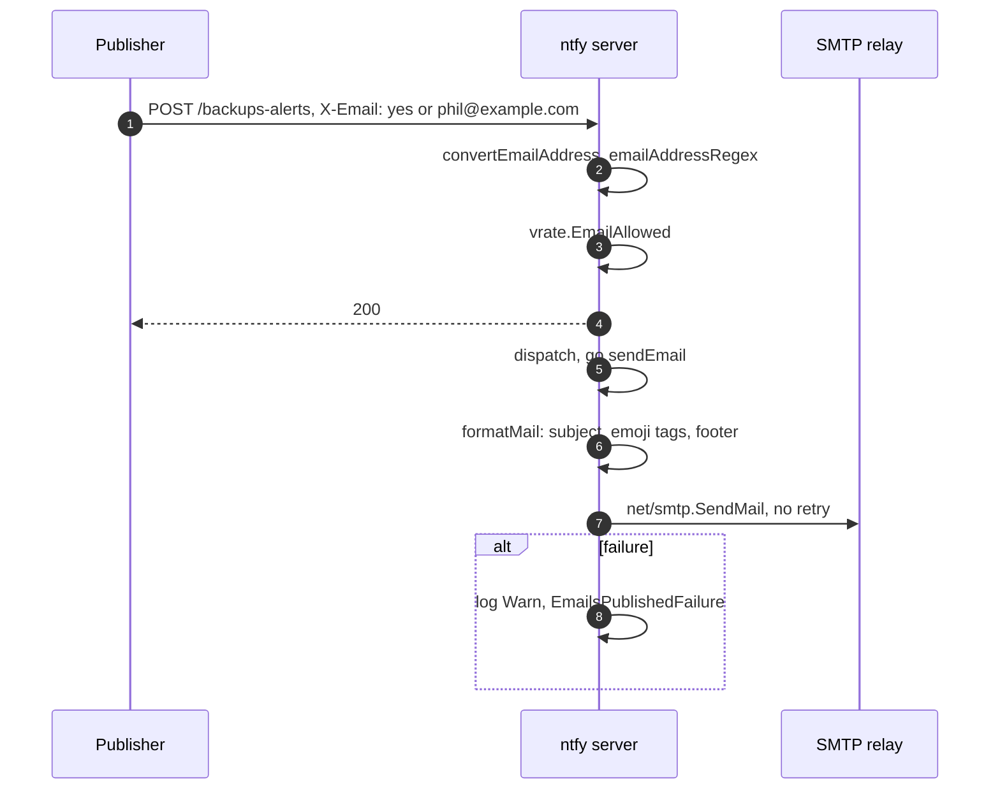

| `X-Email` value | Result |
|---|---|
| Boolean (`yes`, `true`, `1`) | Primary verified address, else first verified; anonymous rejected |
| Address, `smtp-sender-verify` off | Sent as is |
| Address, `smtp-sender-verify` on | Must be a verified address of the user; anonymous rejected |

Limits: `visitor-email-limit-burst` (16) and `visitor-email-limit-replenish` (1h). Delayed messages cannot carry email
or a call. The `From` display name is the short topic URL so clients group by topic; attachments are linked, not
attached. After Stripe checkout, `maybeEnqueueBillingEmailVerification` (`server/server_payments.go`) may send a
verification link to the billing address (best-effort, not for provisioned users).

## Twilio

Calls (`X-Call`) and phone number verification; there is no SMS notification delivery. Client: `twilio/client.go`;
glue: `server/server_twilio.go`, phone endpoints in `server/server_account.go`.

| Key | Meaning |
|---|---|
| `twilio-account` | Account SID; non-empty enables |
| `twilio-auth-token` | Auth token |
| `twilio-phone-number` | Caller ID |
| `twilio-verify-service` | Verify service SID |
| `twilio-call-format` | Optional TwiML `text/template` override |

All four plus `base-url` and a user database are required together (`cmd/serve.go`).

### Phone verification

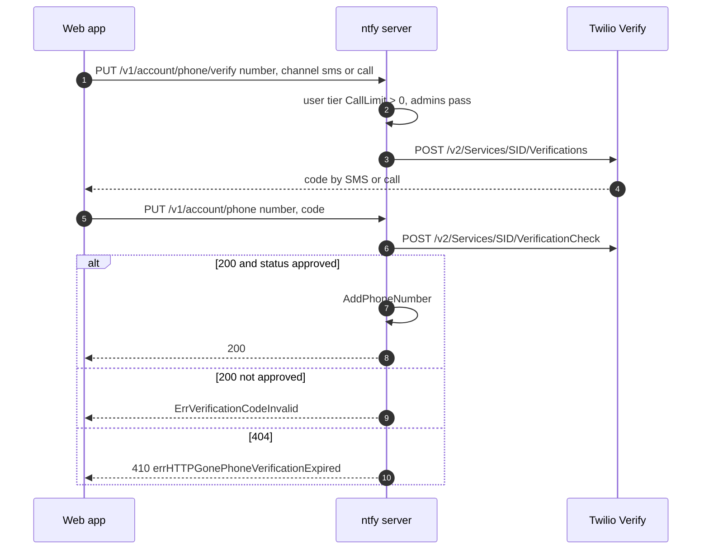

`DELETE /v1/account/phone` removes a number without calling Twilio.

### Phone call

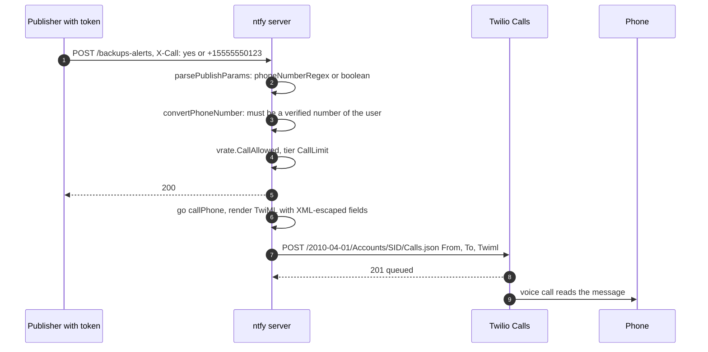

Anonymous publishers and unverified numbers are rejected, so an unverified number is never dialed. TwiML is rendered
with `text/template`, so `CallData.escaped()` is the only injection defense; a custom `twilio-call-format` is the
operator's responsibility. Failures count `CallsMadeFailure`.

## Stripe

Handlers in `server/server_payments.go` (build tag `nopayments` stubs them out), shim in `payments/payments.go`.
Principle: Stripe is the source of truth and is mirrored, not questioned. All calls go through the `stripeAPI`
interface so tests can mock it.

| Key | Meaning |
|---|---|
| `stripe-secret-key` | Non-empty enables payments |
| `stripe-webhook-key` | Webhook signing secret, required |
| `billing-contact` | Shown in the upgrade dialog |
| `StripePriceCacheDuration` | Price cache TTL, default 3h (no flag) |

Requires `base-url` and a user database (`auth-file` or `database-url`).

### Data model

Billing lives in the user DB; the full schema is in
[protocol-and-data-model.md](protocol-and-data-model.md) (user database schema). The Stripe-relevant columns:

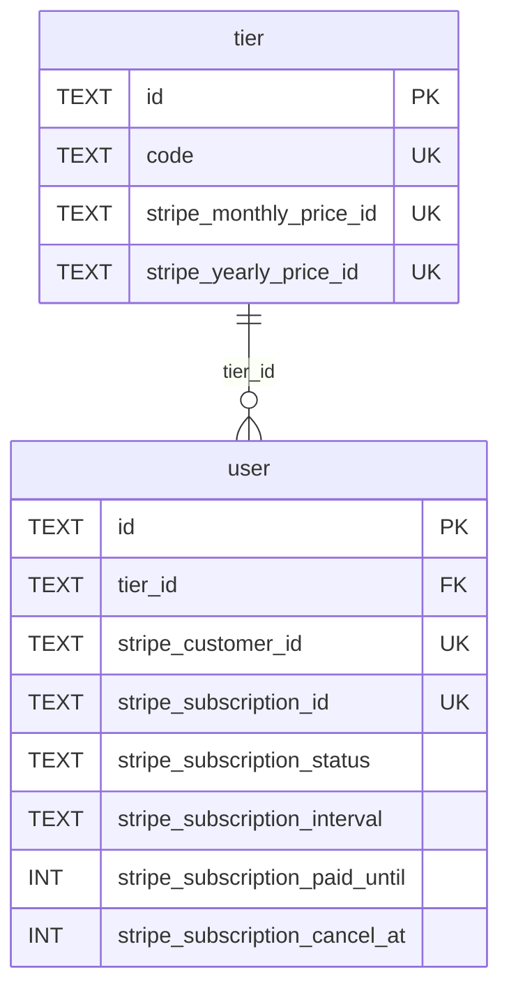

| user.id | tier | stripe_customer_id | stripe_subscription_id | status | interval | paid_until | cancel_at |
|---|---|---|---|---|---|---|---|
| `u_A1b2C3d4E5f6` | `pro` (`price_1Mo...`, `price_1Yr...`) | `cus_N7xAbC...` | `sub_1Pq2Rs...` | `active` | `month` | 1766600000 | 0 |
| `u_Q9w8E7r6T5y4` | none | `cus_K3lMnO...` | | | | 0 | 0 |

The second row is a cancelled user: the deleted webhook reset the tier but kept the customer ID for a later checkout.
Tiers map to Stripe by price ID (`TierByStripePrice`), set with `ntfy tier add|change --stripe-monthly-price-id
--stripe-yearly-price-id` (both or neither). `GET /v1/account/billing/tiers` lists a synthetic Free tier plus every tier
whose monthly and yearly prices are both active in Stripe; a tier missing either is silently hidden.

### Checkout

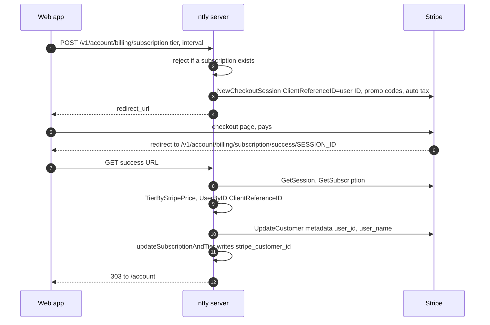

The success redirect is the only place the ntfy user is linked to the Stripe customer.

| Flow | Method and path | Notes |
|---|---|---|
| Upgrade / downgrade | PUT `/v1/account/billing/subscription` | Swaps the single line item's price, always-invoice proration, clears `CancelAtPeriodEnd` |
| Cancel | DELETE `/v1/account/billing/subscription` | Sets `CancelAtPeriodEnd`; the tier changes when the deleted webhook arrives |
| Portal | POST `/v1/account/billing/portal` | Needs a customer ID, returns the portal URL |

Every flow expects exactly one line item; others get `errHTTPBadRequestBillingRequestInvalid`.

### Webhooks

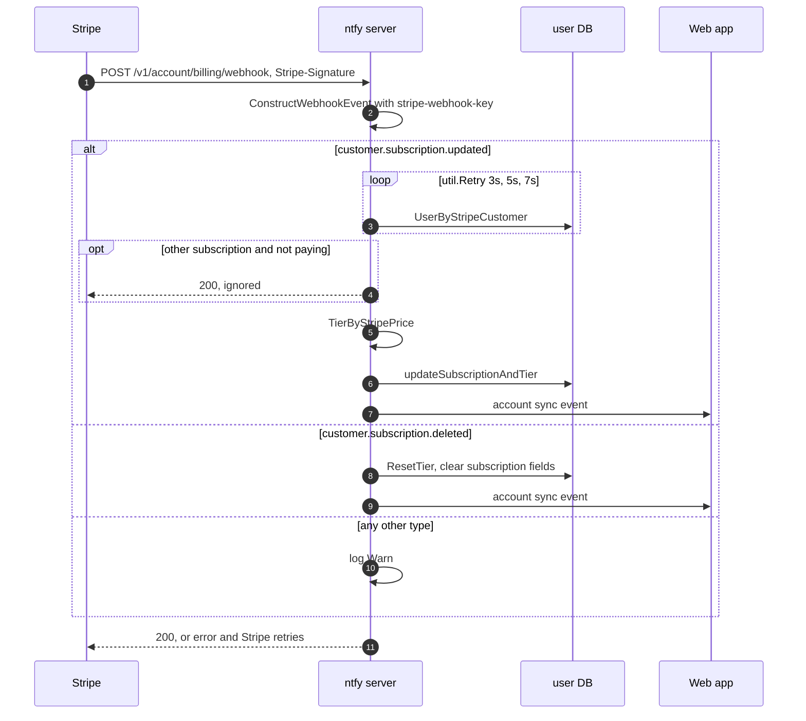

The retry covers the race with the checkout success redirect, which writes the customer ID. The "not paying" guard
(`stripeSubscriptionPaying`: `incomplete`, `incomplete_expired`, `canceled`) keeps an abandoned second checkout from
replacing a paid subscription. `updateSubscriptionAndTier` is the single write path: shed excess reservations
(`maybeRemoveMessagesAndExcessReservations`), `ResetTier` or `ChangeTier`, then `ChangeBilling`. A customer that is
never mapped keeps failing until Stripe gives up; check the Stripe dashboard's webhook log.

## Attachment storage

One `attachment.Store` (`attachment/store.go`) over a `backend` (`attachment/backend.go`): local files
(`backend_file.go`) or S3 (`backend_s3.go`). `createAttachmentStore` (`server/server.go`) picks S3 when
`attachment-cache-dir` starts with `s3://`; empty disables attachments.

```mermaid
flowchart LR
    H["handleBodyAsAttachment"] --> ST["attachment.Store<br/>Write, Read, sync"]
    F["handleFile GET /file/ID"] --> ST
    ST --> B{"attachment-cache-dir"}
    B -->|"path"| FB["fileBackend<br/>local dir"]
    B -->|"s3://"| SB["s3Backend"] --> SC["s3.Client<br/>own SigV4, no AWS SDK"] --> S3[("bucket/prefix")]
    MC[("message cache<br/>attachment rows")] -. "active set, sizes" .-> ST
```

S3 URL (`s3.ParseURL`, `s3/util.go`):
`s3://ACCESS_KEY:SECRET_KEY@BUCKET[/PREFIX]?region=REGION[&endpoint=ENDPOINT][&disable_http2=true]`. Without
`endpoint` it uses AWS virtual-host addressing; with one, path-style (scheme defaults to `https`). `disable_http2`
works around HTTP/2 stream errors on some providers. Required IAM actions are in the `s3.Client` doc comment.

### Upload and download

```mermaid
sequenceDiagram
    autonumber
    participant P as Publisher
    participant S as ntfy server
    participant St as attachment.Store
    participant B as disk or S3
    participant C as Subscriber
    P->>S: PUT /backups-alerts, Filename: backup.zip, body
    S->>S: early check Content-Length vs file and total limits
    S->>St: Write id, body, limiters: bandwidth, file size, remaining
    alt S3, known length up to 5 GB
        St->>B: single streamed PUT, UNSIGNED-PAYLOAD
    else unknown length
        St->>B: buffer 5 MB, then PUT or multipart
    end
    alt limit reached
        St->>B: delete partial object
        S-->>P: 413
    end
    S-->>P: 200 with attachment.url = base-url/file/ID.zip
    C->>S: GET /file/ID.zip
    S->>S: charge bandwidth to the uploader, not the downloader
    S->>St: Read
    St->>B: get
    S-->>C: file stream
```

| Key | Default |
|---|---|
| `attachment-total-size-limit` | 5 GB |
| `attachment-file-size-limit` | 15 MB |
| `attachment-expiry-duration` | 3h, never longer than the message |
| `visitor-attachment-total-size-limit` | 100 MB |
| `visitor-attachment-daily-bandwidth-limit` | 500 MB |
| `AttachmentOrphanGracePeriod` (no flag) | 1h |

### Expiry and orphan cleanup

Two deliberately decoupled loops:

1. **Database**: `pruneAttachments` (`server/server_manager.go`, leader only) marks expired attachments deleted in
   batches; it touches rows only.
2. **Storage**: `Store.syncLoop` runs at startup and every 15 minutes. It lists every object, deletes those not in the
   DB's active set and older than the grace period, recomputes the size from the DB, and aborts stale multipart
   uploads. Keys that are not valid message IDs are never deleted. On S3 the listing fails past 500 pages and that
   round does nothing.

## Message templates

Templates turn a JSON webhook body (Grafana, GitHub, Alertmanager) into a message. Code: `server/server_template.go`.
`X-Template` / `template` / `tpl` selects the mode (`templateMode`, `server/types.go`):

- **Inline** (boolean): `message`, `title` and `priority` are templates.
- **File** (any other value): `tpl=grafana` loads `grafana.yml` from `template-dir`, else the embedded
  `server/templates/` (`alertmanager.yml`, `github.yml`, `grafana.yml`). Names match `^[-_A-Za-z0-9]+$`.

Rendering uses `template/gotext`, a patched copy of `text/template` (`ExecuteContext`, `PrintCheck`; see
`template/gotext/README.md`), with the vendored Sprig function map (`template/sprig`).

| Group | Functions |
|---|---|
| Strings | `trim`, `trimAll`, `trimPrefix`, `trimSuffix`, `upper`, `lower`, `title`, `substr`, `trunc`, `repeat`, `replace`, `contains`, `hasPrefix`, `hasSuffix`, `quote`, `squote`, `cat`, `indent`, `nindent`, `plural`, `split`, `splitList`, `splitn`, `join`, `toString`, `atoi` |
| Regex | `regexMatch`, `regexFind`, `regexFindAll`, `regexReplaceAll`, `regexReplaceAllLiteral`, `regexSplit`, `regexQuoteMeta` |
| Dates | `now`, `ago`, `date`, `dateInZone`, `dateModify`, `toDate`, `unixEpoch`, `duration`, `durationRound`, `htmlDate` |
| Math | `add`, `add1`, `sub`, `mul`, `div`, `mod`, `max`, `min`, `maxf`, `minf`, `ceil`, `floor`, `round`, `randInt`, `seq`, `until`, `untilStep` |
| Lists, dicts | `list`, `first`, `last`, `rest`, `initial`, `append`, `prepend`, `concat`, `reverse`, `uniq`, `without`, `has`, `slice`, `chunk`, `sortAlpha`, `compact`, `dict`, `get`, `set`, `unset`, `hasKey`, `keys`, `values`, `pick`, `omit`, `pluck`, `dig` |
| JSON, encoding | `toJSON`, `toPrettyJSON`, `toRawJSON`, `fromJSON`, `b64enc`, `b64dec`, `b32enc`, `b32dec`, `sha1sum`, `sha256sum`, `sha512sum`, `adler32sum` |
| Logic, types | `default`, `empty`, `coalesce`, `all`, `any`, `ternary`, `fail`, `typeOf`, `typeIs`, `kindOf`, `kindIs`, `deepEqual` |
| Paths, URLs | `base`, `dir`, `ext`, `clean`, `isAbs`, `urlParse`, `urlJoin` |

Most also have a `must*` variant that returns an error instead of a zero value. No `env`, `expandenv` or network
functions exist. Blocked builtins: `call`, `html`, `js`, `urlquery`, plus `{{define}}`, `{{block}}`, `{{template}}`
(`templateUsesDisallowedFeatures` walks the parse tree, so `{{if call .x}}` is caught too).

| Limit | Value |
|---|---|
| Execution deadline | 100 ms, `templateMaxExecutionTime` (fix for GHSA-rhwf-xgc9-m9fp) |
| Output | 1 MB, `templateMaxOutputBytes` |
| Template size | 32 KB, `templateMaxTemplateBytes` |
| Input body | max(`MessageSizeLimit`, 128 KB) |
| Printed values | depth 100, about 256 KB, no cycles (`template/printable.go`) |
| Rendered title and message | `MessageSizeLimit` |

## Action buttons

`action.Parse` (`action/action.go`) takes a JSON array or the simple format
`view, Open, https://example.com/x; http, Ack, https://api.example.com/ack, method=PUT, body={"ok":1}`, parsed by a
hand-written lexer. Sections are comma-separated, actions semicolon-separated; keyless sections fill `action`, `label`,
then `url` or `value` by position. `headers.*` and `extras.*` fill maps.

| Type | Required | Optional | Effect on the client |
|---|---|---|---|
| `view` | label, url | clear | Opens the URL in a browser or app |
| `broadcast` | label | extras.*, clear | Sends an Android broadcast intent (Android only) |
| `http` | label, url | method (clients default to POST), headers.*, body (not for GET/HEAD), clear | Client sends the HTTP request |
| `copy` | label, value | clear | Copies the value to the clipboard |

At most 3 actions (`actionsMax`); each gets a random 10-character ID. Errors become `errHTTPBadRequestActionsInvalid`.
Actions travel in FCM `data.actions` as JSON and count against the 4000-byte cap.

## iOS and APNs

The server never talks to APNs. FCM relays to APNs, so the whole server-side APNs surface is the `messaging.APNSConfig`
from `createAPNSAlertConfig` and `createAPNSBackgroundConfig`.

```mermaid
flowchart LR
    subgraph Servers
        SH["self-hosted ntfy<br/>upstream-base-url"]
        NS["ntfy.sh<br/>owns the Firebase project"]
    end
    FCM["FCM"]
    APNS["APNs"]
    subgraph iPhone
        NSE["Notification Service<br/>Extension"]
        APP["ntfy iOS app"]
    end
    SH -->|"poll request, topic hash"| NS
    NS -->|"messaging.Message + APNSConfig"| FCM
    FCM --> APNS
    APNS -->|"alert, mutable-content"| NSE
    APNS -->|"background, content-available"| APP
    NSE -->|"poll_request: fetch by poll_id"| SH
    NSE <-->|"App Group Core Data"| APP
```

```mermaid
sequenceDiagram
    autonumber
    participant S as ntfy.sh
    participant F as FCM
    participant A as APNs
    participant N as NSE
    S->>F: data + aps.alert + mutable-content
    F->>A: relay with ntfy.sh APNs credentials
    A->>N: wake extension
    alt event message
        N->>N: decode data, save, format
    else event poll_request
        N->>N: fetch message from its server by poll_id
    end
    N-->>A: modified notification shown
```

Background pushes (delete, clear, keepalive) do not run the NSE and are effectively no-ops on iOS. Registration, FCM
topic naming (`sha256` of the topic URL for non-default servers) and device-side event handling are in
[ios.md](ios.md#push-delivery).
