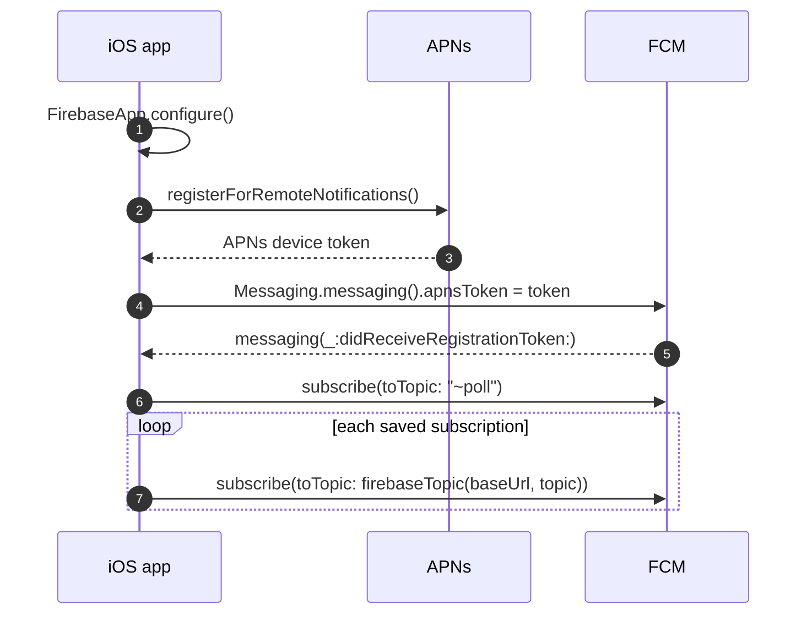
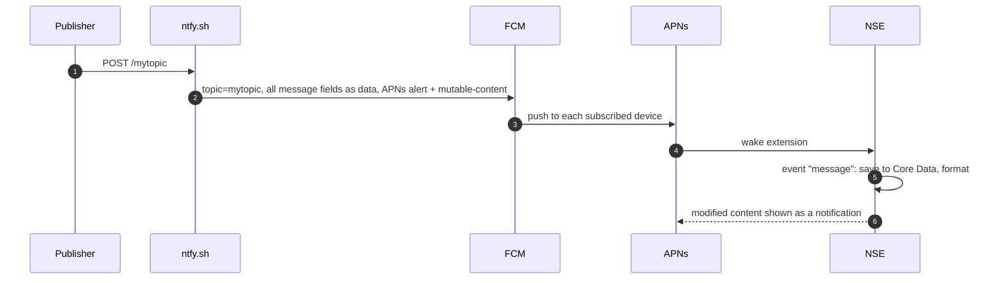
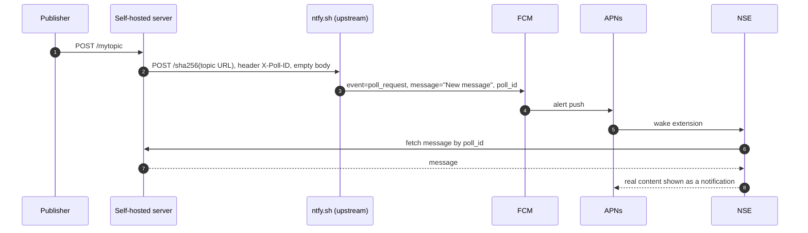

# iOS Push Architecture

## How a Ntfy notification reaches the iOS app

How messages travel from an ntfy server to the iOS app and its Notification Service Extension (NSE). Code
references: `server/` paths are in this repo; `ntfy/` and `ntfyNSE/` paths are in
[ntfy-ios](https://github.com/binwiederhier/ntfy-ios).

## Who knows what (in the IOS Flow)

| Component | Knows | Doesn't know |
|---|---|---|
| **ntfy.sh** | topics and messages | which devices listen; it sends to an FCM topic |
| **Self-hosted server** | topics and messages | which devices listen; it forwards a poll request to its `upstream-base-url` (ntfy.sh) |
| **FCM** (Firebase Cloud Messaging) | which device tokens subscribe to each FCM topic | message meaning |
| **APNs** (Apple Push Notification service) | device tokens | topics |
| **iOS app** (`ntfy` target) | subscriptions (Core Data), polling, UI | |
| **NSE** (`ntfyNSE` target) | runs in its own process for *alert* pushes; shares Core Data with the app via App Group `group.io.heckel.ntfy` | |

The APNs credentials for `io.heckel.ntfy` are in ntfy.sh's Firebase project, so every push to the app goes through
ntfy.sh and FCM (see [TECHNICAL_LIMITATIONS.md](https://github.com/binwiederhier/ntfy-ios/blob/main/docs/TECHNICAL_LIMITATIONS.md)).

## 1. Registration and topic subscription

`ntfy/App/AppDelegate.swift`, `ntfy/Utils/Helpers.swift`

`firebaseTopic` uses the plain topic name for the app's home server (`APP_BASE_URL`, `https://ntfy.sh`) and
`sha256("<baseUrl>/<topic>")` for any other server. Topics are subscribed in `didReceiveRegistrationToken`; a failed
subscribe is logged.

## 2. Message on the home(ntfy.sh) server: content is in the push

`server/server_firebase.go` (`toFirebaseMessage`, `createAPNSAlertConfig`), `ntfyNSE/NotificationService.swift`

If anonymous users can't read the topic, the server sends a `poll_request` instead, with no message content, and the
NSE fetches the message from the server.

## 3. Message on a self-hosted server: only a message ID is in the push

`server/server.go` (`forwardPollRequest`), `ntfyNSE/NotificationService.swift` (`handlePollRequest`)

The self-hosted server needs `upstream-base-url: "https://ntfy.sh"`. ntfy.sh and FCM see only the topic hash and the
message ID. If the NSE can't fetch the message in time, iOS shows the push as sent ("New message").

## 4. Event types

`server/server_firebase.go` (`toFirebaseMessage`), `ntfy/App/AppDelegate.swift`
(`didReceiveRemoteNotification`)

**Alert pushes** show a notification. The NSE runs first and can change it.

- `message`: the NSE saves it and displays it.
- `poll_request`: the NSE fetches the message from the server, saves it and displays it.

**Background pushes** (`content-available`) are currently no-ops on iOS. They don't run the NSE, and the app delegate
drops any push whose topic isn't `~poll`.

- `message_delete`, `message_clear`: sent on the subscribed topic, so the app ignores them. A message deleted or
  cleared on the server stays on the phone.
- `keepalive` on `~poll`: the app would poll every subscription, but the server doesn't send it (commented out in
  `runFirebaseKeepaliver`, `server/server.go`).

## Payload limits

From `server/server_firebase.go`:
- The APNs alert body is truncated to 100 characters.
- The FCM message JSON is capped at 4000 bytes; a longer `message` is truncated and `truncated=1` is set.
- A comment there notes that APNs silently drops payloads over 4 KB.

## See also

- [TECHNICAL_LIMITATIONS.md](https://github.com/binwiederhier/ntfy-ios/blob/main/docs/TECHNICAL_LIMITATIONS.md)
- [ntfy docs: iOS instant notifications](https://docs.ntfy.sh/config/#ios-instant-notifications)
- [Blog: the iOS app's architecture](https://blog.ntfy.sh/2023/12/06/138-lines-of-code/#ios-app)
