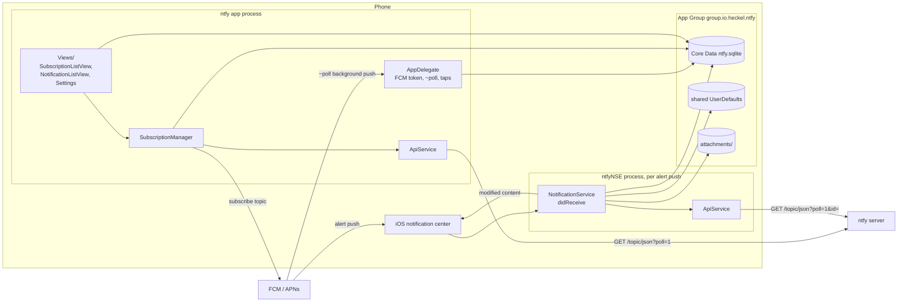
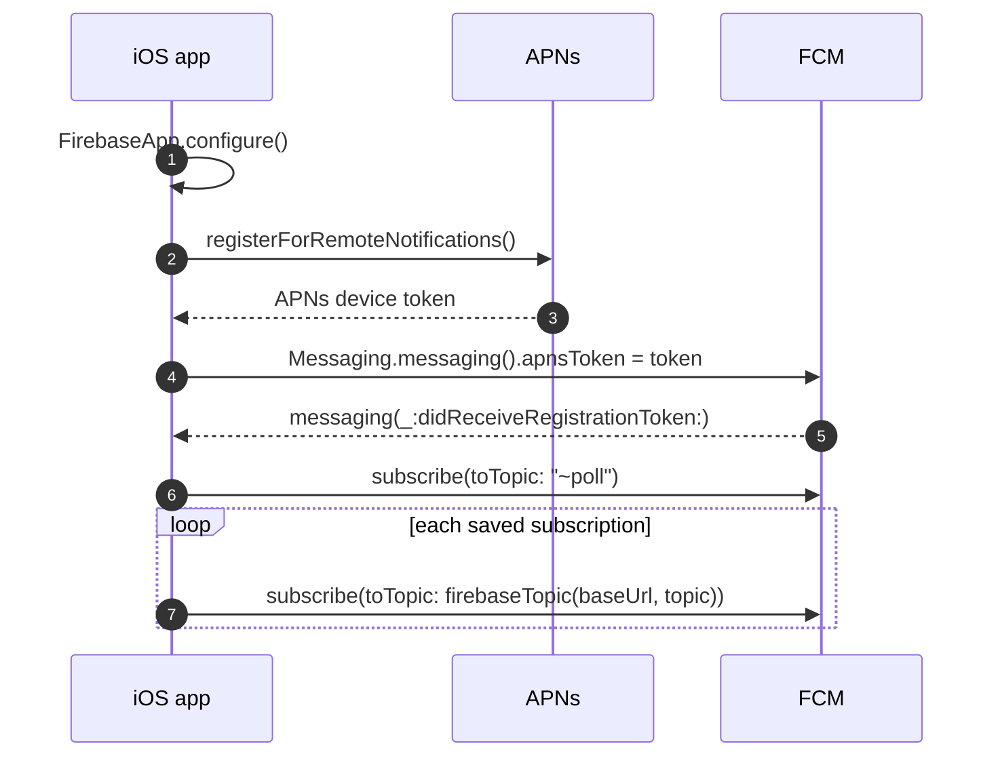
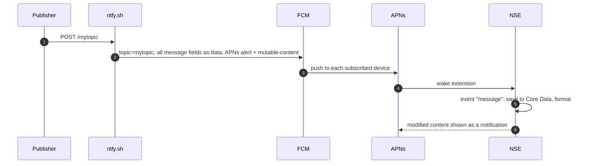
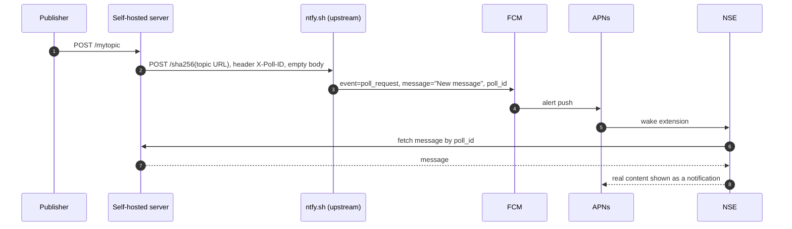
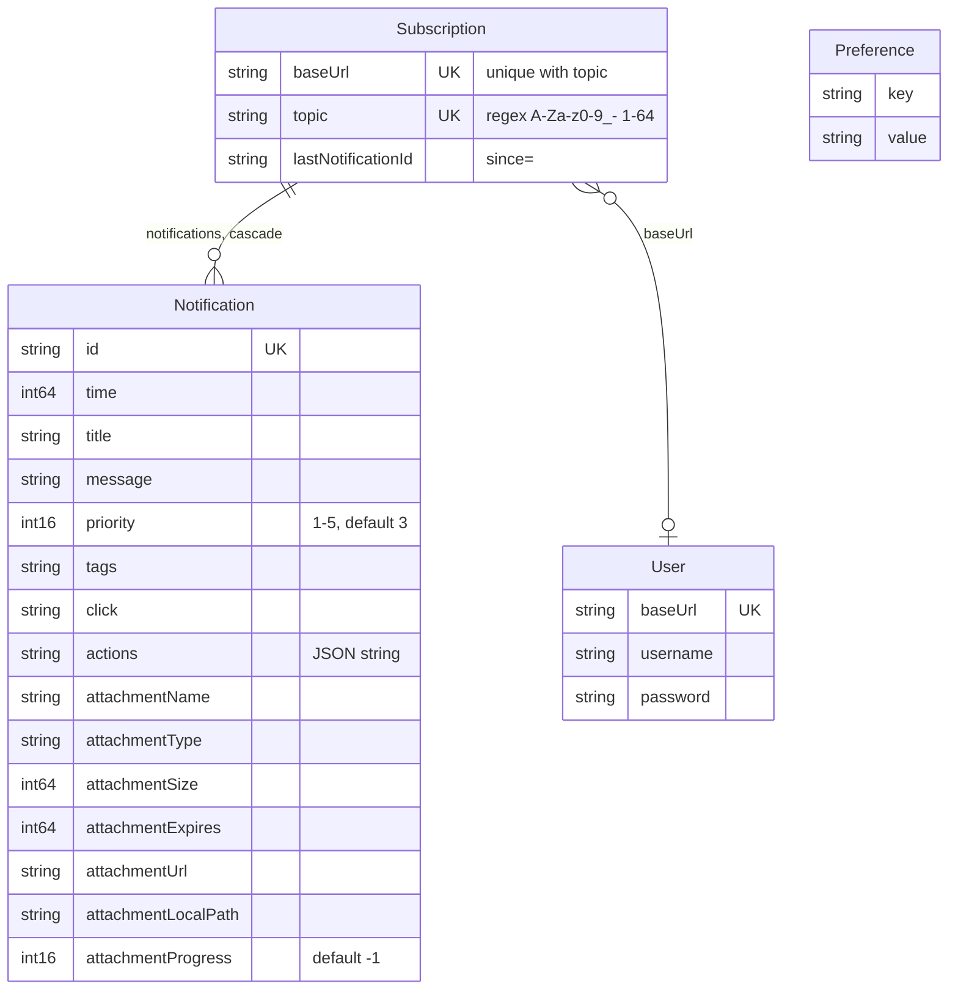
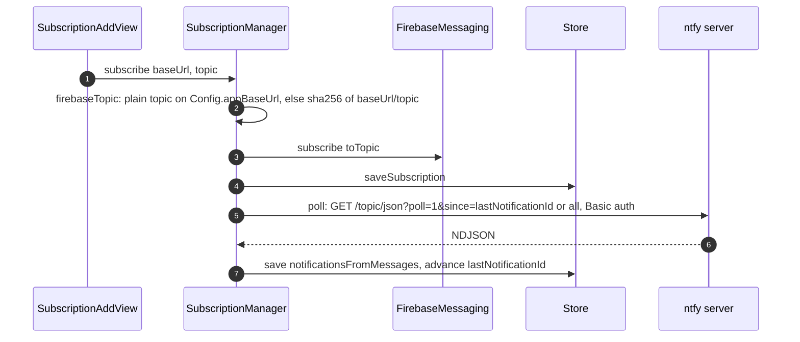
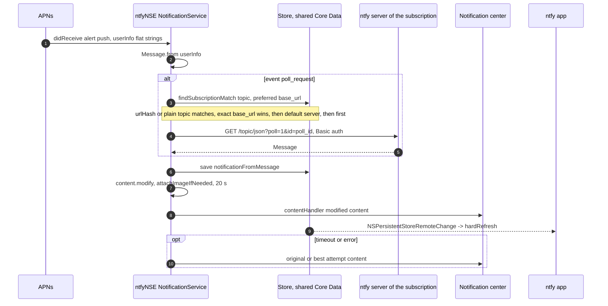

# iOS app internals

How the iOS app is structured: its two targets, push delivery, the shared Core Data store, subscriptions and polling. Code is in
[ntfy-ios](https://github.com/binwiederhier/ntfy-ios); `ntfy/`, `ntfyNSE/` and `ntfyTests/` paths are there,
`server/` paths are in this repo.

How a message gets from a server to the phone (FCM, APNs, `poll_request`, `upstream-base-url`) is in
[Push delivery](#push-delivery). See [web-app.md](web-app.md#cross-client-feature-matrix) for how iOS compares
to the other clients.

## Overview

| Item | Value |
|---|---|
| Language / UI | Swift, SwiftUI, Combine |
| Deployment target | iOS 15.0 (project default still 14.0; some `#available(iOS 15.0, *)` checks remain) |
| Dependency | Firebase iOS SDK via SwiftPM (`FirebaseMessaging`), the only one |
| Server | build setting `APP_BASE_URL = "https://ntfy.sh"` -> `AppBaseURL` in both `Info.plist` -> `Config.appBaseUrl` (`ntfy/Utils/Config.swift`) |
| Firebase config | `GoogleService-Info.plist` not in the repo (`docs/GETTING_STARTED.md`); CI writes a dummy (`scripts/dummy-firebase-plist.sh`) |
| Tests | `ntfyTests/` (Swift Testing) + SwiftLint in `.github/workflows/ci.yml`; see `docs/dev/testing.md` |

## Targets

| Target | Type | Bundle ID | Role |
|---|---|---|---|
| `ntfy` | app | `io.heckel.ntfy` | UI, subscriptions, FCM registration, polling, `~poll` pushes, taps |
| `ntfyNSE` | notification service extension | `io.heckel.ntfy.ntfyNSE` | own process per alert push: save, fetch `poll_request`, rewrite content |
| `ntfyTests` | unit tests | `io.heckel.ntfyTests` | `HelpersTests`, `MessageTests`, `NotificationContentTests`, `StoreTests` |

Both carry the App Group and the critical alerts entitlement, and set `NSAllowsArbitraryLoads` (self-hosted
servers may be plain HTTP). Only background mode: `remote-notification`; no `BGTaskScheduler`.

| Path | Contents |
|---|---|
| `ntfy/App/` | `AppMain.swift`, `AppDelegate.swift` |
| `ntfy/Persistence/` | `Store.swift`, `SubscriptionManager.swift`, `Notification.swift` (wire types `Message`, `MessageAttachment`, `Action`), `SubscriptionsObservable` / `NotificationsObservable` (`NSFetchedResultsController`), model in `ntfy.xcdatamodeld/` |
| `ntfy/Utils/` | `ApiService.swift`, `NotificationContent.swift`, `Helpers.swift` (URLs, topic hashing), `Actions.swift` / `ActionExecutor.swift`, `AttachmentFileStore.swift` |
| `ntfy/Views/` | `ContentView` -> `MainView` tabs |
| `ntfyNSE/` | `NotificationService.swift` |

## Push delivery

How a message travels from an ntfy server to the app and its Notification Service Extension (NSE).

### Who knows what

| Component | Knows | Doesn't know |
|---|---|---|
| **ntfy.sh** | topics and messages | which devices listen; it sends to an FCM topic |
| **Self-hosted server** | topics and messages | which devices listen; it forwards a poll request to its `upstream-base-url` (ntfy.sh) |
| **FCM** (Firebase Cloud Messaging) | which device tokens subscribe to each FCM topic | message meaning |
| **APNs** (Apple Push Notification service) | device tokens | topics |
| **iOS app** (`ntfy` target) | subscriptions (Core Data), polling, UI | |
| **NSE** (`ntfyNSE` target) | runs in its own process for *alert* pushes; shares Core Data with the app via App Group `group.io.heckel.ntfy` | |

The APNs credentials for `io.heckel.ntfy` are in ntfy.sh's Firebase project, so every push to the app goes through
ntfy.sh and FCM (see [TECHNICAL_LIMITATIONS.md](https://github.com/binwiederhier/ntfy-ios/blob/main/docs/TECHNICAL_LIMITATIONS.md)).

### Registration and topic subscription

`ntfy/App/AppDelegate.swift`, `ntfy/Utils/Helpers.swift`

`firebaseTopic` uses the plain topic name for the app's home server (`APP_BASE_URL`, `https://ntfy.sh`) and
`sha256("<baseUrl>/<topic>")` for any other server. Topics are subscribed in `didReceiveRegistrationToken`; a failed
subscribe is logged.

### Message on the home (ntfy.sh) server: content is in the push

`server/server_firebase.go` (`toFirebaseMessage`, `createAPNSAlertConfig`), `ntfyNSE/NotificationService.swift`

If anonymous users can't read the topic, the server sends a `poll_request` instead, with no message content, and the
NSE fetches the message from the server.

### Message on a self-hosted server: only a message ID is in the push

`server/server.go` (`forwardPollRequest`), `ntfyNSE/NotificationService.swift` (`handlePollRequest`)

The self-hosted server needs `upstream-base-url: "https://ntfy.sh"`. ntfy.sh and FCM see only the topic hash and the
message ID. If the NSE can't fetch the message in time, iOS shows the push as sent ("New message").

### Event types

`server/server_firebase.go` (`toFirebaseMessage`), `ntfy/App/AppDelegate.swift`
(`didReceiveRemoteNotification`)

**Alert pushes** show a notification. The NSE runs first and can change it.

- `message`: the NSE saves it and displays it.
- `poll_request`: the NSE fetches the message from the server, saves it and displays it.

**Background pushes** (`content-available`) are currently no-ops on iOS. They don't run the NSE, and the app delegate
drops any push whose topic isn't `~poll`.

- `message_delete`, `message_clear`: sent on the subscribed topic, so the app ignores them. A message deleted or
  cleared on the server stays on the phone.
- `keepalive` on `~poll`: the app would poll every subscription, but the server doesn't send it (commented out in
  `runFirebaseKeepaliver`, `server/server.go`).

### Payload limits

From `server/server_firebase.go`:
- The APNs alert body is truncated to 100 characters.
- The FCM message JSON is capped at 4000 bytes; a longer `message` is truncated and `truncated=1` is set.
- A comment there notes that APNs silently drops payloads over 4 KB.

## Core Data store shared by app and NSE

`Store.shared` (`ntfy/Persistence/Store.swift`) opens `ntfy.sqlite` in the App Group container (`/dev/null` for
`Store(inMemory: true)`), so two processes share one file.

| Mechanism | Why |
|---|---|
| `NSPersistentStoreRemoteChangeNotificationPostOptionKey` + `.NSPersistentStoreRemoteChange` -> `hardRefresh()` | app sees NSE writes; the code calls it a hack |
| `automaticallyMergesChangesFromParent`, `mergeByPropertyStoreTrumpMergePolicyType` | store wins on conflict |
| `transactionAuthor` `ntfy.appex` / `ntfy` | tells the writers apart |
| `rollbackAndRefresh()` | a failed save usually means the NSE stored the same notification first |
| Lightweight migration | single model version so far |

The App Group also holds a shared `UserDefaults` (`criticalAlertsAuthorized`, read by the NSE) and downloaded
attachments under `attachments/`.

### Entities (`Model.xcdatamodel/contents`)

| Entity | Example row |
|---|---|
| `Subscription` | `baseUrl=https://ntfy.sh, topic=backups-alerts, lastNotificationId=aB3dE5fG7hJ9` |
| `Notification` | `id=aB3dE5fG7hJ9, time=1764000000, title=Backup, message=Nightly backup done, priority=4, tags=warning, attachmentProgress=-1` |
| `User` | `baseUrl=https://ntfy.example.com, username=alice, password=s3cret` |
| `Preference` | `key=defaultBaseUrl, value=https://ntfy.example.com` (also `attachmentAutoDownloadMaxSize`, `criticalAlertsEnabled`) |

- `attachmentProgress` (`AttachmentProgressState.swift`): negative = terminal (none, failed, deleted, canceled,
  skipped), 0-99 = percent, 100 = done.
- No `sequenceId` and no `icon`: message updates/deletes and per-message icons are not supported.

## Subscriptions

- `unsubscribe` removes the FCM topic and deletes the subscription with its notifications.
- `AppDelegate.messaging(_:didReceiveRegistrationToken:)` re-subscribes `~poll` and every subscription on each FCM
  token refresh.
- Other servers work only if they forward poll requests via `upstream-base-url` (explained in
  `SubscriptionAddView`, `DefaultServerView`, and [Push delivery](#push-delivery)).

## Polling

No long-lived connection (no WebSocket, SSE or JSON stream; `docs/TECHNICAL_LIMITATIONS.md`). Every request in
`ntfy/Utils/ApiService.swift` is a one-shot `URLSession` task.

| Trigger | Code | Request |
|---|---|---|
| After subscribing | `SubscriptionManager.subscribe` | `GET /<topic>/json?poll=1&since=<id or all>` |
| List appears | `SubscriptionListView.pollSubscriptions` | same, every subscription |
| Pull to refresh | `NotificationListView` `.refreshable` | same, one subscription |
| `~poll` background push | `AppDelegate.application(_:didReceiveRemoteNotification:...)` | same, every subscription, then local notifications one by one. The server does not send these today ([Event types](#event-types)) |
| `poll_request` alert push | `NotificationService.handlePollRequest` | `GET /<topic>/json?poll=1&id=<poll_id>`, one `Message`, 30 s timeout |

### Polling after a push (NSE)

Other requests: `POST /<topic>` with `Title`, `Priority`, `Tags` headers (test notification) and
`GET /<topic>/auth` (credential check, 401/403 = unauthorized). `newRequest(url:user:)` sets User-Agent and Basic
auth; no `/v1/account*`, no bearer tokens.

## Showing notifications

`NotificationContent.swift` (`modify(message:baseUrl:)`), used by the NSE and for locally posted notifications:

| ntfy priority | Interruption level |
|---|---|
| 1, 2 | `.passive` |
| 3 | `.active` |
| 4 | `.timeSensitive` |
| 5 | `.critical` + critical sound if enabled and granted, else `.timeSensitive` |

- `threadIdentifier` = topic URL. `configureNotificationActions` redefines category `ntfyActions` per message, max
  4; only `view` and `http` (`Actions.swift`, run by `ActionExecutor.swift`).
- Images are downloaded in the NSE (ephemeral session) respecting `attachmentAutoDownloadMaxSize`; other
  attachments are summarized in the body.
- `Message.from(userInfo:)` / `toUserInfo()` (`Notification.swift`) mirror `toFirebaseMessage` in
  `server/server_firebase.go`.
- Taps: `AppDelegate.userNotificationCenter(_:didReceive:)` runs an action, else `click`, else opens the topic.
  Foreground presentation is `[.banner, .sound]`.

## Gotchas

- **Debugging the NSE** needs Xcode "Attach to Process by PID or Name"; push doesn't work in the simulator.
- **Credentials are plaintext in Core Data**, not the Keychain (`Store.saveUser`).
- **No `message_delete` / `message_clear` handling.**
- **Stale comment**: the `ntfyNSE/NotificationService.swift` header says poll requests are "not implemented yet";
  `handlePollRequest` implements them.
- **Stale doc**: `docs/FEATURE_PARITY.md` (2023-05-23) lists attachments and auth as incomplete; both work now.

## See also

- [TECHNICAL_LIMITATIONS.md](https://github.com/binwiederhier/ntfy-ios/blob/main/docs/TECHNICAL_LIMITATIONS.md)
- [ntfy docs: iOS instant notifications](https://docs.ntfy.sh/config/#ios-instant-notifications)
- [Blog: the iOS app's architecture](https://blog.ntfy.sh/2023/12/06/138-lines-of-code/#ios-app)
