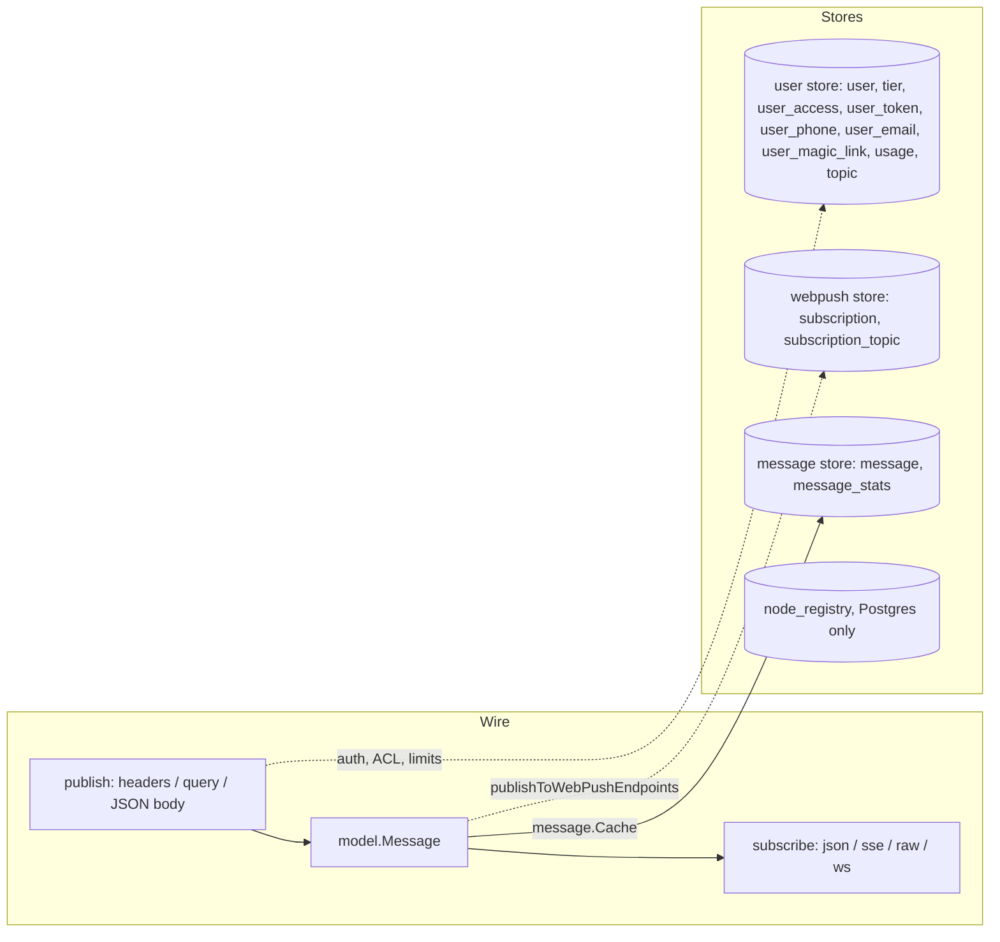
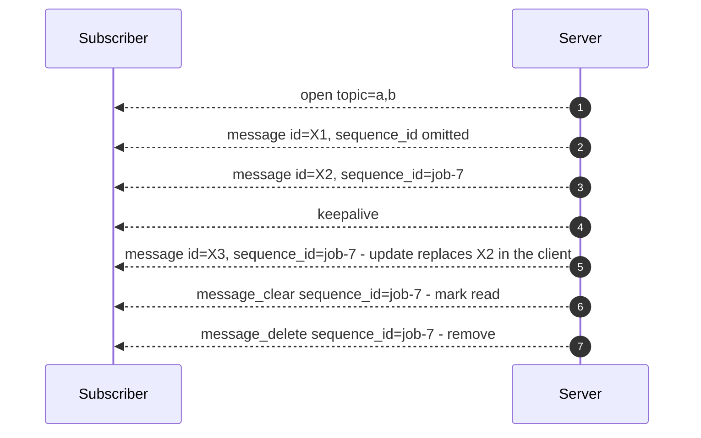
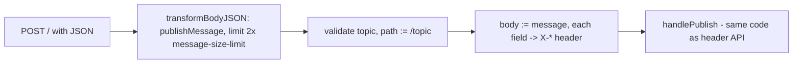
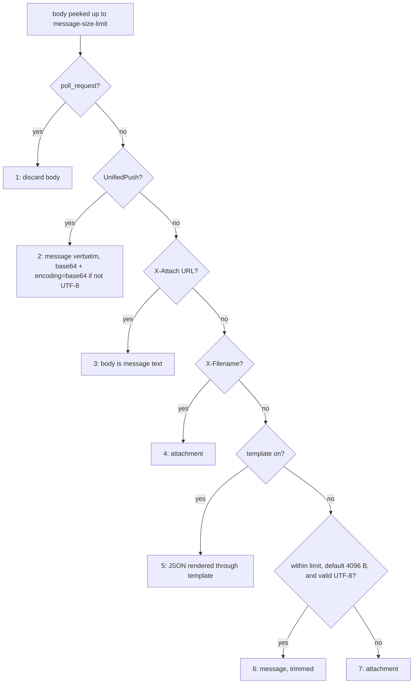
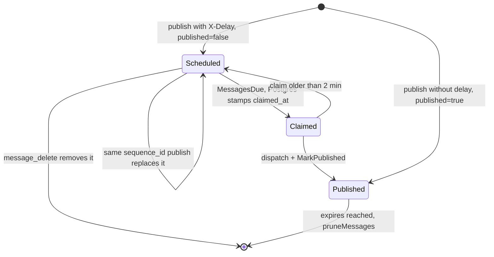
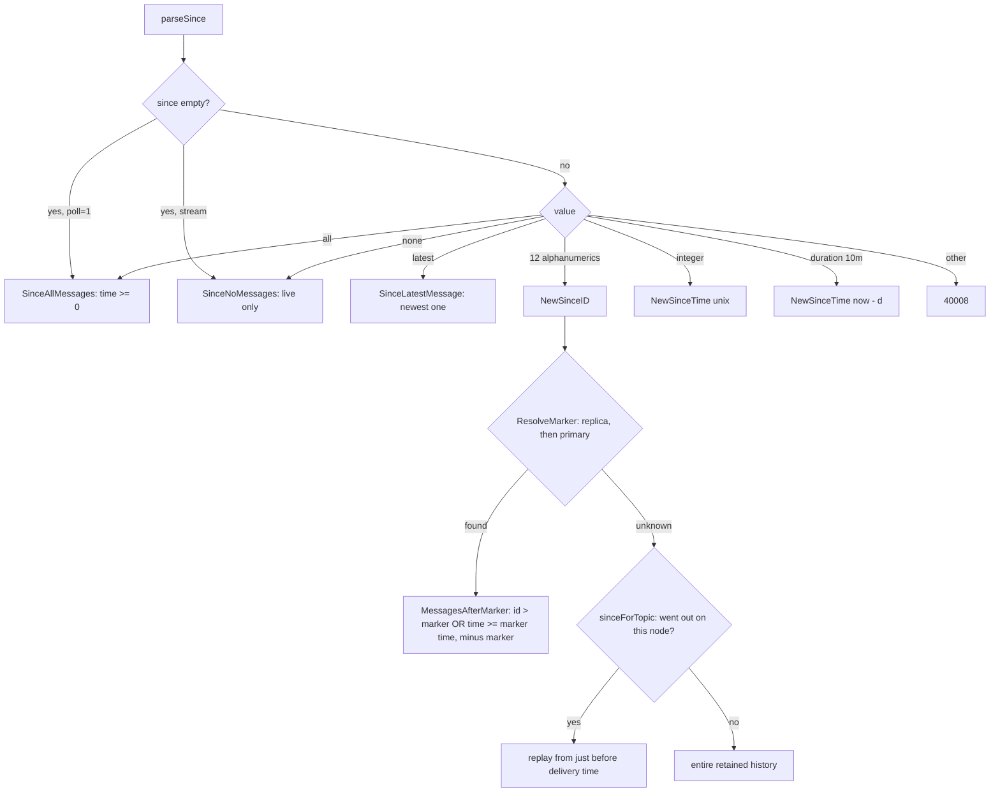
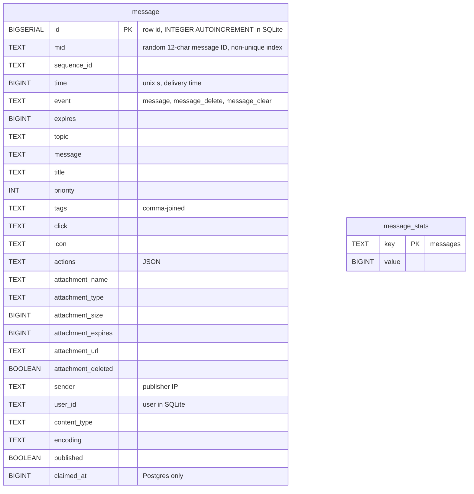
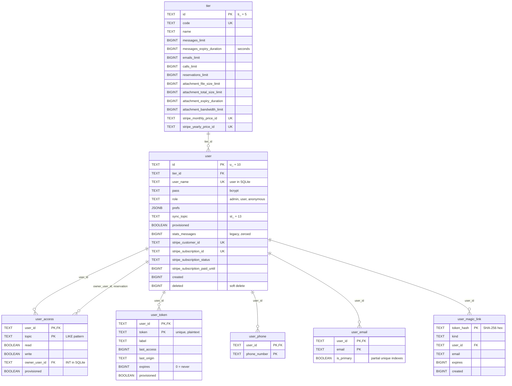
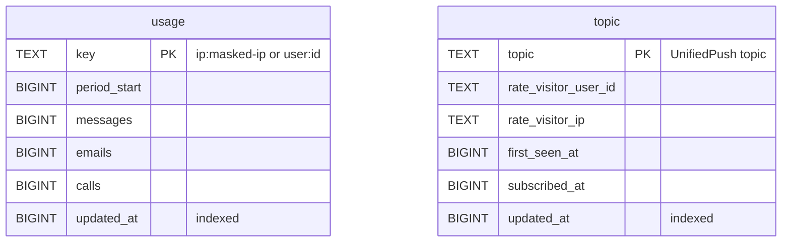
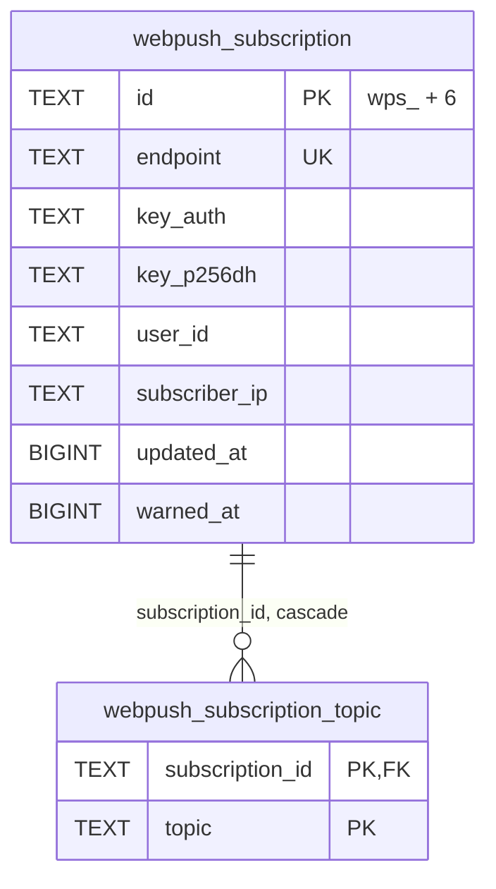

# Protocol and data model

What goes over the wire and what lands in the database. The wire side is one JSON struct
(`model.Message`) and a generous publish surface: every option works as a header, a query
parameter or a JSON field, with short aliases. The storage side is a few SQL stores (message
cache, user database, and smaller stores sharing them), each with a SQLite and a Postgres dialect
whose names do not entirely agree. Request flows: [server-architecture.md](server-architecture.md).



## Where the types live

The wire types live in `model/`, so the CLI, mailer and cache need not import the server.

| Concept | Package | File |
|---|---|---|
| `Message`, `Attachment`, `Action`, `SinceMarker`, event constants | `model` | `model/model.go` |
| Action parsing and validation | `action` | `action/action.go` |
| JSON publish body, query filters, `api*` types | `server` | `server/types.go` |
| Message cache (store, queries, schema, migrations, tail) | `message` | `message/cache*.go`, `message/tail.go` |
| User database (manager, queries, schema, migrations) | `user` | `user/manager*.go`, `user/types.go` |
| Daily usage counts (`usage` table) | `limit` | `limit/store*.go` |
| UnifiedPush topic state (`topic` table) | `topic` | `topic/store*.go` |
| Web push subscriptions | `webpush` | `webpush/store*.go` |
| Schema versioning | `db/schema` | `db/schema/schema.go` |

## The wire message

Every subscribe endpoint emits `model.Message`, and a successful publish returns it
(`m.ForJSON()`). Example as a `/json` line:

```json
{
  "id": "Xk3pQ9mZr2Lw",
  "sequence_id": "nightly-backup",
  "time": 1764072000,
  "expires": 1764115200,
  "event": "message",
  "topic": "backups-alerts",
  "title": "Backup failed",
  "message": "rsync exited with code 23 on db-replica",
  "priority": 4,
  "tags": ["warning", "floppy_disk"],
  "click": "https://example.com/backups/2026-11-25",
  "actions": [
    {"id": "a1B2c3D4e5", "action": "view", "label": "Open log", "url": "https://example.com/log/123", "clear": false}
  ],
  "attachment": {
    "name": "backup.log",
    "type": "text/plain; charset=utf-8",
    "size": 18234,
    "expires": 1764082800,
    "url": "https://ntfy.example.com/file/Xk3pQ9mZr2Lw.txt"
  },
  "content_type": "text/markdown"
}
```

| Field | JSON | Type | Meaning |
|---|---|---|---|
| `ID` | `id` | string | Random 12-char message ID; always present |
| `SequenceID` | `sequence_id,omitempty` | string | Identity across updates; omitted when equal to `id` (except on `/ws`) |
| `Time` | `time` | int64 | Unix seconds; for a scheduled message, the **delivery** time |
| `Expires` | `expires,omitempty` | int64 | Unix seconds; unset for `open`/`keepalive` or with `cache=no` |
| `Event` | `event` | string | See event types |
| `Topic` | `topic` | string | For `open`/`keepalive` on a multi-topic subscription, the comma-joined list |
| `Title` | `title,omitempty` | string | At most 1024 bytes (40057) |
| `Message` | `message,omitempty` | string | Body; `triggered` if empty |
| `Priority` | `priority,omitempty` | int | 1 to 5; 0 = unset, treated as 3 |
| `Tags` | `tags,omitempty` | []string | At most 512 bytes total (40058) |
| `Click`, `Icon` | `click`, `icon` | string | URLs |
| `Actions` | `actions,omitempty` | []*Action | At most 3 |
| `Attachment` | `attachment,omitempty` | *Attachment | `name`, `type`, `size`, `expires`, `url` |
| `PollID` | `poll_id,omitempty` | string | On `poll_request`: the message to fetch |
| `ContentType` | `content_type,omitempty` | string | Empty for `text/plain`, or `text/markdown` |
| `Encoding` | `encoding,omitempty` | string | Empty for UTF-8, or `base64` (binary UnifiedPush) |
| `Sender` | `-` | netip.Addr | Publisher IP; **never serialized** (column `sender`) |
| `User` | `-` | string | Publisher user ID; **never serialized** (column `user` / `user_id`) |

Clients must treat a missing `sequence_id` as equal to `id`. `SanitizeUTF8()` runs once at publish
and cleans every publisher-supplied string. Logging uses `Message.Context()`.

### Event types

| Event | Constant | When | Body | Persisted |
|---|---|---|---|---|
| `open` | `OpenEvent` | First frame of every streaming subscription; not with `poll=1` | empty | no |
| `keepalive` | `KeepaliveEvent` | Every `keepalive-interval` (45s) on `/json`, `/sse`, `/raw`; also the Firebase `~control` keepalive | empty | no |
| `message` | `MessageEvent` | A notification | full | yes |
| `message_delete` | `MessageDeleteEvent` | `DELETE /<topic>/<sequence-id>` or `GET .../delete` | `sequence_id` | yes |
| `message_clear` | `MessageClearEvent` | `GET`/`PUT /<topic>/<sequence-id>/read` or `/clear` | `sequence_id` | yes |
| `poll_request` | `PollRequestEvent` | To Firebase / upstream so a client fetches a message it cannot receive inline | `poll_id` | no |

`/ws` sends no `keepalive`; it uses ping/pong. Query filters (`queryFilter.Pass`) apply only to the
three persisted events.



### Action

`id` (random), `action`, `label`, `clear`, plus `url` (view, http), `method`/`headers`/`body`
(http), `intent`/`extras` (broadcast), `value` (copy). `action.Parse` enforces: at most 3; `action`
in `view|broadcast|http|copy`; `label` required; `url` for view/http, `value` for copy; http
defaults to **POST**, no body for GET/HEAD. Input starting with `[` is JSON, else the "simple"
format.

## Publishing

### Every way to publish

| Form | Notes |
|---|---|
| `PUT`/`POST /<topic>` | Canonical; body is the message or an attachment |
| `PUT`/`POST /` with a JSON body | `transformBodyJSON`; topic from the body |
| `GET /<topic>/publish`, `/send`, `/trigger` | Everything in query params |
| `PUT`/`POST /<topic>/<sequence-id>` | Update; sequence ID from the path |
| `DELETE /<topic>/<sequence-id>`, `GET /<topic>/<sequence-id>/delete` | Emits `message_delete` |
| `GET`/`PUT /<topic>/<sequence-id>/read` or `/clear` | Emits `message_clear` |
| `POST /_matrix/push/v1/notify` | Matrix push gateway, `transformMatrixJSON` (`server/server_matrix.go`) |
| Email to the SMTP server | `server/smtp_server.go` turns a mail into a publish via `s.handle` |

`readParam` falls back to query parameters, so `?title=x&priority=5` works on any method.

### The JSON body path



`cache` and `firebase` are strings in `publishMessage` (default true, so a zero bool would be
ambiguous). `template` and `unifiedpush` are header/query only.

### Publish parameters

`readParam` (`server/util.go`) tries header names in order, then the same names lowercased as
query params. Header values are MIME word-decoded (`=?utf-8?q?...?=`). Parsing:
`parsePublishParams` (`server/server.go`).

| Header | Aliases | Field | Validation and behavior |
|---|---|---|---|
| `X-Title` | `Title`, `t` | `Title` | At most 1024 bytes, else 40057 |
| `X-Message` | `Message`, `m` | `Message` | `\n` becomes a newline unless inline-template mode |
| `X-Priority` | `Priority`, `prio`, `p` | `Priority` | `util.ParsePriority`, else 40007; deferred to the template if templating |
| `X-Tags` | `Tags`, `tag`, `ta` | `Tags` | Comma-separated, trimmed; 512 bytes total |
| `X-Click` | `Click` | `Click` | none |
| `X-Icon` | `Icon` | `Icon` | `^https?://`, else 40021 |
| `X-Attach` | `Attach`, `a` | `Attachment.URL` | `^https?://`, else 40013; name from the URL path, fallback `attachment` |
| `X-Filename` | `Filename`, `file`, `f` | `Attachment.Name` | Forces the body to be an attachment |
| `X-Delay` | `Delay`, `X-At`, `at`, `X-In`, `in` | `Time` | See scheduled delivery |
| `X-Timezone` | `Timezone` | (delay) | IANA zone for natural-language delays, else 40059 |
| `X-Actions` | `Actions`, `action` | `Actions` | `action.Parse`, else 40018 |
| `X-Email` | `X-E-Mail`, `Email`, `E-Mail`, `mail`, `e` | (not stored) | Address or bool, else 40050; 40001 without a mailer |
| `X-Call` | `Call` | (not stored) | `+<digits>` or bool, else 40033; 40032 without Twilio and a user manager |
| `X-Cache` | `Cache` | (control) | Bool, default **true**; false = never persisted |
| `X-Firebase` | `Firebase` | (control) | Bool, default **true** |
| `X-UnifiedPush` | `UnifiedPush`, `up` | (control) | Bool; forces `firebase=false`; implied by `Content-Encoding: aes128gcm` |
| `X-Markdown` | `Markdown`, `md` | `ContentType` | Bool; also `Content-Type: text/markdown` |
| `X-Template` | `Template`, `tpl` | (control) | Empty = off, bool = inline, else template file name (`templateMode`) |
| `X-Sequence-ID` | `Sequence-ID`, `sid` | `SequenceID` | Topic charset, else 40049; on update routes the path wins |
| `X-Poll-ID` | `Poll-ID` | `PollID` | If set: `unifiedpush=false`, `cache=false`, no email |

Bools: `1`/`yes`/`true` and `0`/`no`/`false`; anything else is false but still "set".

**The `Priority` header trap.** RFC 9218 `Priority` headers (added by proxies and CDNs such as
Cloudflare) matching `priorityHeaderIgnoreRegex` are dropped by `maybeIgnoreSpecialHeader`, so the
lookup falls through to `X-Priority`, `prio`, `p`. Otherwise every such request would fail 40007.

### How the body is interpreted

`handlePublishBody` (`server/server.go`), first match wins:



6 versus 7 is the surprise: `curl -T file.txt` becomes a message or an attachment by size and
encoding alone. Attachments need an attachment store and `base-url` (40014) and are limited by
file size, total size and bandwidth (41301).

### Priorities, tags

| Value | Spellings (`util.ParsePriority`) |
|---|---|
| 1 | `1`, `min` |
| 2 | `2`, `low` |
| 3 | `3`, `default` |
| 4 | `4`, `high` |
| 5 | `5`, `max`, `urgent` |

Empty is 0 ("not set", treated as 3). Tags are stored comma-joined; emoji mapping is a client
concern, except email (`mail/format.go` maps tags to subject emoji).

### Scheduled delivery

`X-Delay` and aliases go through `util.ParseFutureTime` (`util/time.go`): Unix timestamp, duration
(`30m`, `3h`, `2d`), RFC 3339, or natural language ("tomorrow, 10am") in `X-Timezone`.

| Condition | Error |
|---|---|
| `cache=no` | 40002 |
| `X-Email` also set | 40003 |
| `X-Call` also set | 40037 |
| Unparseable | 40004 |
| Earlier than now + `MessageDelayMin` (10s) | 40005 |
| Later than now + `message-delay-limit` (default 3 days) | 40006 |



## Subscribing

All `GET`, comma-separated topics (each `[-_A-Za-z0-9]{1,64}`, at most 150, 40061). Sequence
diagrams per transport are in server-architecture.md section 8.

| Path | Content type | Framing |
|---|---|---|
| `/<topics>/json` | `application/x-ndjson` | One JSON object per line |
| `/<topics>/sse` | `text/event-stream` | `data: <json>`; non-message events add `event:` |
| `/<topics>/raw` | `text/plain` | Body only, newlines as spaces; other events are empty lines |
| `/<topics>/ws` | WebSocket | JSON frames; ping/pong instead of `keepalive` |
| `/<topics>/auth` | JSON | Not a subscription: read check only, `{"success":true}` |

SSE framing example:

```
event: open
data: {"id":"q1W2e3R4t5Y6","time":1764072000,"event":"open","topic":"backups-alerts"}

data: {"id":"Xk3pQ9mZr2Lw","time":1764072001,"event":"message","topic":"backups-alerts","message":"done"}

event: keepalive
data: {"id":"u7I8o9P0a1S2","time":1764072046,"event":"keepalive","topic":"backups-alerts"}
```

| Parameter | Aliases | Meaning |
|---|---|---|
| `poll` | `X-Poll`, `po` | Return cached messages and close |
| `since` | `X-Since`, `si` | Replay start, see below |
| `scheduled` | `X-Scheduled`, `sched` | Include not-yet-published (delayed) messages |
| `id` | `X-ID` | Exact match on message ID |
| `message` | `X-Message`, `m` | Exact match on body |
| `title` | `X-Title`, `t` | Exact match on title |
| `priority` | `X-Priority`, `prio`, `p` | Comma-separated; any |
| `tags` | `X-Tags`, `tag`, `ta` | Comma-separated; **all** required |

Filters run in-process after the cache query (bandwidth saving, not database work).

### Replay size

The newest messages per topic within `Config.MessagePollSizeLimit` (10 MiB of `Message.Size()`,
always at least one). A cut sets `X-Messages-Truncated: 1` (no-op on `/ws`). Poll replays charge
the bandwidth budget (42905). Topics are merged and **stable**-sorted by `time` (#1297).

### `since` semantics



The time branch of `MessagesAfterMarker` catches messages written before the marker but published
in its second or later (batches and cluster nodes write independently); the cost is an occasional
duplicate. Because an unknown marker can replay the whole topic, **clients must de-duplicate by
ID**. Sentinels: `SinceAllMessages = {Unix(0), ""}`, `SinceNoMessages = {Unix(1), ""}`,
`SinceLatestMessage = {Unix(0), "latest"}`.

## Message IDs

`model.GenerateMessageID()` = `util.RandomString(12)` over 62 alphanumerics, `crypto/rand` with
rejection sampling (unbiased).

- **Not sortable**: ordering comes from the `id` row column and `time`.
- **No uniqueness constraint**: `mid` has a non-unique index; uniqueness rests on 62^12 values.
- `ValidMessageID` checks only length and charset (how `parseSince` tells an ID from a timestamp).
- `SequenceID` uses the topic charset and defaults to the message ID.

## Schema versioning

`schema.Migrate` (`db/schema/schema.go`), one transaction per store. Postgres: one database, one
`schema_version(store, version, min_version)` keyed by store, advisory-locked. SQLite: one file per
store with `schemaVersion(id = 1, version, min_version)`. No version row = fresh database (create +
record target). Steps must be contiguous; **migrations must be additive**.

| Store (`schema_version.store`) | Package | SQLite file | Current version | Oldest migratable |
|---|---|---|---|---|
| `message` | `message` | `cache-file` | 17 | SQLite 1, Postgres 14 |
| `user` (also `usage` and `topic`) | `user` | `auth-file` | 11 | SQLite 1, Postgres 6 |
| `webpush` | `webpush` | `web-push-file` | 1 | n/a |
| `node_registry` | `cluster/registry` | Postgres only | 2 | 1 |

Postgres arrived at message version 14 and user version 6; older Postgres databases fail with
"cannot find ... migration step".

## The message cache schema

DDL: `message/cache_sqlite_schema.go`, `message/cache_postgres_schema.go`. **Table names and one
column differ**, so every query is per dialect.

| | SQLite | Postgres |
|---|---|---|
| Messages table | `messages` | `message` |
| Stats table | `stats` | `message_stats` |
| Version table | `schemaVersion` | `schema_version` (shared) |
| User column | `user` | `user_id` |
| Booleans (`published`, `attachment_deleted`) | `INT` 0/1 | `BOOLEAN` |
| 64-bit ints | `INT` | `BIGINT` |
| `claimed_at` | (none) | `BIGINT NOT NULL DEFAULT 0` |



Example rows (Postgres names, columns abbreviated):

| id | mid | sequence_id | time | event | topic | message | priority | attachment_name | sender | user_id | published | expires |
|---|---|---|---|---|---|---|---|---|---|---|---|---|
| 81234 | `Xk3pQ9mZr2Lw` | `nightly-backup` | 1764072000 | `message` | `backups-alerts` | `Backup failed` | 4 | `backup.log` | `203.0.113.17` | `u_A1b2C3d4E5` | true | 1764115200 |
| 81235 | `Hh7Jk2Lm9Nn0` | `Hh7Jk2Lm9Nn0` | 1764075600 | `message` | `deploys` | `Deploy at 14:00` | 3 | | `198.51.100.4` | | false | 1764118800 |
| 81236 | `Zz1Yy2Xx3Ww4` | `nightly-backup` | 1764072300 | `message_clear` | `backups-alerts` | | 0 | | `2001:db8::42` | `u_A1b2C3d4E5` | true | 1764115500 |

Row 81235 is scheduled (`published = false`, `time` in the future); row 81236 marks row 81234 read
by sequence ID. `message_stats` holds one row, `('messages', 1048576)`, incremented by `AddStats`.

Inserts write all 24 columns (`insertMessageColumns`); `published` is computed as `m.Time <= now`,
`attachment_deleted` starts false. The 22-column select list must match `readMessage`'s scan order
(no column-name binding).

### Indexes

| SQLite | Postgres | Serves |
|---|---|---|
| `idx_mid (mid)` | `idx_message_mid (mid)` | Lookup by ID, `ResolveMarker` |
| `idx_sequence_id` | `idx_message_sequence_id` | Scheduled replace/delete by sequence ID |
| `idx_topic_published_time (topic, published, time)`, `idx_topic`, `idx_time` | `idx_message_topic_published_time (topic, published, time, id)` | Time replays, `latest`, time branch of since-ID |
| (rowid) | `idx_message_topic_published_id (topic, published, id)` | Id branch of since-ID |
| `idx_expires` | `idx_message_published_expires (published, expires)` | Expiry deletion |
| `idx_attachment_expires` | `idx_message_attachment_expires ... WHERE attachment_deleted = FALSE` | Attachment expiry sweep |
| `idx_sender` | `idx_message_sender_attachment_expires ... WHERE user_id = ''` | Anonymous attachment quota |
| `idx_user` | `idx_message_user_id_attachment_expires` | Per-user attachment quota |

### Key queries

| Query | Shape |
|---|---|
| Insert | SQLite multi-row `INSERT ... VALUES` up to 1000 rows; Postgres one fixed `INSERT ... SELECT * FROM unnest($1::TEXT[], ...)` per batch (pgx statement cache stays small) |
| Since time | `topic = ? AND time >= ? AND published = 1 ORDER BY time DESC, id DESC`, trimmed to budget and reversed; `scheduled=1` drops the published filter |
| Since ID | `UNION ALL` of `time >= marker time AND id <> marker id` and `id > marker id AND time + 0 < marker time` (`+ 0` avoids the time index); `scheduled=1` adds unpublished rows |
| Due | SQLite `time <= now AND published = 0`; Postgres claims up to 1000 with stale `claimed_at`, `FOR UPDATE SKIP LOCKED` |
| Tail | `selectMessagesAfterRowID`: rows after the cursor plus hole ids, from the primary |
| Expiry | `DELETE ... WHERE mid IN (SELECT mid ... WHERE expires <= ? AND published = 1 LIMIT ?)` |

### Message cache migrations

SQLite 1 to 17 (pre-v1.10.0 databases cannot migrate); Postgres 14 to 17. Selected steps:

| Step | Change |
|---|---|
| 1 -> 2 | Add `published` |
| 4 -> 5 | **Table rebuild**: string ID moves from the PK to `mid`; `id` becomes autoincrement |
| 6 -> 7 | Rename `attachment_owner` to `sender` |
| 9 -> 10 | Add `user`, `attachment_deleted`, `expires`; backfill `expires = time + cache-duration` |
| 10 -> 11 | Add `stats` |
| 13 -> 14 | Add `sequence_id`, `event` (updates, deletes, clears) |
| 14 -> 15 | Postgres: partial `idx_message_attachment_expires`; SQLite no-op |
| 15 -> 16 | Postgres: `claimed_at`; SQLite no-op |
| 16 -> 17 | SQLite `idx_topic_published_time`; Postgres `idx_message_topic_published_id` |

Startup: `server.New` -> `createMessageCache` -> `message.NewPostgresStore` / `NewSQLiteStore` ->
`schema.Migrate`. In-memory stores use the SQLite path, so tests run real migrations.

## The user database schema

DDL: `user/manager_sqlite_schema.go`, `user/manager_postgres_schema.go`. **Portability gotcha:**
the table is `user` in SQLite but `"user"` (quoted) in Postgres, and the username column is `user`
in SQLite but `user_name` in Postgres. Booleans are `INT` in SQLite, `BOOLEAN` in Postgres; JSON
is `JSON` versus `JSONB`; 64-bit ints are `INT` versus `BIGINT`.



`user` also has `stats_emails`, `stats_calls`, `stripe_subscription_interval` and
`stripe_subscription_cancel_at` (omitted above). `u_everyone` (username `*`, role `anonymous`) is
seeded at creation.

Example rows:

`user`

| id | tier_id | user_name | role | sync_topic | prefs | provisioned | deleted |
|---|---|---|---|---|---|---|---|
| `u_everyone` | | `*` | `anonymous` | | `{}` | false | |
| `u_A1b2C3d4E5` | `ti_Pro12` | `phil` | `admin` | `st_Qw3Er5Ty7Ui9Op` | `{"language":"en","notification":{"min_priority":3},"subscriptions":[{"base_url":"https://ntfy.example.com","topic":"backups-alerts","display_name":"Backups"}]}` | true | |
| `u_Z9y8X7w6V5` | | `alice` | `user` | `st_Mn2Bv4Cx6Za8Lk` | `{}` | false | 1764000000 |

`tier`

| id | code | name | messages_limit | messages_expiry_duration | attachment_file_size_limit | stripe_monthly_price_id |
|---|---|---|---|---|---|---|
| `ti_Pro12` | `pro` | `Pro` | 20000 | 2592000 | 104857600 | `price_1Ab...` |

`user_access` (`*` is stored as `%`, `_` as `\_`)

| user_id | topic | read | write | owner_user_id | provisioned |
|---|---|---|---|---|---|
| `u_A1b2C3d4E5` | `backups-alerts` | true | true | `u_A1b2C3d4E5` | false |
| `u_everyone` | `backups-alerts` | false | false | `u_A1b2C3d4E5` | false |
| `u_everyone` | `public\_%` | true | false | | true |

The first two rows are a reservation: the owner gets read-write, everyone else deny.

`user_token`, `user_phone`, `user_email`, `user_magic_link`

| table | row |
|---|---|
| `user_token` | `u_A1b2C3d4E5`, `tk_8f2k...`, label `laptop`, last_access 1764071000, last_origin `203.0.113.17`, expires 0, provisioned false |
| `user_phone` | `u_A1b2C3d4E5`, `+15555550123` |
| `user_email` | `u_A1b2C3d4E5`, `phil@example.com`, is_primary true |
| `user_magic_link` | `9c1e...` (SHA-256 hex), kind `email_verify`, `u_Z9y8X7w6V5`, `alice@example.com`, expires 1764075600 |

### Table notes

| Table | Note |
|---|---|
| `user` | `stats_*` are legacy since user v10 (counts live in `usage`); soft-deleted users are hard-deleted after 7 days |
| `tier` | Durations in seconds; `code` and price IDs unique (named indexes in SQLite, inline in Postgres) |
| `user_access` | PK `(user_id, topic)` is the upsert target; both FKs cascade. SQLite declares `owner_user_id INT`, which works only through type affinity; carried through rebuilds, leave it |
| `user_token` | Unique index on `token` alone is the hot path of every Bearer request |
| `user_phone` | SQLite step 8 -> 9 rebuilds it to repair a foreign key |
| `user_email` | `idx_user_email_primary_user` (one primary per user), `idx_user_email_primary_addr` (an address is primary on one account); predicate `is_primary = 1` vs `is_primary` |
| `user_magic_link` | Email verification and password reset; index `(user_id, kind)`; reaped hourly |

### `usage` and `topic` (same database)



| table | key / topic | values |
|---|---|---|
| `usage` | `ip:198.51.100.0` | period_start 1764028800, messages 41, emails 2, calls 0 |
| `usage` | `user:u_A1b2C3d4E5` | period_start 1764050400, messages 1203, emails 0, calls 1 |
| `topic` | `upAbC123dEf456` | rate_visitor_user_id (empty), rate_visitor_ip `203.0.113.0`, subscribed_at 1764071900 |

`usage` (package `limit`, `limit/store_*.go`): one row per visitor key reused across its 24h
periods; nodes upsert deltas (same period add, newer replace, older drop), read back rows changed
since their watermark, prune after 25h. `topic` (package `topic`, `topic/store_*.go`): merged per
field (earliest `first_seen_at`, latest `subscribed_at`, last rate visitor), pruned after 7 days.

### Web push and cluster tables



SQLite names them `subscription` and `subscription_topic` (in `web-push-file`). With clustering,
Postgres also holds `node_registry` (`node_id`, `advertise_url`, `last_heartbeat`, `role`); see
[cluster.md](cluster.md).

### User DB migrations

Version 11 in both dialects (SQLite from 1, Postgres from 6), each step inside the single
`schema.Migrate` transaction:

| Step | Change |
|---|---|
| 1 -> 2 | Rename the old `user` table aside, regenerate IDs and sync topics in Go, fold legacy `access` into `user_access` |
| 5 -> 6 | `provisioned` columns by full table rebuild (needs foreign keys off) |
| 6 -> 7 | `user_email` |
| 7 -> 8 | `is_primary`, partial unique indexes, `user_magic_link` |
| 8 -> 9 | SQLite only: rebuild `user_phone`; no-op on Postgres |
| 9 -> 10 | `usage`; zero `stats_*` |
| 10 -> 11 | `topic` |

## Auth on the wire

The decision flow is in server-architecture.md ("Authentication"). Wire facts:

| Form | Meaning |
|---|---|
| `Authorization: Bearer tk_...` | `AuthenticateToken`; async `EnqueueTokenUpdate` records last access/origin |
| `Authorization: Basic base64(user:pass)` | User or verified primary email (`userByNameOrEmail`), bcrypt |
| `Authorization: Basic base64(:tk_...)` | Empty username: the password is a token (`curl -u :tk_...`) |
| `?auth=base64url("Basic " + base64("user:pass"))` or `?authorization=` | Unpadded base64url of the whole header value; overrides the header. For `EventSource` and browser `WebSocket`; lands in logs and history |
| `WebPush ...`, `vapid ...`, anything else | Treated as anonymous, not failed auth (#629) |

The auth-failure bucket is checked before the database (42909).

### Tokens

| Property | Value | Where |
|---|---|---|
| Prefix | `tk_` | `tokenPrefix` (`user/manager.go`) |
| Length | 32 including the prefix (29 random) | `tokenLength` |
| Alphabet | lowercase alphanumeric (tokens appear in case-insensitive `<topic>+<token>@<domain>` addresses) | `GenerateToken` |
| Max per user | 60, excess trimmed at creation | `tokenMaxCount`, `createTokenTx` |
| Validation | `^tk_[-_A-Za-z0-9]{29}$` (looser than the generator) | `allowedTokenRegex` (`user/util.go`) |

**Access tokens are stored in plaintext** (lookup `token = ? AND (expires = 0 OR expires >= ?)`):
a legacy trade-off, so a database read yields working credentials. **Magic-link tokens are
hashed**: 48 base62 chars, only the SHA-256 hex is stored (`hashToken`).

### Passwords, permissions, roles

| Item | Value |
|---|---|
| Hash | bcrypt, `Config.AuthBcryptCost` (default 10); `ValidPasswordHash` accepts `$2a$`/`$2b$`/`$2y$` at or above the minimum cost |
| Timing | `userAuthIntentionalSlowDownHash` for unknown/soft-deleted users; its cost must track the default, nothing enforces it |
| `Permission` | `DenyAll=0`, `Read=1`, `Write=2`, `ReadWrite=3`; `ParsePermission` accepts `rw`, `ro`, `wo`, `deny`, ... |
| `Role` | `admin`, `user`, `anonymous` (matches the SQL `CHECK`); `AllowedRole` permits only `user` and `admin` for new accounts |
