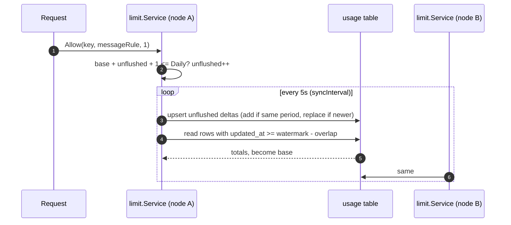

# Rate limiting and quotas

How the ntfy server decides whether a request, message, e-mail, call or byte is allowed, and how that
state is kept across restarts and shared between cluster nodes. Code references are repo-relative:

| Package | Role |
|---|---|
| `visitor/` | Identity and policy: turns an IP or user into a limiter key (`Key`, `Mask`) and resolves the limits for it from the config or the user's tier (`LimitsFor`). No HTTP, no counting. |
| `limit/` | Mechanism: answers "may key K use N units of kind X under rule R?" from sharded in-memory token buckets and daily counts (`Service.Allow`). Knows nothing about users, tiers or HTTP. |
| `server/visitor.go` | Glue: the per-request `visitor` type, which maps resolved limits to `limit.Rule`s and exposes `RequestAllowed`, `MessageAllowed`, `EmailAllowed`, ... to the handlers. |
| `cluster/cluster_mesh_buckets.go` | Shares token-bucket usage between cluster nodes every second. |
| `limit/store*.go`, `usage` table | Persists and shares the daily counts (messages, e-mails, calls). |

## The visitor abstraction

### Keys

`visitor.Key` (`visitor/key.go`) computes the key every limit is counted under:

| Request | Key |
|---|---|
| Anonymous | `ip:<ip masked to visitor-prefix-bits-ipv4/ipv6>` |
| Authenticated user **without** a tier | `ip:<masked ip>` (same as anonymous) |
| Authenticated user **with** a tier | `user:<user id>` |

Consequences:

- Logging in as a tier-less user does not give you your own buckets; you share the IP key with
  everyone behind that prefix. Only `u.Tier != nil` promotes a visitor to a user key.
- Tokens are not a separate identity. Bearer (or `Basic` with an empty username) auth resolves to a
  `*user.User` (`server/server_auth.go`, `authenticateBearerAuth`), and keying is then identical to
  password auth.
- IPv4 defaults to `/32` and IPv6 to `/64` (`DefaultVisitorPrefixBitsIPv4/IPv6`, `server/config.go`).
  The IPv6 default groups a whole subnet, because a single IPv6 client typically owns a `/64` and
  could otherwise rotate addresses freely.
- A user key is shared across every IP the account uses.

### Per-request visitors

`Server.visitor` (`server/server.go`) calls `newVisitor` (`server/visitor.go`) on **every request**.
A `visitor` is an immutable value: its `key`, the request `ip`, the `user` and the resolved
`*visitor.Limits`. Nothing is cached between requests, so concurrent requests from one IP cannot see
each other's user (#1051), and `v.ip` is always the current request's IP (it used to be stale on
shared account visitors). All state lives in the `limit.Service`, keyed by `v.key`; two visitors with
the same key share one set of buckets and counts.

Shared, immutable pieces (config, the precomputed IP-based limits, the limit service, the
subscription gauge) live in `visitorEnv`, built once in `newVisitorEnv`.

`maybeAuthenticate` (`server/server_auth.go`) always builds an IP visitor first (`vip`), which owns
the auth-failure bucket, and builds a second visitor with the user only after successful
authentication. A tiered user therefore touches two keys per authenticated request: `ip:...` for
auth failures and `user:...` for everything else.

### Expiry

There is no visitor map to expire. `limit.Service.Prune` (`limit/service.go`), run by
`pruneVisitors` (`server/server_manager.go`) every `manager-interval` (default `1m`), forgets a
key's buckets once **every** bucket is full again and the key has been idle for `settledIdle`
(`1m`); a forgotten key comes back with full buckets, so pruning changes nothing. Daily counts are
kept until their 24h period ends. `Touch` (called by `newVisitor` and `Keepalive`) keeps a key with
a long-lived subscription alive.

### Rate visitors (subscriber-based rate limiting)

With `visitor-subscriber-rate-limiting`, a UnifiedPush topic (`up*`) can carry a *rate visitor*: the
subscriber who pays for its pushes. `Server.rateVisitor` (`server/server_rate_visitor.go`) reads the
subscriber's IP and user ID from the topic's row (`topic.Service.State`, shared by all servers), and
builds a visitor for it while the subscriber was active within `rateVisitorLiveFor` (`1d`) or has a
stream open. `limitRequestsWithTopic` (`server/server_middleware.go`) puts it into the request
context as `contextRateVisitor`, and the publish path charges requests, messages, e-mails and calls
to it instead of the publisher.

A UnifiedPush publish with the feature on and no live rate visitor returns `507` / `50701`, not a
4xx, because some app servers (Mastodon) delete the subscription on most 4xx codes. A topic with no
subscriber activity for `unifiedPushAbandonedAfter` (4 days) returns `410` / `41002` instead, so
the app server removes it (`handlePublishInternal`, `unifiedPushTopicAbandoned`).

## Configurable limits

Every flag also accepts an underscore alias and can be set in `server.yml` under the same key. Env
vars and defaults are declared in `cmd/serve.go`; the default constants are in `server/config.go`.

### Per-visitor limits

| `server.yml` key | Env var | Default | Unit | On exceed |
|---|---|---|---|---|
| `visitor-request-limit-burst` | `NTFY_VISITOR_REQUEST_LIMIT_BURST` | `60` | requests | `429` / `42901` |
| `visitor-request-limit-replenish` | `NTFY_VISITOR_REQUEST_LIMIT_REPLENISH` | `5s` | one token per interval | `429` / `42901` |
| `visitor-request-limit-exempt-hosts` | `NTFY_VISITOR_REQUEST_LIMIT_EXEMPT_HOSTS` | empty | hosts, IPs, CIDRs | bypass, see below |
| `visitor-message-daily-limit` | `NTFY_VISITOR_MESSAGE_DAILY_LIMIT` | `0` (derived, see below) | messages per 24h | `429` / `42908` |
| `visitor-subscription-limit` | `NTFY_VISITOR_SUBSCRIPTION_LIMIT` | `30` | open subscriptions, per node | `429` / `42903` |
| `visitor-email-limit-burst` | `NTFY_VISITOR_EMAIL_LIMIT_BURST` | `16` | e-mails | `429` / `42902` |
| `visitor-email-limit-replenish` | `NTFY_VISITOR_EMAIL_LIMIT_REPLENISH` | `1h` | one token per interval | `429` / `42902` |
| `visitor-topic-creation-limit-burst` | `NTFY_VISITOR_TOPIC_CREATION_LIMIT_BURST` | `100` | new in-memory topics; `0` disables | `429` / `42911` |
| `visitor-topic-creation-limit-replenish` | `NTFY_VISITOR_TOPIC_CREATION_LIMIT_REPLENISH` | `1m` | one token per interval | `429` / `42911` |
| `visitor-attachment-total-size-limit` | `NTFY_VISITOR_ATTACHMENT_TOTAL_SIZE_LIMIT` | `100M` | stored attachment bytes | `413` / `41301` |
| `visitor-attachment-daily-bandwidth-limit` | `NTFY_VISITOR_ATTACHMENT_DAILY_BANDWIDTH_LIMIT` | `500M` | bytes per 24h: attachment up/downloads and poll replays | `429` / `42905` (download, poll), `413` / `41301` (upload) |
| `visitor-prefix-bits-ipv4` | `NTFY_VISITOR_PREFIX_BITS_IPV4` | `32` | bits | keying only |
| `visitor-prefix-bits-ipv6` | `NTFY_VISITOR_PREFIX_BITS_IPV6` | `64` | bits | keying only |
| `visitor-subscriber-rate-limiting` | `NTFY_VISITOR_SUBSCRIBER_RATE_LIMITING` | `false` | bool | `507` / `50701` for UnifiedPush without a subscriber |

Phone calls and topic reservations have no config key: for visitors without a tier both are `0`
(`visitor.DefaultCallsLimit`, `visitor.DefaultReservationsLimit`, `visitor/types.go`), because
phone numbers must be verified and reservations are a tier feature.

### Global and message limits

| `server.yml` key | Env var | Default | On exceed |
|---|---|---|---|
| `message-size-limit` | `NTFY_MESSAGE_SIZE_LIMIT` | `4K` | body beyond the limit becomes an attachment (`util.Peek` in `handlePublishInternal`); JSON publish allows `2x` and returns `413` / `41303`; Matrix returns `413` / `41302` |
| `global-topic-limit` (`-T`) | `NTFY_GLOBAL_TOPIC_LIMIT` | `15000` | `429` / `42904` (`topicsFromIDs`) |
| `attachment-total-size-limit` (`-A`) | `NTFY_ATTACHMENT_TOTAL_SIZE_LIMIT` | `5G` | rejected by the attachment store |
| `attachment-file-size-limit` (`-Y`) | `NTFY_ATTACHMENT_FILE_SIZE_LIMIT` | `15M` | `413` / `41301` |
| `attachment-expiry-duration` (`-X`) | `NTFY_ATTACHMENT_EXPIRY_DURATION` | `3h` | deletion |
| `cache-duration` (`-b`) | `NTFY_CACHE_DURATION` | `12h` | expiry; also the IP-based `MessageExpiryDuration` |
| `message-delay-limit` | `NTFY_MESSAGE_DELAY_LIMIT` | `3d` | `400` / `40006` |

`message-size-limit` above 4K logs a warning, and above `5M` is a startup error (`cmd/serve.go`).

### Limits without a config key

Compile-time constants; changing them needs a rebuild.

| Limit | Constant | Value | On exceed |
|---|---|---|---|
| Account actions (signup and password reset share one bucket), burst | `DefaultVisitorAccountCreationLimitBurst` | `6` | `429` / `42906` |
| Account actions, replenish | `DefaultVisitorAccountCreationLimitReplenish` | `24h` | `429` / `42906` |
| Auth failures, burst | `DefaultVisitorAuthFailureLimitBurst` | `30` | `429` / `42909` |
| Auth failures, replenish | `DefaultVisitorAuthFailureLimitReplenish` | `1m` | `429` / `42909` |
| Firebase pause after FCM "quota exceeded" | `DefaultFirebaseQuotaExceededPenaltyDuration` | `10m` | Firebase send skipped |
| Poll replay size per topic | `DefaultMessagePollSizeLimit` | `10M` | replay truncated |
| Title / tags size | `messageTitleSizeLimit`, `messageTagsSizeLimit` | `1024` / `512` bytes | `400` |

`handleAccountPasswordResetRequest` (`server/server_account.go`) consumes an account token on every request,
including one for an unknown address, to throttle account probing.

### Error codes

All defined in `server/errors.go`. The rate-limiting family:

| Code | HTTP | Meaning | Raised in |
|---|---|---|---|
| `41301` | 413 | attachment too large, or bandwidth limit reached during upload | `handleBodyAsAttachment` |
| `41302` | 413 | Matrix request too large | `newRequestFromMatrixJSON` (`server/server_matrix.go`) |
| `41303` | 413 | JSON body too large | `readJSONWithLimit` (`server/util.go`), e.g. via `transformBodyJSON` |
| `42901` | 429 | too many requests | `limitRequests`, `limitRequestsWithTopic` |
| `42902` | 429 | too many e-mails | `handlePublishInternal`, account e-mail verification |
| `42903` | 429 | too many active subscriptions | `handleSubscribeHTTP`, `handleSubscribeWS` |
| `42904` | 429 | total server topic limit reached | `topicsFromIDs` |
| `42905` | 429 | daily bandwidth reached | `handleFile`, poll replay in `handleSubscribeHTTP` |
| `42906` | 429 | too many account requests | `handleAccountCreate`, `handleAccountPasswordResetRequest` |
| `42907` | 429 | too many topic reservations | reservation handler (`user.ErrTooManyReservations`) |
| `42908` | 429 | daily message quota reached | `handlePublishInternal`, `handleActionMessage` |
| `42909` | 429 | too many auth failures | `maybeAuthenticate` |
| `42910` | 429 | daily phone call quota reached | `handlePublishInternal` |
| `42911` | 429 | too many new topics | `topicsFromIDs` |
| `50701` | 507 | UnifiedPush publish without an active subscriber | `handlePublishInternal` |

When Stripe is configured, `handleError` (`server/server.go`) appends an upsell hint to 429/413
errors for visitors without a tier.

### Response headers

A denial carries its `limit.Decision` (`errHTTP.WithLimitDecision`), and `handleError` turns it into:

- `Retry-After`: whole seconds until the usage could be admitted, rounded up
  (`errHTTP.retryAfterSeconds`). Omitted when the wait is unknown (e.g. `n` exceeds the burst, or a
  bucket that never refills) and for state-based limits (subscriptions, total topics, reservations).
- `RateLimit-Policy` and `RateLimit` (draft-ietf-httpapi-ratelimit-headers), via
  `setRateLimitHeaders` (`server/server_middleware.go`), e.g. `"messages";q=250;w=86400` and
  `"messages";r=249;t=3600`. Successful publishes also send them for the request and message
  limits.

## Limit resolution

`visitor.LimitsFor(conf, tier)` (`visitor/limits.go`) is the single resolution path, pinned by
`TestLimitsFor_Config` and `TestLimitsFor_Tier` (`visitor/limits_test.go`). `Limits.Basis` is `ip`
or `tier`. The server precomputes the IP-based limits once (`visitorEnv.ipLimits`) and resolves
tier-based limits per request, so a tier edited in the database applies on the next request.

### Config-based (no tier)

- Daily messages: `visitor-message-daily-limit`, or if `0`, `24h / visitor-request-limit-replenish`
  = **17280** at defaults. Tightening the request replenish also tightens the daily quota unless the
  daily limit is set explicitly.
- Daily e-mails: `24h / visitor-email-limit-replenish` (= 24 at defaults), or `0` if
  `visitor-email-limit-burst` is `0`.
- Calls and reservations: `0`.

### Tier-based

`user.Tier` (`user/types.go`) fields override the config: `MessageLimit`, `MessageExpiryDuration`,
`EmailLimit`, `CallLimit`, `ReservationLimit`, `AttachmentFileSizeLimit`, `AttachmentTotalSizeLimit`,
`AttachmentExpiryDuration`, `AttachmentBandwidthLimit`. The request and e-mail buckets are derived
from the daily limits, and **a tier never lowers the configured request bucket**:

| Value | Formula (`tierBasedLimits`) |
|---|---|
| Request burst | `MinMax(MessageLimit * 5%, visitor-request-limit-burst, 1000)` |
| Request refill | faster of `visitor-request-limit-replenish` and `24h / (2 * MessageLimit)` |
| E-mail burst | `MinMax(EmailLimit * 20%, visitor-email-limit-burst, 150)` |
| E-mail refill | `24h / EmailLimit`, not clamped (a tiny tier really refills slowly); `0` never refills |

No tier field overrides `visitor-subscription-limit`, the topic-creation, account or auth limits.

### Mapping to rules

`server/visitor.go` translates `Limits` into a `limit.Rule` per call (`requestRule`, `messageRule`,
`emailRule`, ...). A rule has `Burst` and `Refill` (a token bucket), `Daily` (a cap per 24h period),
or both, plus a `Threshold` for persistence (below).

| Kind (`limit/types.go`) | Bucket | Daily cap | Shared in a cluster |
|---|---|---|---|
| `requests` | burst / replenish | | gossip |
| `messages` | | `MessageLimit` | usage table |
| `emails` | e-mail burst / refill | `EmailLimit` | both |
| `calls` | | `CallLimit` | usage table |
| `bandwidth` | `AttachmentBandwidthLimit`, refilling over 24h | | gossip |
| `topics` | topic-creation burst / replenish | | gossip |
| `account` | account burst / replenish | | gossip |
| `auth` | auth-failure burst / replenish (`Check` before, `Allow` on failure) | | gossip |
| `firebase` | 1 token, refill = penalty duration (taking it pauses sends) | | gossip |

A daily limit of `0` means "admits nothing" at the `visitor` layer (the methods return a denying
`Decision` before calling the service), while `Daily: 0` in a `limit.Rule` means "no cap"; this is
why `MessageAllowed`, `CallAllowed`, `EmailAllowed` and `BandwidthAllowed` short-circuit on zero.

Subscriptions are not a `limit` kind: `subscriptionGauge` (`server/visitor_subscriptions.go`) counts
open streams per key on this node only. `SubscriptionAllowed` must be paired with
`RemoveSubscription`.

## The limit service

`limit.Service` (`limit/service.go`) holds two sharded structures (64 shards each, FNV-1a on the key):

- **Token buckets** (`limit/buckets.go`): one `bucket` per key and kind, created full, refilled
  lazily on use. The rule is passed in on every call rather than baked into the state, so a tier
  change applies immediately: a changed burst shifts the tokens by the difference (down to a debt of
  one burst), so the user keeps what was already spent instead of getting a fresh bucket.
- **Daily counters** (`limit/counters.go`): per key, `base` (the row as last read from the store,
  all nodes) plus `unflushed` (admitted here since the last write), for messages, e-mails and calls.

`Allow(key, rule, n)` charges the bucket first, then checks the daily cap; if the cap denies, the
bucket is refunded, so the two locks are never nested. `Check` asks without consuming. `Refund` hands
units back. `Limiter` returns a `util.Limiter` view for `util.LimitReader` / `util.LimitWriter`; a
negative `AllowN` refunds, so when an attachment upload is rejected by a size limiter, the bandwidth
already charged in that write is handed back.

### Daily periods, no midnight reset

There is no global daily reset. Each key's 24h period starts at its own time of day,
`keyOffset(key)` (an unseeded FNV-1a hash of the key modulo one day, `limit/util.go`), so every node
and every restart agree, and resets are spread over the day. `periodStart` / `periodEnd` compute the
current period; a counter rolls over lazily on the key's next use. The reset time is exposed as
`stats.reset_at` in `/v1/account` (`visitorStats.ResetAt`).

### The usage table

Daily counts persist in the `usage` table, created by the user schema (`user/manager_sqlite_schema.go`,
`user/manager_postgres_schema.go`): in the `auth-file` on SQLite, or the shared database on
PostgreSQL (`createUsageStore`, `server/server.go`). Without either, counts are memory only.

```
key TEXT PRIMARY KEY, period_start BIGINT, messages BIGINT, emails BIGINT, calls BIGINT, updated_at BIGINT
```

One row per key, reused across periods. The `stats_*` columns of the user table are no longer used
(zeroed by the migration that added `usage`).



Details (`limit/counters.go`, `limit/store.go`):

- **Startup** (`Start`): loads every row written in the last day, waiting up to `loadWait` (30s),
  then serving from memory while the load continues in the background.
- **Write**: deltas are upserted sorted by key in chunks of 1000. A delta for an older period than
  the stored row is dropped (a node's leftover of the previous day would otherwise be counted twice).
  Postgres uses one `unnest` statement per chunk, SQLite one prepared statement per row in a
  transaction. A timeout after send is treated as possibly written (`errMaybeWritten`), so it is
  never written twice: undercount over double count.
- **Read-back**: rows changed since the watermark, re-reading `readOverlap` (6s) back to catch rows
  committed late. Reads go to the primary.
- **Prune**: hourly, rows not written for 25h.
- **Failure**: store errors never reach the request path; counts stay unflushed and are written
  once the store is back (per-node limits meanwhile).
- **Promotion threshold**: to keep one-off IPs out of the table, an anonymous key's count is only
  written once it reaches 10% of its daily cap (`promoteRate`, `messageRule` in `server/visitor.go`).
  An authenticated visitor's count is written from the first message, including a tier-less user,
  which persists the shared IP key.
- **Clocks**: periods, `updated_at` and the watermark use the node's clock, so nodes sharing a
  database must keep their clocks in sync (NTP).

In a cluster, a count reaches the other nodes within about two sync intervals, so the overshoot is
bounded by roughly `(nodes - 1)` times what a key is admitted in ~10s.

### Cluster bucket exchange

Token buckets are per node, but shared over the cluster mesh (enabled with
`experimental-cluster-listen`; `TrackDeltas` is set only then, `server/server.go`):

- **Gossip**: every `bucketGossipInterval` (1s) `runBucketGossip` takes `Service.BucketDeltas()`
  (tokens used per key and kind since the last round, refunds netted out, each with its burst and
  refill) and posts it to every live peer (`broadcastBuckets`). Peers apply it with `ChargeBuckets`,
  creating buckets for keys they have not seen. A client spread over N nodes therefore gets its
  limits once, not N times, after at most about one burst per node.
- **Restore**: a starting node calls `restoreBuckets` before serving: it fetches
  `Service.BucketSnapshot()` (every non-full bucket) from each live peer (`GET` on `BucketsPath`,
  `handleBucketSnapshot`) and applies it with `RestoreBuckets`, which keeps the larger of local and
  snapshot usage (never the sum). A rolling restart or crash forgives nothing as long as one node is
  up; peers that do not answer within `bucketRestoreTimeout` (10s) are skipped (fail open).
- **Bounds** (`limit/peers.go`): at most `BucketDeltasMax` (50000) buckets per round; peer usage can
  push a bucket into debt of at most `peerDebtMax` (10) bursts; usage with a burst above
  `peerBurstMax` or a negative refill is ignored. When a peer's rule and the local rule disagree, the
  more generous one is used.
- A lost round undercounts; failed sends are not retried.

Not shared in a cluster: the subscription gauge (each node protects its own connections) and the ban
feed trackers.

## Proxy handling and visitor identity

Getting this wrong collapses every visitor behind a reverse proxy into one key (the proxy's IP), or
lets clients spoof their identity.

`extractIPAddress` (`server/util.go`):

1. If `behind-proxy` and `proxy-forwarded-header` are set, try `extractIPAddressFromHeader`.
2. On any error, fall back to `r.RemoteAddr`.
3. If even that fails, log a warning and use `0.0.0.0`.

`extractIPAddressFromHeader`:

1. Joins **all** lines of the header (proxies may add a line rather than append), lowercased.
2. Splits on `,`, accepting bare IPs and RFC 7239 `for="[v6]"` / `for="v4"` forms.
3. Drops every address inside `proxy-trusted-hosts`.
4. Returns the **right-most** remaining address: the one the nearest trusted proxy appended.
   Everything to its left is client supplied.

| `server.yml` key | Env var | Default |
|---|---|---|
| `behind-proxy` (`-P`) | `NTFY_BEHIND_PROXY` | `false` |
| `proxy-forwarded-header` | `NTFY_PROXY_FORWARDED_HEADER` | `X-Forwarded-For` |
| `proxy-trusted-hosts` | `NTFY_PROXY_TRUSTED_HOSTS` | empty |

`behind-proxy` with an empty header is a startup error. `proxy-trusted-hosts` and
`visitor-request-limit-exempt-hosts` are both parsed by `parseIPHostPrefix` (`cmd/serve.go`): a
CIDR, an IP, or a hostname resolved once at startup via `net.LookupHost`. An unresolvable trusted
proxy is fatal; an unresolvable exempt host is only logged and dropped.

`maybeAuthenticate` stores the extracted IP in the request context (`contextVisitorIP`) for the ban
feed. The SMTP server sets the forwarded header itself on mail-published messages
(`server/smtp_server.go`), so they are attributed to the SMTP peer.

### Exemptions

`visitor-request-limit-exempt-hosts` (`Config.VisitorRequestExemptPrefixes`) is checked against the
request IP with `util.ContainsIP` in exactly two places:

- the request bucket: `limitRequests`, `limitRequestsWithTopic`;
- the daily message cap: `handlePublishInternal`, `handleActionMessage`.

Everything else still applies: e-mails, calls, subscriptions, bandwidth, attachment sizes, topic
creation, auth failures and account actions.

## Gotchas

### What survives a restart

| State | Single node | Cluster |
|---|---|---|
| Daily messages / e-mails / calls | survives if a user database exists (auth-file or Postgres); anonymous keys below the 10% threshold are lost | shared via the usage table |
| Token buckets (requests, bandwidth, topics, account, auth, firebase, e-mail bucket) | reset to full | restored from peers |
| Subscription gauge | rebuilt as clients reconnect | per node |
| Ban-feed trackers | reset | per node |

A restart of a single node therefore forgives all consumed bandwidth and request burst.

### Sharp edges

- **The key changes with the tier.** Gaining a tier moves the user from `ip:<prefix>` to
  `user:<id>`, which has its own (possibly empty) daily counts; losing it moves them back. Within one
  key, a tier change keeps spent bucket tokens and daily counts; only the caps change.
- **Bandwidth refills continuously**: it is a bucket of `AttachmentBandwidthLimit` bytes refilling
  over 24h, not a daily counter, so it has no `reset_at`.
- **Poll replays cost bandwidth.** Messages replayed from the cache by a poll (`poll=1`) are charged
  to the bandwidth bucket before they are written (`meterPollBandwidth`, `handleSubscribeHTTP`);
  heavy pollers share the budget with attachment downloads.
- **Attachment downloads are billed to the uploader**, not the downloader: `handleFile` charges the
  message's user (`m.User`) or sender IP (`m.Sender`).
- **Subscriptions are per node.** In a cluster, a client can hold `visitor-subscription-limit`
  streams on each node.
- **Anonymous calls are zero by design.** `42910` for a visitor without a tier is expected;
  publishing with `call` also requires a verified number (`40034`) or is refused for anonymous users
  (`40035`).
- **Account actions while logged in**: signup from an authenticated (non-admin) context is rejected
  with `40101` before the account bucket is consulted (`handleAccountCreate`).
- **Topic creation counts only new in-memory topics.** `topicsFromIDs` charges the topic-creation
  bucket only when the topic is not already in `s.topics`; the global topic limit is checked first.
- **`MessageExpiryDuration` comes from the limits**, so a tier changes how long that user's messages
  are cached (`handlePublishInternal`).
