# Rate limiting and quotas

How the ntfy server decides whether a request, message, e-mail, call or byte is allowed, and how that
state survives restarts and is shared between cluster nodes. Code references are repo-relative.

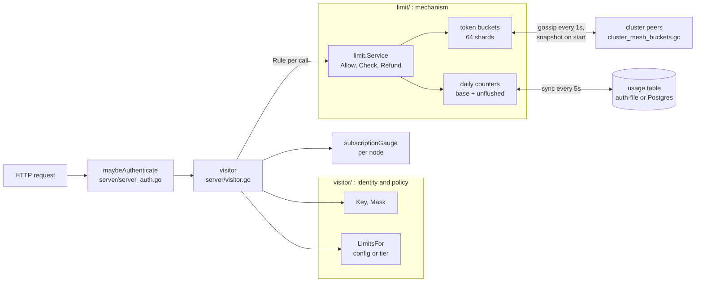

| Package | Role |
|---|---|
| `visitor/` | Turns an IP or user into a limiter key (`Key`, `Mask`) and resolves its limits (`LimitsFor`). No HTTP, no counting. |
| `limit/` | Answers "may key K use N units of kind X under rule R?" (`Service.Allow`). Knows nothing about users, tiers or HTTP. |
| `server/visitor.go` | Per-request `visitor`: maps limits to `limit.Rule`s and exposes `RequestAllowed`, `MessageAllowed`, `EmailAllowed`, ... |
| `cluster/cluster_mesh_buckets.go` | Shares token-bucket usage between cluster nodes. |
| `limit/store*.go`, `usage` table | Persists and shares the daily counts (messages, e-mails, calls). |

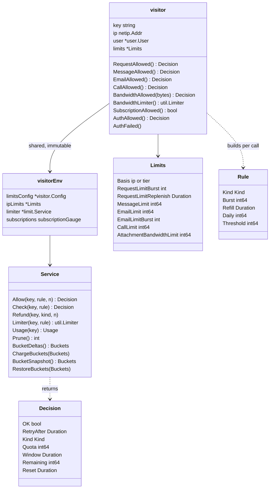

## The visitor abstraction

### Keys

`visitor.Key` (`visitor/key.go`) computes the key every limit is counted under.

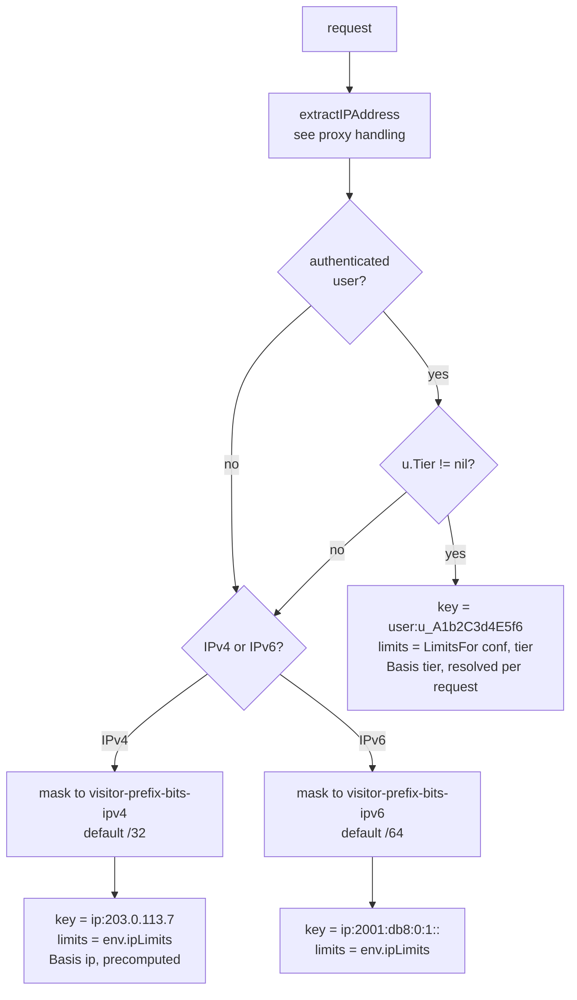

- A tier-less user shares the IP key with everyone behind that prefix; only a tier gives an own key.
- Tokens are not a separate identity: a token resolves to its `*user.User`, then keys the same way.
- IPv6 defaults to `/64` because one client typically owns a whole `/64` and could rotate addresses.
- A user key is shared across every IP the account uses.

### Per-request visitors

`Server.visitor` -> `newVisitor` (`server/visitor.go`) runs on **every request** and returns an
immutable `visitor`; nothing is cached between requests (#1051). All state lives in `limit.Service`
under `v.key`, so two visitors with the same key share buckets and counts. `maybeAuthenticate`
always builds an IP visitor first (it owns the `auth` bucket), then a second one for the user, so a
tiered user touches `ip:...` for auth failures and `user:...` for everything else.

### Expiry

There is no visitor map. `limit.Service.Prune`, run by `pruneVisitors` (`server/server_manager.go`)
every `manager-interval` (`1m`), forgets a key's buckets once all are full again and the key was
idle for `settledIdle` (`1m`); a forgotten key comes back full, so pruning changes nothing.
`Touch` (from `newVisitor` and `Keepalive`) keeps long-lived subscribers alive. Daily counts live
until their period ends.

### Rate visitors (subscriber-based rate limiting)

With `visitor-subscriber-rate-limiting`, a UnifiedPush topic (`up*`) is charged to its subscriber,
not the publisher (`server/server_rate_visitor.go`).

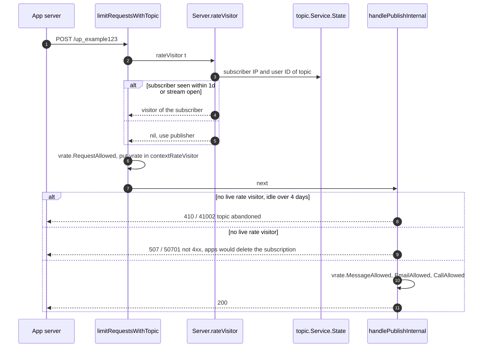

## Configurable limits

Every flag is also a `server.yml` key, accepts an underscore alias, and has an env var
`NTFY_<KEY_IN_UPPER_SNAKE>` (`cmd/serve.go`). Defaults are constants in `server/config.go`.

### Per-visitor limits

| `server.yml` key | Default | Unit | On exceed |
|---|---|---|---|
| `visitor-request-limit-burst` | `60` | requests | `429` / `42901` |
| `visitor-request-limit-replenish` | `5s` | one token per interval | `429` / `42901` |
| `visitor-request-limit-exempt-hosts` | empty | hosts, IPs, CIDRs | bypass, see below |
| `visitor-message-daily-limit` | `0` (derived) | messages per 24h | `429` / `42908` |
| `visitor-subscription-limit` | `30` | open subscriptions, per node | `429` / `42903` |
| `visitor-email-limit-burst` | `16` | e-mails | `429` / `42902` |
| `visitor-email-limit-replenish` | `1h` | one token per interval | `429` / `42902` |
| `visitor-topic-creation-limit-burst` | `100` | new in-memory topics; `0` disables | `429` / `42911` |
| `visitor-topic-creation-limit-replenish` | `1m` | one token per interval | `429` / `42911` |
| `visitor-attachment-total-size-limit` | `100M` | stored attachment bytes | `413` / `41301` |
| `visitor-attachment-daily-bandwidth-limit` | `500M` | bytes per 24h, up/downloads and poll replays | `429` / `42905`, `413` / `41301` on upload |
| `visitor-prefix-bits-ipv4` / `-ipv6` | `32` / `64` | bits | keying only |
| `visitor-subscriber-rate-limiting` | `false` | bool | `507` / `50701` |

Calls and reservations have no key: without a tier both are `0` (`visitor.DefaultCallsLimit`,
`visitor.DefaultReservationsLimit`).

### Global and message limits

| `server.yml` key | Default | On exceed |
|---|---|---|
| `message-size-limit` | `4K` | larger body becomes an attachment; JSON publish allows `2x`, then `413` / `41303`; Matrix `413` / `41302`. Above `5M` is a startup error. |
| `global-topic-limit` (`-T`) | `15000` | `429` / `42904` (`topicsFromIDs`) |
| `attachment-total-size-limit` (`-A`) | `5G` | rejected by the attachment store |
| `attachment-file-size-limit` (`-Y`) | `15M` | `413` / `41301` |
| `attachment-expiry-duration` (`-X`) | `3h` | deletion |
| `cache-duration` (`-b`) | `12h` | expiry; also the IP-based `MessageExpiryDuration` |
| `message-delay-limit` | `3d` | `400` / `40006` |

### Limits without a config key

| Limit | Constant | Value | On exceed |
|---|---|---|---|
| Account actions (signup + password reset share one bucket) | `DefaultVisitorAccountCreationLimitBurst` / `...Replenish` | `6` / `24h` | `429` / `42906` |
| Auth failures | `DefaultVisitorAuthFailureLimitBurst` / `...Replenish` | `30` / `1m` | `429` / `42909` |
| Firebase pause after FCM quota exceeded | `DefaultFirebaseQuotaExceededPenaltyDuration` | `10m` | send skipped |
| Poll replay size per topic | `DefaultMessagePollSizeLimit` | `10M` | replay truncated |
| Title / tags size | `messageTitleSizeLimit`, `messageTagsSizeLimit` | `1024` / `512` B | `400` |

A password reset request consumes an account token even for an unknown address, to throttle probing.

### Error codes

All in `server/errors.go`:

| Code | HTTP | Meaning | Raised in |
|---|---|---|---|
| `41301` | 413 | attachment too large / bandwidth hit during upload | `handleBodyAsAttachment` |
| `41302` | 413 | Matrix request too large | `newRequestFromMatrixJSON` |
| `41303` | 413 | JSON body too large | `readJSONWithLimit` |
| `42901` | 429 | too many requests | `limitRequests`, `limitRequestsWithTopic` |
| `42902` | 429 | too many e-mails | `handlePublishInternal`, e-mail verification |
| `42903` | 429 | too many active subscriptions | `handleSubscribeHTTP`, `handleSubscribeWS` |
| `42904` | 429 | total server topic limit | `topicsFromIDs` |
| `42905` | 429 | daily bandwidth reached | `handleFile`, poll replay |
| `42906` | 429 | too many account requests | `handleAccountCreate`, `handleAccountPasswordResetRequest` |
| `42907` | 429 | too many reservations | reservation handler |
| `42908` | 429 | daily message quota | `handlePublishInternal`, `handleActionMessage` |
| `42909` | 429 | too many auth failures | `maybeAuthenticate` |
| `42910` | 429 | daily call quota | `handlePublishInternal` |
| `42911` | 429 | too many new topics | `topicsFromIDs` |
| `50701` | 507 | UnifiedPush publish without subscriber | `handlePublishInternal` |

With Stripe configured, `handleError` appends an upsell hint to 429/413 for visitors without a tier.

### How a publish passes the checks

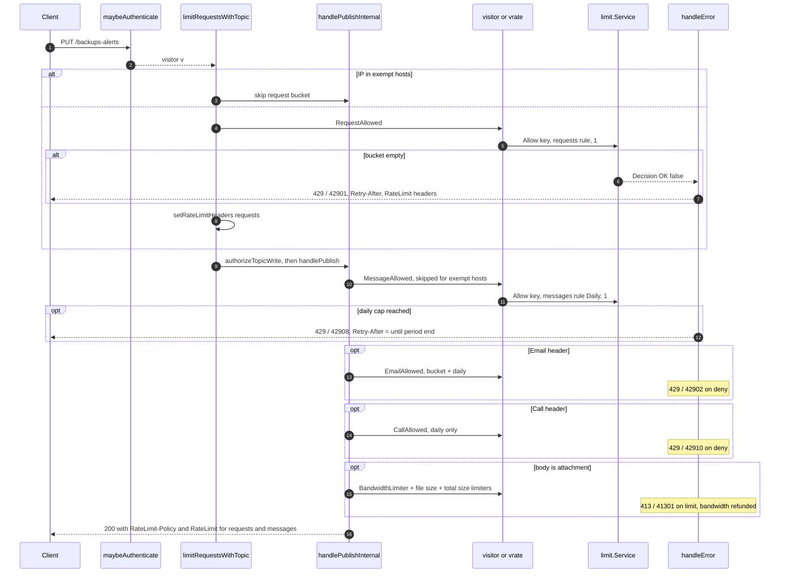

`handleError` (`server/server.go`) turns the denial's `limit.Decision` (`errHTTP.WithLimitDecision`)
into headers:

| Header | Example | Notes |
|---|---|---|
| `Retry-After` | `3600` | whole seconds, rounded up (`retryAfterSeconds`); omitted when unknown or for state limits (subscriptions, topics, reservations) |
| `RateLimit-Policy` | `"messages";q=250;w=86400` | draft-ietf-httpapi-ratelimit-headers, `setRateLimitHeaders` |
| `RateLimit` | `"messages";r=249;t=3600` | also sent on successful publishes |

## Limit resolution

`visitor.LimitsFor(conf, tier)` (`visitor/limits.go`) is the single path, pinned by
`TestLimitsFor_Config` and `TestLimitsFor_Tier`. IP limits are computed once (`visitorEnv.ipLimits`);
tier limits per request, so a tier edited in the database applies on the next request.

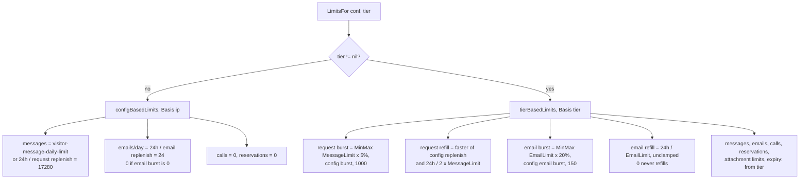

A tier never lowers the configured request bucket. No tier field overrides the subscription,
topic-creation, account or auth limits. Tier fields: `user.Tier` in `user/types.go`.

### Mapping to rules

`server/visitor.go` builds a `limit.Rule` per call (`requestRule`, `messageRule`, `emailRule`, ...):

| Kind (`limit/types.go`) | Bucket | Daily cap | Shared in a cluster |
|---|---|---|---|
| `requests` | burst / replenish | | gossip |
| `messages` | | `MessageLimit` | usage table |
| `emails` | e-mail burst / refill | `EmailLimit` | both |
| `calls` | | `CallLimit` | usage table |
| `bandwidth` | `AttachmentBandwidthLimit`, refills over 24h | | gossip |
| `topics` | topic-creation burst / replenish | | gossip |
| `account` | account burst / replenish | | gossip |
| `auth` | auth-failure burst / replenish (`Check` before, `Allow` on failure) | | gossip |
| `firebase` | 1 token, refill = penalty (taking it pauses sends) | | gossip |

Zero means opposite things per layer: a `0` limit in `visitor` admits nothing (the methods return a
denying `Decision` without calling the service), while `Daily: 0` in a `Rule` means no cap.
Subscriptions are not a kind: `subscriptionGauge` (`server/visitor_subscriptions.go`) counts open
streams per key on this node; pair `SubscriptionAllowed` with `RemoveSubscription`.

## The limit service

`limit.Service` (`limit/service.go`) keeps two structures, 64 shards each (FNV-1a on the key):

- **Token buckets** (`limit/buckets.go`): per key and kind, created full, refilled lazily. The rule
  comes with every call, so a tier change applies at once; a changed burst shifts tokens by the
  difference (down to a debt of one burst) instead of handing out a fresh bucket.
- **Daily counters** (`limit/counters.go`): per key, `base` (row as last read, all nodes) plus
  `unflushed` (admitted here since the last write).

```
Service.Allow(key, rule, n)
+- takeTokens            bucket, if rule.Burst > 0; deny -> Decision with RetryAfter
+- dailyIndex(kind) < 0  -> done (no daily count)
+- counterNoLock(key, periodStart)
   +- base + unflushed + n > Daily -> refundTokens, deny until period end
   +- unflushed += n; promoted once total >= Threshold
```

`Check` asks without consuming, `Refund` hands units back. `Limiter` is a `util.Limiter` view for
`util.LimitReader` / `LimitWriter`; a negative `AllowN` refunds, so a rejected upload returns its
bandwidth.

### Daily periods, no midnight reset

Each key's 24h period starts at its own time of day: `keyOffset(key)`, an unseeded FNV-1a hash
modulo one day (`limit/util.go`), so all nodes and restarts agree and resets spread over the day.
A counter rolls over lazily on next use. `/v1/account` shows it as `stats.reset_at`.

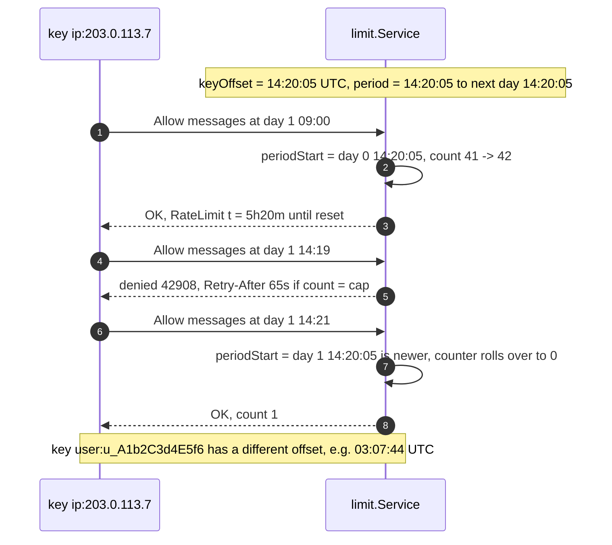

### The usage table

Daily counts persist in `usage`, part of the user schema (`user/manager_sqlite_schema.go`,
`user/manager_postgres_schema.go`): in the `auth-file` on SQLite or the shared Postgres
(`createUsageStore`, `server/server.go`). Without either, counts are memory only. The old `stats_*`
columns of the user table are zeroed and unused.

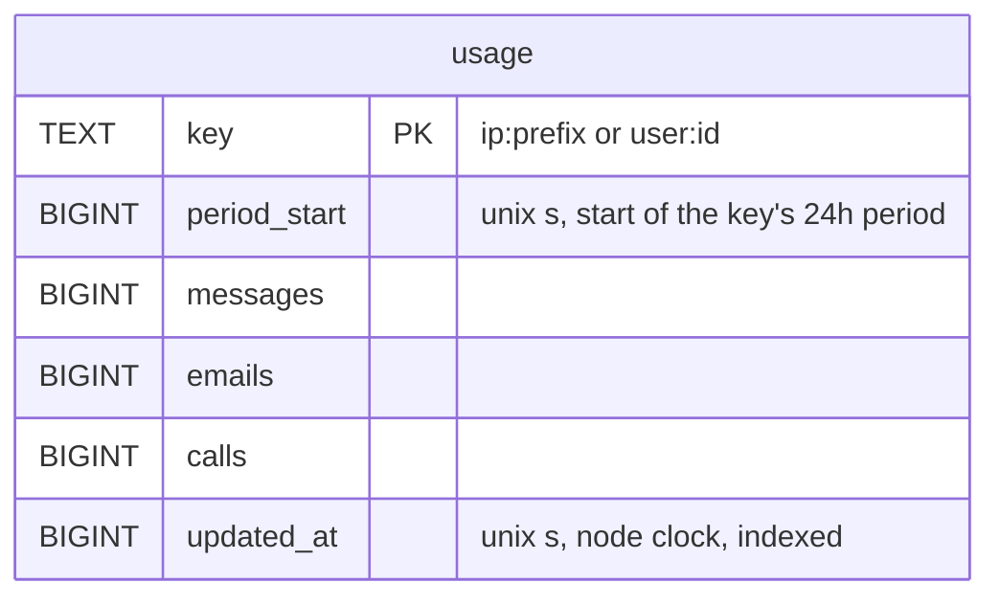

| key | period_start | messages | emails | calls | updated_at |
|---|---|---|---|---|---|
| `user:u_A1b2C3d4E5f6` | 1764040064 | 1873 | 12 | 1 | 1764101530 |
| `ip:203.0.113.7` | 1764051605 | 1729 | 0 | 0 | 1764101528 |
| `ip:2001:db8:0:1::` | 1764019812 | 2310 | 3 | 0 | 1764101525 |

One row per key, reused across periods.

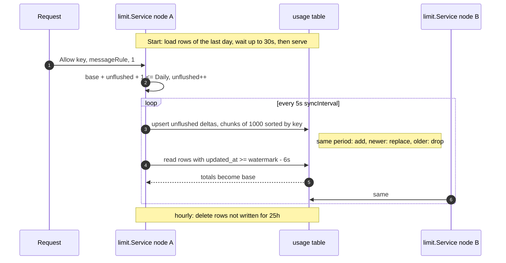

- **Write**: Postgres one `unnest` statement per chunk, SQLite one prepared statement per row in a
  transaction. A timeout after send counts as maybe written (`errMaybeWritten`): undercount over
  double count.
- **Failure**: store errors never reach requests; counts stay unflushed until the store is back.
- **Promotion threshold**: an anonymous key's count is written only from 10% of its cap
  (`promoteRate`, `messageRule`), keeping one-off IPs out of the table. Logged-in visitors are
  written from the first message.
- **Clocks**: periods, `updated_at` and watermark use the node clock; keep nodes on NTP.
- **Overshoot**: a count reaches other nodes within about two sync intervals, so overshoot is about
  `(nodes - 1)` times what a key is admitted in ~10s.

### Cluster bucket exchange

Token buckets are per node but shared over the cluster mesh (`experimental-cluster-listen`;
`TrackDeltas` is set only then).

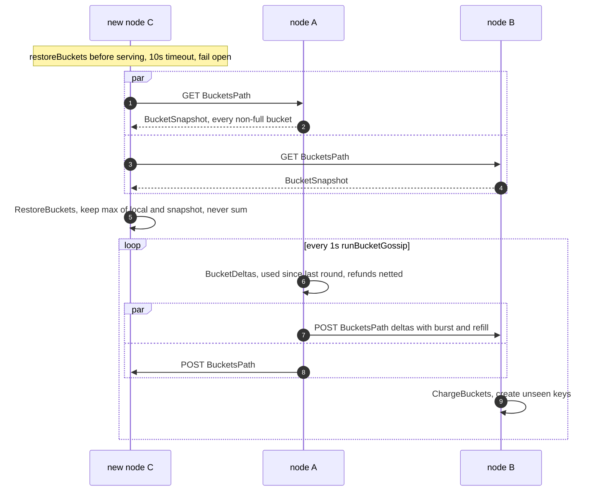

- A client spread over N nodes gets its limits once, not N times, after at most one burst per node.
- Bounds (`limit/peers.go`): `BucketDeltasMax` (50000) buckets per round; peer usage pushes a bucket
  at most `peerDebtMax` (10) bursts into debt; usage above `peerBurstMax` or with a negative refill
  is ignored; if rules disagree, the more generous one wins.
- A lost round undercounts; failed sends are not retried.
- Not shared: the subscription gauge and the ban-feed trackers.

## Proxy handling and visitor identity

Getting this wrong collapses all visitors behind a proxy into one key, or lets clients spoof IPs.

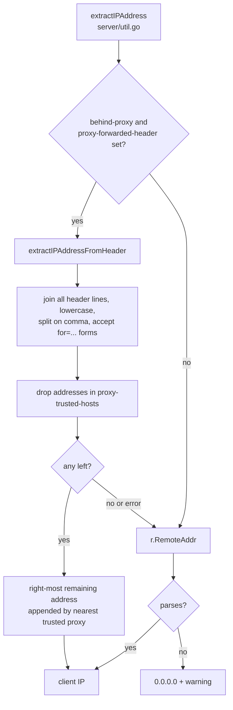

Example: `X-Forwarded-For: 198.51.100.9, 203.0.113.7, 10.0.0.2` with `proxy-trusted-hosts:
10.0.0.0/8` yields `203.0.113.7`; `198.51.100.9` is client supplied and ignored.

| `server.yml` key | Default |
|---|---|
| `behind-proxy` (`-P`) | `false` |
| `proxy-forwarded-header` | `X-Forwarded-For` |
| `proxy-trusted-hosts` | empty |

`behind-proxy` with an empty header is a startup error. Trusted and exempt hosts are parsed by
`parseIPHostPrefix` (`cmd/serve.go`): CIDR, IP, or hostname resolved once at startup; an
unresolvable trusted proxy is fatal, an unresolvable exempt host is logged and dropped. The IP goes
into `contextVisitorIP` for the ban feed. SMTP-published messages are attributed to the SMTP peer.

### Exemptions

`visitor-request-limit-exempt-hosts` (`util.ContainsIP`) skips exactly two checks: the request
bucket (`limitRequests`, `limitRequestsWithTopic`) and the daily message cap
(`handlePublishInternal`, `handleActionMessage`). E-mails, calls, subscriptions, bandwidth,
attachment sizes, topic creation, auth failures and account actions still apply.

## Gotchas

### What survives a restart

| State | Single node | Cluster |
|---|---|---|
| Daily messages / e-mails / calls | survives with a user database; anonymous keys below 10% are lost | usage table |
| Token buckets (requests, bandwidth, topics, account, auth, firebase, e-mail) | reset to full | restored from peers |
| Subscription gauge | rebuilt on reconnect | per node |
| Ban-feed trackers | reset | per node |

### Sharp edges

- **The key changes with the tier**: gaining a tier moves `ip:<prefix>` to `user:<id>` with its own
  counts; losing it moves back. Within one key, a tier change keeps spent tokens and counts.
- **Bandwidth refills continuously** (a 24h bucket, not a daily counter), so it has no `reset_at`.
- **Poll replays cost bandwidth** (`meterPollBandwidth`, `handleSubscribeHTTP`).
- **Downloads are billed to the uploader**: `handleFile` charges `m.User` or `m.Sender`.
- **Subscriptions are per node**: a client can hold the limit on each cluster node.
- **Anonymous calls are zero by design**: `42910` without a tier is expected; `call` also needs a
  verified number (`40034`) and is refused for anonymous users (`40035`).
- **Signup while logged in** (non-admin) is `40101` before the account bucket is consulted.
- **Topic creation** charges only for topics not yet in `s.topics`; the global limit is checked first.
- **`MessageExpiryDuration` comes from the limits**, so a tier changes how long messages are cached.
