# Server architecture

How the ntfy Go server is put together: startup, the request path, the in-memory topic graph,
visitors and limits, the message cache, the database layer, the user package, the background
loops and the subscribe transports. Paths are relative to the repo root. Wire format and schemas:
[protocol-and-data-model.md](protocol-and-data-model.md). Clustering: [cluster.md](cluster.md).

One process, no web framework: routing is an if/else chain in `handleInternal`, middleware is
closure wrapping over `handleFunc`, and errors are `*errHTTP` values (HTTP status plus a stable
five-digit ntfy code).

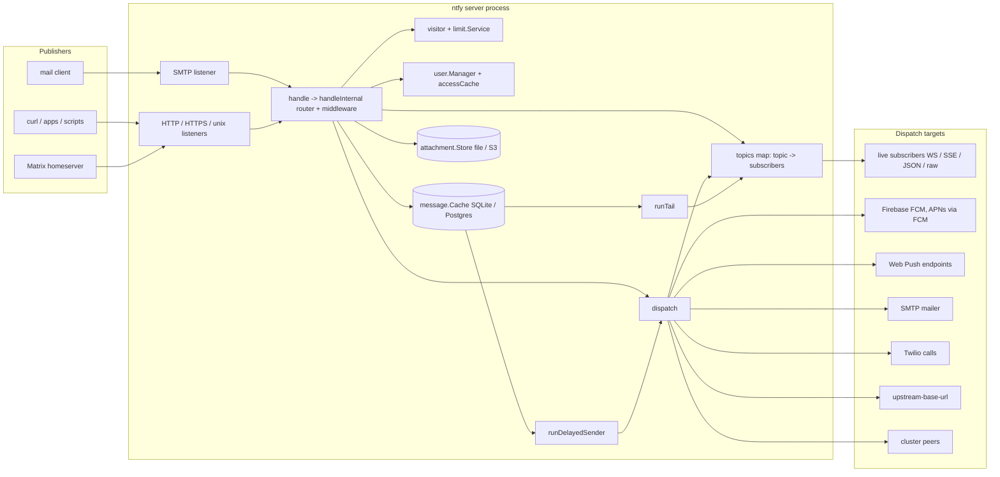

## Package map

| Package | Role |
|---|---|
| `main.go`, `cmd/` | CLI entry point; `cmd/serve.go` turns flags and `server.yml` into a `*server.Config` |
| `server/` | HTTP handlers, routing, live topics, per-request visitors, publish/subscribe, SMTP, Firebase, web push, Matrix |
| `model/` | `Message`, `Attachment`, `Action`, `SinceMarker`: the wire and storage types |
| `message/` | The message cache (SQLite or Postgres), and the tail that reads back what was written |
| `user/` | Users, tiers, tokens, ACLs, the access cache |
| `db/`, `db/pg/`, `db/schema/` | Primary/replica wrapper, Postgres pool, schema versioning and migrations |
| `limit/` | Rate and quota decisions per visitor key (token buckets and daily counts) |
| `visitor/` | Visitor keys (`ip:<prefix>` / `user:<id>`) and limit resolution from config or tier |
| `topic/` | Shared state of UnifiedPush topics (subscriber activity, rate visitor) |
| `ban/` | Abuse ban feed (weighted strikes per IP prefix, appended to a ban file) |
| `attachment/` | Attachment store (file system or S3) |
| `webpush/` | Web push subscription store |
| `cluster/` | Peer-to-peer fan-out and node registry; a no-op without clustering |

### Core types

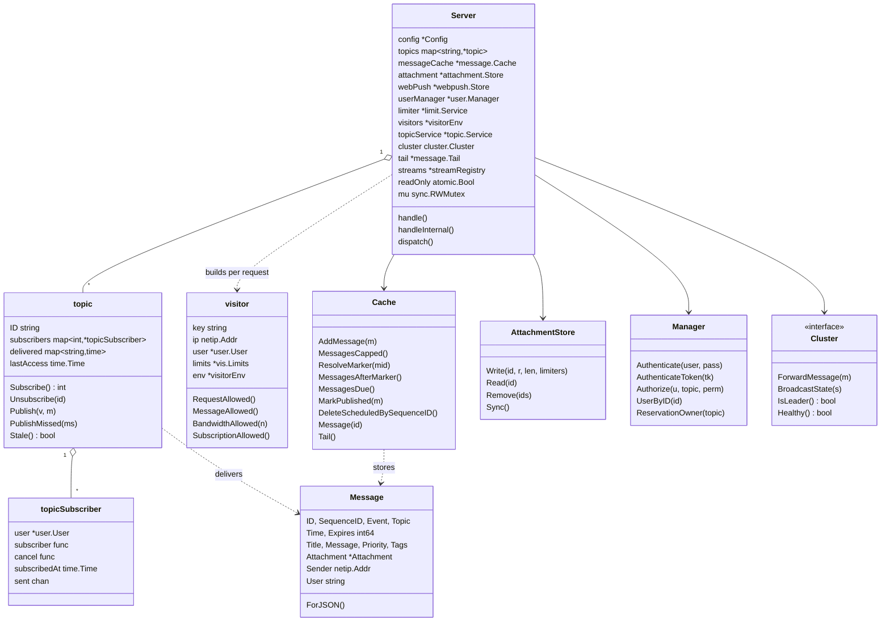

`message.Cache`, `attachment.Store` (`attachment/store.go`, over a private `backend` interface
with file and S3 implementations) and `webpush.Store` are concrete structs with a per-dialect
`queries` struct; only `cluster.Cluster` (`cluster/cluster.go`) is a Go interface with a nop and a
mesh implementation.

## 1. Startup and the request lifecycle

### main.go, cmd/serve.go, server.New

`main.go` stamps build vars and runs the urfave/cli app. `cmd/serve.go` `execServe` reads flags
(merged with `server.yml` by `initConfigFileInputSourceFunc`), builds a `*server.Config`, calls
`server.New`, installs signal handlers, then `s.Run()`. `auth-users` / `auth-access` /
`auth-tokens` become `Provisioned: true` records the user manager reconciles on every boot.

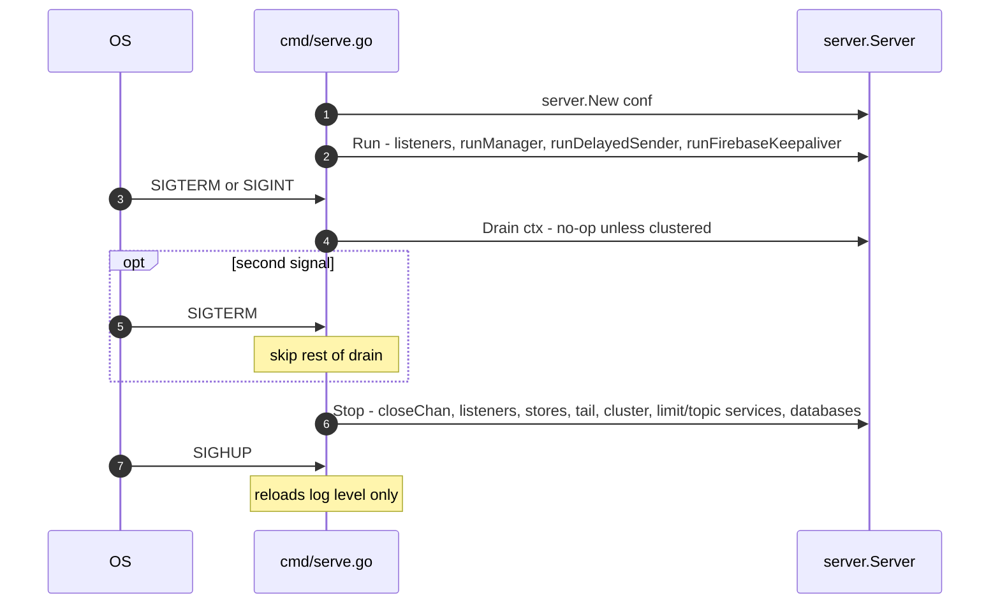

`server.New` (`server/server.go`) wires in a fixed order:

| Step | Notes |
|---|---|
| Mailer | `mail.NewSender`, nil unless `smtp-sender-addr` is set |
| Stripe | nil unless `payments.Available` and a secret key is set |
| Postgres pool | Only with `database-url`: `pg.Open` primary, `pg.OpenReplica` per replica, wrapped in `db.New` |
| Message cache | `createMessageCache`: Nop store (cache disabled), Postgres, SQLite file, or SQLite in memory |
| Web push store | Postgres or SQLite, only if `web-push-public-key` is set |
| Topic map, counter | `messageCache.Topics()` pre-creates topics; `messageCache.Stats()` seeds `s.messages` |
| Attachment store | `createAttachmentStore`: `s3://` selects S3, a directory the file store, else nil |
| Twilio, ban feed | `ban.NewService` only if `ban-file` is set |
| User manager | Only if `auth-file` is set or a Postgres pool exists |
| Firebase | Note the `user.Auther` nil-interface dance (issue #641) |
| Limit service | `limit.New` with a usage store on the user database (`createUsageStore`), or memory only |
| Visitor env, topic service | `newVisitorEnv`; `tp.New` with `createTopicStore` |
| Cluster | `cluster.New`; nop unless `experimental-cluster-listen` is set |
| Tail | Only with a message cache; starts `runTail` |
| Start | `s.limiter.Start`, `s.topicService.Start` load their state |

`Run` mounts one catch-all `mux.HandleFunc("/", s.handle)` on every public listener. Metrics,
pprof, SMTP, cluster peer and admin socket listeners are separate. All push into one `errChan`;
`Run` returns on the first failure. `Stop` is idempotent and bounded by `stopTimeout` (10s); the
message cache closes before the shared Postgres pool.

### handle, handleFunc, handleInternal

```go
type handleFunc func(http.ResponseWriter, *http.Request, *visitor) error
```

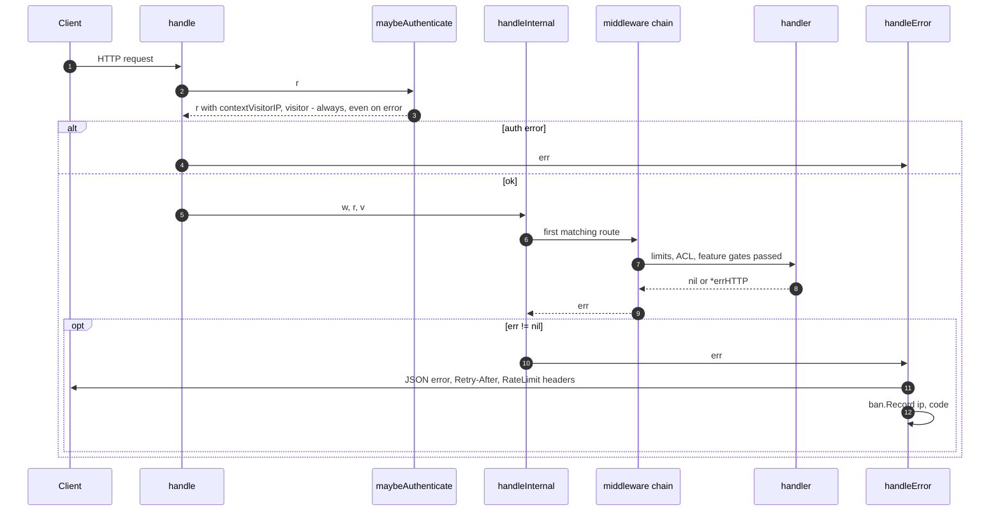

Middleware are `func(next handleFunc) handleFunc` (`server/server_middleware.go`), composed inline:
`s.transformBodyJSON(s.limitRequestsWithTopic(s.authorizeTopicWrite(s.handlePublish)))`.

| Middleware | Does |
|---|---|
| `limitRequests` | Request bucket of the visitor, else 42901 (skipped for `visitor-request-limit-exempt-hosts`) |
| `limitRequestsWithTopic` | Resolves the topic, picks the rate visitor (UnifiedPush subscriber, if any), stores both in the context (`contextTopic`, `contextRateVisitor`), charges the rate visitor |
| `authorizeTopicRead` / `authorizeTopicWrite` | `userManager.Authorize` per topic in the path, else 40301; no-op without a user manager |
| `ensureUserManager`, `ensureUser`, `ensureAdmin` | 404 without a user manager, 401 without a user / admin |
| `ensureWebEnabled`, `ensureWebPushEnabled`, `ensureEmailsEnabled`, `ensureCallsEnabled`, `ensurePaymentsEnabled`, `ensureStripeCustomer` | Feature gates, mostly 404 |
| `withAccountSync` | On success, `publishSyncEventAsync` to the user's sync topic |
| `transformBodyJSON`, `transformMatrixJSON` | Rewrite a JSON or Matrix body into a normal publish request |

Handlers never write errors themselves. A handler that already wrote body bytes must return nil
(the subscribe handlers do), or `handleError` writes headers on top.

### handleError and errHTTP

`handleError` uses a plain type assertion `err.(*errHTTP)`, not `errors.As`: a `%w`-wrapped
`*errHTTP` becomes a 500. Use `Wrap`, `With`, `Fields`, `WithLimitDecision` (`server/errors.go`).
It also counts `metrics.HTTPRequests`, logs `normalErrorCodes` at debug, skips `WriteHeader` for
`*errWebSocketPostUpgrade`, adds a Stripe upsell hint on 429/413 for tierless users, and feeds
`s.ban.Record`.

```go
type errHTTP struct {
    Code     int    `json:"code,omitempty"` // five-digit ntfy code
    HTTPCode int    `json:"http"`
    Message  string `json:"error"`
    Link     string `json:"link,omitempty"`
    context  log.Context     // log-only
    decision *limit.Decision // Retry-After and RateLimit headers
}
```

The code is `<http status><two-digit serial>`; the full list is the `errHTTP*` var block.

| Range | HTTP | Examples |
|---|---|---|
| 400xx | 400 | 40001 email disabled, 40009 topic invalid, 40016 not a WebSocket upgrade, 40041 to 40048 and 40055/40056 templating, 40049 sequence ID invalid, 40061 too many topics |
| 40101 | 401 | `errHTTPUnauthorized` |
| 403xx | 403 | 40301 ACL denial, 40302 admin-socket-only operation |
| 40401 | 404 | Fallthrough of `handleInternal`, disabled-feature gates |
| 409xx | 409 | 40901 user exists, 40905/40906 provisioned user/token change |
| 410xx | 410 | 41001 phone verification expired, 41002 abandoned UnifiedPush topic |
| 413xx | 413 | 41301 attachment too large or bandwidth exhausted, 41303 JSON body too large |
| 429xx | 429 | 42901 requests, 42903 subscriptions, 42908 daily messages, 42909 auth failures, 42911 topic creation |
| 500xx | 500 | 50001 generic, 50002 invalid path, 50003 missing base-url |
| 50301 | 503 | Node is draining (cluster) |
| 50701 | 507 | UnifiedPush publish without a prior subscriber; 5xx so app servers like Mastodon keep the subscription |

## 2. Routing table

The if/else chain in `handleInternal` (`server/server.go`); first match wins, fallthrough is
`errHTTPNotFound`. Path regexes are at the top of `server/server.go`.

### Publish

| Method | Path | Chain |
|---|---|---|
| PUT/POST | `/` (topic in JSON body) | `transformBodyJSON` -> `limitRequestsWithTopic` -> `authorizeTopicWrite` -> `handlePublish` |
| POST | `/_matrix/push/v1/notify` | `transformMatrixJSON` -> `limitRequestsWithTopic` -> `authorizeTopicWrite` -> `handlePublishMatrix` |
| PUT/POST | `/<topic>` or `/<topic>/<sequence-id>` | `limitRequestsWithTopic` -> `authorizeTopicWrite` -> `handlePublish` |
| DELETE `/<topic>/<sequence-id>`, GET `/<topic>/<sequence-id>/delete` | | same guards -> `handleDelete` -> `handleActionMessage(MessageDeleteEvent)` |
| GET/PUT | `/<topic>/<sequence-id>/(read\|clear)` | same guards -> `handleClear` -> `handleActionMessage(MessageClearEvent)` |
| GET | `/<topic>/(publish\|send\|trigger)` | same guards -> `handlePublish` (`publishPathRegex`) |

### Subscribe

| Method | Path | Handler (all behind `limitRequests` -> `authorizeTopicRead`) |
|---|---|---|
| GET | `/<t1,t2,...>/json` | `handleSubscribeJSON` |
| GET | `/<t1,...>/sse` | `handleSubscribeSSE` |
| GET | `/<t1,...>/raw` | `handleSubscribeRaw` |
| GET | `/<t1,...>/ws` | `handleSubscribeWS` |
| GET | `/<t1,...>/auth` | `handleTopicAuth`: `{"success":true}` if the read check passed |

### Account (`server/server_account.go`, `server/server_payments.go`)

| Method | Path | Guards | Handler |
|---|---|---|---|
| POST | `/v1/account` | `ensureUserManager` | `handleAccountCreate` |
| GET | `/v1/account` | none (anonymous allowed) | `handleAccountGet` |
| DELETE | `/v1/account` | `ensureUser`, `withAccountSync` | `handleAccountDelete` |
| POST | `/v1/account/password` | `ensureUser` | `handleAccountPasswordChange` |
| POST | `/v1/account/login` | `ensureUser`, `withAccountSync` | `handleAccountLogin` |
| POST/PATCH/DELETE | `/v1/account/token` | `ensureUser`, `withAccountSync` | `handleAccountToken{Create,Update,Delete}` |
| PATCH | `/v1/account/settings` | `ensureUser`, `withAccountSync` | `handleAccountSettingsChange` |
| POST/PATCH/DELETE | `/v1/account/subscription` | `ensureUser`, `withAccountSync` | `handleAccountSubscription{Add,Change,Delete}` |
| POST | `/v1/account/reservation` | `ensureUser`, `withAccountSync` | `handleAccountReservationAdd` |
| DELETE | `/v1/account/reservation/<topic>` | `ensureUser`, `withAccountSync` | `handleAccountReservationDelete` |
| PUT/DELETE | `/v1/account/phone`, PUT `/v1/account/phone/verify` | `ensureUser`, `ensureCallsEnabled`, `withAccountSync` | `handleAccountPhoneNumber{Add,Delete,Verify}` |
| PUT/DELETE | `/v1/account/email` | `ensureUser`, `ensureEmailsEnabled`, `withAccountSync` | `handleAccountEmail{Add,Delete}` |
| POST | `/v1/account/email/primary` | `ensureUser`, `withAccountSync` | `handleAccountEmailSetPrimary` |
| POST | `/v1/account/email/resend` | `ensureUser`, `ensureEmailsEnabled` | `handleAccountEmailResend` |
| POST | `/v1/account/email/verify` | `ensureEmailsEnabled`, `limitRequests` | `handleAccountEmailVerify`; no `ensureUser`, the link is clicked from a mail client |
| POST | `/v1/account/password/reset/request`, `/v1/account/password/reset` | `ensureEmailsEnabled`, `limitRequests` | `handleAccountPasswordReset{Request,}`; unauthenticated |
| POST/PUT/DELETE | `/v1/account/billing/subscription` | `ensurePaymentsEnabled` + `ensureUser` (POST) or `ensureStripeCustomer` | `handleAccountBillingSubscription{Create,Update,Delete}` |
| GET | `/v1/account/billing/subscription/success/<id>` | `ensurePaymentsEnabled`, `ensureUserManager` | `handleAccountBillingSubscriptionCreateSuccess` |
| POST | `/v1/account/billing/portal` | `ensurePaymentsEnabled`, `ensureStripeCustomer` | `handleAccountBillingPortalSessionCreate` |
| POST | `/v1/account/billing/webhook` | `ensurePaymentsEnabled`, `ensureUserManager` | `handleAccountBillingWebhook` (from Stripe) |
| GET | `/v1/account/billing/tiers` | `ensurePaymentsEnabled` | `handleBillingTiersGet` |

Billing endpoints skip `withAccountSync`; the Stripe webhook drives the sync.

### Admin (`server/server_admin.go`, all `ensureAdmin`)

| Method | Path | Handler |
|---|---|---|
| GET | `/v1/version` | `handleVersion` |
| GET/POST/PUT/DELETE | `/v1/users` | `handleUsers{Get,Add,Update,Delete}` |
| PUT/POST, DELETE | `/v1/users/access` | `handleAccessAllow`, `handleAccessReset` |
| GET/POST/DELETE | `/v1/users/tokens` | `handleUsersTokens{Get,Add,Delete}` |
| POST | `/v1/users/password/reset` | `handleUsersPasswordReset` |
| GET (admins), POST, PUT, DELETE | `/v1/tiers` | `handleAdminTiers{Get,Add,Update,Delete}`; a non-admin GET falls through to `handleBillingTiersGet` |

The admin socket (`experimental-listen-admin-unix`, `handleAdminSocket`) serves only
`adminSocketPaths` through the same `handleInternal`, as the synthetic `adminSocketUser` from
127.0.0.1, bypassing rate limits and the ban feed. `contextAdminSocket` unlocks what the network
API refuses (role changes, else 40302). Socket mode 0660: whoever can open it is admin.

### Health, config, misc

| Method | Path | Handler |
|---|---|---|
| GET | `/v1/health` | `handleHealth`: `{"healthy":..., "role":...}`; 503 if the cluster heartbeat went stale |
| GET | `/v1/ready` | `handleReady`: should a load balancer send clients here (cluster role, draining) |
| GET | `/v1/config`, `/config.js` | `handleConfig` (JSON), `handleWebConfig` (JS), `server/server_web.go` |
| GET | `/manifest.webmanifest` | `handleWebManifest`, gated on web push |
| GET | `/v1/stats` | `handleStats`: total messages and a rate from `messagesHistory` |
| POST/DELETE | `/v1/webpush` | `ensureWebPushEnabled`, `limitRequests` -> `handleWebPushUpdate` / `handleWebPushDelete` |
| GET | `/metrics` | `handleMetrics`, only if `enable-metrics` and no `metrics-listen-http` |
| GET | `/_matrix/push/v1/notify` | `handleMatrixDiscovery` |
| GET/HEAD | `/file/<message-id>[.ext]` | `limitRequests` -> `handleFile`, only with an attachment store |
| OPTIONS | any | `limitRequests` -> `handleOptions` (CORS), even with the web app disabled (#598) |
| HEAD | `/` | `handleEmpty` |

### Static site and docs (go:embed)

`server/site` and `server/docs` are `//go:embed`ded and served through `util.CachingEmbedFS`, which
stamps the process start as `ModTime` so `304 Not Modified` works.

| Path | Handler |
|---|---|
| `/static/...`, `/app.html`, `/sw.js`, `/sw.js.map` | `handleStatic` |
| `/docs...` | `handleDocs` |
| `GET /`, `/<topic>`, `/<domain>/<topic>` | `handleTopic` -> `handleWebApp` (SPA); `?up=1` returns UnifiedPush discovery JSON |
| `/account/email/verify/<token>`, `/account/password/reset/<token>` | `handleWebAppNoIndex`: `Referrer-Policy: no-referrer`, `X-Robots-Tag: noindex` |

`go run` fails without the embedded trees: `make cli-deps-static-sites` (placeholders) or
`make web docs`.

## 3. Topics, subscribers, visitors

### Server-level state

`s.mu` (RWMutex) guards `topics`, `messages` / `messagesHistory` and the listeners. Visitors are
not stored on the server. `topicsFromIDs` takes the write lock (it may insert) and enforces
`disallowed-topics`, `global-topic-limit` (default 15000) and the visitor's topic-creation bucket
(42911; `v == nil` bypasses it, internal only). `topicsFromPath` de-duplicates and caps at 150
topics (40061). `allTopics` copies the map so scans run without `s.mu`.

### topic

`topic` and `topicSubscriber` are in `server/topic.go` (fields in the class diagram above).
Subscriber IDs are `rand.Int()` with a 5-attempt collision retry. `Stale()` = no subscribers and
`lastAccess` older than `topicExpungeAfter` (6h); the manager then drops it. State that must
outlive it (UnifiedPush rate visitor, activity) lives in the `topic` package.

### Fan-out

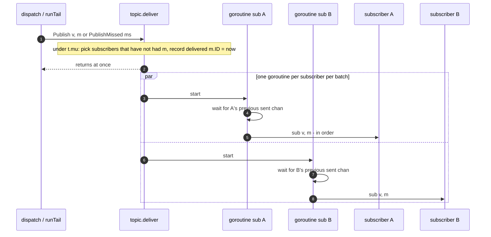

| Invariant | Why |
|---|---|
| Delivery never under `t.mu` | A wedged client cannot block publishes |
| One goroutine per subscriber per batch, chained via `sent` | No head-of-line blocking; per-subscriber order kept |
| `Publish` is async, returns nil | The publisher's response may go out before any subscriber gets it; send errors drop the rest of that subscriber's batch |
| At most once per subscriber via `delivered` | Tail and live fan-out can both call `deliver`; entries kept `topicDeliveredRetain` (2 min), dropped by `ExpireDelivered` |

### The publish path

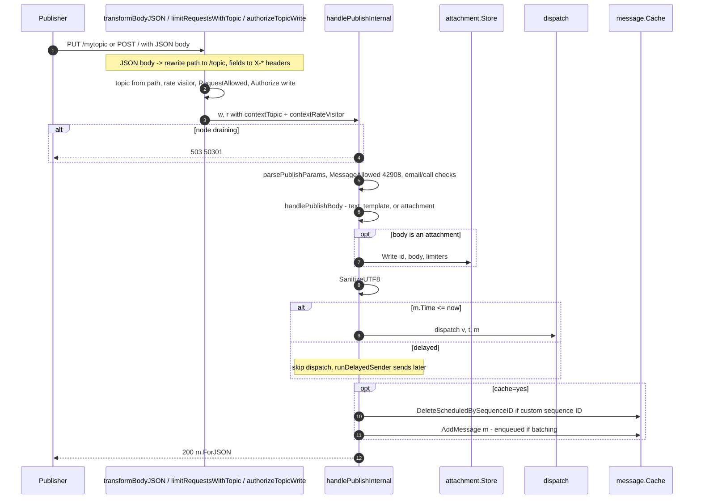

Call tree (`server/server.go`):

```
handlePublish
+- handlePublishInternal
|  +- s.readOnly -> 503 when draining
|  +- fromContext contextTopic, contextRateVisitor
|  +- util.Peek body up to message-size-limit
|  +- parsePublishParams            -> cache, firebase, email, call, template, unifiedpush
|  +- unifiedPushTopicAbandoned     -> 410 / 507 if UP without rate visitor
|  +- vrate.MessageAllowed / EmailAllowed / CallAllowed
|  +- convertEmailAddress, convertPhoneNumber
|  +- handlePublishBody
|  |  +- handleBodyDiscard               poll_request
|  |  +- handleBodyAsMessageAutoDetect   UnifiedPush
|  |  +- handleBodyAsTextMessage         X-Attach URL, or small UTF-8 body
|  |  +- handleBodyAsTemplatedTextMessage
|  |  +- handleBodyAsAttachment -> v.Info, attachment.Store.Write
|  +- m.SanitizeUTF8
|  +- dispatch (if not delayed)
|  |  +- cluster.ForwardMessage -> peers
|  |  +- topic.Publish -> topic.deliver -> subscribers
|  |  +- go sendToFirebase, sendEmail, callPhone
|  |  +- go forwardPollRequest (upstream, not for UP)
|  |  +- go publishToWebPushEndpoints
|  +- messageCache.DeleteScheduledBySequenceID, attachment.Remove
|  +- messageCache.AddMessage
|  +- s.messages++
+- writeJSON m.ForJSON
```

**Fan-out happens before persistence.** A live subscriber can see a message that a `?poll=1` a
moment later does not return yet (especially with batched writes).

### Delete and clear events

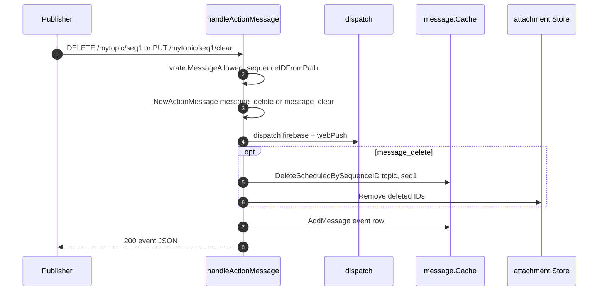

Delete/clear are ordinary rows in the cache, so a reconnecting client's replay reapplies them.

### Delayed (scheduled) publishing

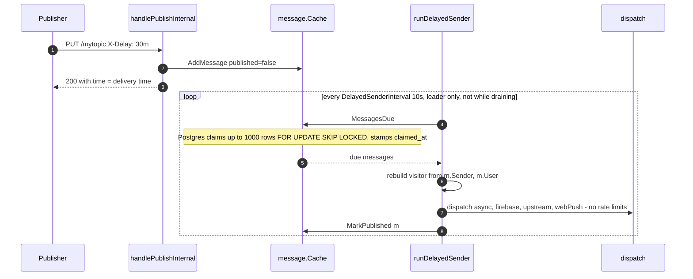

A claim older than `claimTimeout` (2 min) is claimable again, so a node dying mid-send loses
nothing. Publishing with the same `sequence_id` replaces a scheduled message.

### Attachments

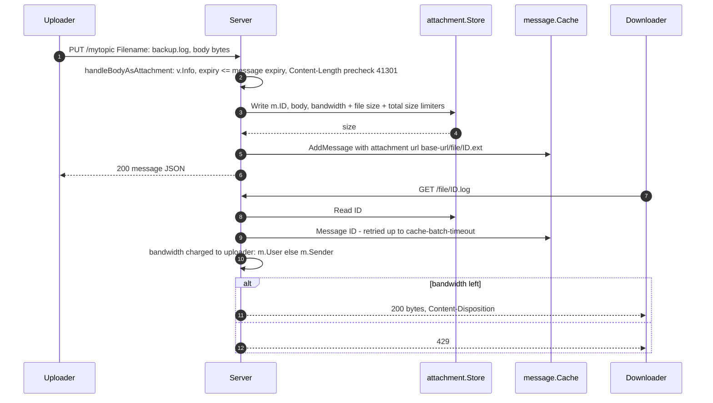

Billing the uploader stops the one-uploader, many-downloaders pattern. Expired attachments are only
flagged (`MarkExpiredAttachmentsDeleted`); the store's sync loop deletes the bytes.

### The tail

`runTail` (`server/server_tail.go`, every second) reads every row written since the last call,
in row-id order, from the **primary** (`message.Tail.Next`), and hands it to `topic.PublishMissed`.
`delivered` ensures only subscribers that missed it get it (a reconnect racing a batched write, or
lost cluster fan-out). Row ids become visible out of order on commit, so the tail tracks holes and
re-checks them for `tailHoleTimeout` (1 min).

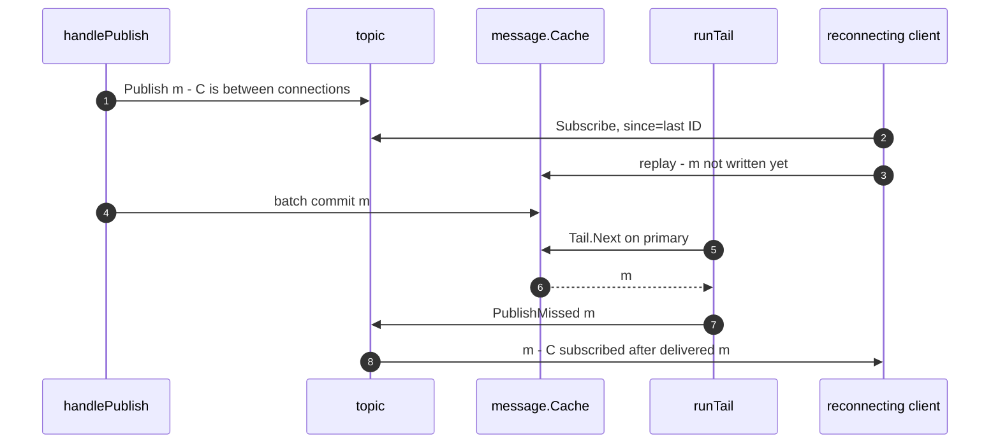

`sinceForTopic` uses `delivered` from the other side: an unknown `since=<id>` that went out here
replays from just before that delivery time instead of the whole topic.

### Connection teardown

Every stream registers its `cancel` with each topic (`Subscribe`) and in `s.streams`
(`streamRegistry`, used by `Drain`).

| Function | Used by |
|---|---|
| `topic.CancelSubscriberUser(userID)` | `killUserSubscriber` (ACL revocation), `handleUsersDeleted` |
| `topic.CancelSubscribersWhere(func(u) bool)` | `reauthorizeSubscribers` after an access-cache reload |
| `topic.CancelSubscribersExceptUser(userID)` | Reservation takeover |
| `topic.CancelAllSubscribers` | Cluster isolation |

`subscribersMatching` copies under the read lock and cancels without `t.mu`.
`authorizeSubscribed` re-authorizes right after subscribing, closing the race with an access
change.

### visitor

Built **per request**, immutable (#1051).

| Field | Meaning |
|---|---|
| `key` | `vis.Key` (`visitor/key.go`): `user:<id>` for a user **with a tier**, else `ip:<prefix>` masked to `visitor-prefix-bits-ipv4/ipv6` |
| `ip`, `user` | Request IP and authenticated user (nil if anonymous) |
| `limits` | `vis.LimitsFor`: config limits, or the tier's |
| `env` | `visitorEnv`, shared: config, limit service, subscription gauge, message cache, user manager |

A tierless user shares the IP key with anonymous visitors behind the same prefix; a tiered user
shares one key across IPs (so the ban feed uses the request IP).

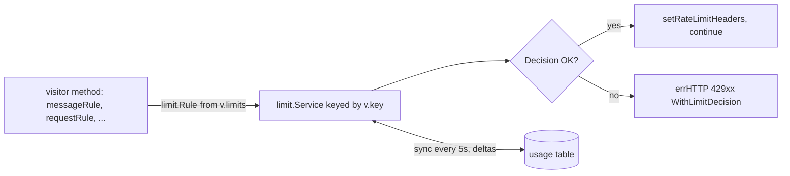

| Kind (`limit.Kind`) | Shape | Checked by |
|---|---|---|
| requests | token bucket, per node | `limitRequests`, `limitRequestsWithTopic` |
| messages, emails, calls | daily count per key (plus a bucket for emails), shared via `usage` | `MessageAllowed`, `EmailAllowed`, `CallAllowed` |
| bandwidth | bucket of daily bytes | attachment up/download, poll replay bytes |
| topics | bucket | `TopicCreationAllowed` |
| account, auth | buckets, anonymous only | signups, password-reset requests; failed logins (42909) |
| firebase | single token, long refill | pauses Firebase after "quota exceeded" |

Daily periods start at an offset hashed from the key (no midnight reset). Anonymous keys reach the
`usage` table only at a tenth of their cap (`promoteRate`). Store failures never reach the request
path. Open subscriptions are per node (`subscriptionGauge`, 42903). `v.Info()` is expensive; use
`infoLight` on hot paths. Details: [rate-limiting.md](rate-limiting.md).

### UnifiedPush rate visitors

For UP topics (`up` + 14 chars total, `isUnifiedPushTopic`) with `visitor-subscriber-rate-limiting`,
`maybeSetRateVisitors` makes the **subscriber** the rate visitor (needs no ACLs, ownership of a
reserved topic, or write access to an unreserved one), state kept by `topic.Service` and the
`topic` table. `rateVisitor` rebuilds it per push, live for `rateVisitorLiveFor` (1 day).

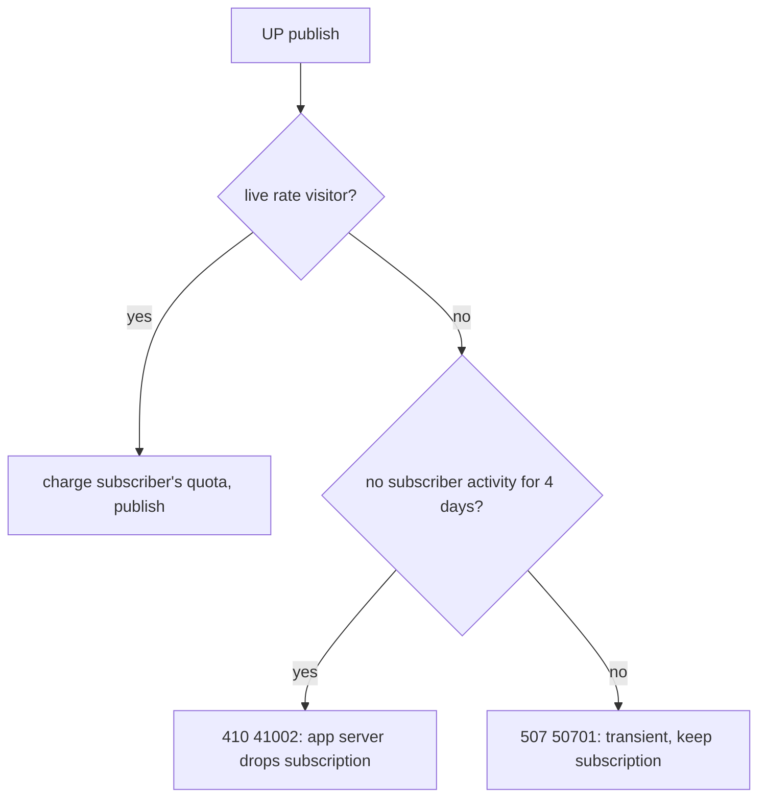

### The ban feed

With `ban-file`, `handleError` calls `ban.Service.Record(ip, httpCode, ntfyCode)`. Strikes per IP
prefix in a weighted bucket (`ban-threshold` per `ban-window`, `ban-weights`); a breaching prefix is
appended to the ban file for tools like fail2ban. The line format is a contract.

## 4. Messages and the message cache

### model.Message

Single wire and storage struct (`model/model.go`; fields in the protocol doc). `Sender` and `User`
are `json:"-"`. Always serialize via `ForJSON()` (blanks `SequenceID` when equal to `ID`).
`Expires` is per message from the visitor's tier. `SanitizeUTF8()` runs once at publish. `Size()`
budgets replays.

### message.Cache

One struct (`message/cache.go`) for both dialects: a `queries` struct plus `insertMessages`, from
`message/cache_sqlite.go` or `message/cache_postgres.go`. `mu` is nil on Postgres, set on SQLite.

| Constructor | Backing |
|---|---|
| `NewPostgresStore(d, batchSize, batchTimeout)` | Shared `*db.DB` pool |
| `NewSQLiteStore(file, ...)` | Own `sql.DB`, wrapped in `db.New` |
| `NewMemStore()` | SQLite `file:<random>?mode=memory&cache=shared` (see `createMemoryFilename`) |
| `NewNopStore()` | Memory store with `nop: true` |

Only `message`, `message_delete`, `message_clear` are persistable (`ErrUnexpectedMessageType`).
Inserts are multi-row (SQLite up to 1000 rows per `INSERT`, Postgres one `unnest` per batch).

| Read | Notes |
|---|---|
| `MessagesCapped(topic, since, scheduled, maxBytes)` | Time or `latest` replay; newest first within `MessagePollSizeLimit` (10 MiB), reversed; bool = truncated |
| `ResolveMarker(mid)` + `MessagesAfterMarker` | `since=<id>` replay |
| `Message(id)` | Single lookup (`handleFile`) |
| `MessagesDue()` | Due delayed messages; Postgres claims them |
| `Tail()` | `message.Tail` after the newest row |

### Batching

With `cache-batch-size` / `cache-batch-timeout`, `AddMessage` enqueues into a
`util.BatchingQueue`; `processMessageBatches` writes each batch in one transaction. Up to 100 full
batches buffer before `Enqueue` blocks; `Close` waits up to 5s.

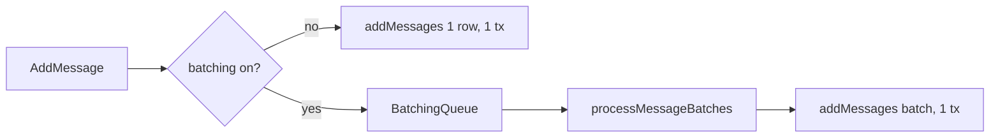

### Retention and pruning

All from the manager loop, in batches of `ManagerBatchSize` (30000), never one unbounded `DELETE`:

| Call | Effect |
|---|---|
| `pruneMessages` -> `DeleteExpiredMessages(limit)` | Delete rows past `expires` |
| `pruneAttachments` -> `MarkExpiredAttachmentsDeleted(limit)` | Only flips `attachment_deleted`; the attachment store sync loop diffs storage against `AttachmentsWithSizes()` (1h grace for fresh uploads) |
| `ExpireMessages(topics...)` | Sets `expires` for whole topics (reservation removed) |
| `DeleteScheduledBySequenceID` | Returns IDs so the caller removes files |

`s.messages` counts publishes on this node; `updateAndWriteStats` flushes deltas via `AddStats`
and folds the stored total back in, so cluster nodes converge.

## 5. The db/ abstraction

`db.DB` (`db/db.go`) wraps a primary and replica `*db.Host`s. Everything goes to the primary;
replicas are opt-in via `ReadOnly()`.

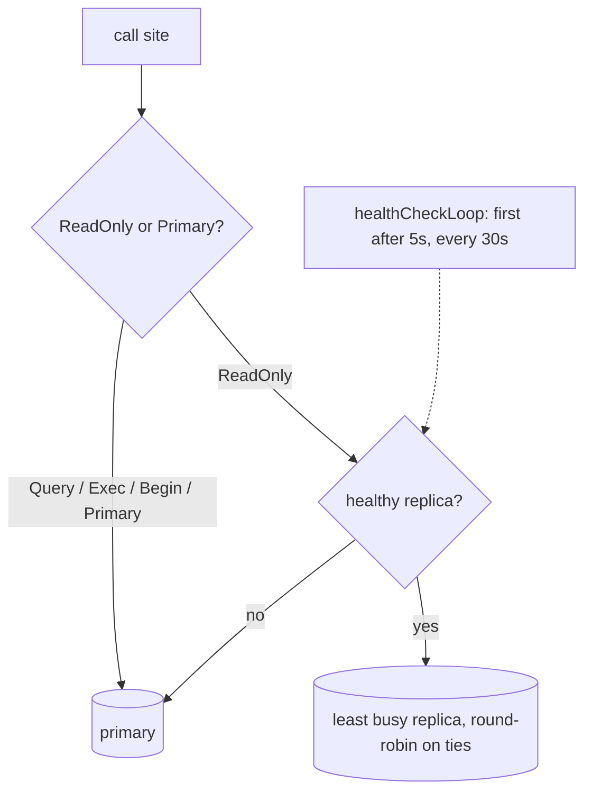

Replicas start unhealthy, so early `ReadOnly()` calls hit the primary (`MarkReplicasHealthyForTest`
for tests). Full pools wait rather than fall back. Pool settings are DSN params stripped by
`db/pg`: `pool_max_conns` (10), `pool_max_idle_conns`, `pool_conn_max_lifetime`,
`pool_conn_max_idle_time`. Transactions: `db.ExecTx` / `db.QueryTx`.

### Schema versioning (db/schema)

`schema.Migrate(db, dialect, store, create, migrations)` runs in one transaction. Postgres: one
shared `schema_version(store, version, min_version)` table, serialized with
`pg_advisory_xact_lock`. SQLite: `schemaVersion(id = 1, ...)` per file. Steps are contiguous
`{From, To}`; an older binary on a newer schema warns and continues, so **migrations must be
additive**; `Breaking` raises `min_version`. See the protocol doc for versions.

### Which reads use replicas

| Call | Backend |
|---|---|
| `Cache.Message`, `messagesLatest`, `Topics`, `Stats`, attachment size queries | `ReadOnly()` |
| `Cache.messagesSinceTime` | `ReadOnly()`, except a replay starting < `recentReplayWindow` (1 min) ago: primary |
| `Cache.resolveMarker` | Replica, then primary if unknown (replay then reads the primary) |
| `Cache.MessagesDue`, `Tail.Next` | Primary |
| `Manager.authorizeTopicAccess` without access cache | `ReadOnly()` |
| `accessCache` reloads | Primary |

Lag hazards: publish-then-poll, upload-then-download (`handleFile` retry covers batching only),
ACL-change-then-authorize without the access cache, attachment quota under-count. Rule: a value
that drives authorization or quota right after this process wrote it should come from the primary.

## 6. The user/ package

### Manager

`user.Manager` (`user/manager.go`): users, tiers, tokens, ACLs, phones, emails, magic links, over
`*db.DB` with a dialect `queries` struct. `user.OpenSQLite` sets `_case_sensitive_like=on` (ACLs
use `LIKE`). SQLite migrates **before** startup queries (5 -> 6 rebuilds need foreign keys off).
`newManager` provisions config users/grants/tokens, starts the access cache, `asyncQueueWriteLoop`
(token last-access, every 33s) and `asyncExpiredMagicLinkReapLoop` (hourly). The user schema also
hosts `usage` (package `limit`) and `topic` (package `topic`).

### Authentication

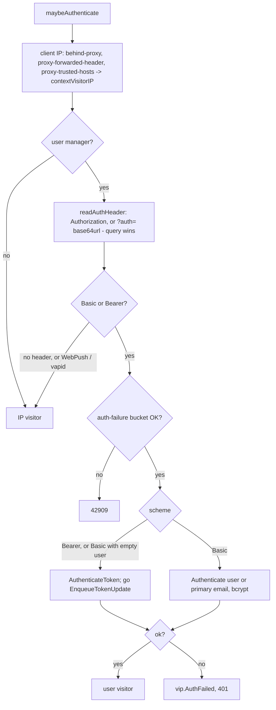

A visitor is returned in every branch. `Authenticate` burns a bcrypt compare against
`userAuthIntentionalSlowDownHash` for unknown or soft-deleted users.

### Tokens

`tk_` + 29 lowercase alphanumerics, at most 60 per user (`deleteExcessTokens`). Expired tokens and
users soft-deleted over 7 days ago go in `pruneTokens`. Provisioned tokens are immutable (40906).

### ACLs

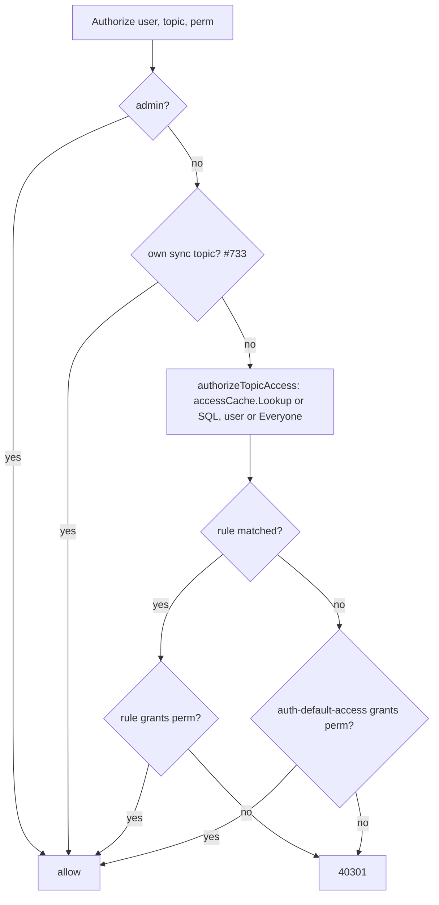

Match priority (`selectTopicPerms`, mirrored in the cache): specific user beats `Everyone` (`*`),
longer pattern beats shorter, write beats read at equal length.

`accessCache` (`user/access_cache.go`, `auth-access-cache`) indexes all of `user_access`
(`exact[user][escapedTopic]` plus `pattern[user]`).

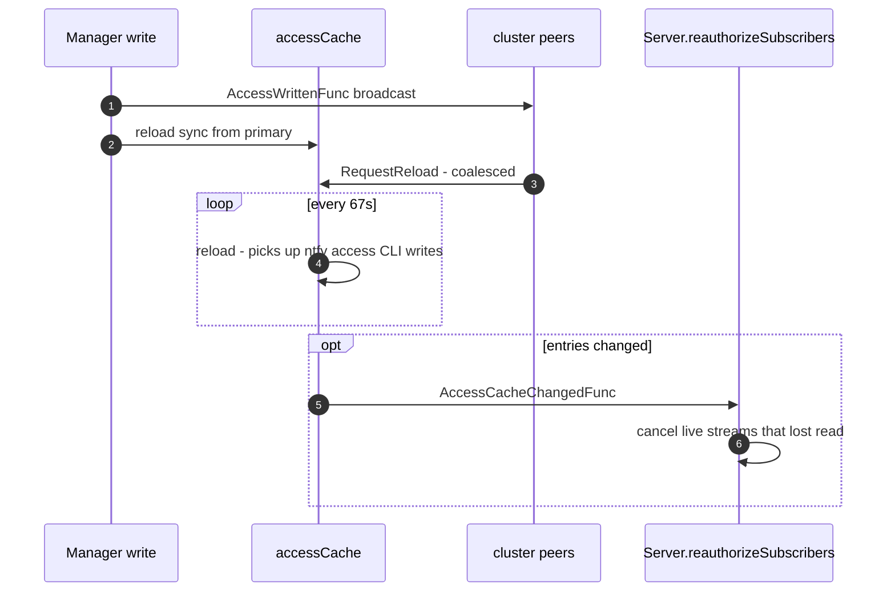

### Roles, permissions, tiers

`Role`: `admin` / `user` / `anonymous`. `Permission`: `DenyAll=0`, `Read=1`, `Write=2`,
`ReadWrite=3`. `Everyone` is username `*`, ID `u_everyone`. `Tier` carries all per-account limits
and Stripe price IDs; it reaches requests only through `vis.LimitsFor`.

## 7. Concurrency model

### Goroutine inventory

| Goroutine | Started in | Lifetime |
|---|---|---|
| One per listener (HTTP, HTTPS, unix, admin socket, metrics, pprof, SMTP, cluster) | `Run` | process |
| `runManager`, `runDelayedSender`, `runFirebaseKeepaliver` | `Run` | until `closeChan` |
| `runTail` | `New` | until `Tail.Close` |
| `db.healthCheckLoop` | `db.New` | until `DB.Close` |
| `Cache.processMessageBatches`, `BatchingQueue` ticker | `newCache` | until closed |
| `limit.Service` / `topic.Service` sync workers | `Start` | until `Close` |
| `Manager` write loop, magic-link reaper, access cache reload | `newManager` | until `quit` |
| Attachment store sync loop | `attachment` | until `Close` |
| Per request | `net/http` | request |
| Per delivery: one per subscriber per batch | `topic.deliver` | delivery |
| Per publish side effect | `dispatch` | fire and forget |
| Per WebSocket: reader + writer (`errgroup`) | `handleSubscribeWS` | connection |

Under load: one handler goroutine per stream (three for WebSockets) plus in-flight deliveries. A
high count under publish load is expected.

### The manager loop

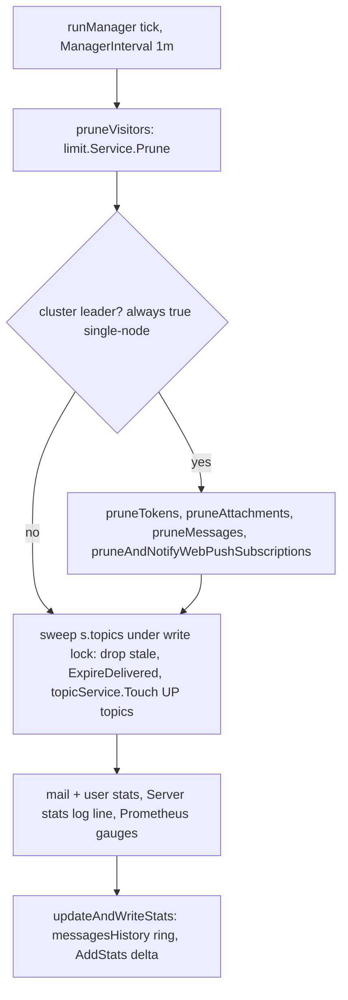

Other loops: `runDelayedSender` (10s, leader); `runFirebaseKeepaliver` (3h, leader) sends to
`~control` with a `0.0.0.0` visitor (the iOS `~poll` variant is disabled, #677).

### Locking rules

| Lock | Guards |
|---|---|
| `s.mu` (RWMutex) | Topic map, counter/history, listeners; no I/O under it, scan via `allTopics` |
| `t.mu` | Subscriber and delivered maps; never held across delivery or cancel |
| `limit.Service` | 64 shards, each locked; visitor methods take no lock |
| `Cache.mu` | nil on Postgres, single writer on SQLite |
| `Manager.mu` | Token write-behind queue |
| `accessCache.mu`, `reloadMu` | Index; serialized reloads |

## 8. Transports: WebSocket, SSE, JSON stream, raw, long-poll

| Transport | Content-Type | Encoder |
|---|---|---|
| JSON stream | `application/x-ndjson` | One `ForJSON()` object per line |
| SSE | `text/event-stream` | `data: {...}`; non-message events add `event: <type>` so `.onmessage()` skips them |
| raw | `text/plain` | Body with newlines as spaces; empty line for other events |
| WebSocket | upgrade | `conn.WriteJSON(msg)` of the raw message, so `sequence_id` is always present |

Call tree of the HTTP stream handler (`handleSubscribeWS` mirrors it, plus the upgrade and the
reader/writer goroutines):

```
handleSubscribeJSON / handleSubscribeSSE / handleSubscribeRaw
+- handleSubscribeHTTP(contentType, encoder)
   +- v.SubscriptionAllowed            -> 42903; defer RemoveSubscription
   +- topicsFromPath                   -> topicsFromIDs, max 150
   +- parseSubscribeParams             -> poll, parseSince, scheduled, parseQueryFilters
   +- readOnly && !poll                -> 503
   +- sub := filters.Pass -> encoder -> wlock -> w.Write + Flush
   +- maybeSetRateVisitors             -> topicService.SetRateVisitor (UP only)
   +- poll=1:  t.Keepalive, sendOldMessages (bandwidth metered), return
   +- s.streams.Add(cancel)
   +- t.Subscribe(sub, user, cancel) per topic
   +- authorizeSubscribed
   +- sub(open)
   +- sendOldMessages
   |  +- ResolveMarker (since=<id>)  or  sinceForTopic
   |  +- MessagesAfterMarker / MessagesCapped per topic
   |  +- sort.SliceStable by Time, X-Messages-Truncated
   +- loop: ctx done | request done | KeepaliveInterval -> sub(keepalive)
   +- defer: Unsubscribe, maybeTouchTopics, closed = true under wlock
```

The `wlock` + `closed` guard stops a delivery goroutine writing to a returned handler's
`ResponseWriter` (panic, #338, PR #1598). Do not simplify it away.

### JSON stream, SSE, raw

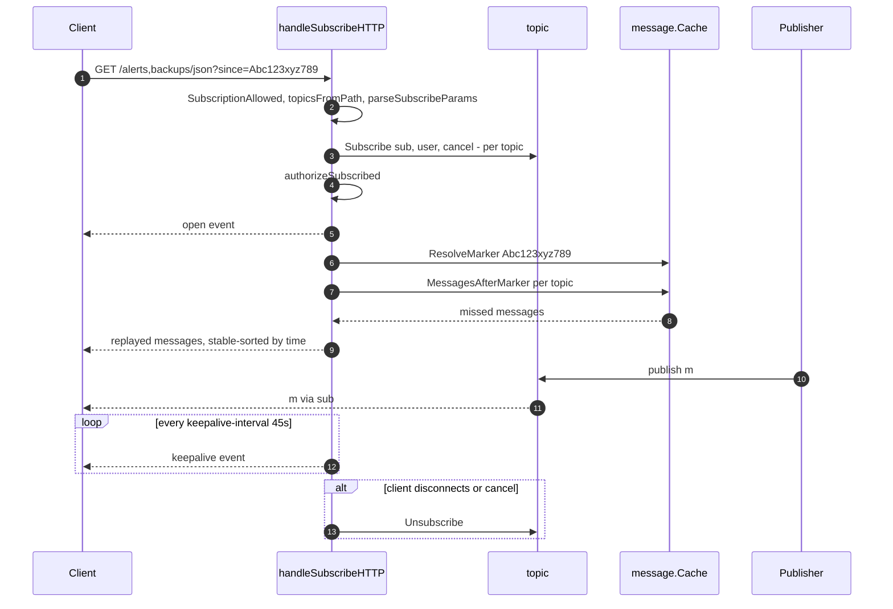

Subscribing **before** the replay, plus the topic's `delivered` map, makes the replay-to-live
hand-over gap-free; occasional duplicates are dropped by clients by ID.

### WebSocket

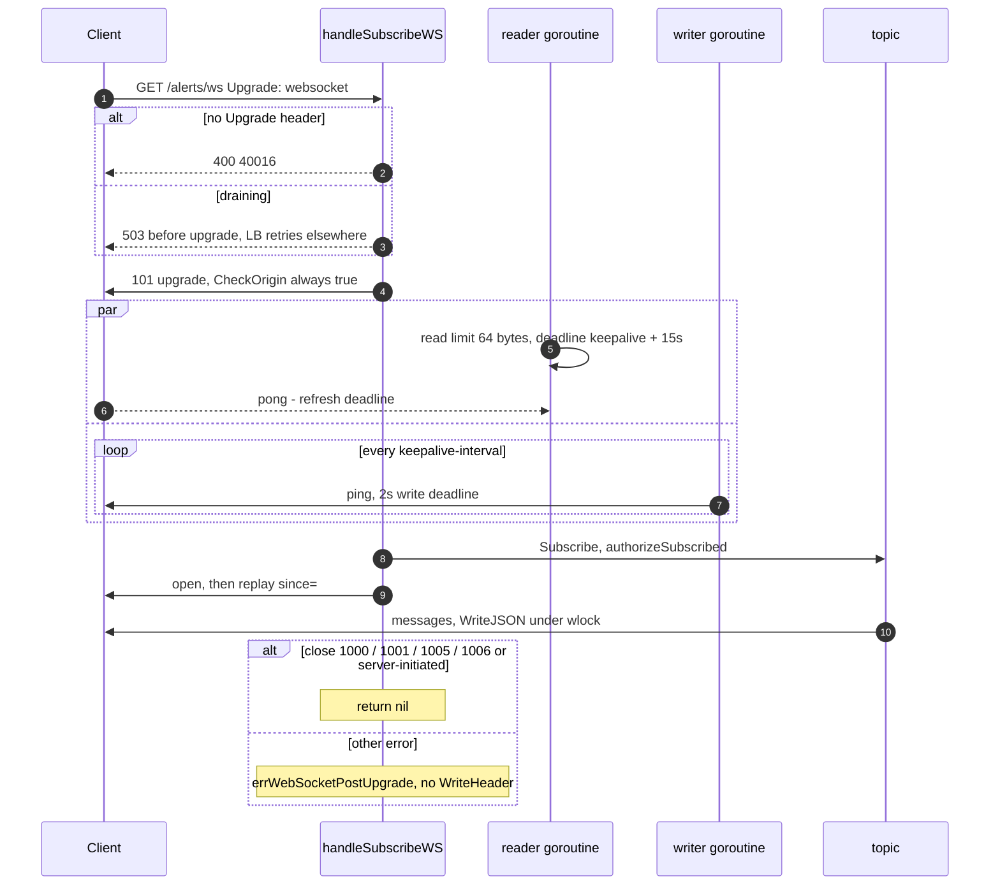

### Polling and long-poll

```mermaid
sequenceDiagram
    autonumber
    participant C as Client
    participant H as handleSubscribeHTTP
    participant MC as message.Cache
    C->>H: GET /alerts/json?poll=1&since=10m
    H->>H: parseSince: absent defaults to all for poll
    H->>H: t.Keepalive per topic, meterPollBandwidth = true
    H->>MC: MessagesCapped since now-10m, MessagePollSizeLimit
    MC-->>H: messages, truncated
    H-->>C: X-Messages-Truncated if cut, one JSON line per message
    Note over H,C: no open event, no Subscribe, not counted as subscription
    H-->>C: close
```

| | Poll | JSON/SSE/raw stream | WebSocket |
|---|---|---|---|
| Counts as a subscription | no | yes | yes |
| History replay | default `since=all` | only with `since=` | only with `since=` |
| Liveness | n/a | `keepalive` event | ping/pong |
| Goroutines per connection | handler | handler | handler, reader, writer |
| Externally cancellable | no | yes (context) | yes (context and close) |
| `?auth=` query param | works | works (needed for `EventSource`) | works (needed for browser `WebSocket`) |

## 9. Quick reference

| Question | Where |
|---|---|
| What handles this URL? | `handleInternal` in `server/server.go` |
| What does error code NNNNN mean? | `errHTTP*` vars in `server/errors.go` |
| How is a message fanned out? | `Server.dispatch` (`server/server.go`), `topic.deliver` (`server/topic.go`) |
| How do missed messages reach live subscribers? | `runTail` (`server/server_tail.go`), `message.Tail` (`message/tail.go`) |
| Why is my client rate limited? | `server/visitor.go` (rules), `limit/service.go` (decisions), `server/server_middleware.go` |
| What is persisted, and when? | `Cache.AddMessage` (`message/cache.go`), `util/batching_queue.go` |
| Primary or replica? | `db.DB.ReadOnly` / `Primary` (`db/db.go`) and the call site |
| How are schemas migrated? | `schema.Migrate` (`db/schema/schema.go`) and each store's `*_schema.go` |
| Who can read or write this topic? | `Manager.Authorize` (`user/manager.go`), `accessCache.Lookup` (`user/access_cache.go`) |
| What runs periodically? | `execManager` (`server/server_manager.go`), `runDelayedSender`, `runFirebaseKeepaliver`, `runTail` |
| What happens on shutdown? | `sigHandlerShutdown` (`cmd/serve_unix.go`), `Server.Drain` (`server/server_drain.go`), `Server.Stop` |
| How does clustering change this? | [cluster.md](cluster.md) |
