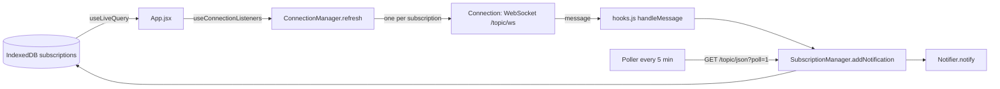
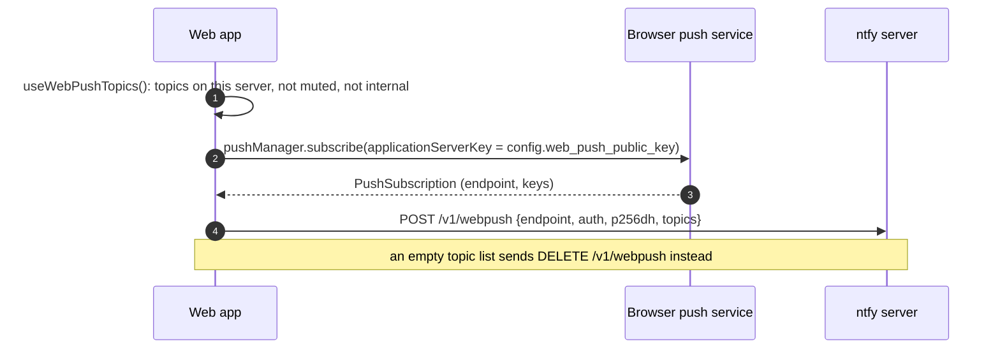

# Web app internals

How the React web app in `web/` is structured, how it talks to the server, and how it is built into the Go binary.
All paths are in this repo. The other first-party clients are described in [android.md](android.md),
[ios.md](ios.md) and [cli.md](cli.md); the [feature matrix](#cross-client-feature-matrix) at the end compares them.

## Stack

| Concern | Library (`web/package.json`) |
|---|---|
| UI | React (pinned to `"latest"`), MUI 9 |
| Routing | `react-router-dom` 7 |
| Local storage | Dexie 4 over IndexedDB, read with `useLiveQuery` (`dexie-react-hooks`) |
| i18n | `i18next`, `i18next-http-backend`, `i18next-browser-languagedetector`, `react-i18next` |
| Build | Vite 8, `vite-plugin-pwa` 2 (`injectManifest` strategy) |
| Tests | Vitest unit tests (`*.test.js` next to the source), Playwright e2e tests in `web/e2e/` |

There is no Redux or similar. IndexedDB is the source of truth, React context holds only the account
(`components/AccountContext.js`) and a theme cache (`components/PrefCache.jsx`), and the router passes
subscriptions down via `<Outlet context>` in `components/App.jsx`.

## Layout

```
web/
  index.html           shell + inline splash script (reads the theme from localStorage)
  vite.config.js       Vite + VitePWA config
  public/
    config.js          dev-only example config; deleted from the build
    sw.js              service worker source (outside src/, imports back into it)
    static/langs/      translation JSON files (Weblate)
  src/
    index.jsx          entry point: registerSW(), then render <App />
    registerSW.js      service worker registration and hourly update check
    app/               non-React service layer (singletons)
    components/        React components, routes.js, hooks.js
  e2e/                 Playwright tests and the server harness (server.mjs)
```

### Service layer (`web/src/app/`)

| File | Role |
|---|---|
| `Api.js` | Topic-level calls: `poll` (`GET /<topic>/json?poll=1&since=`), `publish` (`PUT /` with a JSON body), `publishXHR` (XHR, only for upload progress), `topicAuth` (`GET /<topic>/auth`), `updateWebPush` / `deleteWebPush` (`POST` / `DELETE /v1/webpush`) |
| `AccountApi.js` | Everything under `/v1/account*`: login (Basic auth exchanged for a token), signup, tokens, settings, subscription sync, reservations, tiers, billing, phone and email verification, password reset. Also a worker that extends the session token (first after 45 s, then every 15 min) |
| `Connection.js` | One WebSocket per subscription (see below) |
| `ConnectionManager.js` | Reconciles open connections against the desired subscription list |
| `SubscriptionManager.js` | Dexie data access for subscriptions and notifications; also decides which topics use Web Push |
| `UserManager.js` | Per-`baseUrl` credentials for other servers; the logged-in user's token comes from `Session`, not the `users` table |
| `Session.js` | Username and token, stored in `localStorage` and replicated into a separate Dexie DB `session-replica` so the service worker can read them |
| `Notifier.js` | Shows notifications through the service worker registration (`registration.showNotification`), plays sounds, creates the Web Push subscription |
| `Poller.js` | Polls every subscription (first after 2 s, then every 5 min) to catch up on missed messages |
| `Pruner.js` | Deletes local notifications older than the `deleteAfter` pref (first after 25 s, then every 30 min) |
| `Prefs.js` | Preferences in the Dexie `prefs` table (defaults in `PREF_DEFAULTS`: sound `ding`, min priority 1, delete after one week, Web Push off) |
| `VersionChecker.js` | Polls `GET /v1/config` every 5 min and compares `config_hash` to raise a "new version" banner |
| `errors.js` | Typed errors for server error codes, and `fetchOrThrow` |
| `config.js` | Reads `window.config` (served by the server as `/config.js`); falls back to `window.location.origin` for an empty `base_url` |

### Routes (`web/src/components/routes.js`)

| Constant | Path |
|---|---|
| `app` | `config.app_root` |
| `login`, `signup` | `/login`, `/signup` |
| `account`, `settings` | `/account`, `/settings` |
| `passwordResetRequest` | `/reset-password` |
| `passwordReset`, `emailVerify` | `/account/password/reset/:token`, `/account/email/verify/:token` |
| `subscription` | `/:topic` (topic on this server) |
| `subscriptionExternal` | `/:baseUrl/:topic` (topic on another server) |

On the server side, `handleWebApp` and `handleWebAppNoIndex` (`server/server_web.go`) serve `app.html` for these
client-side routes; the token pages are marked `no-referrer` and `noindex`.

## Subscriptions and connections



`useConnectionListeners` (`web/src/components/hooks.js`) wires it together:

- **Which topics get a WebSocket.** All subscriptions minus the topics that currently use Web Push
  (`useWebPushTopics`). A topic is either on a WebSocket or on Web Push, never both.
- **Connection identity.** `makeConnectionId` (`ConnectionManager.js`) hashes the subscription ID with the
  username, password and token, so a credential change closes the old socket and opens a new one.
- **Transport.** `Connection.start` opens `wss://<base>/<topic>/ws?since=<last id>&auth=<...>`. Browsers can't set
  headers on a WebSocket, so credentials go in the `auth` query parameter as base64url-encoded `Basic ...` or
  `Bearer ...`. `open` events are ignored; `message`, `message_delete` and `message_clear` are passed on.
- **Reconnect.** An unclean close retries after 5, 10, 20, 30, 60, then 120 s (capped). A clean close does not
  retry.
- **Handling.** `handleNotification` deletes or marks read by `sequence_id` for `message_delete` and
  `message_clear`; otherwise `SubscriptionManager.addNotification` stores the message (replacing older versions of
  the same sequence) and `notify` shows it, honoring mute and the min-priority pref.
- **Account sync topic.** A logged-in account has a `sync_topic`. The app subscribes to it as an `internal`
  subscription; a `{"event":"sync"}` message on it triggers `accountApi.sync()`, which pulls prefs and
  subscriptions from `/v1/account` and calls `subscriptionManager.syncFromRemote()`.

Background workers (`Poller`, `Pruner`, `VersionChecker`, the token extender) are started and stopped by
`useBackgroundProcesses` in `hooks.js`, so their lifetime follows the React tree.

## Storage (IndexedDB via Dexie)

`web/src/app/db.js` declares `db.version(3)`. The database name is per user: `ntfy` when anonymous, `ntfy-<username>`
when logged in, so logging in or out switches to a different database rather than clearing tables.

| Table | Schema | Notes |
|---|---|---|
| `subscriptions` | `&id,baseUrl,[baseUrl+mutedUntil]` | `id` is the topic URL; the compound index serves the Web Push topic query |
| `notifications` | `&id,sequenceId,subscriptionId,time,new,[subscriptionId+new],[subscriptionId+sequenceId]` | `id` is the server message ID |
| `users` | `&baseUrl,username` | credentials for other servers |
| `prefs` | `&key` | key/value preferences |

Things to know:

- Only indexed fields are declared; the rest of each record is schemaless.
- `new` is stored as `1`/`0` because Dexie can't index booleans.
- `mutedUntil` must appear in the `where()` of `SubscriptionManager.webPushTopics`, otherwise the live query does
  not react when a topic is muted (comment in the code).
- `db.on("versionchange")` closes the connection so another tab or the service worker can upgrade.
- `dbAsync()` is for the service worker (reads the username from `session-replica`), `db()` for the app.

## Service worker and Web Push

`web/public/sw.js` is hand-written; `vite-plugin-pwa` in `injectManifest` mode only injects the precache manifest.
`manifestTransforms` in `vite.config.js` renames the `index.html` entry to `app.html` to match the Makefile.

### Subscribe flow



- The VAPID public key comes from the generated `/config.js` (`web_push_public_key`), not from an API call.
- Only topics on the app's own server (`config.base_url`) can use Web Push.
- `useWebPushListener` (`hooks.js`) re-sends the topic list whenever it changes;
  `SubscriptionManager.updateWebPushSubscriptions` does the update or delete.
- Server side, `handleWebPushUpdate` and `handleWebPushDelete` (`server/server_webpush.go`) store the subscription.
  Endpoints are checked against `webPushAllowedEndpointsRegexes` (the known browser push services).
  `publishToWebPushEndpoints` sends each published message to the matching subscriptions.
- The server warns a subscription that is about to expire (`web-push-expiry-warning-duration`, default 55 days) with
  a `subscription_expiring` push, and deletes it after `web-push-expiry-duration` (default 60 days)
  (`pruneAndNotifyWebPushSubscriptions`). The app re-subscribes while it is used.

### Push handling (`sw.js`)

| Handler | What it does |
|---|---|
| `push` listener -> `handlePush` | Dispatches on the event type |
| `handlePushMessage` | Shows the notification first (Safari unsubscribes a page that doesn't), dedupes by sequence ID, writes to `db.notifications`, updates the badge, and posts on `BroadcastChannel("web-push-broadcast")` so an open app window can play the sound (the SW can't) |
| `handlePushMessageDelete`, `handlePushMessageClear` | Delete or mark read by sequence ID and close the shown notification |
| `handlePushSubscriptionExpiring` | Shows a "your subscription is expiring" notification |
| `handlePushUnknown` | Shows a generic notification; silently ignoring a push can get the permission revoked |
| `notificationclick` -> `handleClick` | Runs `view` and `http` action buttons, else opens `message.click`, else focuses or opens the topic page |
| `periodicsync` (`extend_token`) | Extends the session token (`PATCH /v1/account/token`), at most hourly; also attempted after each push. The app registers it from `usePeriodicTokenExtend` (`hooks.js`) |

Only `view` and `http` actions become notification buttons (`toNotificationParams` in
`web/src/app/notificationUtils.js`); `broadcast` and `copy` work only inside the app.

In production builds the SW also calls `importScripts("/config.js")`, registers a `NavigationRoute` bound to
`/app.html`, and serves `/config.js` `NetworkFirst`. It calls `skipWaiting()` on install and activate, plus
`clientsClaim()`.

## Build and embedding

`make web` runs `web-deps` (`npm ci`, so the lock file is left alone) and `web-build`:

```
cd web && npm run build \
  && mv build/index.html build/app.html \
  && rm -rf ../server/site && mv build ../server/site \
  && rm ../server/site/config.js
```

- `index.html` becomes `app.html` because the server needs `/index.html` free for other content.
- The example `config.js` is removed; the server generates the real one (`handleWebConfig`, `server/server_web.go`)
  as `var config = {...}` from `configResponse()`.
- `server/server.go` embeds the result with `//go:embed site` (`webSiteDir = "/site"`, `webAppIndex = "/app.html"`).
  `handleStatic` serves it gzipped; `handleWebManifest` serves the PWA manifest.
- `make cli-deps-static-sites` writes empty `server/site/app.html` and `server/docs/index.html` so the Go code builds
  without a web build.

Other targets: `make web-lint`, `make web-fmt`, `make web-fmt-check`, `make web-test` (Vitest), and `make web-e2e`
(builds the web app and a server binary, then runs Playwright against it; see `web/e2e/server.mjs`).

## Local development

- `npm start` in `web/` runs Vite on port 3000. There is no proxy: point `base_url` in `web/public/config.js` at a
  separately running `ntfy serve`.
- `devOptions.enabled: true` registers a real service worker in dev too. With `autoUpdate`, `skipWaiting()` and
  precaching, a browser profile that loaded an earlier build can keep serving a stale bundle. Unregister the service
  worker and clear site storage (DevTools, Application tab) when the UI doesn't match the source.
- The per-user IndexedDB and `session-replica` survive a service worker reset unless site storage is cleared too.

## Gotchas

- **Message handling is duplicated in four places**: `hooks.js` (`handleNotification`), `sw.js`, and in
  ntfy-android `SubscriberService` and `FirebaseService` (see the comment in each). A change to message semantics
  (for example `sequence_id` updates) needs all of them.
- **`Notifier.js` uses the global `config`** (set by `/config.js` as `var config`) without importing
  `app/config.js`.
- **`fetchOrThrow` (`errors.js`) treats any status other than 200 as an error**, so an endpoint returning 201 or
  204 would throw.
- **`i18n.js` sets `debug: true`** unconditionally.
- **Stale comment**: `sw.js` refers to `web/src/app/WebPush.js`, which no longer exists; that logic is in
  `components/hooks.js`.

## Cross-client feature matrix

From the current code of each client. "Send only" means the client can publish the field but does not use it when
receiving. Details are in [android.md](android.md), [ios.md](ios.md) and [cli.md](cli.md).

| Feature | Web | Android | iOS | CLI |
|---|---|---|---|---|
| Receive transport | WebSocket per topic, or Web Push | JSON stream (default) or WebSocket, one connection per server; FCM on `play` | FCM/APNs push, then HTTP poll | JSON stream |
| Catch-up poll | `?poll=1` every 5 min | `PollWorker` hourly | on open and pull to refresh | `--poll` |
| Auth | Basic, Bearer, account login | Basic | Basic | Basic, Bearer |
| Accounts, reservations, billing | Yes | No | No | Server-side admin commands |
| Client certificates (mTLS) | No | Yes | No | No |
| Attachments: view | Yes | Yes | Yes | No (metadata only) |
| Attachments: upload | Yes (picker, drag and drop, paste) | Yes (share sheet) | No | Yes (`--file`, `--attach`) |
| Actions `view`, `http` | Yes | Yes | Yes (max 4) | Send only |
| Actions `broadcast`, `copy` | Yes (in-app only) | Yes | No | Send only |
| Per-message `icon` | No | Yes | No | Send only |
| Markdown | Yes | Yes | No | Send only |
| Update/delete via `sequence_id` | Yes | Yes | No | Send only |
| Min-priority filter | Yes | Yes (global and per topic) | No | Server-side filter (`if:`) |
| Local retention | 1 week default | 1 month default | manual delete | n/a |
| UnifiedPush distributor | No | Yes | No | No |
| Publish: delay, email, call | Yes | Yes | No | delay and email (no call option) |
| Publish: templates | No | No | No | Yes (`--template`) |
