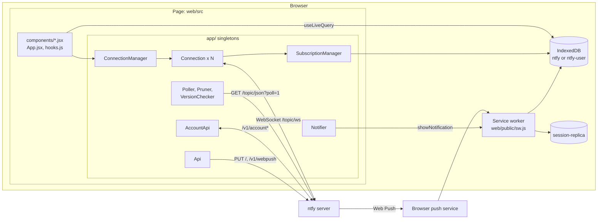
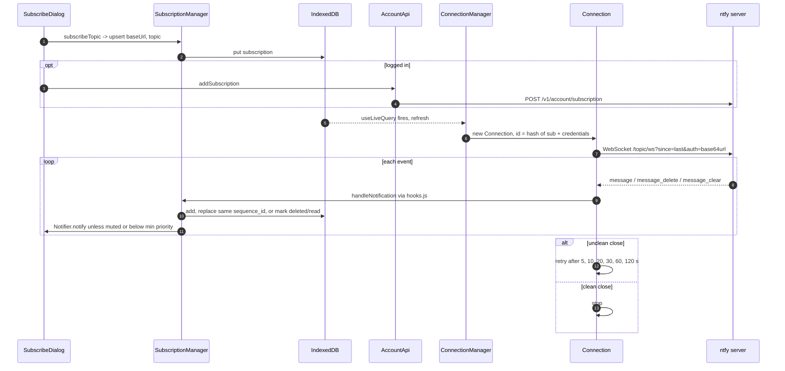
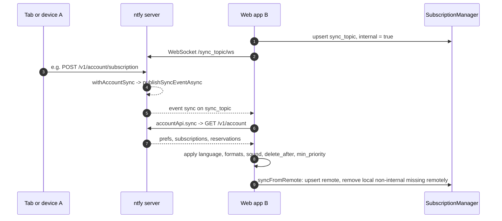
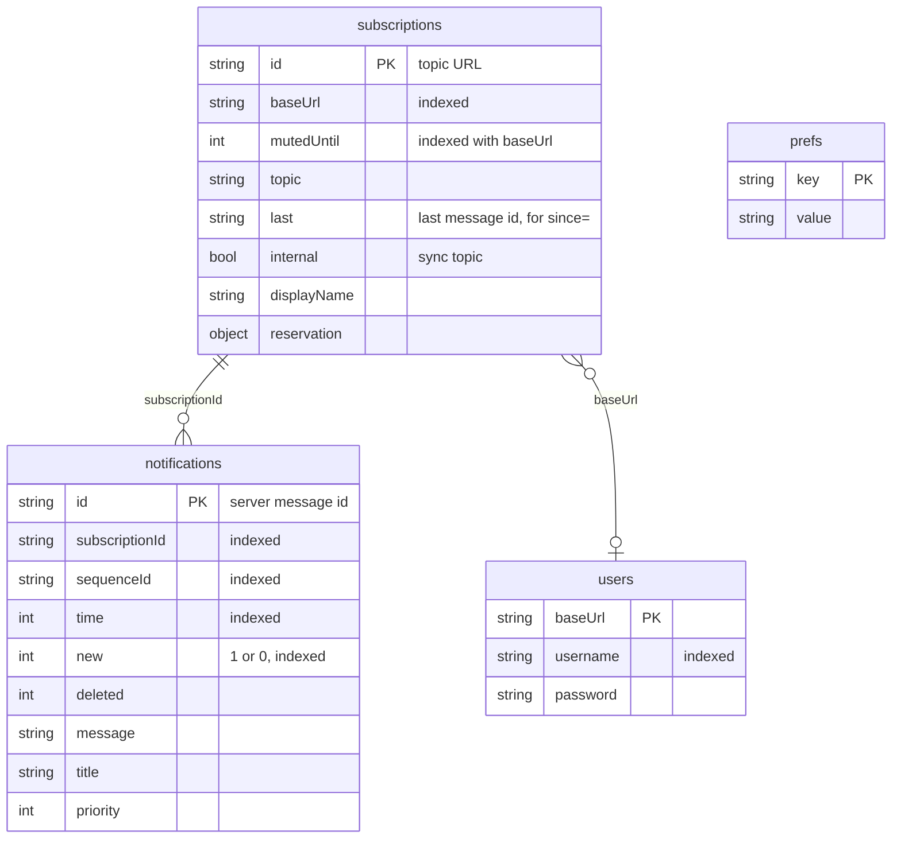
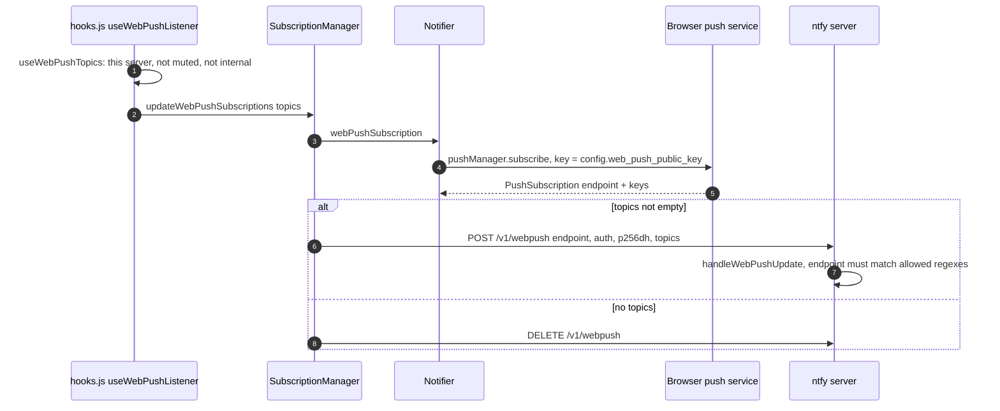
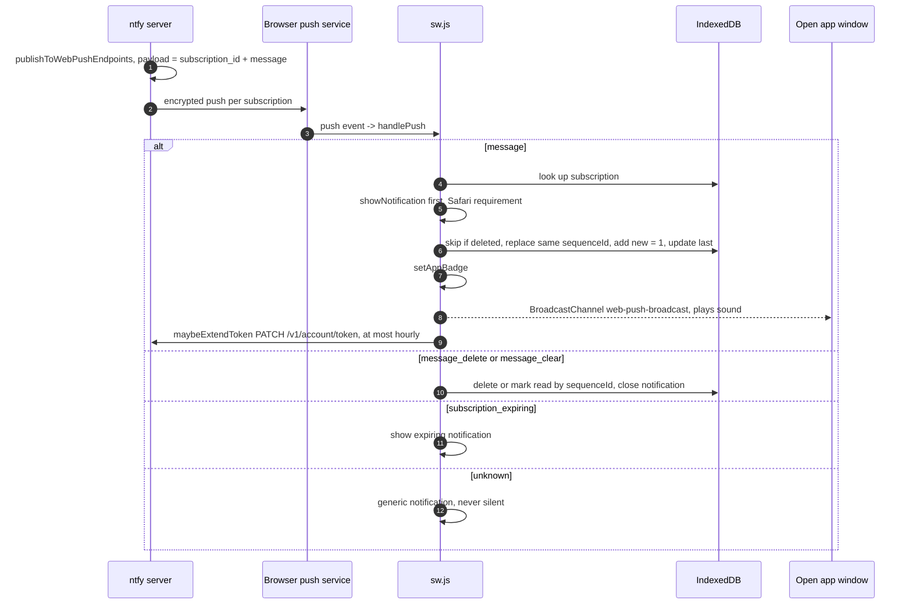

# Web app internals

How the React web app in `web/` is structured, how it talks to the server, and how it is built into the Go binary.
All paths are in this repo. The other first-party clients are in [android.md](android.md), [ios.md](ios.md) and
[cli.md](cli.md); the [feature matrix](#cross-client-feature-matrix) at the end compares them.

## Stack

| Concern | Library (`web/package.json`) |
|---|---|
| UI | React (pinned to `"latest"`), MUI 9 |
| Routing | `react-router-dom` 7 |
| Local storage | Dexie 4 over IndexedDB, read with `useLiveQuery` (`dexie-react-hooks`) |
| i18n | `i18next` + http backend + language detector, `react-i18next` |
| Build | Vite 8, `vite-plugin-pwa` 2 (`injectManifest` strategy) |
| Tests | Vitest (`*.test.js` next to the source), Playwright e2e in `web/e2e/` |

No Redux. IndexedDB is the source of truth; React context holds only the account (`components/AccountContext.js`)
and a theme cache (`components/PrefCache.jsx`).

## Layout



```
web/
  index.html        shell + inline splash script (theme from localStorage)
  vite.config.js    Vite + VitePWA config
  public/config.js  dev-only example config; deleted from the build
  public/sw.js      service worker source (imports back into src/)
  public/static/langs/  translations (Weblate)
  src/index.jsx     entry: registerSW(), render <App />
  src/app/          non-React service layer (singletons)
  src/components/   React components, routes.js, hooks.js
  e2e/              Playwright tests + server harness (server.mjs)
```

### Service layer (`web/src/app/`)

| File | Role |
|---|---|
| `Api.js` | `poll`, `publish` (`PUT /` JSON body), `publishXHR` (upload progress), `topicAuth`, `updateWebPush` / `deleteWebPush` |
| `AccountApi.js` | All of `/v1/account*` (login, tokens, settings, subscriptions, reservations, billing, phone, email). Token extender worker: after 45 s, then every 15 min |
| `Connection.js`, `ConnectionManager.js` | One WebSocket per subscription; manager reconciles against the desired list |
| `SubscriptionManager.js` | Dexie access for subscriptions and notifications; picks the Web Push topics |
| `UserManager.js` | Credentials for other servers; the session user comes from `Session` |
| `Session.js` | Username + token in `localStorage`, mirrored into Dexie DB `session-replica` for the SW |
| `Notifier.js` | `registration.showNotification`, sounds, creates the push subscription |
| `Poller.js` / `Pruner.js` / `VersionChecker.js` | Poll all subscriptions (2 s, then 5 min) / delete old notifications (25 s, then 30 min) / compare `config_hash` from `GET /v1/config` (5 min) |
| `Prefs.js` | `prefs` table, defaults in `PREF_DEFAULTS` |
| `errors.js`, `config.js` | Typed errors + `fetchOrThrow`; `window.config` from the server's `/config.js` |

Workers start and stop with the React tree via `useBackgroundProcesses` (`hooks.js`).

### Routes (`web/src/components/routes.js`)

| Constant | Path |
|---|---|
| `app` | `config.app_root` |
| `login`, `signup`, `account`, `settings` | `/login`, `/signup`, `/account`, `/settings` |
| `passwordResetRequest` | `/reset-password` |
| `passwordReset`, `emailVerify` | `/account/password/reset/:token`, `/account/email/verify/:token` |
| `subscription` / `subscriptionExternal` | `/:topic` / `/:baseUrl/:topic` |

Server side, `handleWebApp` / `handleWebAppNoIndex` (`server/server_web.go`) serve `app.html` for these; token pages
get `no-referrer` and `noindex`.

## Subscriptions and connections

A topic is on a WebSocket or on Web Push, never both: `useConnectionListeners` (`hooks.js`) passes all subscriptions
minus `useWebPushTopics` to `ConnectionManager.refresh`.



- Browsers can't set WebSocket headers, so credentials go in `auth=` (base64url `Basic ...` or `Bearer ...`).
- `makeConnectionId` includes username, password and token, so a credential change reopens the socket.
- `Poller` catches up missed messages with `GET /<topic>/json?poll=1&since=`.

### Account sync

A logged-in account has a `sync_topic`. Server handlers wrapped in `withAccountSync` (`server/server_middleware.go`)
publish `{"event":"sync"}` there after a successful change (`publishSyncEventAsync`, `server/server_account.go`).



## Storage (IndexedDB via Dexie)

`web/src/app/db.js`, `db.version(3)`. Database name is `ntfy` when anonymous and `ntfy-<username>` when logged in,
so logging in or out switches databases. Only indexed fields are declared; records are otherwise schemaless.



| Table | Example row |
|---|---|
| `subscriptions` | `{id: "https://ntfy.example.com/backups-alerts", baseUrl: "https://ntfy.example.com", topic: "backups-alerts", mutedUntil: 0, last: "aB3dE5fG7hJ9"}` |
| `notifications` | `{id: "aB3dE5fG7hJ9", subscriptionId: "https://ntfy.example.com/backups-alerts", sequenceId: "aB3dE5fG7hJ9", time: 1764000000, new: 1, event: "message", message: "Backup done", priority: 3}` |
| `users` | `{baseUrl: "https://other.example.com", username: "alice", password: "s3cret"}` |
| `prefs` | `{key: "deleteAfter", value: "604800"}` |

- `new` is `1`/`0` because Dexie can't index booleans.
- `mutedUntil` must be in the `where()` of `SubscriptionManager.webPushTopics`, or the live query misses mutes.
- `db.on("versionchange")` closes the DB so another tab or the SW can upgrade.
- `dbAsync()` (reads the username from `session-replica`) is for the SW; `db()` for the app.

## Service worker and Web Push

`web/public/sw.js` is hand-written; `vite-plugin-pwa` only injects the precache manifest, and `manifestTransforms`
renames `index.html` to `app.html`.

### Enabling Web Push



- The VAPID key comes from `/config.js`, not an API call. Only topics on `config.base_url` can use Web Push.
- The server sends `subscription_expiring` after `web-push-expiry-warning-duration` (55 days) and deletes after
  `web-push-expiry-duration` (60 days) (`pruneAndNotifyWebPushSubscriptions`); an active app re-subscribes.

### Receiving a push



| Other SW handler | What it does |
|---|---|
| `notificationclick` -> `handleClick` | `view` / `http` action, else `message.click`, else focus or open the topic |
| `periodicsync` `extend_token` | Token extension, registered by `usePeriodicTokenExtend` (`hooks.js`) |

Only `view` and `http` actions become notification buttons (`toNotificationParams`, `app/notificationUtils.js`). In
production the SW also does `importScripts("/config.js")`, a `NavigationRoute` to `/app.html`, `NetworkFirst` for
`/config.js`, `skipWaiting()` and `clientsClaim()`.

## Build and embedding

```
make web
+- web-deps     npm ci
+- web-build    npm run build
   +- mv build/index.html build/app.html     (server keeps /index.html for other content)
   +- mv build ../server/site
   +- rm ../server/site/config.js            (server generates it: handleWebConfig)
server/server.go  //go:embed site  -> handleStatic (gzip), handleWebManifest
```

- `make cli-deps-static-sites` writes empty `server/site/app.html` and `server/docs/index.html` so Go builds without
  a web build.
- Other targets: `web-lint`, `web-fmt`, `web-fmt-check`, `web-test` (Vitest), `web-e2e` (Playwright against a
  fresh server binary, `web/e2e/server.mjs`).

## Local development

- `npm start` in `web/` runs Vite on port 3000 with no proxy; point `base_url` in `web/public/config.js` at a
  separate `ntfy serve`.
- The dev service worker is real (`devOptions.enabled`). If the UI doesn't match the source, unregister it and clear
  site storage; the per-user IndexedDB and `session-replica` survive a SW reset otherwise.

## Gotchas

- **Message handling is duplicated in four places**: `hooks.js` (`handleNotification`), `sw.js`, and Android
  `SubscriberService` / `FirebaseService`. Change all of them together.
- **`Notifier.js` uses the global `config`** without importing `app/config.js`.
- **`fetchOrThrow` treats any non-200 as an error** (a 201 or 204 would throw).
- **`i18n.js` sets `debug: true`** unconditionally.
- **Stale comment**: `sw.js` mentions `web/src/app/WebPush.js`, which is now in `components/hooks.js`.

## Cross-client feature matrix

From the current code of each client. "Send" means the client can publish the field but ignores it when receiving.

| Feature | Web | Android | iOS | CLI |
|---|---|---|---|---|
| Receive | WebSocket per topic, or Web Push | JSON stream or WS, one per server; FCM on `play` | FCM/APNs push, then poll | JSON stream |
| Catch-up poll | every 5 min | hourly `PollWorker` | on open, pull to refresh | `--poll` |
| Auth | Basic, Bearer, login | Basic | Basic | Basic, Bearer |
| Accounts, billing | Yes | No | No | admin commands |
| mTLS client certs | No | Yes | No | No |
| Attachments view / upload | Yes / Yes | Yes / share sheet | Yes / No | metadata / `--file`, `--attach` |
| Actions `view`, `http` | Yes | Yes | Yes, max 4 | Send |
| Actions `broadcast`, `copy` | in-app only | Yes | No | Send |
| Per-message `icon` | No | Yes | No | Send |
| Markdown | Yes | Yes | No | Send |
| `sequence_id` update/delete | Yes | Yes | No | Send |
| Min-priority filter | Yes | global + per topic | No | `if:` filter |
| Local retention | 1 week | 1 month | manual | n/a |
| UnifiedPush distributor | No | Yes | No | No |
| Publish delay / email / call | Yes | Yes | No | delay, email |
| Publish templates | No | No | No | `--template` |
